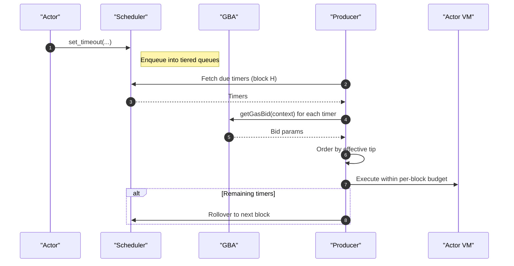

# Sequence Diagram

The scheduler workflow is illustrated as follows...

<Tip>
  The sequence below is conceptual and illustrative (non-normative). Final interfaces are defined by the SDK and normative CIPs; do not treat this diagram as a fixed API.
</Tip>

## End-to-End Sequence (Conceptual)

## What Happens At A Glance

- Actors schedule timers via `set_timeout(...)`; the scheduler enqueues them in tiered queues.
- At each block, the producer fetches due timers and queries each timer’s GBA for a bid (read-only context).
- Timers are ordered by effective priority (tip-based) and executed within a fixed per-block budget.
- Unexecuted timers automatically roll over to the next block.
- Fee metering and dynamics follow CIP-3 (dual metering, basefee burn, proposer tip).

## Further Reading

- [Scheduler Overview](/architecture/scheduler/overview)
- [DoS Protection Parameters](/architecture/scheduler/dos-parameters)
- [Overview: Architecture](/overview/architecture)

