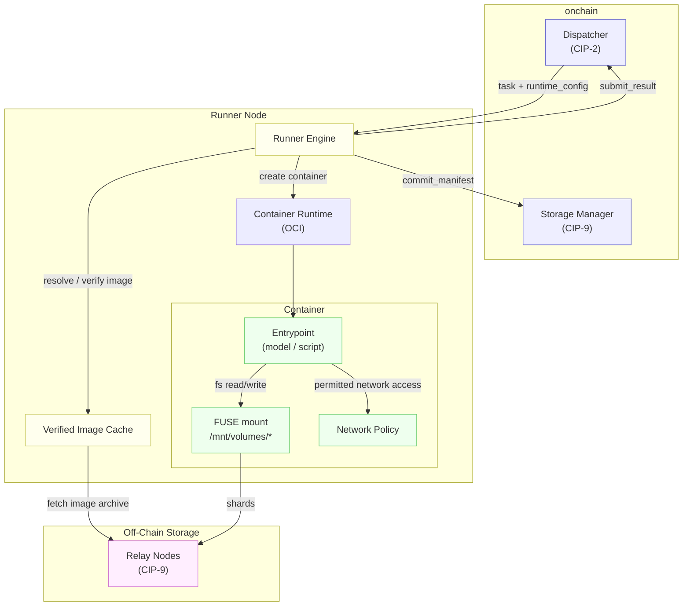
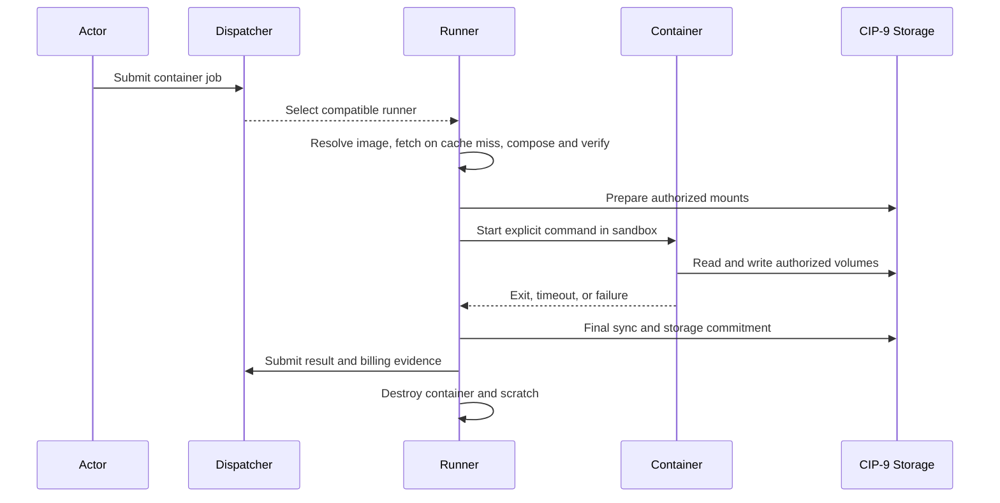

# CIP-10: Runner Container Runtime

<Note>
  **Status:** Draft<br/>
  **Type:** Standards Track<br/>
  **Category:** Core<br/>
  **Created:** 2026-03-07<br/>
  **Requires:** CIP-2, CIP-9<br/>
</Note>

The key words **MUST**, **MUST NOT**, **REQUIRED**, **SHOULD**, **SHOULD NOT**, and **MAY** are to be interpreted as described in RFC 2119 and RFC 8174.

## 1. Background

CIP-2 defines off-chain job dispatch, runner selection, and result submission. CIP-9 defines durable storage and runner access to volumes. Container execution needs a common environment that isolates dependencies from the host, bounds resource use, mounts authorized volumes, and supplies compute usage for on-chain settlement.

Task containers execute a bounded job and are destroyed at exit. Persistent workloads keep a process warm across requests, with identity, ownership, health, and route eligibility controlled by an on-chain record. Both use the Container Registry at `0x13`.

## 2. Goal

Define one container execution contract covering image identity, runtime configuration, isolation, storage, lifecycle, and billing. The contract supports scripts, compiled binaries, local model execution, and model harnesses without prescribing application logic.

The implemented task runtime uses provisioned root filesystems and explicit commands. Permissionless CBFS image distribution is specified in §5; its registry, fetch, capability, and billing integration remains work. GPU execution and allowlisted egress also remain incomplete; their requirements are retained where they belong and are distinguished from available execution paths. The persistent-workload registry is implemented, while its supervisor and mount lifecycle remain integration work (§16 and §17.8).

## 3. Definitions

- **Task container**: An isolated process environment created for a CIP-2 job, subject to a wall-clock bound and destroyed after completion.
- **Persistent workload**: A container governed by a workload registry record rather than an individual job (§17).
- **OCI runtime bundle**: A root filesystem and OCI runtime configuration used to launch a container. The required CBFS path constructs the filesystem under §5.8. OCI manifest and layer pulls are outside that path; the inspected executor still uses operator-provisioned filesystems.
- **Image reference**: A protocol base-image enum or registered 32-byte rootfs digest (§5).
- **Runtime configuration**: The image, command, resource tier, network policy, and minimum isolation tier carried by a container job (§11.1).
- **Scratch filesystem**: Writable, ephemeral container storage. Durable state belongs in authorized CIP-9 volumes.
- **Base image**: A whole-rootfs image registered under §5.5. Protocol `BaseImage` enum keys resolve through reserved registry names; application deltas pin their base by digest.

## 4. Design Overview

### 4.1 Architecture

A Runner node is a machine (physical or virtual) that runs an OCI-compatible container runtime. When a Runner is selected for a CIP-2 task, it:

1. Resolves the registered image, fetches and composes it on a cache miss, and verifies its digest (§5).
2. Creates a container with the specified resource limits and network policy.
3. Mounts CIP-9 volumes as FUSE filesystems inside the container.
4. Starts the container entrypoint.
5. Monitors execution until completion, timeout, or crash.
6. Commits storage manifests and submits results onchain.
7. Destroys the container.



### 4.2 Relationship to Existing CIPs

- **CIP-2 (Off-Chain Compute)**: Container jobs carry `JobType::Container { runtime: RuntimeConfig }` (§11.1). Runner selection and result handling follow CIP-2 with the container capability filter (§7.4).
- **CIP-9 (Runner Attached Storage)**: CIP-9 volumes specified in `volume_attachments` are mounted inside the container as FUSE filesystems at `/mnt/volumes/{name}/`. The FUSE daemon and sync daemon (CIP-9 §12.1) run as sidecar processes alongside the container.
- **CIP-3 (Fee Model)**: Container resource usage (CPU-seconds, memory-seconds, GPU-seconds) uses attestation-based billing — metered externally by Runner cgroup counters, settled onchain via `BillingAttestation` (§12.3). This is distinct from CIP-3 Cycles/Cells, which are metered directly by the VM during transaction execution.

## 5. Container Images

### 5.1 Image Distribution

Image registration is permissionless and CBFS-backed. A publisher registers the composed rootfs digest and a locator in a public CBFS volume they own and fund, following §5.6's registration-before-publication order. Runners fetch, compose, verify, and cache the tree on demand. A delta pins a whole-rootfs base by digest; protocol base names are reserved for `system_deployers` (§5.5).

```rust
ImageRef::Base(BaseImage)
ImageRef::Digest([u8; 32])
```

These wire variants are unchanged. The required registration, admission, and fetch behavior is specified below. The inspected task runtime still resolves operator-provisioned filesystems; that implementation baseline does not satisfy the CBFS distribution contract (§16.1–16.2). OCI registry pulls, multi-architecture manifests, and private-image delivery are not implied by this path.

### 5.2 Artifact Identity and Digest

A registered image is **base plus delta**.

- The **registered digest** MUST be the blake3 rootfs digest of the **composed** tree, computed with the recipe below. No second identity is introduced; `ImageRef::Digest` (`cowboy-protocol/crates/cowboy-protocol-codec/src/job_spec/container.rs:86-89`) continues to carry it.
- The **delta** is the archive specified in §5.3. It carries the installed off-chain dependency group and the project source and nothing else.
- The **base** is a complete rootfs, itself a registered image. `base = None` registers a **whole-rootfs image**: the archive is the complete tree and composition is the identity function. Protocol base images MUST be registered through this same instruction with `base = None`; there is no separate provisioning path.
- Composition is **one level deep**. A delta MUST NOT be composed onto another delta image. Deeper chains are deferred.

Any change to the source, the locked off-chain dependencies, the base, the bootstrap, or the platform yields a different composed tree and therefore a different registration.

**Digest recipe (normative).** The digest is `blake3(walk(root, root))` where `walk` is the following, and is byte-for-byte the shipped implementation at `runner/crates/runner-container/src/image.rs:68-96`:

```text
walk(base, dir):
    entries := read_dir(dir)                      # error propagates; no entry is skipped
    sort entries by file_name()                   # OS byte order of the file name, per directory
    for e in entries:
        path := e.path()
        rel  := path relative to base             # never includes the root itself
        meta := symlink_metadata(path)            # lstat: symlinks are NOT followed

        emit rel.to_string_lossy() as bytes
        emit 0x00
        emit (meta.permissions().mode() as u32).to_le_bytes()    # 4 bytes, little-endian
        emit 0x00

        if meta is symlink:   emit read_link(path).to_string_lossy() as bytes
        elif meta is file:    emit file contents
        elif meta is dir:     walk(base, path)                    # inline recursion, no marker
        else:                 emit nothing                        # fifo/socket/device: path+mode only

        emit 0x00                                 # trailing NUL closes every entry, including dirs
```

Consequences that are normative, not incidental:

- Sorting is **per directory, by `file_name()`**, not a global sort over full paths. A directory's subtree is emitted inline between its own `path ‖ NUL ‖ mode ‖ NUL` prefix and its trailing `NUL`; there is no separate directory terminator or depth marker.
- The mode is the full `st_mode` as a **u32 in little-endian byte order**, not an octal string and not masked to permission bits.
- Paths and symlink targets are hashed via `to_string_lossy()`, so a non-UTF-8 name hashes as its replacement-character rendering. Publishers MUST NOT rely on this; §5.8 rejects non-UTF-8 archive members outright.
- Entries that are neither a regular file, a directory, nor a symlink contribute **path, mode, and the trailing NUL only**. This case cannot arise in a composed image because both the CLI assembler and the runner's extractor refuse such entries, but the recipe defines it.
- The rootfs **root directory's own mode is not hashed** — the walk emits entries under the root, never the root itself.

The reference implementations are `runner-node image-digest <rootfs>` and the CLI's byte-for-byte port (`node`, branch `feat/offchain-image-assembly`, `cli/crates/offchain-image/src/digest.rs`), which differs only in rejecting the special-file case rather than hashing it.

### 5.3 Delta and Composition

The delta archive format is consensus-relevant: two publishers composing the same base with the same logical contents MUST arrive at the same digest, or the digest stops being a shared identity.

**Archive format.** The delta MUST be a **gzip-compressed tar** archive. *(proposed: the reference assembler emits GNU-format headers via `tar::Header::new_gnu` (`cli/crates/offchain-image/src/package.rs`), not POSIX ustar; this specification pins GNU format to match the implementation. A reviewer request for ustar was not adopted because it would invalidate the reference assembler for no stated benefit — if ustar is wanted, the assembler must change first.)*

- Every member path MUST be relative and MUST be under `app/`. Absolute paths, `..` components, and members outside `app/` are invalid.
- The archive MUST contain the `app/` directory entry itself, so that a delta contributing no files still creates the mount point. An archive with **no members at all** is invalid. *(proposed reconciliation: a review request to make "an empty delta invalid" is honored for the zero-member case; a delta consisting only of `app/` remains valid because the reference assembler emits it deliberately, `package.rs`.)*
- `uid`, `gid`, `mtime`, `atime`, `ctime`, device major and minor, and owner and group names MUST all be normalized to `0` / empty. The gzip header's mtime MUST be `0` and its OS byte `255` (unknown). **None of these fields participate in the digest** — the digest hashes only relative path, mode, and content or link target (§5.2) — but normalizing them is what makes the archive itself byte-reproducible.
- Members MUST be emitted in a total order over archive path bytes.
- setuid, setgid, and sticky bits MUST be stripped at packaging time.
- Symlink modes MUST be normalized to `0o777` and directory modes created by the assembler to `0o755`. This is not cosmetic: Linux reports symlink modes as `0o777` while macOS applies the process umask, and the recipe hashes the mode, so an unnormalized symlink digests differently on the two platforms (`cli/crates/offchain-image/src/fsutil.rs`).

**Mode normalization (normative).** §5.2 hashes the mode of every entry, so the mode is part of the image identity. An assembler MUST NOT let the builder's environment reach it. In the delta:

- regular files MUST be `0o644`, or `0o755` when **any** execute bit was set on the source;
- directories MUST be `0o755`;
- symlinks MUST be `0o777`; and
- setuid, setgid, and sticky bits MUST be stripped.

This is git's mode model: a file is either executable or it is not, and nothing else about its permissions is meaningful to the image. Preserving real modes instead would make the digest a function of the developer's umask — the same tree installed under `umask 022` and `umask 077` yields two different digests for one logical input (`cli/crates/offchain-image/src/install.rs:136-152`).

**Installed-package normalization (normative).** Python package installers leave builder-specific residue in the target directory. An assembler MUST remove it before packaging:

- a `*.dist-info/` directory MUST contain only `METADATA`, `WHEEL`, `top_level.txt`, `entry_points.txt`, `namespace_packages.txt`, `INSTALLER`, `REQUESTED`, and license or notice files;
- `bin/`, `RECORD`, `direct_url.json`, `uv_cache.json`, `.lock`, and `__pycache__` MUST be absent anywhere in the delta; and
- bytecode MUST NOT be compiled into the delta.

Each of these is a concrete non-determinism, not tidiness. `bin/` console scripts embed the absolute path of the builder's interpreter; `RECORD` lists those scripts and their hashes, so it varies with them; `direct_url.json` and `uv_cache.json` record local paths and cache state; `.lock` is installer scratch; `__pycache__` and any compiled bytecode carry the interpreter version, build path, and source mtime. Dropping `bin/` is safe because off-chain code is never entered through a console script — the runner runs `python3 -m cowboy_offchain`, which imports `main` and calls the named function.

Taken together, the mode and installed-package rules exist so that **the composed digest is a function of the logical contents only** — the source, the resolved dependency set, and the base — and not of the builder's umask, interpreter path, install cache, or filesystem. Two independent assemblers given the same inputs MUST produce the same digest; an assembler that omits any rule above will produce a digest no other builder reproduces, and its images will fail verification at every runner that fetches them.


**Base constraints.** The base rootfs MUST NOT contain a top-level `/app` entry. A base that does would have its `/app` silently replaced by the delta, making the composed digest depend on a shadowing rule rather than on a union.

**Composition.** Composition MUST clone the base into a fresh tree preserving **every mode bit, symlink target, and hardlink structure**, then extract the delta at `<root>/app`. Extraction MUST preserve member modes exactly as recorded. An implementation that hardlinks regular files out of the base to avoid copying MUST unlink a destination before writing over it, or the write lands on the base's inode and corrupts the pinned base for every other image composed from it.

The CLI assembler on `node` branch `feat/offchain-image-assembly` (`cli/crates/offchain-image/src/{package,compose,digest}.rs`) already implements this shape and is the reference for it.

### 5.4 Storage and Availability

The delta object MUST live in a CBFS volume, and the on-chain `StorageCommitment` for that volume (`node/ras/src/types.rs:226-263`) is the **sole availability signal** for the image. No new storage service, index, or pinning service is introduced.

- The volume MUST be `Visibility::Public` (`node/ras/src/types.rs:230`) *(proposed — the plan says "public CBFS volume" without making it a checked precondition; a private volume's DEK is not releasable to an arbitrary drawn runner, so a private locator would register an image nobody can fetch)*. Visibility is fixed at volume creation and is not mutable thereafter, so it is checked once at registration and admission need not re-check it.
- Rent is the hosting fee. There is no separate image-hosting charge, no protocol-funded mirror, and no expiry timer independent of rent. A volume that rots takes its images with it: `status` leaves `Active`, and §5.7 stops admitting jobs that reference it.
- The publisher MUST keep the volume funded for as long as any actor pins one of its digests. Escrow top-up is the existing CIP-9 deposit path; nothing in this section changes it.
- **Rent is not the only way an image dies.** A publisher who keeps paying rent may still overwrite or delete the object at `object_path`, or commit a manifest that no longer contains it, while the volume stays `Active` and the registration stays admissible. Admission cannot detect this; the failure surfaces as a cold runner failing to fetch. Runners MUST treat it as a fetch failure (§5.8) and MUST NOT treat it as a job failure. Publishers MUST NOT mutate or remove an object that any live registration points at; making the object immutable for the life of the registration is the publisher's obligation, unenforced by the chain in this specification.

### 5.5 Image Registration

`RegisterBaseImage` (160) and `DeregisterBaseImage` (161) are **replaced**, not retained. Base images and application images are the same object under this section, so a second registration path would be a second trust path to the same digest index for no benefit. The two opcodes are reused in place *(proposed — 160/161 carry new payloads rather than taking fresh opcodes; the alternative is a new pair at 219/220 with 160/161 deleted, which costs two opcodes to preserve nothing)*.

| Opcode | Instruction | Sender |
|---:|---|---|
| **160** | `RegisterImage { digest, base_digest, name, volume_id, object_path, object_hash, delta_bytes, rootfs_bytes }` | any account |
| **161** | `DeregisterImage { digest }` | the recorded publisher |

**162–163 (resource classes) are `system_deployers`-gated; 160–161 are permissionless**, except for the named protocol-base case below. Settlement configuration and disputes follow §11.4. The opcode-uniqueness test MUST continue to cover 160–165.

Wire encoding follows the codec's existing container-instruction conventions (`cowboy-protocol/crates/cowboy-protocol-codec/src/instruction.rs:1559-1563, 3522-3531, 4751-4757`) — opcode byte, then fields in declaration order, `Vec<u8>` range-bounded on read, `[u8; 32]` fixed *(proposed, in full)*:

```
RegisterImage {
  digest:       [u8; 32],          // composed rootfs digest (§5.2); MUST NOT be zero
  base_digest:  Option<[u8; 32]>,  // u8 0 = None | 1 ‖ [u8; 32]
  name:         Vec<u8>,           // ≤ 64, UTF-8; empty for an unnamed image
  volume_id:    [u8; 32],
  object_path:  Vec<u8>,           // ≤ 256, UTF-8 CBFS manifest path
  object_hash:  [u8; 32],          // BLAKE3 plaintext content hash of the delta object
  delta_bytes:  u64,
  rootfs_bytes: u64,
}
```

**Decode-time rejections.** The boundary between decode and execution is normative: two implementations that disagree about which block decodes disagree about whether a block is valid at all. Rejected at decode, before execution: `digest` equal to zero; `base_digest` present and equal to zero; `name` longer than 64 bytes; `object_path` longer than 256 bytes; an `Option` tag other than 0 or 1; non-canonical varint lengths; trailing bytes. All other checks in this section run at execution.

**The base is pinned by digest, never by name.** `base_digest` carries the base's own registered digest, not a `BaseImage` enum value. The `BaseImage` enum key is resolved to a digest exactly once — by the publishing tool, at registration time — and the locator then pins that digest forever. A runner composing an image MUST use `base_digest` from the locator and MUST NOT perform a name lookup at fetch time. Without this, rebinding a protocol base name would silently change the composed tree of every image built on it, and every such image's registered digest would stop matching what a runner reconstructs.

Two rules make the pin durable:

- Re-registering an existing `name` under a **different** digest MUST be rejected. There is no in-place base refresh.
- A new base release is therefore either a **new name**, or requires an explicit `DeregisterImage` of the old digest first — which is reference-count gated, so a base cannot be retired out from under a workload that references it.

**`object_hash` is the CBFS plaintext content hash.** It MUST equal the `ObjectDescriptor.content_hash` CBFS records for the object (`cbfs/types/src/lib.rs:180-198`): BLAKE3 over the plaintext object bytes. For a delta object these are the compressed archive bytes before CBFS encryption. The reference assembler exposes this as `DeltaPackage.blake3`; its separate SHA-256 value is a local build-cache aid, not the registry hash (§16.1).

**`name` and the protocol base binding.** The name→digest index lets clients resolve `runner-python` and other protocol `BaseImage` enum keys. The name index serves the protocol base keys only; application images are addressed by digest.

- `name` empty — an ordinary permissionless registration. Any account MAY submit it. The empty case MUST bypass `validate_name` (`container_registry.rs:76-84`), which rejects an empty name; no `BaseImageEntry` is written.
- `name` non-empty — it MUST be a protocol base-image enum key (`runner-base`, `runner-python`; `job_spec/container.rs:35-52`) and the sender MUST hold a `genesis.system_deployers` key. Binding an enum key is a protocol-trust operation: an unprivileged account that could rebind `runner-python` would capture every `ImageRef::Base(RunnerPython)` job on the chain. This is the only privileged case in this section.

**Execution checks.** `RegisterImage` MUST reject unless all hold:

1. `digest` is non-zero and is **not already registered**, live or tombstoned. Registration is create-only; there is no refresh. (This tightens the current `register_base_image`, which rewrites an existing name→digest binding, `container_registry.rs:551-561`.)
2. The `StorageCommitment` for `volume_id` exists at the Storage Manager (`0x0A`) under `sm_keys::volume_key` — the same read the registry already performs for workload mounts (`node/execution/src/execution/container_registry.rs:304-312`).
3. `commitment.status == VolumeStatus::Active` (`node/ras/src/types.rs:262`). Registering into a volume already in grace is refused; grace only extends an existing registration (§5.7).
4. `commitment.visibility == Visibility::Public` *(proposed, §5.4)*.
5. `commitment.owner` equals the transaction signer.
6. `object_path` is non-empty, valid UTF-8, and within its cap; `object_hash` is non-zero.
7. `delta_bytes <= MAX_IMAGE_DELTA_BYTES` and `rootfs_bytes <= MAX_COMPOSED_ROOTFS_BYTES` (§5.9).
8. If `base_digest = Some(d)`, `d` resolves to a live (non-tombstoned) locator, that locator's own `base_digest` is `None` (one-level composition), and its volume is live under §5.7 *(proposed — a composed image whose base is unreachable is unrunnable on a cold runner; checking it at registration converts a run-time failure into a submit-time one)*.
9. If `name` is non-empty, the `name`/`system_deployers` rule above, and no existing entry for that name under a different digest.
10. The volume's live registration count is below `MAX_REGISTRATIONS_PER_VOLUME` (§5.9). A registration is **live** for this purpose until its locator record is reaped: a tombstoned-but-unreaped locator still occupies its slot, because its bytes are still on chain.

Execution writes, in one atomic transaction:

- the **digest→name index** the current `RegisterBaseImage` writes, at `system:container_registry:digest:<digest>` (`container_registry.rs:64-67, 574-581`), so §5.7 admission and `get_image_name_by_digest` (`container_registry.rs:623-640`) keep working unchanged. For an unnamed image the indexed value MUST be the lowercase hex of the digest *(proposed — the index value is a JSON string and admission only tests presence (`node/execution/src/runner/dispatcher.rs:5467-5477`), so an empty string would be indistinguishable from a corrupt entry; hex gives clients a stable display name)*. Note that 64 hex characters is exactly `CONTAINER_NAME_MAX_LEN` (`container_registry.rs:24`), so the hex form fits the existing bound with no slack — the index value is written directly and is not routed through `validate_name`;
- for a named registration, the `BaseImageEntry` at `system:container_registry:image:<name>` exactly as today (`container_registry.rs:562-573`), with `size_bytes = rootfs_bytes`;
- the **locator record** at `system:container_registry:image_locator:<digest>` *(proposed key, following the actor's existing `system:container_registry:<family>:<suffix>` idiom, `container_registry.rs:57-105`)*, serde-JSON like every other value this actor stores; and
- the **per-volume registration counter** at `system:container_registry:image_count:<volume_id>` *(proposed)*, a `u64` JSON-decimal count in the same style as the existing workload reference counts (`container_registry.rs:182-215`), incremented here and decremented when the locator is reaped — not when it is tombstoned.

```rust
ImageLocator {
  digest:        [u8; 32],
  base_digest:   Option<[u8; 32]>,   // pinned at registration; never re-resolved
  name:          Option<String>,     // Some only for a protocol base key
  publisher:     Address,
  volume_id:     [u8; 32],
  object_path:   String,
  object_hash:   [u8; 32],
  delta_bytes:   u64,
  rootfs_bytes:  u64,
  registered_at: u64,                // block height
  tombstoned:    bool,
  tombstoned_at: u64,               // 0 while live; set at phase 1
}
```

*(proposed: the RFC's build descriptor also records the base digest, an off-chain requirements hash, the bootstrap ABI version, the platform, and a recipe version. Only `base_digest` is promoted on chain, because it is the only one composition depends on. The rest stay in the off-chain descriptor; if the chain later needs to reject an image built for the wrong platform, `platform` is the field to add.)*

**`DeregisterImage { digest }`** MUST reject unless the sender is the record's `publisher`; a named protocol base additionally requires a `system_deployers` sender. It MUST refuse while the image is referenced by a persistent workload, reusing the existing reference count at `system:container_registry:workload_ref:image:<digest>` (`container_registry.rs:97-101, 594-597`) — a nonzero count rejects with `WorkloadReferenceInUse`.

Deregistration is **two-phase**, both phases submitted under the same opcode by the same publisher.

**Phase 1 — tombstone.** The first successful `DeregisterImage` sets `tombstoned = true` and `tombstoned_at = current_block` on the locator and deletes the digest→name index and any name entry. It does **not** delete the locator and does **not** decrement the per-volume count. The locator is retained so that a job admitted before deregistration can still be resolved by the runner that draws it: admission stops at the digest-index deletion, while in-flight resolution continues through the retained record. A tombstoned digest MUST NOT be re-registered (check 1), so the tombstone is also what prevents a deregister-then-reregister rebinding of the same digest to different bytes.

**Phase 2 — reap.** A second `DeregisterImage` for the same digest MUST delete the locator and decrement the per-volume count, **freeing the slot**. It MUST reject unless `current_block >= saturating_add(tombstoned_at, IMAGE_TOMBSTONE_GRACE_BLOCKS)`, inclusive at the exact boundary — the same comparison shape the registry already uses for persistent-workload stale cleanup (`container_registry.rs:108-113`). `IMAGE_TOMBSTONE_GRACE_BLOCKS = 600` remains the proposed grace period. Its sizing assumes a `LIVENESS_TIMEOUT_BLOCKS = 100` redraw and a 300-block billing-dispute window, with headroom for one additional redraw. The actual dispute window is job-configured (§12.3), so these assumed values do not establish that all in-flight references have expired; validating the grace period against the full admitted-job and redraw lifetime remains an integration requirement (§16.2). Reference counting in-flight jobs per digest was rejected: it would add a write to every container job's submit and settle path to save a bounded, self-clearing record.

Reaping is therefore neither deferred nor automatic — it is an explicit act by the publisher, which is also who wants the slot back. A publisher who never reaps simply keeps the slot occupied.

Deregistration does not revoke images already cached by runners; it only stops new admissions.

### 5.6 Resolution and Publication

Registry keys exceed 32 bytes and are hash-stored, so they are invisible to prefix scans; clients MUST resolve through the exact-key storage read RPC (`GET /actors/{addr}/storage/value?key=`). Resolution is **by digest**: a client holding a digest reads `system:container_registry:image_locator:<digest>` directly. Name resolution exists only for the two protocol base keys and only to answer "which digest is `runner-python` right now"; there is no name→digest lookup for application images, because there are no application image names.

`cowboy container register-image` gains the locator flags and loses its operator-only framing (`node/cli/src/commands/container.rs:21-35, 101-118`, which today submits `RegisterBaseImage` with only `name`, `digest`, `size_bytes`). `cowboy container deregister-image` changes its selector from `--name` to `--digest` (`node/cli/src/commands/container.rs:37-45`). `cowboy container images`, which lists registrations with each volume's current status so a rotted image is visible before a job is submitted, is a **new** subcommand — no listing command exists today.

**Publication order (normative).** The publishing tool MUST, in this order:

1. submit `RegisterImage` and **observe its commitment on chain**; then
2. make the delta object publicly readable; and only then
3. disclose the digest.

Registration is create-only and first-come, so a digest disclosed before it is registered can be bound by anyone. Ordering the publish this way closes the window in the normal case.

The residual is real and MUST be stated. While a digest is tombstoned, check 1 refuses re-registration, so a mistaken phase-1 deregistration cannot be undone — the publisher must wait out the grace window, reap, and register again. Once reaped, the digest is registrable by anyone, which reopens the front-running window for it. That is a smaller hazard than it sounds: the digest commits to the composed tree, so a re-registration either points at byte-identical content or fails verification at every runner. It cannot be rebound to different bytes. The practical effect is the useful direction — a third party holding the correct delta can revive a reaped image for actors still pinned to it — with the same denial risk as any first registration.

The alternative design is a `(digest, owner)` multimap: several publishers may each register a locator for the same digest, admission accepts a job if **any** locator is live, and a runner tries them in a defined total order — `registered_at` ascending, then publisher address bytes ascending. It removes front-running entirely, at the cost of a `MAX_LOCATORS_PER_DIGEST` cap, a K-times-larger worst case for a runner that must try K bad locators before a good one (bounded by the fetch timeout times K), and a more expensive admission read. **The choice between the ordering rule above and the multimap is pending a user decision**; this draft specifies the ordering rule.

### 5.7 Admission

A job whose `ImageRef` is a `Digest` is admissible **iff both** hold, evaluated at submit, before dispatch commits:

- the digest resolves through the digest index — the check that exists today at `node/execution/src/runner/dispatcher.rs:5467-5477`, inside `escrow_container_compute` (`dispatcher.rs:5457`); **and**
- the locator's volume commitment loads and its `status` is **exactly `Active` or exactly `GracePeriod`**.

This is a **strict whitelist**, not a blacklist. The normative `VolumeStatus` is the node's (`node/ras/src/types.rs:176-184`), which has **six** variants — `PendingMpkSetup`, `MpkSetupFailed`, `Active`, `GracePeriod`, `Deleted`, `GarbageCollecting` — not the four in the CBFS client mirror (`cbfs/registry-proto/src/types.rs:67-73`). A blacklist written against the four-variant mirror would admit `PendingMpkSetup` and `MpkSetupFailed` volumes today, and would admit every variant added in the future by default. Every status other than `Active` and `GracePeriod`, present or future, MUST reject; so MUST a missing commitment, an unreadable locator, and a tombstoned locator.

Grace-period serving is deliberate and matches the gateway's public-volume serving policy: the manifest root is immutable during grace, so bytes already committed are still safely fetchable, and a publisher whose rent lapses gets the grace window as warning rather than an instant cliff.

The same whitelist MUST be applied to the volume of the locator named by `base_digest` *(proposed, §5.5 check 8)*.

Rejection MUST fail the whole submit transaction, matching the surrounding escrow handler's atomicity contract (`dispatcher.rs:5448-5456`): no partial escrow may survive an inadmissible image.

### 5.8 Fetch, Compose, Verify, and Cache

On a digest job for which `<image_root>/<hex-digest>/rootfs` is absent, the runner MUST, in order:

1. **Read the locator** for the digest from the Container Registry, proof-checked.
2. **Resolve the base** from `base_digest` — never from a name. If `base_digest = Some(d)`, ensure `d` is installed locally, fetching it by this same procedure first. Bases are pinned once installed.
3. **Fetch the object** at `object_path` from the public volume using the existing CBFS SDK client already used for runner storage. The fetch MUST be subject to `IMAGE_PULL_TIMEOUT_SEC` (§13) and MUST **abort as soon as the streamed byte count exceeds `min(delta_bytes, MAX_IMAGE_DELTA_BYTES)`**. A publisher who under-declares `delta_bytes` cannot make a runner stream more than it agreed to.
4. **Verify the object hash** against `object_hash` before anything is extracted. A mismatch aborts; the bytes MUST NOT be written into the image root.
5. **Extract with a hardened extractor** into a private temporary directory on the same filesystem as the image root, under an unprivileged uid. The extractor MUST reject, and abort the whole fetch on, any of: an absolute member path; any `..` component; a member not under `app/`; a symlink or hardlink whose resolved target escapes the extraction root; a device, FIFO, or socket member; a member with setuid, setgid, or sticky bits; a member path that is not valid UTF-8; a duplicate member path; and a cumulative uncompressed size exceeding `min(rootfs_bytes, MAX_COMPOSED_ROOTFS_BYTES)`. Sizes MUST be enforced during streaming, not from archive-declared headers. Member modes MUST otherwise be preserved exactly (§5.3).
6. **Compose** the extracted tree onto a mode-, symlink- and hardlink-preserving copy of the pinned base at `/app`, per §5.3. Composition MUST NOT let the delta replace or shadow any path outside `/app`.
7. **Digest and compare.** Recompute the §5.2 rootfs digest over the composed tree and compare with the registered digest. Any mismatch MUST abort and delete the temporary tree. This is the same rule the existing `verify_digest_root` enforces for provisioned trees (`runner/crates/runner-container/src/image.rs:98-120`); this section extends it to fetched ones.
8. **Install atomically** by renaming the verified tree into `<image_root>/<hex-digest>/rootfs`. A partially fetched or unverified tree MUST never be observable at that path. The rootfs is mounted read-only into every sandbox. Successful digest verification is cached for the runner process lifetime; operators MUST protect installed verified trees against host-side mutation while they are in use. Read-only sandbox mounts do not prevent host edits, and the cached check is not continuous integrity monitoring.
9. **Record** the fetch in the cache index for LRU accounting.

**Cache.** Runners MUST maintain a bounded image cache: a configurable byte quota (default `RUNNER_IMAGE_CACHE_BYTES`, §5.9), LRU eviction by last use, **registered protocol base images never evicted**, a per-digest lock so concurrent jobs on one digest fetch once, and **at most one concurrent fetch per runner**. Prefetch is demand-driven, never registration-driven: a runner MUST NOT fetch an image merely because it was registered, since registration is permissionless and a registration that no job uses must cost the fleet nothing. A runner MAY prefetch the image of a job it observes admitted on chain (a `JobSubmit` carrying a digest ref is visible before the draw resolves) so that a replacement draw after a liveness timeout finds a warm cache, subject to a per-runner budget (`IMAGE_PREFETCH_BUDGET_BYTES_PER_HOUR`, §5.9) and skipping digests already cached or in the negative cache. Prefetch MUST yield to the fetch for the runner's own assignment and MUST respect the same quota and concurrency bound. Under this rule every byte a runner downloads corresponds to a job whose submitter paid escrow, and a popular image spreads through the fleet at the rate it is actually used.

Runners MUST also keep a **per-digest negative cache**:

- A digest whose fetch failed for a *transient* reason (timeout, relay unavailable, object temporarily missing) MUST NOT be retried before an exponential backoff elapses, starting at one fetch-timeout interval and doubling to a cap, so that a rotted or unpublished image cannot be re-fetched once per job assignment.
- A digest that failed **verification** — object-hash mismatch, hostile archive, or composed-digest mismatch — MUST NOT be retried for the process lifetime. Verification failure is a deterministic property of the registered bytes, not a transient condition; retrying it burns bandwidth to reach the same conclusion and is exactly the shape an attacker would use to amplify a registration into repeated runner work.

**Fetch failure.** If any step above fails, the runner does not run the job. It MUST NOT submit a failed result for a fetch failure, because a fetch failure is a property of the runner's attempt, not of the job. In this specification the job is recovered by the **existing chain-side liveness timeout**: after `LIVENESS_TIMEOUT_BLOCKS = 100` blocks with no result, the dispatcher draws a replacement committee excluding the original assignee and writes a `JobTimeoutRecord` (`node/execution/src/runner/dispatcher.rs:35-40, 3457-3470`). `CancelReason::Reassigned` on the CIP-11 wire (`runner/crates/runner-common/src/cip11_wire.rs:732-738`) is validator-initiated and is not a runner-side decline.

The cost is stated plainly rather than hidden: an unfetchable image costs the job **a full 100-block timeout per drawn runner** before redraw, instead of an immediate redraw. For a job whose image volume has rotted between admission and dispatch, that is the whole latency budget. A runner-initiated decline would remove it; it is specified as deferred work in §16.3 rather than asserted as a requirement here, because it is a new system instruction with its own authorization, accounting, and griefing surface and does not exist in any repo today.

### 5.9 Image Limits

| Limit | Value | Enforced at |
|---|---:|---|
| `MAX_IMAGE_DELTA_BYTES` — delta tarball, compressed | 256 MiB | registration, fetch |
| `MAX_COMPOSED_ROOTFS_BYTES` — composed rootfs, unpacked | 2 GiB | registration, extraction |
| `IMAGE_PREFETCH_BUDGET_BYTES_PER_HOUR` — per-runner cap on speculative prefetch of admitted jobs' images | 512 MiB (proposed) | runner |
| `RUNNER_IMAGE_CACHE_BYTES` — runner image cache quota | 20 GiB | runner |
| `MAX_IMAGE_FETCH_CONCURRENCY` — concurrent fetches per runner | 1 | runner |
| `MAX_IMAGE_OBJECT_PATH_BYTES` — CBFS manifest path in a registration | 256 | registration |
| `MAX_REGISTRATIONS_PER_VOLUME` — live registrations per volume | 64 | registration |
| `IMAGE_TOMBSTONE_GRACE_BLOCKS` — blocks before a tombstoned locator may be reaped | 600 | deregistration |

The two byte caps match the reference assembler's defaults (`cli/crates/offchain-image/src/limits.rs`). Cold-start latency is unmeasured: these caps are a first bound, not a measured optimum, and the first benchmark run is expected to move them.

### 5.10 Protocol Base Images

The protocol defines `BaseImage::RunnerBase` and `BaseImage::RunnerPython` (wire tags 0 and 1), with keys `runner-base` and `runner-python`. Both MUST be registered as whole-rootfs images through §5.5. ML and agent-specific images use a registered digest rather than additional enum variants.

| Image | Description | Size | Contents |
|-------|-------------|:----:|----------|
| `cowboy/runner-python` | Python runtime and off-chain bootstrap | Set by the CI recipe | Python 3.12 and the `cowboy_offchain` bootstrap package only |

The Python base carries no application libraries. `numpy`, `pandas`, `requests`, and every other project dependency arrive in the project's delta, installed from its lock into `/app`. The base is shared across projects and cached by runners; project-specific bytes stay in the delta. Image sizes depend on the build recipe and MUST respect §5.9's caps.

An agent image SHOULD provide the Unix tools required by its harness, such as a shell, file utilities, Python, and search tools. ML images require the model's dependencies and, when GPU execution is supported, the matching device runtime (§8).

## 6. Runtime Environment

### 6.1 Filesystem

The image root is read-only and the process working directory is `/`. `/tmp` and `/dev` are writable tmpfs mounts, each capped at `65536k`; `/proc` is a procfs mount. No `/workspace` directory is created by the runtime. Writable scratch storage is ephemeral; authorized CIP-9 mounts appear at `/mnt/volumes/{name}`. Mount access follows the volume's authorization rather than granting general host-filesystem access. The host-side storage process prepares mounts before the container starts; the container uses ordinary file I/O.

### 6.2 Environment

The executor constructs the container environment with `COWBOY_JOB_ID` (lowercase hexadecimal), `COWBOY_VOLUME_ROOT=/mnt/volumes`, and `COWBOY_VOLUME_{NAME_UPPERCASE}=/mnt/volumes/{name}` for each supplied mount. It MUST NOT inherit arbitrary host environment variables or expose host credentials. The `COWBOY_` namespace is reserved for runtime metadata.

`RuntimeConfig` has no arbitrary `env` field. Application-specific environment overrides and encrypted model-provider credentials require an explicit delivery mechanism; an example must not imply that an encrypted string placed in a job is sufficient secret provisioning.

### 6.3 Command

A container job MUST provide a non-empty command vector. The wire format permits at most 256 arguments of at most 4,096 UTF-8 bytes each. The executor runs that command; it does not resolve an OCI image's `ENTRYPOINT` or `CMD`. `RuntimeConfig` has no working-directory override.

A model harness MAY run as the command and expose filesystem tools against authorized mounts. Model selection, prompts, tool behavior, and provider authentication belong to the harness. External model APIs additionally require the egress capability in §9, which the task executor does not yet implement.

### 6.4 User and Permissions

The OCI process uses UID/GID 0 inside the container. For rootless runc these IDs map to the invoking unprivileged host UID/GID. Container UID 0 does not grant host root privileges. All Linux capabilities are dropped and `no_new_privileges` is set. There is no `allow_root` option in `RuntimeConfig`.

## 7. Resource Limits

### 7.1 Resource Declaration

Jobs select a `ResourceTier`; the Container Registry stores named resource classes for admission and pricing. A class contains:

```rust
ResourceClassEntry {
  name: String,
  cpu_millicores: u32,
  memory_mib: u32,
  scratch_disk_mib: u32,
  max_duration_sec: u32,
  gpu_count: u8,
  gpu_min_vram_mib: u32,
}
```

A custom per-job `ResourceLimits` object is not part of `RuntimeConfig`. Resource-class registration is operational and restricted to `system_deployers` (§11.4).

### 7.2 Enforcement

The Standard sandbox uses cgroups v2 for CPU, memory, and PID limits: CPU excess is throttled and memory excess can trigger an OOM kill. The runner enforces a wall-clock timeout. Writable scratch MUST be bounded; durable volume limits follow CIP-9 authorization and quotas.

Strong isolation and the unsafe no-cgroups fallback currently run without host-cgroup enforcement (§15). An unmetered bill is not evidence that resource limits were enforced.

### 7.3 Executable Tiers

The implemented task executor's limits are:

| Tier | CPU | Memory | PID limit | Maximum duration |
|---|---:|---:|---:|---:|
| `Small` | 500 millicores | 512 MiB | 128 | 120 seconds |
| `Medium` | 2,000 millicores | 2,048 MiB | 512 | 600 seconds |

A shorter job wall-time limit further bounds execution. Registered class values drive the compute escrow (§12.1), while these executor limits are local runtime policy. Operators MUST align advertised tiers, registered classes, and actual enforced capacity; changing a registry entry does not reconfigure the runner sandbox.

Larger and GPU tiers require corresponding execution support. The resource fields in the registry do not establish such support by themselves (§8 and §16).

### 7.4 Capabilities and Selection

Container capability filtering MUST enforce requested isolation and resource capacity. Among compatible runners, selection follows CIP-2. The executor selects the lowest supported isolation tier meeting `min_isolation_tier` and MUST reject a job when it cannot provide its requested execution capability.

`serves_registered_images` (`node/runner/src/types.rs:489-494`) changes meaning from "this host has digest-addressed rootfs directories provisioned under its image root" to "**this host can fetch a registered image from CBFS, verify it, and cache it**". A runner MUST advertise it whenever the container executor is enabled and its cache directory is writable with the configured quota available, and MUST NOT advertise it otherwise. The fail-closed rule of §7.4 continues to apply: a host that cannot enforce resource caps advertises no container capability at all.

**The `base_images` inventory match is retired.** Dispatcher Filter 3.5 currently matches an `ImageRef::Base(b)` job only against runners whose advertised `base_images` contains `b` (`node/execution/src/runner/dispatcher.rs:2729-2735`). After this section, base images are registered and fetched exactly like any other image, so an inventory list is the wrong predicate — it excludes a capable runner that simply has not fetched that base yet, which is the normal state of every newly started runner. Filter 3.5 MUST therefore match **both** `ImageRef::Base` and `ImageRef::Digest` on `serves_registered_images` alone.

`base_images` becomes **informational** — useful for operators and for warm-start scheduling heuristics, not a match predicate. It is not removed from the capability record, so no wire shape changes. The CLI currently hardcodes it (`node/cli/src/commands/runner.rs:542`, which advertises `["RunnerBase", "RunnerPython"]` unconditionally); that hardcode is harmless once the field is informational, but it is also now meaningless and should be either populated honestly from the cache or dropped from the registration template.

Two implementation facts follow:

- The runner-side mirror of the capability struct (`runner/crates/runner-common/src/types.rs:193-202`) has **no** `serves_registered_images` field, so no runner can advertise it today even though the node's dispatcher already filters on it. Adding the field and advertising it is REQUIRED.
- `RunnerCapabilities` round-trips through **bincode into sled** on the runner side. The struct comment and `runner_registration_bincode_roundtrips_optional_capability_fields` test require positional serialization without skipped fields. Adding `serves_registered_images` changes that stored record shape; `#[serde(default)]` does not make bincode self-describing. Persistence and deployment acceptance follow §16.4.

Automatic runner registration in the inspected baseline emits no container capability, while the explicit node CLI advertisement does not probe cgroup delegation or sandbox launch. The unsafe no-cgroups path rejects jobs above `Small` at execution, but registration does not enforce the required fail-closed advertising rule. Completing and testing that guard remains work (§16.2).

## 8. GPU Passthrough

GPU passthrough is a retained execution requirement, not an available task-runtime path. The following request and device descriptions express the required semantics; they are not additional fields in the current `RuntimeConfig` wire schema. An implementation MUST satisfy these requirements before advertising GPU execution.

### 8.1 GPU Request

Tasks requiring GPU access specify a `GpuRequest`:

```
GpuRequest {
  count:          u8,        // number of GPUs requested
  min_vram_mib:   u32,       // minimum VRAM per GPU
  compute_cap:    string?,   // minimum CUDA compute capability (e.g., "8.0")
  driver:         string?,   // required driver framework ("cuda", "rocm")
}
```

### 8.2 Device Exposure

GPU devices are exposed to the container via the OCI runtime's device mapping:

- **NVIDIA GPUs**: Exposed via `nvidia-container-runtime` (CDI). The container sees `/dev/nvidia*` devices and CUDA libraries.
- **AMD GPUs**: Exposed via ROCm device mapping. The container sees `/dev/kfd` and `/dev/dri/render*`.

Only the requested number of GPUs are visible to the container. The Runner engine manages GPU allocation across concurrent containers.

### 8.3 GPU Capability in Runner Registry

Runners with GPUs advertise them:

```
GpuDevice {
  vendor:        string,     // "nvidia", "amd"
  model:         string,     // "A100", "H100", "MI300X"
  vram_mib:      u32,        // e.g., 81920 for A100-80G
  compute_cap:   string,     // e.g., "8.0" for A100
}
```

### 8.4 Capability Filtering

Before GPU execution is enabled, runner selection MUST filter for the requested GPU count, memory, vendor/driver compatibility, and available capacity. An empty eligible set MUST fail admission through the CIP-2 capability checks. GPU indices and an execution-time capacity check remain required; this CIP does not define a second VRF formula or a `skip_task()` instruction.

## 9. Network Policy

### 9.1 Default: Isolated

`NetworkPolicy::None` (wire tag 0) is the only network-policy variant. The task executor disables network access for every container. Allowlisted egress therefore requires both a protocol schema and executor implementation. This is the safest posture and sufficient for pure computation tasks that read from CIP-9 volumes and write results.

### 9.2 Egress Allowlist

Allowlisted egress remains an implementation requirement. The rule descriptions below specify its intended enforcement, not a claim that the executor installs the rules today. Unsupported policies MUST NOT be advertised as usable.

Tasks that need external network access (API calls, web scraping, model API endpoints) declare an egress allowlist:

```
// Egress requirements; not the RuntimeConfig wire schema.
EgressRule {
  host:     string,          // hostname or IP (e.g., "api.anthropic.com", "api.moonshot.cn")
  port:     u16?,            // specific port (default: 443)
  protocol: ENUM { TCP, UDP },  // default: TCP
}
```

**Rules:**

- **No wildcards**: Each allowed host must be explicitly listed. `*.example.com` is not valid.
- **DNS resolution and IP pinning**: DNS resolution is performed by a **host-side DNS proxy** (not inside the container) that enforces the allowlist. The proxy resolves each allowlisted hostname at container startup, pins the resolved IP(s), and configures iptables rules to permit traffic only to those pinned IPs on the specified ports. This prevents DNS rebinding attacks (where an attacker changes a DNS record mid-session to redirect traffic to an internal IP). The container's `/etc/resolv.conf` points to the host proxy, which rejects queries for non-allowlisted domains.
  - **TLS SNI verification**: For TLS connections (port 443), the Runner's network filter verifies that the TLS ClientHello SNI matches the allowlisted hostname. This prevents an attacker from using an allowlisted IP to tunnel traffic to a different hostname.
  - **DNS TTL refresh**: Pinned IPs are refreshed at DNS TTL expiry (minimum 60s, maximum 300s) to handle legitimate IP rotations (CDNs, load balancers). New IPs are verified against the allowlist hostname before being permitted.
- **No task ingress**: Task containers cannot accept external inbound connections. Persistent workloads expose the registry-controlled endpoint in §17; that exception does not grant ingress to task containers.
- **No inter-container networking**: Containers from different tasks cannot communicate directly, even if they run on the same Runner node. Communication between tasks happens through CIP-9 shared volumes.

### 9.3 Model API Access

For LLM tool-calling workloads, the model API endpoint must be in the egress allowlist. The Runner operator's model harness handles authentication with the model provider.

For example, a harness calling `api.anthropic.com` requires an explicit TCP port 443 rule plus an authorized credential-delivery mechanism. The current isolated task executor cannot make that call.

For Runners that host models locally (on-device inference), no egress is needed — the model runs inside the container.

## 10. Container Lifecycle

### 10.1 Execution Flow



### 10.2 Setup and Teardown

Setup resolves the registered image and fetches, composes, and verifies it on a cache miss (§5.8), checks execution capability, prepares namespaces and limits, obtains authorized storage material through CIP-9, mounts volumes, injects runtime metadata, and starts the command. An image mismatch or failed mount MUST prevent execution. Failure and reassignment follow CIP-2; this CIP adds no `skip_task()` instruction.

During execution, the runner monitors the process and samples resource accounting (§15.2). Storage synchronization follows CIP-9. On completion it MUST attempt final synchronization and submit the required storage commitment before claiming durable output. Container and scratch cleanup also applies to failure paths.

The final-sync target is a bounded 30-second teardown window. Successful storage integration requires proof that writes survive teardown; an exited process alone does not prove the storage lifecycle completed (§16.2).

### 10.3 Failures

| Failure | Required handling |
|---|---|
| OOM or resource failure | Stop the container, report failure, preserve only storage durably synchronized under CIP-9. |
| Wall-clock timeout | Terminate and reap the process, attempt bounded final sync, report timeout. |
| Nonzero command exit | Report the exit status as a failure. |
| Image fetch, extraction, or verification failure | Do not start the container or submit a failed result; apply the negative-cache rules and chain liveness-timeout recovery in §5.8. |
| Unauthorized or failed volume mount | Do not start the container; report setup failure. |
| Storage service unavailable | Retry within the storage and job bounds; do not claim unsynchronized writes are durable. |
| Runner host loss | CIP-2 timeout/reassignment applies; unsynchronized local state can be lost. |

### 10.4 Exit Evidence

Exit zero indicates command success; a nonzero exit indicates failure. The runner MUST distinguish its own timeout decision, a signal termination, and observed OOM evidence. Exit 137 alone does not prove OOM, and exit 143 alone does not prove a timeout. Result encoding and verification follow CIP-2 rather than introducing container-specific job status enums here.

## 11. On-chain Interface

### 11.1 Container Jobs

A container job uses `JobType::Container { runtime }`, whose job-kind tag is `0x06`:

```rust
RuntimeConfig {
  image: ImageRef,
  command: Vec<String>,
  resource_tier: ResourceTier,
  network: NetworkPolicy,
  min_isolation_tier: IsolationTier,
}
```

Wire field order is the order shown. `ImageRef` tags are `Base = 0` and `Digest = 1`; `ResourceTier` tags are `Small = 0` and `Medium = 1`; `IsolationTier` tags are `Standard = 0` and `Strong = 1`. Unknown enum tags reject. Serde defaults are `NetworkPolicy::None` and `IsolationTier::Standard`. Volume attachments belong to the surrounding job's storage configuration. Environment overrides, working directory, arbitrary resource limits, and a GPU request object are not fields in this runtime schema.

### 11.2 Container Registry

`CONTAINER_REGISTRY = 0x13` is the Council-pausable system actor for image locators and protocol base-name bindings, resource classes, compute locks, pending container settlements, and workload records. The [whitepaper §9.1](../whitepaper/cowboy-technical-whitepaper.md) owns the cross-CIP address allocation.

```rust
BaseImageEntry {
  name: String,
  digest: [u8; 32],
  size_bytes: u64,
  updated_at: u64,
}
```

Image locators use §5.5 and resource-class records use §7.1. These records do not contain an architecture manifest. Workload records are defined in §17.3.

### 11.3 Storage

Records are JSON values in actor storage. Image and class keys are the literal prefix concatenated with the name bytes:

```text
system:container_registry:image:<name>
system:container_registry:class:<name>
```

The registry also maintains the digest index, image locators, and per-volume registration counts defined in §5.5; admission follows §5.7. Clients MUST use the actual actor storage key, not a locally invented RLP encoding or a hash of an alternative logical schema. Workload keys, JSON encoding, and reverse references are specified in §17.3.

### 11.4 Instructions

| Opcode | Instruction | Authorization |
|---:|---|---|
| 160 | `RegisterImage { digest, base_digest, name, volume_id, object_path, object_hash, delta_bytes, rootfs_bytes }` | Any account for an unnamed image; protocol base names require `system_deployers`. Full checks in §5.5. |
| 161 | `DeregisterImage { digest }` | Recorded publisher; protocol base names additionally require `system_deployers`. Tombstone and reap rules in §5.5. |
| 162 | `RegisterResourceClass { name, cpu_millicores, memory_mib, scratch_disk_mib, max_duration_sec, gpu_count, gpu_min_vram_mib }` | `system_deployers` |
| 163 | `DeregisterResourceClass { name }` | `system_deployers` |
| 164 | `UpdateContainerSettlementConfig { runner_percent, treasury_percent, burn_percent }` | Direct instruction execution rejects; update requires passed-proposal enactment. |
| 165 | `DisputeContainerBilling { job_id }` | The job's submitter, under §12.3. |
| 176 | `SubmitContainerSettlementConfigProposal` | Governance proposal submission rules. |
| 196–199 | Workload registration, update, removal, and reporting | §17.3.2. |

Container settlement config changes use `SubmitContainerSettlementConfigProposal` followed by `ExecuteProposal` after the proposal passes. Direct opcode 164 execution is unauthorized; a transaction from `0x09` is not a substitute for the proposal path. Only protocol base-name binding and resource-class administration use operational deployer authorization; ordinary image publication is permissionless under §5.5.

The [whitepaper §9.2](../whitepaper/cowboy-technical-whitepaper.md) owns the cross-CIP instruction allocation.

### 11.5 Image Access Weights

Registration and admission touch committed state, so both need rows in the consensus access-weight schedule (`node/execution/src/access_weights.rs:2253-2256, 2654-2657`; table version 5, `access_weights.rs:15`). The existing rows are `RegisterBaseImage → Rk(3)+Wk(3)` and `DeregisterBaseImage → Rk(2)+Wk(2)`. They are replaced by:

| Instruction | Access row | Reads | Writes |
|---|---|---|---|
| `RegisterImage` | `Rk(5)+Wk(4)` | digest index (novelty), volume commitment, base locator (when `base_digest` is `Some`), name entry (when named), per-volume count | digest index, locator, name entry (when named), per-volume count |
| `DeregisterImage` | `Rk(2)+Wk(3)` | phase 1: locator, workload reference count — phase 2: locator, per-volume count | phase 1: locator (tombstone), digest index (delete), name entry (delete) — phase 2: locator (delete), per-volume count |

Both rows are **fixed**, reserved in full before any store operation, and priced at the maximal shape — a registration that is unnamed or unbased still reserves five reads, matching the existing `UserSystemAccessRow::fixed` idiom for this family rather than introducing input-dependent branches into the reservation.

Admission (§5.7) adds reads to the container path of job submission: **`Rk(2)`** for the image (locator plus volume commitment) on top of the digest-index read already charged, and **`Rk(2)` more** when `base_digest` is `Some`, for up to `Rk(4)` added. These reads are charged to the submitting transaction, not amortized, because they gate its acceptance.

## 12. Billing and Fees

### 12.1 Compute Escrow

Container compute is an additional charge alongside CIP-2 job payment. At admission the dispatcher resolves the registered class for the runtime tier and locks the maximum compute cost from the submitter at `0x13`:

```text
max_compute_cost = cpu_millicores * max_duration_sec * cpu_rate / 1000
                 + memory_mib * max_duration_sec * mem_rate / 1024
                 + gpu_count * max_duration_sec * gpu_rate
```

Arithmetic uses saturating `u128` multiplication and addition with integer division in the order shown; division MUST NOT precede multiplication. The duration is the registered class's `max_duration_sec`.

The three rates are read once at escrow creation and stored in `JobComputeLock` with `amount` and `submitter`. Settlement uses that snapshot; a subsequent governance-rate change MUST NOT reprice an in-flight job. The parameter paths and fallback rates are in §13.

### 12.2 Metered Charge

```text
d_ms = max(actual_duration_ms, 100)
measured_cost = cpu_used_millicores * d_ms * cpu_rate / 1000 / 1000
              + peak_memory_mib * d_ms * mem_rate / 1024 / 1000
              + gpu_seconds * gpu_rate
actual = min(measured_cost, escrowed)
refund = escrowed - actual
```

Arithmetic follows the same saturating integer rules as §12.1. CPU is average millicores, memory is peak MiB, wall-clock duration is milliseconds, and GPU usage is whole GPU-seconds. Billing floors duration at `MIN_BILLABLE_DURATION_MS = 100`.

The node uses the supplied meter only when billing data parses and `metered = true`. Missing, malformed, or unmetered billing falls back to the full compute escrow. The flag is not cryptographic proof that the values came from real cgroups.

`bytes_egressed` is carried as evidence but is not charged by this formula. Cold-fetch fees are a separate reservation and settlement component under §12.6; that integration is not implemented in the inspected baseline. There is no per-byte egress charge in the compute formula.

### 12.3 Attestation and Disputes

```rust
BillingAttestation {
  cpu_used_millicores: u32,
  peak_memory_mib: u32,
  actual_duration_ms: u32,
  gpu_seconds: u32,
  bytes_egressed: u64,
  cgroup_digest: [u8; 32],
  metered: bool,
  tee_attestation: Option<Vec<u8>>,
}
```

`tee_attestation` carries an encoded Composite Attestation Envelope (CAE), serialized in JSON as an optional lowercase hexadecimal string without `0x`. Job and runner identities are bound by the enclosing submission and verification context, not additional fields in this struct. CAE requirements and meter binding follow CIP-23 §3.12. An attestation's presence MUST NOT make it authoritative.

The node contains a CAE verification path controlled by an activation height. The configured height is currently `u64::MAX`, and the task executor emits `tee_attestation = None`. Authoritative settlement requires activation, exactly one runner, `metered = true`, and successful bound CAE verification. It becomes eligible at result height `H + 1`; it does not transfer funds during result verification and rejects billing disputes.

The ordinary path records a pending settlement at `0x13` with the escrow, actual charge, dispute status, and due height `H + max(dispute_window_blocks, 1)`. Result verification moves no compute funds. Finalization processes eligible records subject to Council pause state and bounded block processing, so the due height is an eligibility threshold, not a guaranteed payout block.

Before the due height the job's submitter MAY file `DisputeContainerBilling { job_id }`. A first valid dispute marks the pending record and applies a score-zero EMA reputation update to the runner; repeated disputes are idempotent. This does not increment a `tasks_failed` counter or adjudicate the true resource usage.

| Settlement | Charge | Refund |
|---|---|---|
| Undisputed, valid metered evidence | Metered charge capped at escrow | Unused escrow |
| Missing, malformed, or unmetered evidence | Full escrow | Zero |
| Disputed non-authoritative settlement | Full escrow | Zero |
| Activated and verified authoritative CAE | Verified charge capped at escrow | Unused escrow |

The settlement split in §12.5 applies to compute in every case; the separate cold-fetch component follows §12.6. A dispute can increase the runner's cash share by raising the charge to full escrow, despite its reputation cost. The mechanism bounds the submitter's exposure; it does not prove truthful reporting is economically dominant.

### 12.4 Separate Accounting

CIP-2 job payment, CIP-9 storage rent, and CIP-10 container compute are independent accounting flows. Container compute locks at `0x13` do not borrow from job-payment escrow or a volume's storage balance. Their governance configuration and settlement rules remain scoped to their owning CIPs.

CIP-3 Cycles and Cells still apply to on-chain submission, verification, and storage operations. Container resource usage is measured off-chain; it is not VM instruction or state metering.

### 12.5 Settlement Split

The container `SettlementConfig` is stored at governance actor `0x09` under `system:container_settlement_config`:

```rust
SettlementConfig {
  runner_percent: 89,
  treasury_percent: 1,
  burn_percent: 10,
}
```

These are `u8` percentages that MUST sum to 100, not basis points. Passed-proposal enactment updates this configuration (§11.4). Eligible runners share the runner portion; the treasury receives the rounding remainder after runner and burn amounts are calculated. A disputed settlement pays this split on the full compute escrow, not the entire compute escrow to a runner. Cold-fetch reimbursement is separate (§12.6).

Finalization pays the charge, refunds unused escrow when applicable, and clears the compute lock and pending settlement. Persistent workloads use the separate billing scope in §17.6.

### 12.6 Cold-Fetch Fee

A runner drawn for a job whose image it does not hold pays the bandwidth. The cold-fetch fee is a separate governance parameter alongside the compute rates in §13.

- **Parameter.** `cip10.container.cold_fetch_fee_per_mib`, in **wei per MiB of `delta_bytes`**, registered alongside the three existing container paths (`node/runner/src/types.rs:1905-1907`). **Default `0`** — the fee is inert until cold-start cost is measured.
- **Charge.** `fee = ceil(delta_bytes / 1 MiB) * rate`, computed from the registered `delta_bytes`, not from anything the runner reports *(proposed rounding)*.
- **Reservation.** The fee is reserved from the submitter at `submit_task` in the same handler that escrows `max_compute_cost` (`node/execution/src/runner/dispatcher.rs:5457`), **on top of** it *(proposed — the plan says "taken from the job's escrow", which could also mean carved out of `max_compute_cost`; charging on top keeps the compute escrow's meaning intact and makes the submitter's total explicit, at the cost of raising the balance a submitter must hold)*.
- **Snapshot.** Both the **rate** and the **computed fee amount and `delta_bytes`** MUST be snapshotted into the `JobComputeLock` at submit (`node/runner/src/types.rs:3513-3527`), not the rate alone. The amount is what settlement pays; recomputing it at settlement from a locator that may since have been tombstoned, or from a governance value that may since have changed, would reprice an in-flight job. Snapshotting `delta_bytes` alongside makes the lock self-describing for audit.
- **Lock existence.** The lock MUST be written whenever `max_compute_cost + cold_fetch_fee > 0`. The current handler returns early when the compute cost is zero (`dispatcher.rs:5490-5493`), which would drop a cold-fetch-only lock on the floor for a job whose resource class prices to zero.
- **Settlement.** The fee is paid **only** when the job's billing attestation reports a cold fetch, and otherwise refunded to the submitter with the compute remainder. Payment goes **whole to the runner** and is NOT split through `ContainerSettlementConfig` *(proposed)* — it reimburses bandwidth a specific runner spent; it is not protocol revenue. It settles on the same schedule as the compute settlement it rides on (§12.3), including the dispute window.
- **Disputed jobs.** A `DisputeContainerBilling` affects the **compute** component only. The cold-fetch component is paid whole to the runner if and only if the attestation reports the cold fetch, and refunded whole to the submitter otherwise — in both cases independent of the dispute and independent of the §12.5 split. A dispute is an assertion about metering, and the cold fetch is not metered; letting a dispute claw back a bandwidth reimbursement would let a submitter dispute purely to recover it.
- **Attestation field.** `BillingAttestation` (`node/runner/src/types.rs:3355-3380`) has no cold-fetch field today. Adding `image_cold_fetch: bool` is REQUIRED. Like `metered`, it is self-reported; unlike `metered`, it has no cgroup evidence behind it (§14.2).

## 13. Parameters

| Parameter | Value | Meaning |
|---|---:|---|
| `cip10.container.cpu_fee_per_core_sec` | 1,000 wei fallback | Price per CPU core-second. |
| `cip10.container.mem_fee_per_gib_sec` | 100 wei fallback | Price per GiB-second of peak memory. |
| `cip10.container.gpu_fee_per_sec` | 0 wei fallback | Price per GPU-second. |
| `cip10.container.cold_fetch_fee_per_mib` | 0 wei default | Proposed CBFS cold-fetch price per MiB of `delta_bytes`; snapshot and settlement in §12.6. |
| `IMAGE_PULL_TIMEOUT_SEC` | 300 seconds | Required fetch timeout; failure follows §5.8, not a runner-initiated decline. |
| `MIN_BILLABLE_DURATION_MS` | 100 | Billing duration floor. |
| Settlement percentages | 89 / 1 / 10 | Runner / treasury / burn default. |
| Dispute duration | Job `dispute_window_blocks`, floored at 1 | Ordinary pending-settlement delay. |

Image caps and cache limits are in §5.9, executor limits in §7.3, and workload health/lease constants in §17.4. No dispute bond or per-byte egress fee is defined by the implemented settlement path. Proposed limits for unfinished capabilities are collected in §16.2; they are not live chain constants.

## 14. Security Considerations

### 14.1 Container Escape

A container escape (breaking out of namespaces/cgroups into the host) is the most critical threat. Mitigations:

- **Namespace isolation**: The Standard bundle isolates PID, mount, network, user, UTS, IPC, and cgroup namespaces. Strong omits the OCI user namespace and uses the gVisor sentry boundary (§15.1).
- **Seccomp profile**: A restrictive seccomp profile blocks dangerous syscalls (`mount`, `reboot`, `kexec_load`, etc.).
- **Capabilities dropped**: All Linux capabilities are dropped without exceptions.
- **Read-only root**: The image filesystem is mounted read-only. Writable tmpfs paths and authorized CIP-9 mounts are described in §6.1.
- **No privileged mode**: `--privileged` is never allowed. Container UID 0 does not grant host root privileges.
- **Isolation requirement**: Standard uses runc; Strong uses gVisor runsc. The executor MUST meet the job's minimum isolation tier (§15.1). Kata is not an implemented tier.

### 14.2 Image Supply Chain

**The extractor is an attack surface.** Runners unpack archives supplied by arbitrary accounts. The §5.8 step-5 rules are the whole of the defense and MUST be enforced by the extractor itself rather than by a post-extraction scan — a scan races with symlink-directed writes. The extractor MUST run unprivileged, into a private temporary directory, and MUST be covered by a hostile fixture set (path escape, symlink escape, hardlink escape, device node, setuid bit, declared-vs-actual size mismatch, duplicate members, deep nesting, zip-bomb expansion ratio) that is refused before anything reaches the image root.

**The digest remains the only authority.** Registration binds a digest to a locator; it never makes the locator trusted. A tree that does not hash to its registered digest never runs, whether it was provisioned or fetched. Neither the publisher's key, the volume owner, nor the object hash grants execution — they only shorten the path to the bytes.

**State-growth spam is a distinct attack from bandwidth abuse.** A registration writes four state entries at the cost of one transaction's fee, independent of whether anyone ever fetches the image. Unbounded, that is a cheap permanent-state attack. `MAX_REGISTRATIONS_PER_VOLUME = 64` is the registration lever: an attacker must fund and keep renting a fresh volume per sixty-four concurrent registrations, which puts CIP-9 rent in front of state growth.

The cap counts only registrations that are still live — registered and not yet reaped — so it bounds concurrent state, not lifetime publishing volume. A project reclaims slots by deregistering superseded images it no longer runs: phase 1 stops admission immediately, and phase 2 frees the slot once the grace window has passed (§5.5). A publisher that retires each image as it supersedes it never approaches the cap; one that accumulates sixty-four concurrently-runnable images on a single volume is describing a second volume. The cap still rations rather than prices, and an attacker willing to pay rent can still buy state linearly. A **refundable registration deposit**, released at reap, is the better long-term answer and should be added once there is a fee market to price it against; it is not in this specification because it needs its own escrow accounting and a policy for deposits stranded behind unreaped tombstones.

**Bandwidth abuse is bounded, not eliminated.** "Register many large images, submit cheap jobs" is capped by `MAX_IMAGE_DELTA_BYTES`, by single-fetch concurrency, by the cache quota, by the negative cache (§5.8), and priced by §12.6. With the default rate at `0` the pricing leg is inactive, so until the rate is set the structural caps are the only defense — acceptable on devnet, and it MUST be revisited before any network with untrusted submitters and non-trivial runner bandwidth costs.

**`delta_bytes` is publisher-declared and unverified on chain.** Nothing at registration checks it against the object CBFS actually holds; the chain sees a number, not the bytes. Two consequences. First, over-declaring inflates the cold-fetch fee a submitter pays: exposure is bounded by `MAX_IMAGE_DELTA_BYTES * cold_fetch_fee_per_mib` per job, which is why the cap and the rate must be chosen together and why the default rate is `0`. Second, under-declaring cannot make a runner stream more than it agreed to, because §5.8 step 3 aborts at `min(delta_bytes, MAX_IMAGE_DELTA_BYTES)` — the under-declared image simply never fetches. Clients MUST surface `delta_bytes` and the fee it implies **before** the submitter signs, not after.

**Registration front-running is a residual denial risk.** Registration is create-only and first-come. An attacker who observes a digest before its publisher registers it can bind that digest to a locator pointing at garbage; every fetch then fails verification, and because the attacker is the recorded publisher, only they can deregister it. The §5.6 publication order closes the window in the normal case, and the affected publisher can always rebuild to a new digest, so this grieves rather than captures — but it is unmitigated in this specification, and the multimap alternative in §5.6 remains open.

**Name squatting is closed by construction.** Only a `system_deployers` key may bind a `BaseImage` enum key (§5.5), so the two names the protocol resolves implicitly cannot be captured. Pinning the base by digest (§5.5) closes the related attack in which rebinding a base name would change the composed contents of every image built on it.

**Availability is bought, not granted.** An image is exactly as available as its volume's rent and as its publisher's restraint (§5.4). The protocol makes no durability promise, runs no mirror, and admits no job against a dead volume (§5.7). Actors pinning a digest whose publisher stops paying lose the ability to run, with one grace window of warning; actors pinning a digest whose publisher deletes the object lose it with none.

**The cold-fetch claim is unverifiable on chain.** `image_cold_fetch` is self-reported with no cgroup analogue and no evidence digest behind it, and a dispute does not help — §12.3's optimistic fallback charges the submitter the full escrow, and §12.6 deliberately puts the cold-fetch component outside the dispute entirely. The claim is bounded only by `delta_bytes` and by the governance rate. Keeping the default at `0` keeps the exposure at zero until the rate is deliberately set.

**Cache poisoning across jobs is prevented by the digest, not by isolation.** Two jobs pinning the same digest share one cached tree. That is safe precisely because the tree was verified against a content digest before install and is mounted read-only; any change to that property re-opens cross-job contamination.

**Why the volume MUST be public, and what that exposes.** An image is code that the drawn runner unpacks to a plain directory, executes, and caches, so no image is confidential from runners by construction; a private volume could hide it only from non-runners. Image registration requires `Visibility::Public` because (1) the reader set is open and unknown at registration time — any runner ever drawn for any job on the digest, replacements after a liveness timeout, and runners that join later — and a private volume's DEK is releasable only through a per-job grant to a drawn runner; (2) cross-job caching and demand-driven prefetch need reads with no job to attach a grant to; (3) N-of-M verification draws several runners that MUST fetch identical bytes; (4) public volumes are the existing path for gateway-served content and for protocol base images. Integrity is independent of visibility: the rootfs digest (§5.2) is recomputed by every runner before use. What a public volume exposes is the delta — the project's off-chain source and installed dependencies — never job data, and never credentials (no secret injection exists for Container jobs). Private images are a bounded extension: treat the image volume as an implicit read-only CIP-9 attachment of every job that uses it, so the drawn runner receives a grant-scoped read token (CIP-9 §7.7.1) and fetches through the same path; such images would have no prefetch, a grant-dependent cold fetch, and an explicit cache-retention rule. That extension is deferred and does not change the digest, the locator, or the compose-and-verify steps.

**Prefetch is demand-driven so registration cannot spend fleet bandwidth.** Registration is permissionless and rent is small, so a rule that fetched images on registration would let one account register many images no job uses and make every serving runner download all of them, with no job and therefore no fee behind the traffic. §5.8 forbids registration-driven prefetch: a runner fetches only for its own assignment or, within `IMAGE_PREFETCH_BUDGET_BYTES_PER_HOUR`, for a job it observed admitted on chain. Every byte a runner downloads corresponds to a `JobSubmit` whose submitter escrowed payment; an image that is registered and never used costs the fleet nothing; a popular image spreads at the rate it is used and stays cached because it keeps being used.

### 14.3 Network Exfiltration

The current executor disables networking. Before enabling egress, the following requirements apply together with §9.2:

- **Default deny**: No network access unless explicitly allowlisted.
- **No wildcards**: Allowlist entries must be specific hostnames.
- **No DNS exfiltration**: The host-side DNS proxy MUST reject queries for non-allowlisted domains.
- **Bandwidth limits**: A configured and enforced bandwidth limit MUST prevent a container from saturating the Runner's network.

### 14.4 Resource Exhaustion

These are required protections; the unmetered paths and remaining enforcement gaps are qualified in §7, §15, and §16.2.

- **Mandatory limits**: Tasks without resource limits are rejected at the Dispatcher.
- **cgroups enforcement**: CPU throttling and memory OOM-kill prevent runaway containers.
- **Disk quotas**: Scratch disk is bounded by overlayfs/tmpfs limits.
- **CIP-9 quotas**: Volume write quotas are enforced by CapToken `max_bytes`.

### 14.5 Secret Leakage

These are secret-handling requirements. A container sandbox or the optional billing CAE field alone does not establish a verified TEE or secret-delivery path.

- **No host env inheritance**: Container environment is clean — only explicitly constructed runtime metadata and approved application values.
- **No host filesystem**: The container has no access to the Runner's host filesystem, Docker socket, or metadata services.
- **TEE attestation**: For sensitive workloads, Runners must attest via TEE (CIP-2 `tee_required=true`). The volume key (CIP-9) and any task secrets are sealed to the enclave.
- **Scratch destruction**: Container scratch filesystem is destroyed immediately after teardown.

### 14.6 GPU Side Channels

These requirements apply before GPU execution is enabled (§8).

- **MIG isolation** (NVIDIA): For multi-tenant GPU sharing, Runners SHOULD use Multi-Instance GPU (MIG) to provide hardware-level isolation between containers.
- **Memory clearing**: GPU memory is cleared between container executions to prevent cross-job data leakage.
- **Single-tenant default**: A GPU device is assigned to at most one container at a time (no sharing).

## 15. Runtime Implementation

### 15.1 Isolation

Standard uses rootless runc and is restricted to trusted/internal development-network workloads. Public or adversarial jobs MUST request Strong isolation. This restriction applies even when Standard has enforced cgroups; resource caps do not establish an adversarial isolation boundary. The enforced-cgroup path invokes `--systemd-cgroup`, sets OCI `cgroupsPath = user.slice:cowboy:<id>`, and defaults `XDG_RUNTIME_DIR` to `/run/user/<uid>`. The user slice needs systemd `Delegate=yes` for CPU, memory, and PID enforcement.

Strong uses gVisor runsc through the OCI driver with `--network=none`, `--ignore-cgroups`, and `--rootless` for an unprivileged caller. Its OCI bundle omits the user namespace because the sentry supplies the isolation boundary. The current driver disables host-cgroup enforcement for runsc even under a root caller. Strong billing is therefore unmetered and falls back to full escrow (§12.2); rootful invocation alone does not enable metering.

The runsc availability probe executes `runsc --version`. It does not prove that a sandbox can launch on that host. Capability qualification MUST include successful execution and the requested enforcement properties before operators advertise the tier.

### 15.2 Cgroup Metering

Systemd can remove a transient cgroup as soon as the process exits, so the runner samples `cpu.stat` and `memory.peak` while the process is live and retains the last readings. It derives average millicores as `cpu_usec / duration_ms`, records the memory high-watermark in MiB, and binds the raw snapshot as:

```text
cgroup_digest = blake3(cpu.stat || NUL || memory.peak)
```

The billed readings and digest are derived from the same retained snapshot. Usage after the final sample can be missed. The digest is evidence for an audit, not chain-verifiable proof that the host measured honestly.

`RUNNER_CONTAINER_UNSAFE_NO_CGROUPS=1` disables resource caps while retaining the sandbox's other isolation. That path reports reserved tier limits with `metered = false`; it is an operator-trusted development fallback. The required advertising guard and the narrower implemented execution guard are described in §7.4.

### 15.3 Startup and Logs

A verified cached image avoids fetch latency. A container-ready target of five seconds is a performance objective, not a measured service guarantee; image hashing, mount/key delivery, and manifest retrieval belong in that measurement.

The executor captures stdout/stderr. Output capture MUST be bounded and cleaned up with the container; a 10 MiB log-buffer limit is the retained target pending caller-path verification. Durable application logs belong in an authorized CIP-9 volume. An application exit MUST NOT imply that its logs or storage output were committed successfully.

## 16. Implementation Scope

### 16.1 Evidence

The task-runtime implementation baseline is node `885855eecd4502d7b8feef8d1f3ccb6b53f60d37` and runner `6f7ad42e1af242c90a7a89f5a3deb9f988905661`. This is code inspection, not deployment or end-to-end proof. The permissionless CBFS image contract in §5, §7.4, §11.5, and §12.6 is a requirement beyond that baseline. Its delta assembler is implemented on [node PR #1598](https://github.com/cowboyinc/node/pull/1598), open at `66f302c4b84ec75de6310a9a828601bfc068858b`; assembler availability does not establish registry, admission, runner-fetch, or settlement integration.

| Surface | Evidence |
|---|---|
| Runtime wire schema | [protocol container types](https://github.com/cowboyinc/cowboy-protocol/blob/95fa02e99168f586e790e53632b88602f38b1ff3/crates/cowboy-protocol-codec/src/job_spec/container.rs#L30-L320) |
| Images and rootfs hashing | [runner image resolver](https://github.com/cowboyinc/runner/blob/6f7ad42e1af242c90a7a89f5a3deb9f988905661/crates/runner-container/src/image.rs#L68-L121) |
| Delta packaging and object hash | [reference assembler](https://github.com/cowboyinc/node/blob/66f302c4b84ec75de6310a9a828601bfc068858b/cli/crates/offchain-image/src/package.rs) |
| Delta composition and digest | [composition](https://github.com/cowboyinc/node/blob/66f302c4b84ec75de6310a9a828601bfc068858b/cli/crates/offchain-image/src/compose.rs), [digest](https://github.com/cowboyinc/node/blob/66f302c4b84ec75de6310a9a828601bfc068858b/cli/crates/offchain-image/src/digest.rs) |
| Task execution, limits, and billing output | [runner executor](https://github.com/cowboyinc/runner/blob/6f7ad42e1af242c90a7a89f5a3deb9f988905661/crates/runner-container/src/executor.rs#L67-L249) |
| Isolation and cgroup sampling | [runner OCI driver](https://github.com/cowboyinc/runner/blob/6f7ad42e1af242c90a7a89f5a3deb9f988905661/crates/runner-container/src/runc.rs#L55-L365) |
| Registry and workload transitions | [node registry](https://github.com/cowboyinc/node/blob/885855eecd4502d7b8feef8d1f3ccb6b53f60d37/execution/src/execution/container_registry.rs#L380-L529) |
| Compute formulas and billing schema | [node types](https://github.com/cowboyinc/node/blob/885855eecd4502d7b8feef8d1f3ccb6b53f60d37/runner/src/types.rs#L3322-L3431) |
| Instruction authorization | [node system instructions](https://github.com/cowboyinc/node/blob/885855eecd4502d7b8feef8d1f3ccb6b53f60d37/execution/src/execution/system_instruction.rs#L5945-L6183) |
| Deferred settlement and CAE gate | [node result verifier](https://github.com/cowboyinc/node/blob/885855eecd4502d7b8feef8d1f3ccb6b53f60d37/execution/src/runner/verifier.rs#L1603-L1727) |

### 16.2 Remaining Requirements

The following work remains explicit; consolidation does not mark it implemented or cancel it:

- **Capability safety:** qualify actual sandbox launch, cgroup delegation, and resource capacity before advertising; test the unsafe no-cgroups registration guard and reject unsupported requested policies.
- **Storage and cleanup:** exercise the actual caller path through authorized mount, writes, final sync, storage commitment, result submission, timeout/failure, and credential cleanup. Verify scratch quotas and bounded output capture. Correct termination attribution: the current driver classifies exit 137 as OOM, which does not satisfy §10.4 without independent OOM evidence.
- **GPU execution:** implement §8's device allocation, compatible runner filtering, and §14.6 isolation/clearing before enabling GPU tiers.
- **Egress:** implement §9's allowlist, DNS/IP pinning, SNI checks, TTL refresh, and bandwidth enforcement, with an explicit credential-delivery mechanism for authenticated model APIs. The rule limit target is 32; a bandwidth value is not yet specified.
- **Image distribution:** implement permissionless registration, locator and tombstone storage, access weights, volume admission, hardened fetch/composition, bounded positive and negative caches, and capability matching under §5, §7.4, and §11.5. Integrate the cold-fetch reservation, attestation field, and settlement in §12.6. The image caps are §5.9 and the fetch timeout is §13; they are requirements, not evidence of a live fetch path. Resolve the publication-order versus per-owner-locator decision recorded in §5.6. Private-image access and runner-initiated decline remain deferred (§14.2 and §16.3).
- **Image retention:** validate the proposed 600-block tombstone grace against actual admitted-job lifetimes, redraw chains, and job-configured dispute windows before relying on reaping to release in-flight locators (§5.5). The sizing assumption is not a proven lifetime bound.
- **Other image paths:** OCI 1.1 image/Docker distribution manifests, architecture selection, and public/private OCI registries remain deferred, with a retained 10 GiB ceiling for a non-registered image path. Private-registry pull credentials MUST be encrypted to the runner's TEE attestation key, scoped to the job, and never persisted. These requirements do not provide a second provisioning path for the registered images in §5.
- **Larger resource envelopes:** retained design ceilings are 16,000 millicores, 65,536 MiB memory, 204,800 MiB scratch, 7,200 seconds, and eight GPUs per task. They require executor, admission, and pricing coverage before use; custom limit overrides are not in the wire schema.
- **Dispute bond:** the retained proposal for a refundable dispute bond has no amount or implemented handling. Define a valid-dispute criterion and refund rule before introducing it; §12.3 currently uses full-escrow fallback without adjudication or a bond.
- **Security profile:** verify the §19 syscall policy and actual host restrictions, including failure paths, rather than inferring them from OCI compatibility.
- **Authenticated metering:** provide CAE generation, activation, and verified meter binding under CIP-23, plus dispute rejection and settlement tests through the actual submission path. The dormant verifier is not an activated service.
- **Persistent supervision:** implement the signed reporter, health/restart/drain loop, lease-expiry shutdown, and renewable workload mount authorization in §17. Complete the gateway integration acceptance sequence in §17.8.

The unimplemented larger-class presets are retained as design targets, not additional `ResourceTier` variants:

| Class | CPU | Memory | Scratch | Duration | GPU count |
|---|---:|---:|---:|---:|---:|
| `large` | 4,000 millicores | 8 GiB | 20 GiB | 1,800 seconds | 0 |
| `gpu-small` | 4,000 millicores | 16 GiB | 50 GiB | 1,800 seconds | 1 |
| `gpu-large` | 8,000 millicores | 32 GiB | 100 GiB | 3,600 seconds | To be specified |

### 16.3 Assignment Decline

A runner-initiated decline is **not specified by this section** and MUST NOT be assumed by implementations of §5.8. It is recorded here as the intended follow-on so that §5.8's timeout cost is understood as a known, priced gap rather than an oversight.

A future `DeclineAssignment` would need, at minimum:

- **an opcode** in the container block or the next free system slot;
- **fields** `{ job_id, assignment_hash, reason }`, where `reason` distinguishes image-fetch failure from capacity and from capability;
- **sender authorization** restricted to a current assignee of that job — no third party may decline on a runner's behalf;
- **binding to the assignment hash**, so a decline cannot replay against a later assignment of the same job;
- **clearing the job's timeout index entry** (`query::put_job_timeout_index`, `dispatcher.rs:3450-3456`) as part of the same transaction, so the redraw is immediate and the stale timeout does not fire later;
- **a redraw that excludes the decliner**, reusing the existing `excluded` argument to the v3 candidate-snapshot builder;
- **a per-epoch decline cap per runner**, so declining is not a free way to cherry-pick jobs; and
- **a liveness-score effect** smaller than a timeout's but not zero, so that declining is cheaper than stalling and more expensive than serving.

No `skip_task`, decline, or runner-initiated reassignment instruction exists in the inspected implementation. Fetch failure uses the liveness-timeout path in §5.8 until a runner-initiated decline is specified and implemented.

### 16.4 Image Integration

- `RegisterImage` and `DeregisterImage` own opcodes 160 and 161 with the payloads in §5.5. Decoders MUST accept only the §5.5 payload shapes for these opcodes; alternative payload layouts MUST reject, with negative decode fixtures covering the name/digest/size and name-only layouts. Shared instruction encoding and exact protocol dependency pins MUST agree across `cowboy-protocol`, node, runner, and the CLI; opcode uniqueness tests MUST cover 160–165.
- Protocol base images MUST be registered before a job uses their enum keys. Both base and digest jobs match on fetch capability, not a warm-cache inventory (§7.4).
- `ImageRef`, `RuntimeConfig`, the container job type, and resource-class wire shapes are unchanged. The image locator and registration instructions, `JobComputeLock` fee snapshot, and `BillingAttestation.image_cold_fetch` require their specified producer/consumer changes. Compute settlement, disputes, and the independent cold-fetch component MUST follow §12.
- Adding `serves_registered_images` changes the runner's bincode-persisted capability record. Persisted registration stores MUST be recreated for that record shape; integration coverage MUST exercise this replacement as well as a fresh runner. The node-side `base_images` field keeps its wire shape and is informational.
- The CBFS path MUST use the existing public-volume client and verify both the plaintext object hash and composed rootfs digest. A working local assembler alone does not satisfy the fetch, admission, and settlement contract.

### 16.5 Exclusions

Container-to-container networking, multi-container pods, non-OCI execution models, decentralized image building, trusted builder attestation, and spot/preemptible pricing are outside the defined task execution path. A harness can manage subprocesses inside one image. Persistent workloads are in scope under §17; their separate exclusions are listed in §17.7.

## 17. Persistent Workloads

### 17.1 Scope

Task containers are dispatched by a job, bounded by `max_duration_sec`, and destroyed at exit. Serving inference requires a process that loads weights once, stays warm, holds streaming connections, and outlives any individual request.

This section defines the bounded persistent-workload class: its registry record, lifecycle, restart policy, volume mounts, health reporting, and inbound serving endpoint. Initial deployments are first-party services on operator-managed hosts. General third-party scheduling, isolation, migration, and billing remain deferred.

A persistent workload differs from an unmanaged sidecar because it has a mandatory on-chain registry record that controls identity, ownership, lifecycle, and route eligibility.

### 17.2 Workload model

A **persistent workload** is a container whose lifetime is governed by its registry record rather than a dispatched job:

- It has no `max_duration_sec` bound. Its resource class still limits CPU, memory, scratch storage, and GPU resources.
- It starts and stops according to `desired_state`, not per-request dispatch.
- It exposes one serving endpoint for CIP-15 gateway routes and authorized first-party callers.
- It MUST load required weights and mounts before reporting `Running`.
- Its egress behavior follows the network policy in §9.

Operator-managed workloads MAY be provisioned manually, but the registry record remains mandatory.

### 17.3 Registry record

The Container Registry actor at `0x13` stores persistent workloads under:

```
system:container_registry:workload:<workload_id>
```

The suffix is the 32-byte workload identifier, lowercase hex. Container Registry keys are text with hex-encoded identifiers (never raw bytes) so the RPC proof route, which addresses a key as a UTF-8 path segment, can prove any record. The stored JSON record has this schema:

```rust
WorkloadRecord {
  workload_id:      [u8; 32],
  generation:       u64,
  owning_actor:     Address,
  image:            ImageRef,
  resource_class:   bytes,
  volume_mounts:    list<WorkloadMount>,
  serving_endpoint: bytes,
  restart_policy:   RestartPolicy,
  desired_state:    WorkloadDesiredState,
  observed_status:  WorkloadObservedStatus,
  observed_at:      u64,
  reporter:         Address,
}
```

`workload_id` and `owning_actor` are immutable. `generation` begins at 1 and increments on every successful update. `observed_at` is the consensus-written freshness anchor: registration, a process-changing update, and an accepted status report set it to the executing block height.

The mutable update envelope is:

```rust
WorkloadChanges {
  image:            Option<ImageRef>,
  resource_class:   Option<bytes>,
  volume_mounts:    Option<list<WorkloadMount>>,
  serving_endpoint: Option<bytes>,
  restart_policy:   Option<RestartPolicy>,
  desired_state:    Option<WorkloadDesiredState>,
  reporter:         Option<Address>,
}
```

The wire codec MUST bound `resource_class` to 64 bytes, `volume_mounts` to 32 entries, each mount path to 256 bytes, and `serving_endpoint` to 256 bytes.

On registration and every update that changes either field, `resource_class` MUST be non-empty UTF-8 naming an existing Container Registry resource class, and a digest-form `image` MUST resolve through the registry's digest index. Protocol base-image enum values are valid by construction. A registered digest or resource class MUST NOT be removed while any workload record references it. The Container Registry stores `u64` JSON-decimal reverse reference counts at `system:container_registry:workload_ref:image:<digest>` and `system:container_registry:workload_ref:class:<name>`; the image suffix is the 32-byte digest in lowercase hex and the class suffix is the validated UTF-8 name. Registration increments the new references, deregistration decrements the old references, and a process-changing update atomically decrements each changed old reference before incrementing its replacement. A zero count deletes the key. The transaction rejects count overflow, underflow, or removal of an image or class while its count is nonzero.

The stored JSON encoding is consensus state and MUST be covered by a golden-vector test. Struct fields are emitted in the order shown above without insignificant whitespace. Fixed and variable byte sequences are JSON arrays of decimal integers in `0..=255`; addresses use the canonical Cowboy address string; enum values use the exact variant names in §17.3.1; `ImageRef` uses Serde's externally tagged form (`{"Base":"RunnerBase"}` or `{"Digest":[...]}`); options use either `null` or the encoded value; and lists are JSON arrays. Readers MUST reject records whose decoded `workload_id` differs from the storage-key suffix.

#### 17.3.1 Enum tags

The commonware wire tags are:

| Type | Tag | Value |
|---|---:|---|
| `WorkloadMountMode` | 0 | `ReadOnly` |
|  | 1 | `ReadWrite` |
| `RestartPolicy` | 0 | `Never` |
|  | 1 | `OnFailure` |
|  | 2 | `Always` |
| `WorkloadDesiredState` | 0 | `Running` |
|  | 1 | `Stopped` |
| `WorkloadObservedStatus` | 0 | `Provisioning` |
|  | 1 | `Running` |
|  | 2 | `Degraded` |
|  | 3 | `Stopped` |

Unknown tags MUST be rejected.

#### 17.3.2 Instructions

This section allocates system opcodes 196 through 199:

| Opcode | Instruction | Authorized sender |
|---:|---|---|
| 196 | `RegisterWorkload { record }` | `system_deployers` |
| 197 | `UpdateWorkload { workload_id, changes, expected_generation }` | `system_deployers` |
| 198 | `DeregisterWorkload { workload_id }` | `system_deployers` |
| 199 | `ReportWorkloadStatus { workload_id, generation, observed_status }` | the record's `reporter` |

The protocol opcode-uniqueness test MUST cover all four values.

#### 17.3.3 Registration and updates

`RegisterWorkload` is create-only. It MUST reject an existing `workload_id` and an `owning_actor` that does not exist. Registration MUST ignore submitted readiness values and store:

- `generation = 1`
- `observed_status = Provisioning`
- `observed_at = current_block`

`UpdateWorkload` MUST compare `expected_generation` with the stored generation and reject a mismatch. Every successful update increments the generation exactly once.

An update at generation `u64::MAX` MUST reject rather than wrap the generation counter.

Changes to `image`, `resource_class`, `volume_mounts`, or `serving_endpoint` describe a different process. They require `desired_state = Stopped` and a workload that is not live under §17.4.3. A successful process-changing update resets `observed_status = Provisioning` and `observed_at = current_block`.

Changes to `desired_state`, `restart_policy`, or `reporter` MAY occur while the workload is live. The new generation prevents a supervisor observing the previous configuration from renewing the new record.

Reference, endpoint, and mount validation runs only when the corresponding field is registered or changed. In particular, an expired or revoked mount grant MUST NOT prevent an authorized update that stops the workload, changes its restart policy or reporter, or removes all mounts after the workload is stopped.

#### 17.3.4 Endpoint validation

`serving_endpoint` is a control-plane trust boundary because the Gateway dials it. Registration and every update touching the endpoint MUST enforce:

- UTF-8 encoding;
- an absolute `http` or `https` URL;
- an explicit host and port;
- no userinfo, query, or fragment; and
- a maximum encoded length of 256 bytes.

Operator deployments MAY use private-network endpoints or mutually authenticated transport. The Gateway MUST resolve the endpoint from the registry record and MUST NOT accept an endpoint from route configuration or request data.

### 17.4 Lifecycle and health

`desired_state` is written by an authorized deployer. `observed_status` is written by the record's reporter except for the consensus-controlled `Provisioning` initialization and reset in §17.3.3. `observed_at` is written only by those consensus paths and accepted reporter updates; neither sender supplies its stored value directly.

`ReportWorkloadStatus` MUST reject the wrong reporter or a generation mismatch. Every accepted report sets `observed_at` to the current block.

#### 17.4.1 Route eligibility

A Gateway MAY establish a new workload connection only when all three conditions hold:

- `desired_state = Running`;
- `observed_status = Running`; and
- `saturating_sub(current_block, observed_at) <= WORKLOAD_LEASE_TTL_BLOCKS`.

`WORKLOAD_LEASE_TTL_BLOCKS = 60`. Eligibility is evaluated from a fresh proof-checked registry read when the connection is established. A later record change does not mutate an established connection.

This 60-block bound governs new route eligibility. It does not require an operator host to terminate a process at block 60, and a host's local process grace does not extend route eligibility. After launch, only a report accepted into consensus refreshes `observed_at`; an attempted submission, an HTTP success response, nonce retirement, or local watchdog renewal does not.

#### 17.4.2 Supervisor behavior

The workload MUST expose `GET /_cowboy/health` at the serving endpoint's origin and return `200` only when it is ready to serve. The probe URL keeps the endpoint's scheme, host, and explicit port, replaces any configured base path with `/_cowboy/health`, and carries no query or fragment. The first-party supervisor uses:

| Constant | Value |
|---|---:|
| `WORKLOAD_HEALTH_INTERVAL_MS` | 10,000 |
| `WORKLOAD_HEALTH_TIMEOUT_MS` | 30,000 |
| `WORKLOAD_HEALTH_THRESHOLD` | 3 |
| `WORKLOAD_BACKOFF_RESET_S` | 300 |
| `WORKLOAD_DRAIN_TIMEOUT_S` | 30 |

Three consecutive successful probes report `Running`; three consecutive failed probes report `Degraded`. The reporter MUST submit a status-change report and MUST attempt to renew an unchanged status at least once every 60 blocks. Only acceptance into consensus renews the chain record.

A typed transient failure fetching authority, submitting or confirming a report, or checking application readiness is unavailable evidence, not permission to serve on stale authority and not a failed `/_cowboy/health` probe. An actual failed health probe still counts toward the threshold. The supervisor MUST close local admission on the first such unavailable-evidence failure. A fresh, proof-checked workload record and required dependency grants MAY keep the process under its independent watchdog during a bounded retry. An invalid proof, changed workload identity or generation, revoked or expired grant, or uncertain writer exit MUST fail closed without that grace. Without fresh authority the watchdog MUST expire rather than be renewed from a stale observation.

For first-party hosts, transient readiness and report-transport deferrals have independent clocks. Once a report has been accepted, either deferral MUST enter policy-governed stop and cleanup by the earlier of 240 seconds from its first unresolved attempt or 160 finalized blocks since the last accepted report. Replaying retained signed bytes or retiring a consumed nonce does not reset the report clock without authenticated acceptance. On observing a finalized-height jump to 360 blocks since the last accepted report, the supervisor MUST close admission and initiate cleanup without waiting for either deferral clock. The process MUST NOT continue under that report beyond the separately budgeted shutdown margin; before the first accepted report, an independent 120-second launch watchdog bounds an unready process. These local limits do not extend the 60-block route lease.

The local writer-stop inequality is one necessary admission condition for the first-party host, not a complete proof of workload safety. The host also requires exactly one active validator, operator-attested validator and Linux test artifacts, maximum clock skew of 10 seconds, tested writer termination within 10 seconds, and a minimum finalized block interval of 1 second. It rejects a profile unless the worst-case local writer-stop budget is strictly below the 360-block margin between its local service cutoff and its 720-block last-report limit:

| Budget component | Maximum |
|---|---:|
| Age of finalized proof at read | 60 seconds |
| Clock skew | 10 seconds |
| Reuse of one verified observation | 120 seconds |
| Admission and independent watchdog lifetime | 120 seconds |
| Proven writer termination | 10 seconds |
| **Total** | **320 seconds < 360 blocks at 1 second per block** |

This budget bounds local admission, watchdog expiry, and writer termination. Local process grace does not authorize storage effects; §17.5 governs mount and grant authorization. The budget does not prove that remote mount-material revocation finishes within 320 seconds.

Under unchanged, valid authority and desired state `Running`, `Never` makes every classified process exit or health stop terminal, `OnFailure` restarts every such outcome except an explicit process exit code of zero, and `Always` restarts every such outcome. Signal termination, OOM kill, loss of the process without an exit status, nonzero exit codes, and supervisor health, readiness-stall, or report-stall stops are failures; an intentional supervisor termination after desired state becomes `Stopped` is not. Invalid proof, changed binding, revoked grant, or uncertain exit or cleanup MUST keep admission closed and MUST NOT enter the restart-policy retry loop. Every exit follows the local stop-and-revoke order in §17.4.3; a restart under the same generation also waits for an accepted `Stopped` report. Consecutive failure number `n`, starting at zero, waits `min(2^n, 60)` seconds with no jitter. The retry counter resets only after 300 seconds of continuous healthy operation; changing desired state to `Stopped` cancels any pending retry.

#### 17.4.3 Stop and deregistration

A transition to `Stopped` stops admission of new connections. Existing connections MAY drain for up to 30 seconds before termination. The supervisor MUST revoke mount material after the process exits.

After any exit, the supervisor MUST prove process and writer termination and revoke mount material. If the registry still describes the exiting generation, the reporter MUST obtain an accepted `observed_status = Stopped` report for that exit, including a terminal exit. A restartable attempt MUST wait for that acceptance before relaunching under the same generation. If a later generation has superseded the exiting attempt, the supervisor MUST NOT report `Stopped` against that successor. It MAY complete old-attempt cleanup only after authenticating the successor and reconciling any pending old report or independently proving its nonce consumed; a new attempt requires fresh binding to the successor and its grants. While report reconciliation is unresolved, admission stays closed, any signed submission remains durable, and a terminal attempt remains non-serving. An HTTP response or consumed nonce alone is not acceptance of a `Stopped` report. If no final report can be accepted, the record becomes removable only through the stale-cleanup path after desired state becomes `Stopped`.

`DeregisterWorkload` requires `desired_state = Stopped` and either:

- `observed_status = Stopped`; or
- `current_block >= saturating_add(observed_at, WORKLOAD_LEASE_TTL_BLOCKS + WORKLOAD_STALE_CLEANUP_GRACE_BLOCKS)`.

`WORKLOAD_STALE_CLEANUP_GRACE_BLOCKS = 30`. The stale cleanup comparison is inclusive at the exact boundary. A fresh `Provisioning` or `Degraded` record is not deregisterable.

### 17.5 Volume mounts

```rust
WorkloadMount {
  volume:     [u8; 32],
  mount_path: bytes,
  mode:       WorkloadMountMode,
  principal:  Address,
}
```

On registration and every update touching mounts:

- the volume MUST exist;
- `mount_path` MUST be valid UTF-8, absolute, contain no NUL byte, `.` segment, `..` segment, repeated `/`, or trailing `/` except for the root path, and be no longer than 256 bytes;
- mount paths MUST NOT overlap after trailing-slash normalization; and
- `principal` MUST be the volume owner or hold a grant covering the requested access mode.

Immutable assets such as model weights SHOULD be mounted read-only. The registry has no asset-purpose field, so consensus enforces the declared mode and its grant but does not infer a volume's contents.

Mount material is scoped to the workload lifetime and MUST NOT reuse a per-job CapToken as an unbounded credential. It MUST NOT outlive the underlying volume grant. The supervisor performs a proof-checked grant validation before mounting, before every lease report, and at least once per health interval. After observing expiry or revocation it stops request admission and revokes mount material before the next health interval elapses; it MUST NOT report `Running` while any mount is unauthorized. Private volumes use the existing CIP-9 and CBSS key-release mechanisms; this section does not create a second key-custody path.

### 17.6 Billing

Persistent workloads on operator-managed hosts do not use the task-container escrow, compute-metering, or dispute path. Request-level payment is defined outside CIP-10.

Billing for third-party persistent-workload hosts is deferred.

### 17.7 Deferred capabilities

- hibernation and summon-on-message;
- migration and rescheduling across hosts;
- autoscaling;
- third-party scheduling and isolation;
- persistent-workload host billing and disputes;
- container-to-container networking and multi-container pods; and
- connectors, secret capabilities, and other fields beyond the registry record in §17.3.

### 17.8 Integration Acceptance

Node registry handlers and consensus validation are implemented. The inspected runner does not contain the persistent-workload supervisor or signed status reporter. Registry records alone do not establish a working persistent service.

The protocol, node, runner, and gateway MUST use compatible workload schemas and opcodes 196–199. Each consumer MUST pin an exact immutable protocol revision containing those types and opcodes; compatibility claims do not replace revision pinning. Complete supervisor deployment, proof-checked gateway resolution, streaming routes, and operator workload registration before treating the service as ready. The end-to-end acceptance sequence is:

```
register → report Running → relay a route → stop and drain → deregister
```

Tests MUST prove:

- an old-generation status report rejects;
- a process-changing update rejects while desired state is `Running`;
- a successful process-changing update clears inherited readiness;
- a new `Provisioning` record is not stale at its registration block;
- stale cleanup rejects one block before its boundary and succeeds at the boundary; and
- a fresh `Degraded` workload with desired state `Stopped` is not deregisterable.

## 18. Examples

### 18.1 Isolated Script

The following shows the runtime portion of a container job; surrounding submission and storage fields follow CIP-2 and CIP-9:

```rust
RuntimeConfig {
  image: ImageRef::Base(BaseImage::RunnerBase),
  command: vec!["/bin/sh".into(), "-c".into(), "echo hello".into()],
  resource_tier: ResourceTier::Small,
  network: NetworkPolicy::None,
  min_isolation_tier: IsolationTier::Standard,
}
```

Under the image contract, the runner resolves the registered base image, fetches and verifies it on a cache miss, creates the sandbox, runs the explicit command, and submits the output with billing evidence. The CBFS fetch integration remains work under §16.2. A host with delegated cgroups supplies a meter; the unmetered fallback charges full compute escrow.

### 18.2 Model Harness

A research harness can read prior notes and write updated reports under `/mnt/volumes/notes`. A registered digest image supplies its tools and dependencies; a read/write volume attachment supplies persistence. Final synchronization and a storage commitment are required before claiming those notes are durable.

A hosted model such as Claude additionally needs the §9 egress implementation and authorized provider credentials. Merely listing a hostname or putting an encrypted API key in pseudocode does not make this an executable job on the isolated task runtime.

### 18.3 GPU Inference

A batch inference process can load a model from a read-only `models` volume and write output to a scoped `predictions` volume. This scenario requires the GPU execution and filtering work in §8 and §14.6. No egress is necessary when the model and input are already mounted. An indefinitely warm inference process instead uses the workload lifecycle in §17.

### 18.4 Custom Tools

A financial-analysis harness can bundle specialized tools in a delta over a pinned base, register its composed BLAKE3 digest and locator, then publish the archive following §5.6 and mount a prefix-scoped reports volume. This uses the image-distribution integration tracked in §16.2. The model sees ordinary files and commands. External data collection still depends on §9; tasks coordinate through authorized storage rather than direct inter-container networking.

## 19. Container Security Profile

The required security profile below must be checked against the concrete OCI configuration and runtime. It is not a complete seccomp JSON program: syscall arguments, architecture variants, networking restrictions, and namespace enforcement require implementation coverage (§16.2). Runners MUST apply at least these restrictions:

**Allowed syscall categories:**
- Process management: `clone`, `fork`, `execve`, `exit`, `wait4`, `kill`, `getpid`, `getppid`
- File I/O: `open`, `read`, `write`, `close`, `stat`, `fstat`, `lstat`, `readdir`, `mkdir`, `unlink`, `rename`
- Memory: `mmap`, `munmap`, `mprotect`, `brk`, `madvise`
- Network (if allowlisted): `socket`, `connect`, `sendto`, `recvfrom`, `bind` (task ingress remains blocked by the network policy)
- Time: `clock_gettime`, `nanosleep`, `gettimeofday`
- Misc: `ioctl` (limited), `fcntl`, `pipe`, `poll`, `select`, `epoll_*`, `futex`

**Blocked syscall categories:**
- Mount operations: `mount`, `umount2`, `pivot_root` (FUSE mounts are set up by the host before container start)
- Module loading: `init_module`, `finit_module`, `delete_module`
- System: `reboot`, `sethostname`, `setdomainname`, `syslog`
- Dangerous: `ptrace`, `process_vm_readv`, `process_vm_writev`, `kexec_load`
- Raw I/O: `iopl`, `ioperm`

The FUSE filesystem is mounted by the Runner engine (host-side) before the container starts. The container process interacts with it through normal file I/O syscalls — no mount privileges required inside the container.
