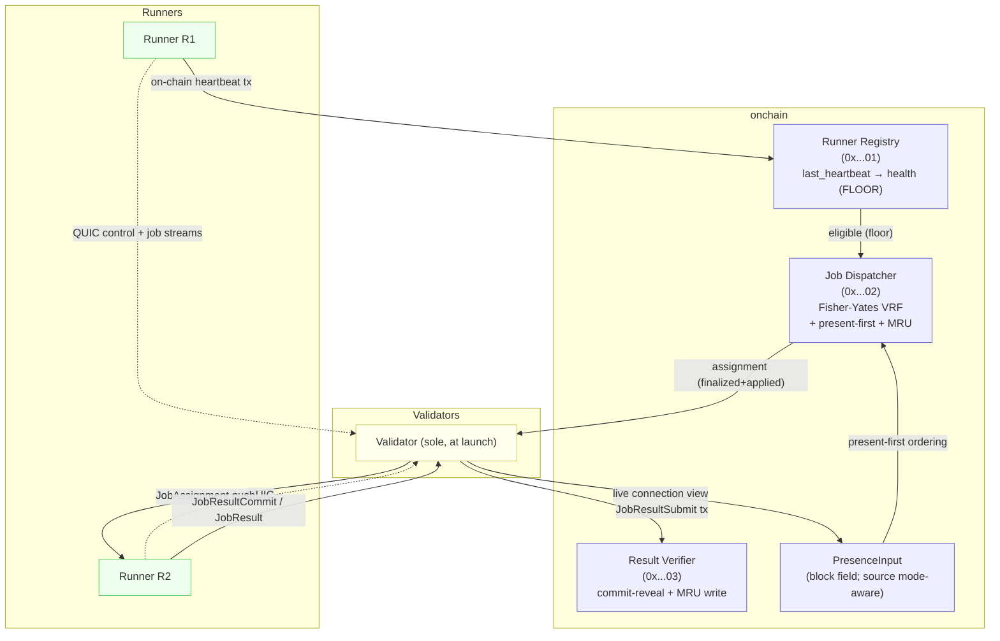

<Note>
  **Status:** Final<br/>
  **Normative-dependency status:** **single-validator launch and a static genesis multi-validator network (Mode B) require no dynamic validator-set reconfiguration.** They do consume the consensus beacon interface for runner-selection seeding (§9.2): `M == 1` jobs select immediately in submission block `S` using the parent beacon `R_{S-1}`, while `M > 1` jobs are recorded in `S` and selected via commit-then-reveal from the seed of an absolute future round `r_seed = advance_round(r_submit, K)` (§9.2). Multi-validator transport/identity checks consume a genesis-anchored `ValidatorSetSnapshot(0)` (§5.4). What **is** gated on a full consensus-layer validator-set-reconfiguration primitive — which **no accepted CIP defines** (it is whitepaper/`commonware`-owned, §5.4/§16) — is **dynamic validator-set changes over time** (`E → E+1`: epoch advance + BLS threshold resharing/DKG emitting new snapshots). **Mode A** additionally requires the §5.4 validator-identity snapshot and Mode-A certificate state/instructions; with a static genesis set it can use `ValidatorSetSnapshot(0)` and does **not** require dynamic reconfiguration. These interfaces are not fully wired into Cowboy execution today; "Final" reflects the design being settled, not that every MUST is immediately implemented (§5.4, §16).<br/>
  **Type:** Standards Track<br/>
  **Category:** Core<br/>
  **Created:** 2026-04-14<br/>
  **Requires:** CIP-2, CIP-13 v2 (`effective_stake` is normative on the VRF / Fisher-Yates weight base used by §9). CIP-11 also consumes two consensus/execution interfaces: (1) execution-readable consensus beacons/seeds for runner-selection seeding (§9.2) — the parent beacon `R_{S-1}` for immediate `M == 1` selection, and verified threshold seeds **by absolute round** (notarization, finalization, **and** nullification certificates) for commit-then-reveal `M > 1` selection (each consumed seed is committed in the assignment block — §9.2 consumed-seed commitment) — and (2) an execution-readable `ValidatorSetSnapshot(epoch)` containing validator Ed25519 peer identities (§5.4). CIP-11 amends CIP-2 §5/§10 for runner-selection seed timing/domain separation (`cowboy-runner-select-v3:`; COW-2200). For a static genesis validator set, `ValidatorSetSnapshot(0)` can be genesis-anchored and does **not** require epoch advancement or BLS threshold resharing. For dynamic validator-set changes over time (`E → E+1`), the consensus integration must additionally expose the validator-set reconfiguration primitive (epoch advancement + BLS threshold resharing/DKG) that emits new snapshots. Consensus, epochs, and the validator-set lifecycle are owned by the technical whitepaper (§"Consensus and Networking", §"Validator Set") and the `commonware` consensus engine — not by any CIP; CIP-11 defines only the execution-readable interfaces it consumes (§5.4).<br/>
</Note>

> **Revision history**
>
> - **r1.3.1 (2026-08-18) — §9.4 caught up with the deployed code (COW-3122).** A distinct revision number rather than a second r1.3: no code moved, but text that was previously unstated is now marked normative (the §9.4 exclusion union, and three determinism details in the CIP-2 §8.1 block), so two documents both called r1.3 would specify different rules with nothing in-band to tell them apart. **Three items.** The first two are drifts in the direction where the spec described a *narrower* rule than the code enforces — the direction that bites at activation, because an implementer following the CIP would build something that pays free-riders and would be right to think they had followed the spec. The third is a status error, not a drift. (1) The write-path consensus-matching set excludes `runners_to_slash` **∪** `runners_unrewarded`, not `runners_to_slash` alone; the union and its reason (an MRU record is a reward, so the test is *did this submission do the work*, not *was it provably dishonest*) are now stated normatively. (2) The implementation-status banner claimed the MRU state did not exist in `node`; it does — key family, accessors, read side and write side — and is dormant behind `MRU_ACTIVATION_HEIGHT = u64::MAX`, so the banner now says *implemented, awaiting a flag day* instead of *not yet implemented*. The parallel CIP-2 §8.1 errata records the same exclusion on aggregator election, and — from the review of this errata — also states the three details that decide whether two implementations elect the SAME aggregator: the ascending sort key with its address tie-break, the integer lower-rank percentile, and the little-endian first-8-seed-bytes index over the sorted sequence. (3) §17's implementation checklist, which the old banner pointed at, is marked up: the five MRU entries — and `ACK_TIMEOUT_BLOCKS`/`PRESENCE_TIMEOUT_BLOCKS`, which ship at the §13 default in the `cip11-transport` crate — are SHIPPED, not pending work; read as a to-do list it would suggest that lowering `MRU_ACTIVATION_HEIGHT` activates unwritten code. The same bullet's `OVERLAP_BLOCKS` claim is corrected in the other direction: that constant has no definition in `node` at all. No behaviour changed in the code; what changed here is which rules the text marks normative.
> - **r1.3 (2026-06-06) — Presence redesigned around what consensus can carry; draft → final.** A pre-finalization feasibility audit against the live node and `commonware-monorepo` sources found the r1.2 mechanism — per-validator presence bitmaps piggybacked on finalization votes and aggregated into a canonical `P(H)` — **cannot be implemented as written** (§2.1): consensus uses **BLS12-381 threshold signatures**, so a finalized block stores a single assembled `Finalization { proposal, certificate }` and individual votes carry no per-validator *application payload* (the whitepaper QC abstraction records at most signer membership, and current `commonware` retains only the recovered threshold certificate; neither carries arbitrary per-validator data); there is **no on-chain validator registry** (validator set hardcoded, `EPOCH = 0`, in consensus config, not execution-readable); and execution receives only `&Block` + receipts, with no access to parent votes. r1.3 keeps presence **load-bearing** but makes it a **mode-aware, consensus-visible `PresenceInput`** read by the dispatcher (§7): under a **single validator** (the launch and initial-mainnet topology) the lone validator's live connection view *is* canonical presence and needs no new consensus primitive; under **multiple validators** the normative path keeps the same proposer-supplied `PresenceInput` (best-effort, fail-open); only an **opt-in hard-exclude Mode A** adds per-validator presence certificates (verified against the live §5.4 validator-set snapshot) carried *separately* from the threshold finalize signature (§8.3). Selection is **present-first, fail-open** (§7.3): presence orders the draw pool and routes push delivery, but the **on-chain heartbeat is an eligibility floor** (resilient to sustained BFT-minority censorship) that presence may never override. The wire format is hardened (app-layer role-scheme identity binding — runner secp256k1 / validator Ed25519 — with TLS-exporter channel binding, `JobResultCommit`, `Goodbye`, explicit signature domains, nonce-echoed `HeartbeatPong`, full `JobAssignment` payload coverage, deterministic MRU winner). A censorship-resistant **hard-exclude mode (A)** is documented for the multi-validator high-security regime; the small-`k` hard-exclude option (C) is rejected (§8.4).
> - **r1.2 (2026-05-26)** — Block-time alignment to 1 s; all `_BLOCKS` constants rescaled ×5 to the canonical 1 s target. *(Presence-vote constants superseded by r1.3; transport/MRU constants retain their 1 s calibration.)*
> - **r1.1 (2026-05-11)** — §9.3 weight base anchored to CIP-13 v2 `effective_stake`; block-time disclaimer (later superseded by r1.2).
> - **v0.2 (2026-04-14)** — canonicalization, MRU, dispatch-outcome review findings.

## 1. Abstract

This proposal replaces the current poll-based runner job retrieval mechanism (CIP-2 §3) with a **push-based delivery layer** built on persistent QUIC connections from runners to a deterministically chosen subset of validators, and makes **real-time runner presence a load-bearing input to selection** so that jobs are routed *first* to runners marked present (reachable and accepting), with fast correction when a selection turns out unreachable (§8, §11).

The existing on-chain runner selection (CIP-2 §4–§5) is preserved unchanged in its core algorithm. CIP-11 adds:

1. A **runtime connectivity layer**: each runner holds long-lived, mutually authenticated QUIC streams to a fixed-size, deterministically assigned subset of validators (§5, §6).
2. A **consensus-visible presence signal** (`PresenceInput`): a deterministic per-block input the on-chain Job Dispatcher reads to draw the runner committee **present-first** (§7). In the normative path it is **proposer-supplied and best-effort/fail-open** in all topologies — the lone validator's live view (§8.1) or an off-chain-gossip aggregate under many (§8.2); an opt-in, governance-gated hard-exclude mode (§8.3) instead derives it from consensus-verified certificates. The dispatcher read-point is identical across modes, so launch upgrades without a dispatcher rewrite.
3. A **push delivery path**: validators with a live stream to a selected runner push the `JobAssignment`; the runner acknowledges, executes, and streams the result back (§10).
4. An **MRU stickiness bias**: the most-recently-successful runner for `(submitter, job_kind)` is favored on the first draw, improving cache locality (§9).

**Presence is load-bearing but fail-open.** Selection draws **present runners first** and routes push to them, but the **eligibility floor is the runner's own on-chain heartbeat** (CIP-2 Part I §4, Runner Registry & Candidate List Construction) — presence may *prioritize and route*, never *exclude* a heartbeat-eligible runner (§7.3). **One carve-out:** for multi-validator **Mode B** jobs with `verification.runners > 1`, committee *membership* is drawn by VRF over the full floor-eligible set (§7.3, §9.2) and presence governs only *delivery routing* — this preserves committee independence (§15.9). This is the deliberate posture for a system that prioritizes end-user experience: a user's job hits a present runner whenever one exists, and the rare false signal only wastes a first attempt that the ack-timeout / fallback path corrects (§7.3, §11).

Key properties:

- **No polling on the hot path.** Dispatch latency drops from `~poll_interval` to *block-inclusion + application + one RTT* (≈1–2 s at 1 s blocks; see §10.1), not literally a single RTT.
- **Prefers active runners whenever presence evidence exists.** Present-first selection plus push delivery makes the common path "selected ⇒ currently connected ⇒ immediate push"; a stale or false presence signal can at worst add a bounded first-attempt latency, and can never fail a job (§7.3).
- **Ships on one validator with a minimal change, upgrades cleanly.** Single-validator presence needs only a `PresenceInput` block field + execution read-point (plus the §9.2 consensus-seed plumbing — `R_{S-1}` for `runners==1`, an absolute future seed round `r_seed` for `runners>1`); multi-validator **Mode B keeps that same committed, proposer-supplied field** (sourced from off-chain validator gossip). A **static genesis multi-validator network needs no dynamic-reconfiguration primitive** — only *changing* the validator set over time does (§5.4) — and only the opt-in **Mode A** swaps the read-point's *source* to consensus-verified certificate state (§8.2–§8.3).
- **No exclusion of eligible runners (default Mode B).** Selection's eligibility floor is canonical chain state (the on-chain heartbeat), which no validator can forge or directly clear (staleness-by-censorship is bounded by proposer rotation — §7.1, §15.2); in Mode B presence only orders within eligible runners, so it cannot make a floor-eligible runner ineligible (§7.3, §15.2) — though a proposer can still deny a specific runner *work* via suppression when the present pool is full (bounded by proposer rotation, §15.9). (Mode A hard-exclude trades this away for strict semantics, §8.3.)
- **Reuses on-chain identity and existing settlement.** Runner identity/stake/capabilities stay in the Runner Registry (`0x0000…0001`); result settlement is the existing CIP-2 commit-reveal path (§10.3).

---

## 2. Motivation

Today, the runner side of CIP-2 is implemented as follows:

1. The Job Dispatcher (`0x0000…0002`) selects M runners on-chain via stake-weighted Fisher-Yates over the registered candidate set and writes each assignment to `runner_jobs_key(addr)`.
2. Each runner separately polls `GET /runner/{addr}/jobs` over plain HTTP every `job_poll_interval_seconds`.
3. When the runner has a result, it POSTs to `/runner/{addr}/job_result` (multi-runner jobs first POST `/runner/{addr}/job_result_commit`). The validator builds the corresponding transaction and forwards it to the mempool.

Concrete problems this creates:

1. **Polling latency is the floor on job start time.** A multi-second poll interval is a large fraction of the budget for short interactive jobs (LLM completions, single MCP calls); driving it lower wastes bandwidth across thousands of runners.
2. **Selection does not consult real-time reachability.** The dispatcher already hard-filters heartbeat-derived health (`registry.rs` marks runners `Unhealthy` once `last_heartbeat` is stale; `dispatcher.rs` selects only `Healthy` runners), but that signal is coarse: a runner that dies between its last heartbeat and selection is still assigned, then times out and re-selects — a multi-block latency spike on every silent failure. **Sharply reducing the user-visible cost of routing a job to a runner that is not actually there is a primary goal of this CIP** (present-first selection plus fast ack-timeout correction, §8); it bounds rather than wholly eliminates that cost.
3. **Heartbeats cost on-chain bandwidth.** ~1,000 runners today (≈5,000 at the §6.6 design target) each posting a periodic heartbeat transaction is real consensus bandwidth.
4. **No path to runner stickiness.** "Most-recently-successful runner for actor A" is a natural cache-locality win that pull-based delivery cannot express.

CIP-11 addresses (1) with push, (2) by making real-time presence a load-bearing, present-first selection input (§7) backed by fast push/ack/timeout correction (§11), and (4) with the MRU bias (§9). It partially addresses (3): because push/ack provides fast liveness, governance MAY widen the heartbeat cadence later (§14 Phase 3); it does not eliminate the heartbeat, which remains the eligibility floor (resilient to sustained BFT-minority censorship, §15.2).

### 2.1 Why presence is a mode-aware artifact, not a vote bitmap

The r1.2 design derived presence from per-validator bitmaps piggybacked on finalization votes — i.e. it tried to *read presence back out of the consensus votes themselves*. A pre-finalization audit found this approach **infeasible**: for one decisive **structural** reason, plus two current-stack gaps that corroborate but are not themselves fundamental. (The code identifiers cited below — `from_finalizes`, `scheme.assemble`, `participants: Set<PublicKey>`, `SYS_VALIDATOR_*`, `apply_finalized_block` — are **non-normative** references to the current node / `commonware-monorepo` sources, given as evidence for the conclusion; they are not normative spec.)

**The decisive, structural reason — threshold-aggregated votes carry no per-validator payload.** Consensus uses BLS12-381 threshold signatures (`commonware_consensus::simplex::scheme::bls12381_threshold`). A finalized block stores `Finalization { proposal, certificate }` — one assembled certificate; `from_finalizes` calls `scheme.assemble(...)`, which recovers a single threshold signature from the individual contributions and discards them. The whitepaper's QC model retains at most a `signer_bitmap` of *which* validators signed (membership); the current `commonware` threshold certificate is narrower still — `assemble` uses signer indices only while recovering, and the output certificate stores just the recovered threshold signature, with no membership bitmap. **Neither representation carries arbitrary per-validator *application payload*** such as a runner-presence observation per validator; the votes have no place to put it. This is inherent to the consensus signature scheme, **not a missing feature**: defeating it would require changing the consensus vote/certificate format itself to retain or separately commit per-validator application payloads. Consensus is owned by the technical whitepaper and `commonware` — there is **no consensus CIP** (§16) — so this is not deliverable as application-layer CIP work. **This reason alone is sufficient.**

**Two further current-stack gaps (corroborating, not fundamental).** The r1.2 read-back path is also unbuilt today:

1. **No execution-readable validator registry.** The validator set is hardcoded (`EPOCH = 0`, no reconfiguration), lives in consensus `Config` (`participants: Set<PublicKey>`), and is not execution-readable; there is no `SYS_VALIDATOR_*` instruction, so the state-transition function cannot today verify a validator-origin attestation.
2. **Execution cannot read parent votes.** `apply_finalized_block` receives `&Block` + receipts; the finalization proof is never threaded into execution.

Unlike the structural reason, both gaps are **buildable, and within CIP-11's scope to consume**: §5.4 defines exactly the execution-readable `ValidatorSetSnapshot(epoch)` the first gap names (trivially `ValidatorSetSnapshot(0)` at static genesis), and the opt-in **Mode A** (§8.3) builds a validator-origin attestation path verified against it. **But building them does not rescue r1.2:** once the per-validator payload is destroyed by aggregation (the structural reason), there is nothing for an execution-readable registry or a threaded finalization proof to attribute. The difference between dead-r1.2 and a working Mode A is precisely that Mode A carries presence evidence *separate from* the aggregated finalize signature, instead of trying to recover it from inside one.

The conclusion is therefore **not** "drop presence" — presence is load-bearing — but "presence evidence must be its own consensus-visible artifact, shaped to what the stack can carry," and that artifact differs by validator-set size:

- **One validator (launch):** there is nothing to aggregate and no Byzantine validator to defend against. The lone validator already observes every runner's connection first-hand; it simply states presence as a block input. No registry, no threshold, no consensus change beyond the input field (§8.1).
- **Many validators:** the normative path keeps proposer-supplied, best-effort presence (no new consensus primitive — it is fail-open, §7.3); validator *identities* come from the live §5.4 `ValidatorSetSnapshot`. Only the **opt-in hard-exclude Mode A** carries per-validator evidence *separate from* the threshold finalize signature, verified against that same snapshot (no separate Mode-A registry); its certificate machinery is governance-gated (§8.3). That evidence path is a real consensus-visible addition, scoped to Mode A and enabled only by governance.

---

## 3. Definitions, Notation, and Conventions

### 3.1 Requirements language

The key words **MUST, MUST NOT, REQUIRED, SHALL, SHALL NOT, SHOULD, SHOULD NOT, MAY, OPTIONAL** are to be interpreted as described in RFC 2119 and RFC 8174 when, and only when, they appear in all capitals. Lowercase uses carry their ordinary English meaning. Unless a requirement is explicitly scoped to a narrower topology, mode, or migration phase, normative requirements apply in every topology/mode in which the referenced component is active. Where presence-selection behavior differs by posture, unqualified presence-selection text describes **Mode B**, the default posture; **Mode A** requirements are explicitly marked (§8.3–§8.4).

### 3.2 Notation

- `H` — a block height; `H−1` its parent, `H+1` its child; `current_block_height` is the height being executed.
- `E`, `E+1` — consecutive active validator-set snapshot epochs; `subset_epoch` is the active `ValidatorSetSnapshot.epoch` value (§5.3–§5.4), **not** a separate per-consensus-epoch tick.
- `V` — the active validator set (snapshot, §5.4); `n = |V|`; `f` — the BFT fault bound (`f < n/3`).
- `R` — a runner; `|R|` — the number of registered runners.
- `Sub(R)` / `Sub_E(R)` — runner `R`'s connectivity subset (in epoch `E`); `k = |Sub(R)|`.
- `M` — the committee size for a job (`= job_spec.verification.runners`); `i` — the zero-based weighted-draw iteration (§9.2).
- `S` — a job's **submission block** height; for `M > 1`, the committee is assigned at a later pending-selection pass once the absolute seed round `r_seed` is readable (§9.2).
- `Round(e, v)` — the consensus round identified by `commonware` `Seed.round = (epoch, view)`. A block height is **not** a round: a block at height `S` is proposed in one absolute round and can be certified/finalized in a later absolute round. Runner-selection randomness MUST name the absolute `Round(e, v)` whose seed is consumed (§9.2).
- `R_X` — a consensus threshold-VRF beacon/seed for round/anchor `X` (e.g. parent beacon `R_{S-1}`, absolute seed round `r_seed`); see `canonical_seed_bytes` (§9.2).
- `multi_validator` — the predicate `n = |V| > 1` (more than one active validator in the §5.4 snapshot); distinguishes the multi-validator security paths from the single-validator launch case (`f = 0`).
- `‖` — byte concatenation; `keccak256(...)` — the Keccak-256 hash.
- **load-bearing** — a value that deterministically affects dispatcher output (the selected committee or its ordering) and is therefore committed to the block's execution identity; contrast a best-effort *hint*.

### 3.3 Defined terms

- **Connectivity Subset** (`Sub(R)`): The deterministic, fixed-size set of validators runner `R` maintains QUIC connections to, computed off-chain from the active validator-set snapshot (§5). Bounds connection fan-out; under one validator it is that validator.
- **Selection Liveness Floor** (a.k.a. the **eligibility floor**, the **on-chain heartbeat floor**, or just **floor**): The on-chain heartbeat-derived eligibility gate the dispatcher applies: a candidate is eligible iff `HealthStatus::Healthy` and `current_block_height − last_heartbeat ≤ HEARTBEAT_TIMEOUT_BLOCKS`. Canonical and runner-self-attested. In **Mode B** it is the *sole* eligibility gate — presence can never make an ineligible runner eligible, nor exclude a floor-eligible one. In **Mode A** (§8.3–§8.4) presence is an *additional* gate on top of the floor (a runner must pass the floor **and** be present). (§7.1, §7.3)
- **Selection posture — Mode B (normative) and Mode A (opt-in)**: The two postures for how `PresenceInput` affects *selection*. **Mode B** is the default, normative in all topologies (§7.3, §8.2): presence is *present-first* and *fail-open* — it orders the draw and routes delivery but never removes a floor-eligible runner. **Mode A** is the opt-in **hard-exclude** posture, governance-gated by `PRESENCE_HARD_EXCLUDE_ENABLED` (§8.3 machinery, §8.4 rationale): presence is a strict gate — a runner not proven present is *not selectable* — and is sound only with honest-majority subsets (large `k`). Unless stated otherwise, the spec describes Mode B.
- **Present-first selection**: Drawing the committee from the present pool first, falling back to the fallback pool only once the present pool is exhausted (§7.3, §9.2). It *orders* selection; it never excludes a floor-eligible runner. In multi-validator Mode B it does **not** determine *membership* for `runners > 1` independence-verification jobs (the membership-steering bound, §7.3/§15.9).
- **Fail-open**: The property (Mode B) that a missing, stale, malformed, or even adversarially-false `PresenceInput` can never fail a job or exclude a floor-eligible runner — at worst it wastes one delivery attempt (caught within `ACK_TIMEOUT_BLOCKS`) or de-prioritizes a runner into the fallback pool (§7.3). The opposite of the fail-closed / hard-exclude behavior of Mode A.
- **Best-effort (presence)**: In Mode B, `PresenceInput` is a non-authoritative routing/ordering *hint*, not a Byzantine-verified fact; its only failure modes are bounded and self-healing (§8.2, §15.2). Authoritative eligibility is the Selection Liveness Floor, not presence.
- **`PresenceInput`**: The deterministic, consensus-visible per-block artifact the Job Dispatcher reads to identify currently-present runners (a bitmap/index set over the Runner Registry). Same execution read-point in all modes; its *source* and *validation* are mode-aware (§7.2, §8).
- **Present pool / fallback pool**: At selection, the present pool is the set of eligible candidates marked present by `PresenceInput`; the fallback pool is the remaining eligible candidates. Selection draws present-first, falling back only as needed (§7.3).
- **Local Presence**: A single validator's off-chain, per-connection view of which runners it currently has a healthy QUIC control stream to. Used to route *its own* push delivery; it is also the source of that validator's contribution to `PresenceInput` (§7.4).
- **Consensus-Verified Presence State** (Mode A only): `presence_proven_until[runner]`, maintained on-chain by verified runner-submitted presence certificates (§8.3); the source of `PresenceInput` only when the opt-in hard-exclude Mode A is enabled.
- **Push Dispatch**: A validator opening a QUIC stream to a runner and writing a `JobAssignment`, replacing the poll (§10).
- **MRU Weight Multiplier**: A deterministic iteration-0 weight bump for the most-recently-successful runner for `(submitter, job_kind)` (§9.3).
- **Dispatch Outcome**: `Success | Duplicate | SoftFailure | HardFailure` — a validator's classification of a push attempt (§10.6).
- **Runner identity**: a runner's registered `Address` in `RunnerRegistration` (20-byte secp256k1/EVM address; live field owner `node/runner/src/types.rs`). `RunnerRegistration` does **not** store a secp256k1 public key; runner-originated CIP-11 frames carry a scheme-tagged compressed secp256k1 `PubKey` and/or a recoverable secp256k1 signature, and verifiers MUST derive/recover the EVM address and require it to equal `RunnerRegistration.address`. This address is the runner's economic identity and the authority for runner-originated control-plane frames.
- **Validator peer identity**: the **Ed25519** `commonware` identity key a validator uses for network peer identification **and** to sign validator-originated CIP-11 control-plane frames — asymmetric to the runner's secp256k1 identity. The BLS12-381 **threshold** key is consensus-only (notarization) and is **never** used for control-plane signatures (§2.1, §12.6).
- **Scheme-tagged key / role-scheme signature**: public-key and signature fields are interpreted by the signer's role — **runner → secp256k1** (33-byte key, 65-byte recoverable ECDSA sig); **validator → Ed25519** (32-byte key, 64-byte sig). Keys carry a 1-byte scheme tag and signed preimages include `role` + `scheme`; verifiers MUST reject any role/scheme/length/source mismatch (§12.6). **Two key types appear in this spec:** `PubKey` is the **wire** type — a scheme-tagged key (`scheme_id ‖ key_bytes`; 34 B secp256k1 / 33 B Ed25519) used in CIP-11 frames and receipts (§12.6); `PublicKey` is the **raw** `commonware` Ed25519 key type used for authoritative §5.4 snapshot state (`ValidatorRecord.peer_pubkey`). A **validator** wire `PubKey` MUST decode (after scheme validation and tag-strip) to the authoritative raw `ValidatorRecord.peer_pubkey`; a **runner** wire `PubKey` MUST be valid secp256k1 key material whose derived EVM address equals the authoritative `RunnerRegistration.address`.
- **`validator_set_hash`**: `keccak256` over the active §5.4 `ValidatorSetSnapshot`'s ordered validator **identities** (`peer_pubkey` per `ValidatorRecord`, excluding the mutable `stake`) — at launch, the genesis single-validator snapshot. Identifies the shared validator-set configuration (§5.1, §5.4, §6.2).
- **Proposer**: The validator that authors the current block. Under one validator it is always that validator; in Mode B it supplies `PresenceInput` in the block it proposes (§8.1–§8.2).
- **Committee**: The set of `M = job_spec.verification.runners` runners the Job Dispatcher selects for a job (§9.2).
- **On-chain system actors**: the **Runner Registry** (`0x0000…0001`) — stores runner identity, stake, `RunnerCapabilities`, `HealthStatus`, and `last_heartbeat` (live field owner: `node/runner/src/types.rs`; state transitions in `node/execution/src/runner/registry.rs`); the **Job Dispatcher** (`0x0000…0002`) — runs selection and writes assignments and `mru_key`; the **Result Verifier** (`0x0000…0003`) — processes commit/reveal, finalizes results, and produces/consumes `VerifiedResult.runners_to_slash`. CIP-2 introduces these actors and selection concepts; CIP-11 extends their behavior but adds no new actor in the normative path.
- **`subset_epoch`**: The `epoch` value of the active `ValidatorSetSnapshot(epoch)` consumed by CIP-11. It is **not** a separate CIP-11 counter and does **not** advance on every consensus epoch tick; it changes only when consensus emits a new CIP-11-visible validator-identity snapshot whose canonical ordered `peer_pubkey` list changes (§5.4). It selects which snapshot `Sub(R)` / `validator_set_hash` are computed against (§5.3–§5.4).
- **`mru_key` / `MruRecord`**: Job Dispatcher state mapping `(submitter, job_kind) → MruRecord { runner_address, set_at_block }` — the most-recently-successful runner used for the §9.3 iteration-0 weight bump (§9.4).
- **`presence_anchor`** (Mode A): per-runner state holding the observation height of the newest accepted presence certificate; the strictly-monotonic anchor that bounds receipt replay (§8.3).
- **CIP-11 wire frames**: the runner↔validator QUIC messages defined in §6 and §10 and tabulated in §12.2. `HeartbeatPing` / `HeartbeatPong` are the **QUIC-layer** liveness frames — distinct from the **on-chain** heartbeat that drives the floor (§7.1).
- **`channel_binding` / `connection_id`**: `channel_binding` is the TLS-Exporter value that binds application-layer role-scheme identity proofs (runner secp256k1 / validator Ed25519) to a specific QUIC/TLS channel (§6.2); `connection_id = keccak256(...)` is the per-connection identifier derived from it plus the peer identities and epoch (§12.6). Both appear in frame signature preimages and are the reason `HeartbeatPong` is not chain-verifiable (§8.3).
- **Reconfiguration & Mode-A objects** (defined where introduced, listed here for discoverability): `ValidatorSetSnapshot` / `ValidatorSetActivated` — the consensus interface CIP-11 consumes (§5.4); `ValidatorRecord` — a snapshot entry (§8.3); `PresenceReceipt` and the `SubmitPresenceCertificate` system instruction — Mode-A presence evidence (§8.3); `OverlapExpired` — a `GoodbyeReason` for reconfiguration teardown (§5.3, §12.5).
- **Imported terms** (defined in other CIPs; used here normatively):
  - `RunnerRegistration`, `RunnerCapabilities`, `HealthStatus` (`Healthy` / `Unhealthy` / `Paused` / `Deregistered`), and `last_heartbeat` — live Runner Registry record and fields (`node/runner/src/types.rs`; heartbeat/state transitions in `node/execution/src/runner/registry.rs`). CIP-2 §4 owns the health-filter concept; CIP-11 consumes it as the floor (§7.1).
  - `JobSpec`, `JobType`, `VerificationMode` (`None`, `EconomicBond`, `MajorityVote`, `StructuredMatch`, `Deterministic`, `SemanticSimilarity`) — job/verification shapes (CIP-2); `JobSpec.verification.runners = M`.
  - `runners_to_slash` — `VerifiedResult.runners_to_slash`, produced by the Result Verifier for minority/mismatch runners and consumed by verifier/aggregator code to exclude dissenters from consensus-matching completion/bonus selection (`node/runner/src/types.rs`, `node/execution/src/runner/verifier.rs`, `node/execution/src/runner/aggregator.rs`); not a CIP-2-defined type.
  - `effective_stake = registration.stake + delegation_totals.total_active` — VRF weight base (CIP-13 v2 §3.2; mirrored by CIP-2 concentration math).
  - `CapabilityKey` (CIP-11-local string key for advisory capability deltas using the runtime `RunnerCapabilities` / dispatcher-filter namespace) and `EntitlementId` (`[u8; 32]`; CIP-2 / `node/types/src/entitlement.rs`) — runner advisory capability and pool/entitlement identifiers. Storage and secret capability semantics remain owned by CIP-9/CIP-24.
  - Fisher-Yates VRF selection, commit-reveal settlement, timeout-based re-selection — the CIP-2 §4–§6 mechanisms CIP-11 extends.
  - `keccak256`, `secp256k1` (ECDSA with `ecrecover`), QUIC (RFC 9000), TLS 1.3 (RFC 8446) and its TLS-Exporter — standard primitives used across Cowboy.
  - `Address` — a Cowboy chain account address; `PublicKey` — the `commonware` Ed25519 consensus/peer participant key type (the validator peer identity above). Runner wire public keys are secp256k1 `PubKey`s authenticated by derived-address equality against `RunnerRegistration.address`.
  - Frame codec — CIP-11 runner↔validator wire frames are QUIC application frames with the envelope defined in §12.1. The payload CBOR canonicalization authority is CIP-11's **deterministic CBOR profile** (§12.6), **not** `commonware-p2p` or `commonware-codec` (commonware-p2p carries no CBOR). `commonware-codec` is relevant only where a field explicitly names an existing codec-owned object, e.g. `tx_bytes = Transaction::write(...)` (§10.3).
  - `SystemInstruction::{RunnerHeartbeat, JobSubmit, JobResultSubmit, JobResultCommit, JobCancel}` — live node system-instruction variants (`node/types/src/execution.rs`); `SubmitPresenceCertificate` is the new Mode-A system instruction this CIP specifies, to be added to the same namespace when Mode A is implemented.
  - `Transaction::payload_bytes(...)` — the node transaction signing preimage builder (`node/types/src/execution.rs`); includes `nonce`, `instruction`, cycles/cells limits, max-fee and priority-fee fields, and signer addresses. CIP-11 result and heartbeat transaction replay protection relies on this ordinary transaction signature/nonce path unless this CIP explicitly defines a separate application-frame nonce.
  - `execution_hash()` / `extra_data` — block identity fields/functions (`node/types/src/execution.rs`). Because `PresenceInput` is load-bearing it MUST be committed in the execution identity / block digest, not carried only in `extra_data`.
  - `selection_reputation_x1e9(runner.reputation, ReputationConfig_at(H), H)` — the live dispatcher reputation normalizer used by the CIP-2 v3 selection weight (`node/execution/src/runner/dispatcher.rs`); `ReputationConfig` is the governance-updatable config type (`node/types/src/execution.rs`).

---

## 4. Design Overview

### 4.1 Architecture



### 4.2 Lifecycle

1. **Bootstrap.** Runner reads the configured validator set, computes `validator_set_hash` and `Sub(R)` (§5), and opens a long-lived QUIC connection to each validator in `Sub(R)` (the sole validator, at launch).
2. **Handshake.** Mutually authenticated, channel-bound, pubkey-bound handshake on each connection (§6.2).
3. **Heartbeat (two layers).** On the QUIC control stream the runner **MUST** emit `HeartbeatPing` at least once every `HEARTBEAT_BLOCKS` (default: once per block); the validator **MUST** update per-connection liveness and local presence for each valid Ping, subject to the backpressure omission rule (§6.4). Independently, the runner submits the **on-chain** heartbeat that maintains its canonical `last_heartbeat`/health — the eligibility floor (§7.1).
4. **Presence input.** The dispatcher reads a `PresenceInput` identifying currently-present runners (§7.2); in the normative path its source is the proposer's view carried in the block — the lone validator's live connections (§8.1) or an off-chain-gossip aggregate under many (§8.2). The opt-in hard-exclude Mode A (§8.3) instead derives it from consensus-verified certificate state.
5. **Selection.** The Job Dispatcher filters by the eligibility floor (§7.1), then runs the normative weighted VRF draw **present-first** using `PresenceInput`, with the MRU iteration-0 bias (§9). `runners == 1` jobs select immediately in the submission block `S` from the parent beacon `R_{S-1}`; `runners > 1` jobs record a pending selection in `S` and are assigned only at the pending-selection pass once block `S` is finalized/applied, the seed for the absolute future round `r_seed` is readable, and the committed candidates-snapshot root verifies (commit-then-reveal, §9.2). Present-first is subject to the §7.3 **membership-steering bound**: in multi-validator Mode B, `runners > 1` committee membership is drawn by VRF over the **full** floor-eligible set and presence is delivery-only. Presence never excludes a floor-eligible runner (§7.3).
6. **Push dispatch (after finalization & application).** Once the assignment block is finalized and applied, validators holding a live stream to the selected runner push a fully-covered, signed `JobAssignment` (§10.1); the runner dedupes and verifies before executing.
7. **Result.** Runner streams the existing commit/reveal material back (§10.3); the validator forwards the existing CIP-2 transaction(s); settlement is unchanged.
8. **MRU update.** The Result Verifier deterministically picks the winning runner and updates `mru_key` (§9.4).
9. **Re-selection.** If no result by the per-job timeout, the existing CIP-2 §6 timeout re-selection runs (§11.2).

### 4.3 Relationship to Existing CIPs

- **CIP-2.** CIP-11 strictly extends CIP-2: candidate list, Fisher-Yates VRF, commit-reveal verification, and timeout re-selection are preserved. Push replaces polling on the hot path; the poll endpoint is retained as a delivery-only fallback (§14). The on-chain heartbeat health gate becomes the codified eligibility floor (§7.1).
- **CIP-9.** Push reduces cold-start before CBFS reads; MRU bias improves read-cache hit rates.
- **CIP-10.** Lower job-start latency reduces idle container cost; base images SHOULD ship the CIP-11 client transport.
- **CIP-13.** Delegated stake is opaque to CIP-11; CIP-13 supplies the `effective_stake` stake term consumed by the **CIP-2 v3** VRF weight (§9.3).

---

## 5. Connectivity Subset Assignment

Each runner connects to a deterministic subset of the active validator set (the sole validator, at launch). The validator **identities** come from the consensus-provided validator-set snapshot (§5.4). **In the normative path (Mode B, all topologies) the subset itself is an off-chain transport-routing and DoS-bounding rule** with no on-chain state; only the opt-in hard-exclude Mode A (§8.3) makes subset *membership* execution-checked (certificate verification requires each receipt's validator to be in `Sub(runner)`). All participants compute the subset from the same snapshot, so they agree without coordination.

### 5.1 Subset Function

Let `V = [v_1, ..., v_n]` be the active validator-set snapshot's participants (§5.4), ordered canonically, and `R.auth_pubkey` the runner's **address-authenticated** compressed secp256k1 public key. `validator_set_hash = keccak256` over the snapshot's ordered validator **identities** (`peer_pubkey` per `ValidatorRecord`; excluding the mutable `stake` — §8.3). `R.auth_pubkey` is **not stored** in `RunnerRegistration`; it is accepted only when the secp256k1 key is valid and its derived EVM address equals `RunnerRegistration.address`. `v.peer_pubkey` is the validator's Ed25519 peer identity from its `ValidatorRecord` (§8.3). The subset is keyed on those:

```
Sub(R) = first k validators in sort_by(v ∈ V, key = keccak256(R.auth_pubkey ‖ v.peer_pubkey))
k      = min(|V|, clamp(ceil(log2(|V|)) + 1, MIN_SUBSET, MAX_SUBSET))
```

Defaults `MIN_SUBSET = 3`, `MAX_SUBSET = 8`. The outer `min(|V|, …)` ensures the subset can never exceed the validator set, so no separate small-`|V|` exception is needed: `|V| = 1` (launch) ⇒ `k = 1` (the sole validator for every runner); `|V| = 2 ⇒ k = 2`. Above the floor the clamp governs: `|V| ∈ [5,8] ⇒ k = 4`, `|V| ∈ [9,16] ⇒ k = 5`, saturating at `MAX_SUBSET = 8` for large `|V|` (e.g. `|V| = 100 ⇒ k = 8`). (Larger `k` is required only for the high-security hard-exclude Mode A — §8.3.)

### 5.2 Properties

- **Stable under runner churn.** A new runner's subset is independent of others'.
- **Load-balanced in expectation.** Each validator handles `|R|·k/|V|` connections in expectation.
- **Validator-side DoS gate.** A validator MUST reject connections from a runner not in that runner's expected `Sub(R)` for the validator's own identity — a purely local check bounding Sybil storms to `k` connections per registered identity (§15.1).

### 5.3 Subset Epochs and Reconfiguration

`Sub(R)` is computed from the **active validator-set snapshot** for the current `subset_epoch` (§5.4). `subset_epoch` is constant within an epoch and increments **only** on a consensus validator-set change — never per block or per runner-registry mutation — so `Sub(R)` and `validator_set_hash` are stable for an epoch's life and connections do not thrash.

**Single validator (launch).** The snapshot is the degenerate epoch-0 set of size 1: `subset_epoch = 0`, `validator_set_hash` constant, `Sub(R)` = the sole validator. No rotation occurs; the rules below are inert until a second epoch exists.

**Reconfiguration (epoch `E → E+1`).** When consensus signals `ValidatorSetActivated(E+1, activation_height)` (§5.4), every node recomputes `Sub_{E+1}(R)` and `validator_set_hash(E+1)` from the new snapshot. To avoid a presence/delivery gap at the boundary, an `OVERLAP_BLOCKS` window (default 160, §13) runs from `activation_height`:

1. **Connections.** Runners MUST open connections to `Sub_{E+1}(R)` while keeping `Sub_E(R)` open — i.e. maintain the **union** `Sub_E(R) ∪ Sub_{E+1}(R)` for the window — then drop epoch-`E`-only validators.
2. **Admission (§6.2) — epoch-paired, never cross-product.** A connection is valid iff `(offered hash == validator_set_hash(E)` **and** this validator ∈ `Sub_E(runner))` **OR** `(offered hash == validator_set_hash(E+1)` **and** this validator ∈ `Sub_{E+1}(runner))`. The offered `(subset_epoch, validator_set_hash)` selects exactly one snapshot; the validator's `peer_pubkey` and its subset membership MUST both resolve in *that same* snapshot. The union `Sub_E(R) ∪ Sub_{E+1}(R)` is merely the set of *simultaneously-valid* connections — it is **never** a license to mix epoch-`E`'s hash with epoch-`E+1` membership (which would break the `connection_id` / `HelloAck` identity binding). The runner applies the same epoch-paired rule when verifying the validator.
3. **Routing & presence.** A validator routes/attests for a runner only over an epoch-paired-valid connection (point 2); in Mode A, a `PresenceReceipt` counts only if its own `(subset_epoch, validator_set_hash)` is epoch `E` or `E+1` **and** the signing validator is in `Sub_epoch(runner)` (where `epoch` is `E` or `E+1` as selected by the offered `(subset_epoch, validator_set_hash)`) (§8.3).
4. **After the window** (at block `activation_height + OVERLAP_BLOCKS`, a height-tied cutoff identical for all nodes — no grace period): only `Sub_{E+1}(R)`, `validator_set_hash(E+1)`, and epoch-`E+1` receipts are valid. Either side MAY initiate closing an epoch-`E`-only connection (one whose validator is not in `Sub_{E+1}(R)`) with `Goodbye { reason: OverlapExpired }` (§12.5); the peer abandons in-flight work on that stream (it drains via §11.5) and MUST NOT reconnect under the epoch-`E` hash — a `Hello` offering `validator_set_hash(E)` past the cutoff is rejected at §6.2 admission.

**When** a new snapshot is emitted — at consensus epoch boundaries (the technical whitepaper fixes epochs and places validator-set updates at epoch boundaries) — is owned by the **consensus integration** (§5.4 `Requires`), **not** by CIP-11. CIP-11 defines no snapshot-emission cadence or churn threshold of its own; its transport only **reacts** to an emitted `ValidatorSetActivated`, and it never independently advances `subset_epoch` (which therefore tracks *actual* validator-set changes, not a fixed block cadence). In-flight jobs that cross the boundary drain per §11.5.

### 5.4 Validator-Set Snapshot (Consensus Interface)

CIP-11 does **not** define validator-set reconfiguration itself — agreeing the next validator set, BLS threshold-key resharing/DKG, and epoch advancement are consensus-layer concerns (see `Requires`). CIP-11 instead **consumes** a consensus-provided, execution-readable primitive:

```
ValidatorSetSnapshot(epoch) {
  epoch:             u64,
  participants:      [ ValidatorRecord ],   // canonically ordered by peer_pubkey (§8.3)
  activation_height: u64,                    // block at which this epoch's set becomes active
}
// event observable by nodes and execution:
ValidatorSetActivated(epoch, activation_height)
```

Snapshot retirement is derived from the successor `ValidatorSetActivated` event plus the `OVERLAP_BLOCKS` reaction window (§5.3); CIP-11 does not consume a separate `retirement_height` field. The field names above are CIP-11's **proposed consumption contract**; a future consensus integration that emits this interface must match them (or CIP-11 adapts to the consensus-side names).

For every block, CIP-11 `subset_epoch` MUST equal the `epoch` field of the active `ValidatorSetSnapshot`. A consensus epoch advance that does **not** change the canonical ordered validator peer-identity list MUST NOT emit a CIP-11 `ValidatorSetActivated`, MUST NOT change `subset_epoch`, and MUST NOT change `validator_set_hash`. Pure stake changes, threshold-key resharing with the same peer-identity set, or other consensus metadata changes are not CIP-11 subset reconfigurations unless the ordered `peer_pubkey` list changes.

Each `ValidatorRecord` carries `{ peer_pubkey, stake }` (§8.3), where `peer_pubkey` is the validator's Ed25519 commonware peer identity (§3) and `stake` is not consumed by any CIP-11 rule (carried for consensus / other-CIP use); `validator_set_hash(epoch)` is `keccak256` over the epoch's ordered `peer_pubkey`s (excluding `stake`). This snapshot is everything CIP-11 needs to recompute `Sub(R)`, `validator_set_hash`, QUIC admission, and overlap behavior, and (Mode A) to verify validator control-plane signatures. The consensus side additionally owns the ordered participants, the group polynomial, local share delivery, and threshold-identity continuity across the reshare — none of which CIP-11 specifies.

**Dependency status (normative).** Separate the validator-identity snapshot from dynamic reconfiguration:

- **Validator identity snapshot:** CIP-11 needs execution to read a canonical list of validator identities (`ValidatorSetSnapshot(epoch)` with ordered Ed25519 `peer_pubkey`s). Static genesis topologies need only `ValidatorSetSnapshot(0)`, derived from the fixed genesis/commonware participant configuration. This is required for multi-validator `Sub(R)`, `validator_set_hash`, QUIC admission, `JobAssignment.validator_pubkey` verification, and Mode-A receipt verification. It is not the dynamic reconfiguration primitive, but it is not exposed as execution state in Cowboy today.
- **Dynamic validator-set reconfiguration:** changing the set over time (`E → E+1`) is separately gated on the consensus reconfiguration primitive named in `Requires` (epoch advancement + BLS threshold resharing/DKG emitting `ValidatorSetSnapshot` / `ValidatorSetActivated`). Cowboy currently runs at epoch 0 and does not consume this primitive.

Static Mode B is implementable without the identity snapshot being on-chain because the proposer-supplied `PresenceInput` is fail-open and selection does not verify validator-origin presence certificates. Static Mode A requires the identity snapshot plus Mode-A certificate state/instructions, but it does not require dynamic epoch advancement or resharing unless the validator set changes.

CIP-11's connectivity behavior for reconfiguration is **fully specified** (§5.3, §6.2, §8.3, §11.5) and activates automatically once snapshots advance past epoch 0 — there is no further CIP-11-side work to define.

---

## 6. The QUIC Connection Layer

### 6.1 Transport

QUIC (RFC 9000) with TLS 1.3; reference impl MAY use `quinn`. Each connection carries one **control stream** (bidirectional, id 0) for the connection lifetime and zero or more validator-initiated **job streams** (one per assignment). QUIC connection migration absorbs network changes without re-handshake.

### 6.2 Handshake and Authentication

TLS 1.3 provides encryption/integrity; certificates MAY be self-signed and use any algorithm the stack supports. **The TLS certificate key is not the CIP-11 identity.** Identity is proven at the application layer by each party's **role key** — the runner's secp256k1 key, the validator's Ed25519 peer key (§3) — signing a CIP-11 control-plane transcript bound to the TLS channel (the signatures are application/control-plane proofs carried over QUIC, not the QUIC/TLS handshake itself):

```
channel_binding = TLS-Exporter("cowboy-cip11-handshake-v1", "", 32)
```

Implementations MUST verify, under the chosen QUIC/TLS stack (`quinn`/`rustls`, RFC 8446 §7.5 exporters), that `channel_binding` bytes are connection-specific, stable only within the authenticated session, and unavailable to a TLS-terminating proxy, **before** relying on the §6.2 MITM/proxy-replay resistance. A stack that cannot provide exporter bytes with those properties is not conforming for CIP-11 mutual authentication.

Both sides exchange `Hello`, then `HelloAck`:

```
Hello {
  version: u16, chain_id: u64,
  validator_set_hash: [u8; 32], subset_epoch: u64,   // §5; subset_epoch v1 = 0
  party_pubkey: PubKey, party_role: Role,            // scheme-tagged wire PubKey (§12.6): Runner→secp256k1 (34B: tag+33B key), Validator→Ed25519 (33B: tag+32B key)
  block_height: u64, challenge_nonce: [u8; 32],
}
HelloAck {
  version: u16, chain_id: u64,
  validator_set_hash: [u8; 32], subset_epoch: u64,
  party_pubkey: PubKey, party_role: Role, block_height: u64,
  signed_challenge: Sig,                               // role-scheme sig (§12.6): Runner→secp256k1 65B, Validator→Ed25519 64B; over §12.6 HelloAck preimage
}

enum Role { Runner, Validator }
```

`HelloAck.signed_challenge` signs the peer's `challenge_nonce` together with `chain_id`, `version`, both roles, both pubkeys, `subset_epoch`, `validator_set_hash`, and `channel_binding` (§12.6), binding the on-chain identity to this specific channel and preventing MITM/proxy replay.

Admission: the runner `party_pubkey` MUST be a valid secp256k1 wire `PubKey` whose derived EVM address resolves to a `RunnerRegistration` with `health != Deregistered`; the validator MUST verify its own identity is in `Sub(runner.auth_pubkey)` for the shared `validator_set_hash`; the runner MUST verify the validator pubkey is in the active validator-set snapshot (§5.4). A `chain_id` mismatch is fatal (`Goodbye`, §12.5). For `validator_set_hash`: outside a reconfiguration overlap, a mismatch is fatal; **during an `OVERLAP_BLOCKS` window (§5.3)** admission is **epoch-paired** — the offered `(subset_epoch, validator_set_hash)` MUST select exactly one snapshot (epoch `E` or `E+1`), this validator's `peer_pubkey` MUST resolve in that snapshot, and this validator MUST be in `Sub_epoch(runner)` (where `epoch` is `E` or `E+1` as selected by the offered `(subset_epoch, validator_set_hash)`). Mixing one epoch's hash with the other epoch's membership is rejected. **Both proofs MUST verify before admission**; before that, a validator MUST NOT apply DoS accounting, record local presence, or push jobs. Validators MUST rate-limit unauthenticated `Hello` per peer.

`Hello.block_height` and `HelloAck.block_height` are **advisory** telemetry for debugging, progress display, and stale-peer heuristics only. They are **not** part of the `HelloAck` signed preimage (§12.6), do not define receipt or assignment freshness, and MUST NOT be used as an admission, rejection, or slashing criterion. Freshness for signed objects MUST use the object-specific signed heights/windows (`PresenceReceipt.block_height`, `assignment_height`, `deadline_block`).

**Validator key custody (normative, all modes).** The validator Ed25519 private key corresponding to `ValidatorSetSnapshot.peer_pubkey` is a validator-node control-plane signing key. It MUST remain inside the validator-node signing boundary and MUST NOT be exported to runner-facing helpers, relay processes, presence-gossip aggregators, or sidecars. In this revision every validator-originated CIP-11 application signature (`HelloAck`, `HeartbeatPong`, `PresenceReceipt`, `JobAssignment`, `JobCancel`, authenticated `Goodbye`) is verified against that snapshotted `peer_pubkey`. A future delegated control key is valid only if the delegation is itself execution-readable and epoch-bound: the active/overlap validator snapshot, or a consensus-owned authorization attached to it, MUST bind the delegated key to `(subset_epoch, validator_set_hash, peer_pubkey)` before nodes or execution accept signatures under it. This custody rule is global, not Mode-A-specific.

### 6.3 Heartbeats

```
HeartbeatPing  { block_height: u64, nonce: u64, signed: [u8; 65] }            // R→V; secp256k1 over §12.6 preimage
HeartbeatPong  { block_height: u64, nonce_echo: u64, accepting_new: bool, validator_signed: [u8; 64] } // V→R; accepting_new = validator's current view of runner capacity; Ed25519 over §12.6 preimage
```

The runner **MUST** send `HeartbeatPing` at least once every `HEARTBEAT_BLOCKS` (default 1) on a new block height. On each valid Ping the validator **MUST** update the runner's per-connection liveness state and **MUST** record/refresh the runner in **local presence** (§7.4) — unless §6.4 currently requires omitting it because the runner is not accepting new work; a runner silent for `PRESENCE_TIMEOUT_BLOCKS` (default 15) is dropped from that validator's local presence. The Ping `nonce` MUST be strictly increasing within a single connection (`nonce[i+1] > nonce[i]`); the runner MUST reject a `HeartbeatPong` whose `nonce_echo` does not equal the most-recent outstanding Ping's `nonce`, and the validator MUST sign `nonce_echo` (anti-replay). The nonce is **per-connection**: on a new connection (initial handshake or reconnect) it restarts at `0`. Because every `HeartbeatPing` signature is bound to `connection_id` (§12.6), which includes the fresh per-connection `channel_binding`, a Ping from one connection cannot be replayed on another even after the counter resets; a validator that loses nonce state on restart simply re-learns it from the next Ping on the new connection. Mode A uses a **separate, chain-verifiable** `PresenceReceipt` (§8.3), not this channel-bound `HeartbeatPong` — the `HeartbeatPong` signs over `connection_id` (TLS channel binding) which the state transition cannot reconstruct.

> The QUIC heartbeat feeds **local presence** (and, in multi-validator mode, presence evidence). The **eligibility floor** used by selection is the separate **on-chain** heartbeat (§7.1).

### 6.4 Backpressure

```
BackpressureSignal { block_height: u64, active_jobs: u32, max_concurrent: u32, accepting_new: bool, reason: Option<String>, signed: [u8; 65] } // R→V; secp256k1 over §12.6 preimage
```

When `accepting_new = false`, validators MUST remove the runner from **local presence** (§7.4) — which stops push routing (§10.1) and removes it from the validator's local-presence contribution to `PresenceInput` — and MUST set `accepting_new = false` in any `HeartbeatPong` (§6.3) / `PresenceReceipt` (§8.3) for it until it re-asserts capacity (a `BackpressureSignal` with `accepting_new = true`, or a fresh handshake, restores the entry on the next valid `HeartbeatPing`, §6.3). A runner that has signaled it cannot accept work is therefore not in the present pool and is not drawn present-first. In **Mode B** this affects presence ordering and routing only, not the eligibility floor: to leave Mode-B selection entirely, a runner must let its on-chain health lapse or deregister. Under **Mode A** (§8.3), `accepting_new = false` receipts do not count toward `t_hard`, so backpressure prevents the runner from obtaining or refreshing consensus-verified presence; once any previously accepted `presence_proven_until` no longer covers the selection block, the runner is not selectable while still backpressured. (If governance wants *immediate* Mode-A exclusion on backpressure it must add a separate on-chain clearing rule; this section only defines receipt validity.) This ensures present-first never prefers a runner that has said it is full, so "present" means *reachable and accepting*, not merely reachable.

### 6.5 Capability and Entitlement Updates

```
CapabilityKey = String   // CIP-11-local advisory key; canonical UTF-8 key in the RunnerCapabilities/dispatcher-filter namespace

CapabilityDelta {
  block_height:          u64,
  added_capabilities:    Vec<CapabilityKey>,
  removed_capabilities:  Vec<CapabilityKey>,
  added_entitlements:    Vec<EntitlementId>,
  removed_entitlements:  Vec<EntitlementId>,
  signed:                [u8; 65],             // secp256k1 over §12.6 preimage
}
```

`CapabilityDelta` is transport-advisory only and MUST NOT mutate the on-chain `RunnerRegistration`; durable capability changes still require the registry path. `CapabilityKey` is a CIP-11-local canonical UTF-8 key drawn from the runtime `RunnerCapabilities` / dispatcher-filter namespace (for example `RunnerCapabilities.job_types` values and boolean/structured capability fields). `EntitlementId` remains the existing `[u8; 32]` entitlement identifier. A validator MAY apply a delta locally to avoid pushing a job the runner cannot currently serve; permanent changes require an on-chain registry update (what selection filters on).

### 6.6 Operational Considerations (single validator, ~5,000 runners)

The launch topology is one validator with up to a few thousand runners — operationally feasible, with concrete tuning requirements implementations MUST account for:

- **Connection count.** With `k = 1` the sole validator holds one QUIC connection per runner (`≈ |R|`, ≈5,000 at target scale). Operators MUST raise file-descriptor limits (e.g. `ulimit -n` ≥ 2× runner count) and budget connection-state memory (~0.5–1 MB/connection). QUIC connection migration (§6.1) avoids reconnect storms on transient network changes.
- **Pre-auth flood resistance.** The §6.2 per-peer `Hello` rate limit and the §5.2 subset DoS gate together bound connection-storm cost; operators SHOULD additionally cap concurrent half-open handshakes and accept-queue depth, since the subset gate only rejects *after* the peer's claimed identity is known.
- **On-chain heartbeat volume.** At ~5,000 runners, on-chain heartbeat volume is cadence-bound, not merely timeout-bound. The "tens per block" target assumes an effective on-chain cadence near the `HEARTBEAT_TIMEOUT_BLOCKS` window (default 100 blocks) and staggered runner phases: `5,000 / 100 ≈ 50` heartbeat transactions per block. The current runner implementation still defaults to a fixed 10 s cadence (`runner/crates/runner-node/src/config.rs`; `runner/crates/runner-node/src/node.rs`; `runner/crates/chain-client/src/client.rs`), which is about 10 blocks at the default 1 s block time and therefore yields `5,000 / 10 ≈ 500` heartbeat transactions per block before launch, restart, or partition-heal bursts. Governance MAY widen `HEARTBEAT_TIMEOUT_BLOCKS` and the effective runner heartbeat cadence in Phase 3 (§14) once push/ack provides the fast-liveness signal, while preserving a floor-safety margin before staleness. The QUIC `HeartbeatPing` (§6.3) is off-chain and free; only the on-chain floor heartbeat consumes block space.
- **Heartbeat staggering.** Runner implementations SHOULD decorrelate on-chain heartbeat submissions with a deterministic per-runner phase bucket. Define `safety_margin_blocks` large enough for normal inclusion/finality delay, bounded jitter, and expected short mempool congestion; define `effective_cadence_blocks ≤ HEARTBEAT_TIMEOUT_BLOCKS − safety_margin_blocks`; then derive a phase such as `phase = keccak256(chain_id ‖ runner_address) mod effective_cadence_blocks` and schedule steady-state on-chain heartbeats in that runner's phase bucket rather than on a short fixed timer. Implementations SHOULD still force an emergency refresh before `current_block_height − last_heartbeat > HEARTBEAT_TIMEOUT_BLOCKS` if normal cadence is missed. The staggering key MUST be runner-specific; implementations MUST NOT use a runner-independent schedule such as "submit when `block_height mod N == C`", because that preserves correlated launch, partition-heal, and chain-restart herds instead of spreading them. QUIC reconnect jitter (§11.3) is not a substitute for on-chain heartbeat staggering.
- **Selection cost.** Present-first partitioning is `O(|eligible|)` per job with `O(1)` bitmap lookups (§7.2 encoding); implementations SHOULD decode `PresenceInput` once per block and reuse it across all jobs in that block.

---

## 7. Presence and the Liveness Floor

CIP-11 keeps two distinct signals and never conflates them:

### 7.1 Eligibility Floor (Canonical, On-Chain, Never Overridable)

The floor is the **existing on-chain heartbeat-derived health**, unchanged in mechanism: a runner with a fresh `last_heartbeat` (`≤ HEARTBEAT_TIMEOUT_BLOCKS`) and `HealthStatus::Healthy` is eligible. This signal is canonical chain state, runner-self-attested, anti-replayed by the **ordinary account transaction nonce and signature** over `Transaction::payload_bytes(...)` (§3.3), and **already load-bearing in the dispatcher**; it is not protected by a CIP-11-local heartbeat nonce, and CIP-11 MUST NOT depend on a separate Runner Registry `last_heartbeat_nonce` for replay protection. Because the heartbeat is the runner's own on-chain attestation, **no validator can forge, directly write, or directly clear floor state**. An inclusion-controlling majority, or the launch sole validator, can censor the heartbeat transaction; under mandatory proposer rotation, however, no BFT minority can sustain the `HEARTBEAT_TIMEOUT_BLOCKS` consecutive censoring proposers needed to floor-exclude a healthy runner (§15.2 gives the bound). CIP-11 codifies the heartbeat-derived health check as the floor and makes `HEARTBEAT_TIMEOUT_BLOCKS` governance-tunable.

CIP-11 does not change the CIP-2 on-chain heartbeat transaction or Runner Registry state transition. CIP-11 constrains the runner-client cadence only because this CIP relies on that heartbeat as the eligibility floor (§15.2): runner clients SHOULD follow the §6.6 staggering rule, choose `effective_cadence_blocks` no larger than `HEARTBEAT_TIMEOUT_BLOCKS − safety_margin_blocks`, and force a refresh before the floor would become stale. A reciprocal CIP-2 erratum SHOULD reference this cadence/staggering guidance anywhere CIP-2 describes Runner Registry heartbeat operation; CIP-11 remains complete because the floor semantics and client-side cadence requirement are specified here.

### 7.2 `PresenceInput` (Consensus-Visible, Mode-Aware Source)

`PresenceInput` is the deterministic per-block input the Job Dispatcher reads to identify currently-present runners, so every node executing the block derives the same present-first ordering. It is never derived from a validator's local execution-time socket state.

**Read-point (normative, same-block).** `PresenceInput(H)` is associated with block `H`, decoded **once** before executing block `H`, against the **parent-block (`H−1`) registry index** (§8.5), and used for **all job selections within block `H`**. (Mode B: it is the committed field of block `H`; Mode A: it is `{ runner | presence_proven_until[runner] ≥ H }` from parent state.) There is no extra one-block lag beyond the `H−1` index basis. The dispatcher's read-point is identical in all modes; only the *source and validation* differ:

- **Mode B — single OR multiple validators (NORMATIVE, §8.1–§8.2):** carried in the proposed block body and supplied by the proposer — its own live view (single validator) or an off-chain-gossip aggregate (multiple). Best-effort and fail-open (§7.3). Because it is **load-bearing for selection**, it MUST be part of the block's deterministic pre-execution input and committed in **both** the execution identity used by propose/verify (`execution_hash` or its successor) **and** the block digest. It MUST NOT live only in uncommitted proposer metadata (e.g. the current excluded `extra_data` path) — otherwise propose/verify could cache or replay a different selection than was committed.
- **Mode A — hard-exclude (governance-gated optional, §8.3):** fully specified but inactive unless `PRESENCE_HARD_EXCLUDE_ENABLED` is set (§13). When active, the proposer-supplied field is ignored and `PresenceInput` is derived from consensus-verified `presence_proven_until` state maintained by runner-submitted certificates.

**Encoding (normative — `PresenceInputV1`).** Bytes are `version: u8 = 0x01` ‖ `kind: u8` ‖ `body`. The index basis is the Runner Registry as of the parent block `H−1` (§7.2 read-point, §8.5): element `i` ↔ registry index `i`.

- `kind = 0x00` **(bitmap):** `body` is **exactly** `⌈|registry(H−1)|/8⌉` bytes; within each byte bit `j` (LSB-first) is registry index `8·byte + j`; every bit at a position `≥ |registry(H−1)|` MUST be 0.
- `kind = 0x01` **(sparse):** `body` is a `u32` `count` (big-endian) followed by `count` **strictly-ascending** `u32` registry indices (big-endian).

`kind = 0x00` and `kind = 0x01` are two encodings of the same abstract present set: a decoder MUST deterministically accept either valid kind and decode it to that set, and a proposer SHOULD choose the smaller. The committed artifact is the proposer's **literal `PresenceInputV1` bytes**; nodes only *decode* those bytes to the present set and MUST NOT recompute or re-canonicalize the encoding (so the bitmap-vs-sparse choice is never a consensus mismatch). `PresenceInput` validity is flag- and mode-scoped:

1. While `CIP11_PRESENT_FIRST_ENABLED` is false, `PresenceInput` is not a block-validity requirement. If the field is absent, malformed, or present only for shadow logging, execution MUST treat the present set as empty for any non-shadow selection behavior.
2. When `CIP11_PRESENT_FIRST_ENABLED` is true and `PRESENCE_HARD_EXCLUDE_ENABLED` is false (active Mode B), each block MUST contain exactly one committed, well-formed `PresenceInputV1`. A proposer that has no present runners MUST encode a valid empty set. An absent or malformed field is block-invalid in this phase because it is a load-bearing deterministic execution input.
3. When Mode A is **effective** (`PRESENCE_HARD_EXCLUDE_ENABLED == true` **and** the §8.4 `K_HARD_MIN` activation guard is satisfied), the proposer-supplied Mode-B field is ignored for selection. `PresenceInput(H)` is derived from parent-state `presence_proven_until` (§8.3); block validity depends on that state derivation, not on any proposer field. A block MAY omit the proposer field in effective Mode A. If the flag is set but the guard is not satisfied, Mode A is inactive: active present-first selection remains Mode B, the bullet-2 proposer-field requirements still apply, and any block/state transition that hard-excludes a floor-eligible runner due to missing Mode-A proof is invalid.

Malformed means any of: wrong `version`, unknown `kind`, wrong bitmap length, a **sparse body length not equal to `4 + 4·sparse_count`**, a set bit beyond `|registry|`, a non-ascending/duplicate sparse index, or any index `≥ |registry(H−1)|`. At ~5,000 runners the bitmap is ~625 bytes.

**Registry index basis (normative).** For block height `H`, `registry(H−1)` is the active-runner list stored by the Runner Registry at the **end of block `H−1`**. Its canonical storage source is the on-chain value under `ACTIVE_RUNNERS_KEY`, decoded as the registry's **append-order** array of runner addresses; the registry index `i` is the zero-based position of an address in that array, and `|registry(H−1)|` is the array length. The active-runner array is an index basis, **not** an eligibility filter: health changes, stale-heartbeat marking, pausing, or other liveness-state updates MUST NOT reorder, compact, or renumber it for CIP-11 presence encoding (such runners may still be excluded later by selection eligibility, but their array positions remain part of the `PresenceInput` index domain). A newly registered runner not already present is **appended** and receives the next index; existing entries keep their indices. Any future protocol change that removes, compacts, or reorders this array is a consensus-affecting change to the CIP-11 presence index basis and requires a CIP-11 erratum or successor activation before use. The reference implementation MUST pin this with a test that seeds `ACTIVE_RUNNERS_KEY` with `[A, B, C]`, marks one unhealthy/stale **without** rewriting the list, asserts indices `0/1/2` still map to `A/B/C`, then registers `D` and asserts `D` receives index `3` — using the same registry storage path as production registration/query code (a separate `runner_index_key(i)` helper is not the index basis unless production reads/writes it as consensus state).

### 7.3 Present-First, Fail-Open Selection (Normative)

Given the eligible candidate set (those passing the floor, §7.1) and `PresenceInput`:

1. Partition eligible candidates into the **present pool** (marked present) and the **fallback pool** (the rest).
2. Run the normative §9.2 weighted VRF committee draw (`weighted_draw`) **over the present pool first**; if it cannot fill the committee size `M`, continue the draw over the fallback pool.
3. In default Mode B, `PresenceInput` therefore **orders** selection and **routes** push delivery; it **never removes** a floor-eligible runner from eligibility. (Mode A, §8.3, is the documented exception where presence does hard-exclude.)

**Guardrails (normative, Mode B):**
- Presence MUST NOT be a hard exclusion of floor-eligible runners. A runner that passes the floor (§7.1) MUST remain drawable from the fallback pool even if it is absent or suppressed from `PresenceInput`; an implementation MUST NOT use `PresenceInput` absence (or a backpressure/`Goodbye` signal) to veto a floor-eligible runner's selection from the fallback pool. A fabricated or stale "present" bit only wastes a first push attempt, caught by the ack timeout and fallback (§10.6, §11).
- If `PresenceInput` is absent or malformed in a phase where §7.2 does not make that block-invalid, the present pool is treated as **empty** and the committee is drawn entirely from floor-eligible runners. In active Mode B with `CIP11_PRESENT_FIRST_ENABLED`, absence/malformedness is already block-invalid (§7.2); a valid empty set is the fail-open representation. Either way a missing presence signal degrades to today's behavior and MUST NEVER fail a job.
- A runner omitted from `PresenceInput` for any reason — a proposer's stale local view, a restart, a backpressure signal, or deliberate proposer suppression — remains in the fallback pool in Mode B, so omission cannot make a floor-eligible runner ineligible; at worst it is de-prioritized when enough present runners exist (though see the slot-steering caveat below and in §15.9).

**Membership-steering bound (normative, multi-validator Mode B).** Present-first *orders* the draw, and in multi-validator Mode B the **proposer** supplies `PresenceInput` (§8.2) — so for a small committee a proposer could mark only chosen runners present and thereby compose the committee from its own set. It cannot *exclude* an eligible runner (fail-open holds), but it can *steer which eligible runners win*. For verification modes whose security relies on multi-runner independence — any job with `verification.runners > 1` (`MajorityVote`, `StructuredMatch`, `Deterministic`, `SemanticSimilarity`) — committee **membership MUST be drawn by the VRF over the full floor-eligible candidate set, not present-first**; presence for such jobs is used only for delivery routing (§7.4) once membership is fixed. Present-first **selection** therefore determines membership only where steering cannot undermine verification: single-validator mode (`f = 0`, trusted proposer); `verification.runners == 1` (`None` / `EconomicBond`, where integrity rests on the runner's bond/slashing, not committee independence); or when Mode A (§8.3) supplies a consensus-verified `PresenceInput` the proposer cannot unilaterally set. See §15.9 for the analysis and the residual `M = 1` bound.

This posture prioritizes end-user experience: where present-first determines membership (per the membership-steering bound above — i.e. excluding multi-validator `runners > 1` jobs), a job is drawn from present runners whenever any exist (present-first), and when none is marked present the system still places the job from the floor-eligible pool (fail-open) rather than stalling. A false or stale presence signal cannot make a job fail or exclude a heartbeat-eligible runner; at worst it costs a bounded first-attempt latency (`ACK_TIMEOUT_BLOCKS`) before fallback / re-selection (§10.6, §11). A runner wrongly omitted from presence is only de-prioritized, never censored — it remains in the fallback pool.

### 7.4 Local Presence (Per-Validator, Delivery Routing + Evidence Source)

A validator's **local presence** set is its off-chain view of which runners it has a healthy authenticated QUIC stream to (from `HeartbeatPing`, §6.3, and `BackpressureSignal`, §6.4). It is used to (a) decide whether *this* validator pushes a given assignment, and (b) form this validator's contribution to `PresenceInput` — its own statement under one validator (§8.1), an input to the proposer's off-chain presence aggregation gossip under multi-validator Mode B (§8.2), and (under Mode A) a dedicated `PresenceReceipt` it issues for on-chain certificates (§8.3).

### 7.5 Optional Observability Gossip (Non-Normative)

Implementations may run an advisory **observability gossip** channel broadcasting local-presence views for dashboards and operator telemetry. This is **not** the Mode-B **presence aggregation gossip** of §8.2 and is **not** consulted for selection, block validity, or any consensus decision.

---

## 8. Presence Derivation by Mode, and Security Posture

### 8.1 Single Validator (Launch and Initial Mainnet)

With one validator, `f = 0`: there is no Byzantine validator to defend against, and the sole validator observes every runner's connection first-hand. Therefore:

- The proposer sets `PresenceInput` to its current local-presence set (§7.4). Its proposed, signed block is already its authoritative statement; **no validator registry, threshold, or aggregation is required.**
- Selection is present-first/fail-open (§7.3). Because the present pool is the validator's live connections, the common path is "selected ⇒ connected ⇒ immediate local push." The only residual is at most a one-block snapshot lag — a runner that disconnects between the proposer's presence snapshot and dispatch is caught by `ACK_TIMEOUT_BLOCKS` + fallback (§15.2) — so the active-runner UX holds in the common case without claiming a hard pre-assignment reachability guarantee.
- The on-chain heartbeat floor (§7.1) still applies as defense-in-depth and as the artifact that makes the *multi-validator* upgrade a source-swap rather than a redesign.

This is the launch consensus/execution delta: a `PresenceInput` field on the block + the dispatcher read-point, **plus** exposing the §9.2 consensus seeds (parent `R_{S-1}` for `runners==1`; verified threshold seeds by absolute round — incl. nullification certs — for `runners>1`) to the dispatcher's selection seed (node consensus→execution plumbing). All are node-level changes — no `commonware` protocol change.

**Crash recovery & new runners.** On validator restart the in-memory local-presence set is empty, so the next block's `PresenceInput` is empty and selection **fails open to the floor-eligible pool** (§7.3) until heartbeats (§6.3) rebuild presence over the following blocks — a brief present-first degradation, never a stall. The proposer MUST mark present only runners registered as of the parent block (the §8.5 index basis); a runner registered in block `H` therefore first becomes present-eligible for jobs selected in `H+1` (it appears in `PresenceInput(H+1)`, indexed against the registry as of `H`), and until then is simply in the fallback pool, never excluded.

### 8.2 Multiple Validators — Mode B (Normative)

The normative model is identical in *mechanism* to §8.1: the proposer supplies `PresenceInput` as a committed block field and execution reads the committed bytes (§7.2). With more than one validator the proposer aggregates presence from an **off-chain validator presence gossip** (validators share which runners they currently hold healthy streams to) into the block it proposes. This needs **no presence certificate, no new system instruction, and no consensus vote extension** (validator *identities* come from the §5.4 snapshot that multi-validator operation already provides):

- **Determinism.** Every verifier executes against the *committed* `PresenceInput` bytes — not its own live view or gossip — so all nodes select the same committee for the block.
- **Bounded Byzantine impact.** Because Mode B presence is best-effort and *fail-open* (§7.3), a Byzantine or mistaken proposer can only fabricate present bits (→ a wasted first push attempt that self-heals via the ack timeout) or suppress them (→ the runner stays floor-eligible in the fallback pool, never censored). Damage is bounded to that proposer's own slots and never affects safety or eligibility.

Because Mode B's correctness does **not** depend on presence being *honest*, paying for on-chain, Byzantine-verifiable presence evidence would be wasted cost — and would re-introduce the very per-runner on-chain transaction stream that §2 (item 3) set out to reduce. The heavy machinery is therefore confined to the opt-in hard-exclude posture (§8.3 machinery, §8.4 rationale), the only mode whose security depends on presence being un-fabricable and un-suppressible.

**Validator identity.** The QUIC handshake's validator identities come from the §5.4 `ValidatorSetSnapshot` — at launch, the degenerate epoch-0 snapshot (the genesis `ValidatorRecord` list). `Sub(R)` keys on `peer_pubkey`; handshake admission and `JobAssignment.validator_pubkey` are the validator's Ed25519 `peer_pubkey`; `validator_set_hash` hashes the canonical, ordered `peer_pubkey`s (§5.1). This identity snapshot is **live in all multi-validator modes** — Mode B uses it to compute `Sub(R)` and admit connections; only Mode A *additionally* consumes it to verify on-chain presence certificates (§8.3).

### 8.3 Mode A Machinery (Opt-in Hard-Exclude)

Mode A (§8.3–§8.4) is the **only** posture whose security depends on presence being Byzantine-sound, so it — and only it — needs consensus-verified presence *evidence*. It builds on the **live** §5.4 validator-set snapshot (which already provides the `ValidatorRecord` identities used to verify a receipt came from a real validator) and adds presence certificates carried *separately from* the threshold finalize signature (which cannot hold per-validator data, §2.1). Mode A is governance-gated: its certificate machinery is enforced only when `PRESENCE_HARD_EXCLUDE_ENABLED` is set (§13); the *identity registry* below is not Mode-A-specific (it is the §5.4 snapshot, live in all multi-validator modes).

`PRESENCE_HARD_EXCLUDE_ENABLED` alone is **not** sufficient to activate hard-exclude behavior: Mode A is **effective** only when the §8.4 `K_HARD_MIN` activation guard holds for the active validator snapshot and subset parameters. Below that guard, the certificate machinery MAY be accepted for shadowing/telemetry, but absence of a Mode-A certificate MUST NOT remove a floor-eligible runner from selection.

**1. Validator identities (`ValidatorRecord`).** The identities Mode A verifies receipts against are exactly the live §5.4 `ValidatorSetSnapshot` — no separate Mode-A registry. Each record is an execution-readable

```
ValidatorRecord {
  peer_pubkey:     PublicKey,     // Ed25519 commonware consensus/peer identity (§3); ALSO signs CIP-11 control-plane frames
  stake:           u128,          // not consumed by any CIP-11 rule; carried for consensus / other-CIP use
}
```

The validator's position is its position in the snapshot's canonical `participants` order (§5.4); CIP-11 does not define, sign, hash, or consume a separate `index` field.

`peer_pubkey` is the validator's **Ed25519** `commonware` peer identity — the same key it uses for consensus/p2p — and is the key it signs CIP-11 control-plane frames and `PresenceReceipt`s with, so the state-transition function can verify a receipt came from a real validator. (This per-validator identity key is distinct from the BLS12-381 *threshold* scheme used to assemble the finalization certificate, §2.1 — the snapshot stores per-validator peer identities, not the threshold key.) The validator peer-key custody rule is **global, not Mode-A-specific**: §6.2 and §12.6 define the signing boundary for the Ed25519 `peer_pubkey` used by validator-originated CIP-11 control-plane signatures. Mode A reuses that same snapshotted key for `PresenceReceipt`s unless a future CIP defines an epoch-bound delegated control key. `validator_set_hash` is `keccak256` over the ordered `peer_pubkey`s; the mutable `stake` is **excluded**, so the hash (and therefore `connection_id` / `channel_binding`, §12.6) stays stable across stake changes. An *identity* change is a reconfiguration: it advances `subset_epoch`, produces a new snapshot and `validator_set_hash`, and is handled by the §5.3 overlap window (not a disruptive re-handshake-everyone event). The snapshot is delivered by the §5.4 consensus interface; at launch it is the genesis epoch-0 set.

**2. Presence receipt and certificate.** A Mode-A `PresenceReceipt` is a **dedicated, chain-verifiable** signature — **not** the QUIC `HeartbeatPong` (which is signed over `connection_id`, i.e. the TLS `channel_binding` the state transition cannot reconstruct). It signs a channel-binding-free domain that explicitly carries the epoch inputs, so execution can verify it directly:

```
PresenceReceipt {            // validator-issued; on-chain verifiable (§12.6 domain)
  validator_pubkey:   PubKey,     // Ed25519 wire PubKey (§12.6); MUST decode to a §5.4 snapshot peer_pubkey
  runner_pubkey:      PubKey,      // secp256k1 wire PubKey (§12.6); derived EVM address MUST equal `runner` (= RunnerRegistration.address)
  subset_epoch:       u64,        // epoch this receipt is bound to (epoch-paired, §5.3)
  validator_set_hash: [u8;32],    // the epoch's snapshot hash
  block_height:       u64,        // validator's observed head when it signed
  nonce_echo:         u64,        // signed entropy/binding only — NOT verified against a challenge on-chain (see below)
  accepting_new:      bool,       // MUST be true to count toward presence (§6.4)
  validator_signed:   [u8;64],    // Ed25519 over the §12.6 PresenceReceipt domain
}
```

`nonce_echo` is included in the signed preimage as replay entropy/binding; unlike the connection-bound `HeartbeatPong`, the state-transition function does **not** verify it against a specific outstanding challenge (it has no per-connection state). The receipt's `chain_id` in the §12.6 domain is the **executing network's chain id** (chain configuration / genesis), not a connection-scoped value: a `PresenceReceipt` is verified on-chain with no connection, so the §12.6 connection-scoped origins rule does not apply to it; a receipt whose `chain_id` differs from the executing network's is invalid.

```

SubmitPresenceCertificate {      // system instruction, runner-submitted
  runner:    Address,
  height:    u64,                // certificate height; receipts must be within RECEIPT_FRESHNESS_BLOCKS of it
  receipts:  Vec<PresenceReceipt>,   // from distinct validators (epoch-paired, see below)
  runner_signed: [u8;65],            // ordinary chain tx signature; MUST recover `runner` over the tx payload
}
```

A validator issues a `PresenceReceipt` (alongside its `HeartbeatPong`) when a runner indicates it will seek a Mode-A certificate; the runner collects them. The QUIC `HeartbeatPong` remains channel-bound for liveness only and is never used as on-chain evidence.

Verification: each `receipt.runner_pubkey` and `receipt.validator_pubkey` is a scheme-tagged wire `PubKey` (§12.6); the verifier first validates its `scheme_id`/length and strips the tag to recover the raw key material. The `runner` Address MUST resolve to a `RunnerRegistration`. Every receipt MUST carry the same `runner_pubkey` (scheme `0x01`), and that secp256k1 public key's derived EVM address MUST equal both the certificate's `runner` field and `RunnerRegistration.address`; `runner_signed` MUST recover that same `runner` Address over the `SubmitPresenceCertificate` payload (the ordinary chain transaction signature). For each receipt, the `(subset_epoch, validator_set_hash)` MUST select one active/overlap snapshot (§5.3 epoch-paired rule) and the tag-stripped `validator_pubkey` (scheme `0x02`) MUST equal the raw `peer_pubkey` of a validator in `Sub_epoch(runner.auth_pubkey)` **in that same snapshot** (where `epoch` is `E` or `E+1` as selected by the offered `(subset_epoch, validator_set_hash)`); `validator_signed` (Ed25519) MUST verify under that `peer_pubkey`. A `SubmitPresenceCertificate` is valid only if every counted receipt satisfies **all** of: `accepting_new` MUST be `true` (§6.4); the receipt MUST be fresh (`receipt.block_height ≤ height ≤ current_block_height` **and** `height.saturating_sub(receipt.block_height) ≤ RECEIPT_FRESHNESS_BLOCKS`); the certificate MUST contain at least `t_hard` distinct valid receipts after raw-`peer_pubkey` deduplication (step 4 below); and the certificate MUST be **strictly newer** than the runner's current anchor (`max(counted receipt.block_height) > presence_anchor[runner]`). On acceptance the chain sets `presence_anchor[runner] = max(counted receipt.block_height)` and `presence_proven_until[runner] = presence_anchor[runner] + PRESENCE_PROOF_TTL_BLOCKS`.

Anti-replay (normative): the TTL is anchored to the receipt **observation** height, not the submission height, and the anchor is strictly monotonic, so replaying older receipts cannot extend presence beyond the last *genuine* observation + `PRESENCE_PROOF_TTL_BLOCKS`. Each receipt is bound to `(chain_id, runner, validator, subset_epoch, validator_set_hash, block_height, nonce_echo, accepting_new)` via the §12.6 domain. An offline runner therefore cannot keep itself present: once its newest genuine receipt ages past the TTL, no replayable receipt can re-certify it.

> A **validator presence sidecar** (validators signing per-block runner bitmaps included by the proposer) is a **non-normative** alternative, noted only for completeness. It is more invasive and needs proposer-inclusion rules; runner-submitted certificates need only the live §5.4 snapshot and keep the proposer out of the presence path.

**3. State-derived read point.** At the start of block `H`, before executing transactions, execution derives from parent state:

```
PresenceInput(H) = { runner | presence_proven_until[runner] ≥ H }
```

Certificates included in block `H` update `presence_proven_until` for `H+1` onward; using parent state avoids any intra-block ordering dependence between a certificate transaction and a job-submit transaction. Under Mode A, `PresenceInput(H)` is derived from `presence_proven_until` at the **same dispatcher read-point** as §8.1/§8.2, replacing the proposer-supplied field.

**4. Threshold (Mode A).** A certificate MUST carry at least `t_hard` distinct valid receipts — a governance-selected honest-majority-of-`k` target — paired with a `k` large enough for the intended censorship-resistance (§8.4). **Distinctness is keyed by the raw, tag-stripped validator `peer_pubkey` bytes** (after scheme validation), not by `(validator_pubkey, subset_epoch)`, `validator_set_hash`, signature bytes, receipt order, or any wire `PubKey` tag. During an `E → E+1` overlap, a validator that appears in both `Sub_E(runner)` and `Sub_{E+1}(runner)` may submit otherwise-valid receipts under both epoch preimages, but those receipts contribute **at most one** validator toward `t_hard`; if multiple valid receipts share the same raw `peer_pubkey`, the verifier retains the one with the greatest `block_height` for anchor computation and ignores the rest for threshold counting. (Mode B does not use certificates at all, so it has no receipt threshold; the §13 `t_route` is reserved for an optional low-assurance certificate variant and is inert in the normative path.)

**Evaluation order and metering (Mode A, normative).** The validity predicates above define what makes a certificate/receipt valid; the following evaluation order is also normative for DoS resistance. Execution MUST perform all signature-free certificate/receipt rejection checks **before** Ed25519 verification whenever they can be evaluated without the validator signature:

1. Before iterating receipts, execution charges `PRESENCE_CERT_BASE_CYCLES` and decodes the `SubmitPresenceCertificate` through the ordinary transaction path (the runner transaction signature/nonce is the normal account anti-replay).
2. For every submitted receipt entry, execution charges `PRESENCE_RECEIPT_PRECHECK_CYCLES` before any receipt-specific signature verification. Malformed encodings, wrong scheme tags/lengths, runner-key mismatch, `accepting_new != true`, stale/future heights (the freshness rule above), inactive/non-overlap `(subset_epoch, validator_set_hash)`, unknown validator keys, and validators outside `Sub_epoch(runner)` are rejected using only decoded fields and snapshot state. Duplicate raw validator keys are bucketed here, but a higher-`block_height` candidate MUST NOT discard lower-height candidates until the higher one's signature has verified.
3. Only prechecked candidates reach Ed25519 verification. Immediately before each attempt, execution MUST charge `PRESENCE_RECEIPT_ED25519_VERIFY_CYCLES` whether the signature succeeds or fails, and MUST NOT attempt a verification without enough remaining cycles to pay for it.
4. Distinctness remains keyed by raw tag-stripped `peer_pubkey`. For each raw validator key, execution considers prechecked candidates in **descending `block_height`** order and verifies until it finds the greatest valid signed receipt for that validator, then ignores the rest for that validator. A forged higher-height receipt therefore cannot suppress a lower-height valid one; it only costs the submitter the charged verification attempt.
5. Threshold counting, strictly-newer-anchor checking, and the `presence_anchor` / `presence_proven_until` updates use only the retained, signature-valid per-validator receipts.

Indexing follows §8.5.

### 8.4 Security Posture and the `k` ↔ Security ↔ Fan-out Trade-off

Presence evidence for a runner can only come from validators connected to it — i.e. its subset `Sub(R)`, size `k`. **The evidence base equals the connection fan-out.** Under the BFT bound (`< 1/3` Byzantine), a small subset can be adversary-majority (e.g. for `k = 8` under a hypergeometric draw from a 33%-Byzantine population, ~26% chance ≥ 4 of 8 are Byzantine — the i.i.d.-binomial upper bound; the exact hypergeometric is slightly lower at small `n`, which only strengthens the rejection argument), so a small-`k` presence signal cannot be a *Byzantine-secure hard exclusion*. This yields three postures:

- **(B) Present-first, fail-open — NORMATIVE (§7.3).** Presence orders and routes; the heartbeat floor governs eligibility. Secure at `k ≤ 8` and bounded fan-out: fabrication self-heals (wasted first attempt), suppression cannot make a floor-eligible runner ineligible (suppressed runner stays in the fallback pool), though it can deny work in a proposer's slot when the present pool can fill the committee (§15.9). Under one validator this is exactly the active-runner gate (§8.1). This is the normative posture in every topology.
- **(A) Hard-exclude — DOCUMENTED high-security upgrade.** Presence is a strict gate (no presence ⇒ not selectable). To be censorship-resistant it requires honest-majority subsets, i.e. **large `k`** (tens to ~100+ depending on target failure probability), raising per-validator connections to `~|R|·k/n`. Mode A is **additionally guarded by `K_HARD_MIN`** (§13): let `effective_k = min(|V|, clamp(ceil(log2(|V|))+1, MIN_SUBSET, MAX_SUBSET))`; hard-exclude behavior is effective only when `effective_k ≥ K_HARD_MIN` (default 20) and `t_hard ≥ floor(effective_k/2)+1`, so the default `MAX_SUBSET = 8` **cannot** accidentally instantiate the rejected small-`k` hard-exclude posture (C). A block that applies hard-exclude while the guard is false is invalid. The normative certificate evidence path generates **gas-bearing transactions**; at `|R| ≈ 5,000` the block-space cost is approximately `|R| · (t_hard · 188 B + envelope) / PRESENCE_PROOF_TTL_BLOCKS(=60)` per block — roughly **172 KB/block at `k=20`/`t_hard=11`, and 800 KB/block at `k=100`/`t_hard=51`**. Mode A is gated by `PRESENCE_HARD_EXCLUDE_ENABLED` (default **false**, §13); only a governance vote may enable it, and governance MUST satisfy the `K_HARD_MIN` guard, size `k` for the target censorship-resistance, and budget for the on-chain byte volume. While the flag is false (always, at launch), presence cannot remove a floor-eligible runner and the §7.3 fallback-pool guarantee holds unconditionally.
- **(C) Hard-exclude at small `k` — REJECTED.** Hard exclusion with `k ≤ 8` exposes ~25% of runners to suppression/censorship with no adequate in-protocol mitigation: subset rotation (§5.3) only reshuffles across epochs and cannot fix an adversary-heavy subset *within* an epoch. Not specified.

The project prioritizes end-user experience over the (theoretical, multi-validator) risk of a single runner being griefed; B is therefore normative, and is also strictly safer (no censorship surface) than C. A is the lever for the high-security regime; the choice between B and A in a future multi-validator deployment is a governance decision, made cheap by the shared §8.1 read-point.

### 8.5 Indexing Across Registry Mutations

Presence is indexed by Runner Registry order **as of the parent block** `H−1` (the `PresenceInput(H)` index basis, §7.2). A runner registered in block `H` is not in the `H−1` index, so it cannot appear in `PresenceInput(H)`; it first appears in `PresenceInput(H+1)` (indexed against the registry as of `H`) and is therefore present-eligible for jobs selected in block `H+1`. Until then it is simply in the fallback pool — never excluded, per §7.3. A runner deregistered/unhealthy in `H` is still excluded by the floor (§7.1) at selection regardless of a historical presence bit.

---

## 9. Updated Selection Algorithm

CIP-11 changes the existing dispatcher (`node/execution/src/runner/dispatcher.rs`) in three targeted ways:

- The candidate filter chain: the heartbeat-derived eligibility floor is codified/parameterized (existing filter made normative, §9.1).
- The committee draw is made **present-first** using `PresenceInput` (§7.3, applied in §9.2), subject to the §7.3 membership-steering bound (multi-validator `runners > 1` jobs draw membership over the full eligible set).
- The base draw weight remains the **CIP-2 v3 §2 VRF weight** `effective_stake · sqrt(reputation)`; CIP-11 adds only the iteration-0 MRU multiplier on top of that base (§9.3).

### 9.1 Candidate Filter Chain (Eligibility Floor)

The candidate filter chain below is the **existing on-chain dispatcher chain, reproduced here for context** — CIP-11 does **not** define these filters; it inserts/codifies only **Filter 1** (the liveness floor). Each non-floor filter is owned by another CIP or the current dispatcher implementation, cited inline:

```
Dispatcher filters (existing chain, reproduced for context):
  0.   Exclusion list (re-selection)            — CIP-2 §6 timeout re-selection
  0.5. Probation                                — current dispatcher implementation
  1.   Liveness floor (CODIFIED by CIP-11):  HealthStatus::Healthy
                                   AND (current_block_height − last_heartbeat) ≤ HEARTBEAT_TIMEOUT_BLOCKS
  2.   Reputation ≥ threshold                   — CIP-2
  3.   Capability supports JobType              — CIP-2
  4.   TEE requirement                          — CIP-23: tee_required ⇒ runner advertises TEE support;
                                   required_tee_type=None accepts any TEE, else exact type match (dispatcher.rs)
  5.   Price ≤ max_price                        — CIP-2
  6.   Concurrency: active_jobs < max_concurrent_jobs — CIP-2
  7.   Entitlement (+ attested-entitlement subset)   — CIP-2; attested subset per current dispatcher
  8.   Storage support                          — CIP-9 (storage_support + valid encryption_pubkey)
  9.   Stake ≥ 1.5 × max_price                  — current dispatcher (effective stake incl. active delegation)
  9.5. DNS min-resolver-count                   — CIP-2 v2 DNS checks: dns_verifier_resolvers ≥ max(min_resolvers) (dispatcher.rs)
```

Only **Filter 1** is CIP-11's: r1.3 declares the existing heartbeat-derived health gate the normative eligibility floor (§7.1), makes `HEARTBEAT_TIMEOUT_BLOCKS` tunable, and removes the r1.2 `STALE_HEARTBEAT_BLOCKS` ceiling and the `P(H-1)` hard presence filter (the infeasible vote-bitmap design, §2.1). The other rows are listed only so the insertion point is unambiguous; their semantics are normative in their owning CIPs, not here. **Presence is applied after this chain as the present-first draw ordering (§7.3), not as a filter that removes candidates** (default Mode B; Mode-A removal applies only when Mode A is **effective** — `PRESENCE_HARD_EXCLUDE_ENABLED` set **and** the §8.4 `K_HARD_MIN` guard satisfied; off at launch).

### 9.2 Selection Algorithm

The stake-weighted VRF selection (`select_runner_committee_with_seed`) is preserved in structure, but CIP-11 amends CIP-2 §5/§10 for **seed timing, seed identity, and domain separation**, and defines the draw normatively (see `weighted_draw`/`partition` below — the prior "Fisher-Yates unchanged" reference is replaced). Let `S = submitted_at` be the block that includes `JobSubmit`, `M = job_spec.verification.runners`, `T = S` the job's **selection-state snapshot block**, and `H` the assignment block (the block in which the committee is actually written; `H = S` for `M == 1`; for `M > 1`, `H` is the pending-selection pass block once the seed and finality conditions below hold). For every first selection, the CIP-2 filter chain, candidate reputation filter, candidate ordering, candidates-snapshot root, `effective_stake(r, T)`, `selection_reputation_x1e9(r, T)`, `ReputationConfig_at(T)`, and base weights are all evaluated against the block-`T` state snapshot. CIP-11 changes the randomness beacon/domain/identity and, for `M > 1`, the assignment timing; it does **not** move the CIP-2 candidate/weight snapshot forward past `T = S`.

For **`M == 1`**, selection remains immediate in block `S` (no added latency), using the parent beacon available before executing `S`:

```
beacon = R_{S-1}   // parent execution-readable consensus beacon, known before executing block S
seed   = keccak256("cowboy-runner-select-v3:" ‖ 0x00 ‖ canonical_seed_bytes(beacon) ‖ job_id ‖ submitted_at_le8)
```

For **`M > 1`**, selection uses **commit-then-reveal** randomness over an **absolute future consensus round** (per `commonware` VRF guidance in `bls12381_threshold/vrf.rs`: it is *not safe* to use a round's randomness to affect execution in that same round). Let:

- `S = submitted_at`, the block height that includes `JobSubmit`;
- `r_submit = Round(epoch, view)`, the absolute consensus round in which block `S` was proposed;
- `T = S`, the CIP-2 selection-state snapshot height;
- `K = SELECTION_SEED_DELAY_VIEWS`;
- `r_seed = advance_round(r_submit, K)`.

`advance_round(round, k)` is **consensus-owned** round arithmetic over the active epoch schedule: it advances by `k` views in total `Round` order, carrying across an epoch boundary per the consensus epoch-transition rules. Execution MUST NOT implement raw `view + k` across epoch boundaries itself. If the referenced future round cannot yet be mapped because the epoch schedule is not known, the pending selection remains pending until it can be mapped; implementations MUST NOT choose a substitute round.

`JobSubmit` in block `S` validates the job and fixes `job_id`, `submitted_at`, `T = S`, `r_submit`, `r_seed`, and the block-`S` `candidates_snapshot_root`. The transaction MUST NOT write runner assignments in block `S`. A later deterministic pending-selection pass assigns the committee only when **all** of the following hold:

1. block `S` is finalized and applied to canonical local state;
2. the verified `commonware` threshold seed for **exactly** `r_seed` is available to the proposer and **committed in the assignment block** (consumed-seed commitment below); verifiers and replayers evaluate this condition solely against the committed `ConsumedSeedsV1` entry;
3. the candidate snapshot derived from canonical block-`S` state matches the committed `candidates_snapshot_root`.

If any condition is false, the pending selection MUST remain pending. Implementations MUST NOT replace `r_seed` with the seed from the round that finalized height `S`, with the parent beacon, with a block hash, with an execution hash, or with any later "next available" seed. This is the commit-then-reveal rule: the job binds before the seed is known, and the seed is identified by an absolute future `Round(epoch, view)` fixed from the submission block's own proposal round.

The **mode byte** is consensus-critical: `0x00` = immediate single-runner selection (`M == 1`), selected in block `S` using the parent beacon; `0x01` = delayed multi-runner selection (`M > 1`), selected after the future seed `r_seed` is readable and all pending-selection conditions above hold. The ASCII domain `cowboy-runner-select-v3:` replaces CIP-2's `cowboy-runner-select-v2:` whenever CIP-11 selection is active (§13, `CIP11_PRESENT_FIRST_ENABLED`); implementations MUST NOT reuse the v2 domain with the v3 preimage. The v3 selection preimage is:

```
seed = keccak256("cowboy-runner-select-v3:" ‖ mode_u8 ‖ canonical_seed_bytes(R) ‖ job_id ‖ submitted_at_le8)
```

For `M == 1`, `R` is the parent execution-readable consensus beacon (`R_{S-1}`). For `M > 1`, `R` is the `commonware` threshold seed whose `Seed.round` equals `r_seed`. Implementations MUST NOT use a block hash, execution hash, proposer timestamp, or height-only proxy as the randomness source.

**`canonical_seed_bytes` (normative).** `canonical_seed_bytes(R)` is exactly the 32-byte `beacon_hash_v1(R)`:

```
beacon_hash_v1(R)   = keccak256("cowboy-beacon-v1" ‖ seed_material_v1(R))
seed_material_v1(R) = epoch_be8 ‖ view_be8 ‖ scheme_id_u8 ‖ signature_len_be2 ‖ signature_bytes
```

`epoch_be8` and `view_be8` are the unsigned 64-bit big-endian values from `R.round = Round(epoch, view)`. `scheme_id_u8 = 0x01` denotes `commonware` BLS12-381 threshold VRF `MinSig` (the active Cowboy consensus scheme); `signature_bytes` MUST be the 48 compressed G1 bytes emitted by `commonware`'s `G1::write`, and `signature_len_be2 = 0x0030`. `scheme_id_u8 = 0x02` is reserved for `MinPk` (96 compressed G2 bytes, `signature_len_be2 = 0x0060`) if a future consensus change activates it. Implementations MUST verify the seed signature against the active consensus threshold public key and that `R.round` equals the expected absolute seed round before computing `beacon_hash_v1`, and MUST NOT use raw `commonware-codec` bytes, CBOR bytes, a block hash, a height-only proxy, or an implementation-selected alternate hash in the selection preimage.

**`candidates_snapshot_root` (normative).** `candidates_snapshot_root` is the root of a binary Merkle tree over the block-`T` selection snapshot (`T = submitted_at = S` for first selection), in the deterministic candidate order after the CIP-2 filter chain, candidate reputation filter, and address ordering at block `T`. Each leaf commits the candidate and the weight inputs used by this selection:

```
leaf_i = keccak256("cowboy-candidates-leaf-v1" ‖ index_be4 ‖ runner_address_20
                   ‖ effective_stake_u128_be ‖ selection_reputation_x1e9_u64_be ‖ base_weight_u128_be)
```

`index_be4` is the zero-based index in the ordered snapshot; `effective_stake`, `selection_reputation_x1e9`, and `base_weight` are evaluated at `T = S` using `ReputationConfig_at(T)` and the CIP-2 v3 weight formula. Including `base_weight` commits the exact block-`S` selection inputs while avoiding storage of the expanded candidate list. Tree construction: the empty-snapshot root is `keccak256("cowboy-candidates-empty-v1")`; a one-leaf tree's root is that leaf; an internal node is `keccak256("cowboy-candidates-inner-v1" ‖ left_32 ‖ right_32)`; for any level with an odd number of nodes, duplicate the final node before hashing the next level. The tree is always binary; no other arity, padding, or promotion rule is valid. At the pending-selection pass the dispatcher MUST re-derive the ordered block-`S` snapshot from canonical historical state, recompute the root, and compare it byte-for-byte to the committed `candidates_snapshot_root`; if they differ, the block is invalid. A non-consensus local cache of expanded candidates/weights MAY be used as an optimization only; replay MUST be correct without it. This definition is also a CIP-2 erratum for the previously undefined `candidates_snapshot` Merkle root (tracked with COW-2200).

**Pending-selection storage.** For `M > 1`, block `S` records:

```
PendingSelectionV1 {
  version:                  u8 = 1,
  job_id:                   [u8; 32],
  submitted_at:             u64,      // S
  selection_state_height:   u64,      // T = S
  committee_size:           u32,      // M = job_spec.verification.runners
  submission_epoch:         u64,      // r_submit.epoch
  submission_view:          u64,      // r_submit.view
  seed_epoch:               u64,      // r_seed.epoch
  seed_view:                u64,      // r_seed.view
  seed_delay_views:         u64,      // K, a view count
  candidates_snapshot_root: [u8; 32],
}
```

`PendingSelectionV1` is encoded with the §12.6 "CIP-11 deterministic CBOR profile"; canonical map keys are unsigned integers in declaration order starting at `0` for `version`. Two storage keys are written:

```
pending_by_job_key          = keccak256("cip11:pending-selection:v1:job" ‖ job_id)
pending_due_round_index_key = "cip11:pending-selection:v1:due-round" ‖ seed_epoch_be8 ‖ seed_view_be8 ‖ submitted_at_be8 ‖ job_id
```

`pending_by_job_key` is for direct lookup. `pending_due_round_index_key` is an **iterable lexicographic** consensus index, **not** a hash; implementations whose storage engine lacks ordered byte-prefix/range scans MUST maintain a logically equivalent per-round ordered list, with the lexicographic index as the consensus semantics. Block `S` MUST write both keys atomically with the rest of `JobSubmit` execution for `M > 1`; a second live pending record for the same `job_id` is invalid. **At the start of block `H`, before ordinary transaction execution**, the dispatcher scans the pending due-round index and collects every pending record whose submission block `S` is finalized and whose exact `Round(seed_epoch, seed_view)` seed is **committed in block `H`** (consumed-seed commitment below), then **MUST process the collected records in ascending `(submitted_at, job_id)` order** — `submitted_at` numeric ascending, `job_id` lexicographic byte order. Storage iteration order MUST NOT change this processing order. If a record's seed is not committed in `H` or `S` is not finalized, it remains pending under the same keys (MUST NOT re-key to a different seed round or choose a replacement seed). A proposer that has not observed the seed for a due record simply leaves it pending; verifiers cannot — and MUST NOT — treat an unprocessed due record as a validity fault (whether the proposer "had" the certificate is unobservable). Withholding therefore delays one slot at a time and is bounded by proposer rotation, exactly like transaction-inclusion censorship. On successful assignment the same state transition MUST: (1) verify a live pending record exists under `pending_by_job_key` — **record deletion in step (4) is the consumption marker; there is no separate consumed flag**; (2) re-derive and verify `candidates_snapshot_root`; (3) write the runner assignment and assignment metadata and set the job's assignment height to the current block `H`; (4) delete both `pending_by_job_key` and `pending_due_round_index_key` atomically. A block that assigns an `M > 1` job without a live pending record (an already-deleted record *is* the consumed state), with a seed other than the record's committed `(seed_epoch, seed_view)`, or whose snapshot root does not verify is invalid.

**Consumed-seed commitment (normative).** The threshold seed consumed by a pending selection is load-bearing for block `H` (§3.2), and when `r_seed` was **nullified** its certificate is not durable chain data (live nodes prune nullifications; only finalizations are archived) — so seed availability MUST NOT be a local-node predicate. Block `H` MUST carry a consensus-committed block field `ConsumedSeedsV1`, covered by the execution identity (`execution_hash`) and the block digest exactly like `PresenceInput` (§7.2, §17): the list of `(seed_epoch: u64, seed_view: u64, seed_signature: [u8; 48])` entries for every distinct seed round consumed by a pending record processed in `H`, deduplicated by round, sorted ascending by `(seed_epoch, seed_view)`, and encoded with the §12.6 deterministic CBOR profile (48 signature bytes per the active `MinSig` scheme; a future `MinPk` activation changes the length together with the §9.2 `scheme_id`). Block validity: every processed record's `(seed_epoch, seed_view)` MUST have exactly one entry; every entry MUST verify as the threshold seed signature for its round under the threshold public key of the epoch named by `seed_epoch`; an entry that no processed record consumes is invalid. Verification and replay MUST derive each §9.2 selection seed from exactly these committed bytes — never from a locally observed certificate — so `M > 1` assignment is verifiable and replayable from chain data alone, including for nullified seed rounds whose certificates no live node retains. Because the threshold seed is unique per round, committing it grants the proposer no grinding power: the proposer chooses only *when* a due record is processed (bounded by rotation, above), never *which* seed it gets.

**Execution-readable seed exposure (consensus integration, MUST).** Seed exposure MUST include every verified consensus certificate type that carries a valid threshold seed for an absolute round: **notarization, finalization, and nullification**. `commonware` signs the seed namespace over only `Round(epoch, view)` for all three subjects, so a nullified `r_seed` still has exactly one valid seed for that round and MUST be usable for pending runner selection once verified/readable. Exposing only notarization/finalization seeds is non-conforming — a nullified `r_seed` would leave otherwise-valid jobs pending forever. This exposure feeds the **proposer** at assignment time; block verification and historical replay rely on the committed `ConsumedSeedsV1` bytes above, never on local certificate availability.

**Selection-seed delay invariant.** `SELECTION_SEED_DELAY_VIEWS` counts consensus **views, not blocks**. Implementations MUST NOT derive an assignment height by adding this view count to `S`; any separate liveness throttle MUST be a distinct block-count parameter and is not part of the seed identity. `K = 3` is the default launch value; activation requires the consensus integration to demonstrate that, under the deployed Simplex timers and execution pipeline, block `S` is finalized before the seed for `advance_round(r_submit, K)` can be revealed to a proposer/coalition able to condition publication on it. If that invariant is not met, governance MUST raise `K` or use a future-epoch seed before enabling `M > 1` CIP-11 selection.

**Whitepaper erratum.** The technical whitepaper describes `R_n = VRF(QC_{n-1})` (parent-QC randomness). CIP-11 requires the execution-readable seed to follow the actual `commonware` threshold-VRF model: a verified `Seed { round: Round(epoch, view), signature }` for a named absolute round. CIP-11 does **not** treat height `S` and `Seed.round` as interchangeable. This erratum is tracked with the COW-2200 CIP-2 selection errata.

For `M == 1` genesis bootstrapping, the chain configuration MUST define a consensus genesis beacon; any block whose parent beacon is unavailable (only blocks whose parent predates the first certified round) uses that configured genesis beacon, so the `M == 1` path is total — there is no `M == 1` pending state. Activating CIP-11 selection (`CIP11_PRESENT_FIRST_ENABLED`, §13) on a chain whose configuration lacks a genesis beacon is invalid. A reorg removes or replays the committed `PendingSelectionV1` and `candidates_snapshot_root` exactly with block `S`; the pending pass re-derives the same block-`S` snapshot from canonical state, verifies the root, and selects with the committed seed for the named absolute `r_seed`. Reorg replay MUST NOT depend on any non-consensus local cache.

The commit-then-reveal seed schedule applies to **all** `M > 1` jobs regardless of validator count (**defer-always**), including the single-validator launch topology — a uniform code path that avoids a launch-only selection rule that would have to change when the validator set becomes multi-validator. The grinding properties it closes (submitter pre-grinding **and** proposer/leader grinding) and the bounded residual are detailed in §15.9; `M == 1` keeps immediate `R_{S-1}` selection, whose residual is MEV/fairness, not multi-runner integrity.

For `M > 1` jobs, the assignment block `H` is the pending-selection pass block satisfying the conditions above; push delivery, ack deadlines, and result deadlines are computed from `H`, while `submitted_at = S` remains part of the seed preimage. Timeout re-selection (§11.2 / CIP-2 §6) derives from this original v3 seed exactly as CIP-2 derives from its original seed.

Committee size is `M = job_spec.verification.runners`. The remaining CIP-11 changes are the present-first pool ordering (§7.3, subject to the membership-steering bound — multi-validator `M > 1` jobs draw membership over the full block-`S` eligible set) and the iteration-0 MRU weight (§9.3). The `job_id`, `submitted_at_le8`, draw iteration (defined normatively by `weighted_draw` below), CIP-2 filter chain, and **CIP-2 v3 base weight formula** are otherwise preserved. The base weight for a runner `r` is the CIP-2 v3 §2 weight with CIP-13 v2 `effective_stake(r, T)` as the stake term and `selection_reputation_x1e9(r, T)` as the reputation term, where `T = S` (§9.3). The assignment/execution block `H` controls when the assignment is written and which `PresenceInput(H)` read-point applies; it does not change the candidate/weight snapshot.

**Normative present-first draw.** To keep two implementations bit-for-bit identical, the draw is defined as a single global iteration over a **per-iteration active pool** (present runners until exhausted, then fallback):

```
T = submitted_at                                          // selection-state snapshot block; fixed at S for first selection
H = assignment block                                      // S for M == 1; the pending-selection pass block for M > 1
eligible = filter_chain(candidates_at(T))                 // §9.1, address-sorted; candidate/reputation filters fixed at T = S
mode_a_effective = PRESENCE_HARD_EXCLUDE_ENABLED          // §8.4 activation guard: the flag alone is NOT sufficient
                   and effective_k ≥ K_HARD_MIN
                   and t_hard ≥ floor(effective_k/2) + 1

if mode_a_effective:                                       // Mode A (§8.3–§8.4): presence is a HARD gate
    // Flag set but guard false ⇒ Mode A INACTIVE: selection falls through to the Mode-B branches
    // below (§7.2 rule 3); a block that hard-excludes a floor-eligible runner below the guard is
    // invalid (§8.4).
    // PresenceInput(H) = { runner | presence_proven_until[runner] ≥ H } (§8.3) — consensus-verified,
    // NOT proposer-set, so the §15.9 steering bound does not apply and hard-exclude is safe for all M.
    present, fallback = (eligible ∩ PresenceInput(H)), []  // non-present runners are NOT selectable
elif multi_validator and job.verification.runners > 1:     // Mode B independence-verification jobs
    // Membership-steering bound (§7.3, §15.9): presence does NOT determine membership.
    // For these jobs H is the pending pass block and seed uses r_seed; membership over the FULL block-S eligible set.
    present, fallback = eligible, []                       // draw membership by VRF over the FULL eligible set
else:                                                      // Mode B present-first membership: M == 1 in any topology, or single-validator M > 1
    // Timing/seed set by M above: M == 1 ⇒ H = S, R_{S-1}; M > 1 ⇒ pending pass, seed for absolute r_seed.
    present, fallback = partition(eligible, PresenceInput(H)) // present-first, fail-open (non-present stays drawable)
selected = []
for i in 0..M:                                            // single global counter i
    pool = present if present is non-empty else fallback   // PRESENT-FIRST: fallback only once present is exhausted
    if pool is empty: break                               // |eligible| < M — see below
    weights = [ cip2_v3_weight(effective_stake(r, T), selection_reputation_x1e9(r, T), ReputationConfig_at(T))
                for r in pool ]                           // CIP-2 v3 §2 base weight at T = S; paired with its runners
    if i == 0 and mru in pool:                            // §9.3 — once, only at global i == 0
        weights[index_of(mru, pool)] = weights[index_of(mru, pool)].saturating_mul(MRU_WEIGHT_MULTIPLIER)
    idx = weighted_draw(pool, weights, seed, i)           // normative draw, defined below (fixed seed; swap_remove)
    selected.append(pool[idx]); remove pool[idx] from its pool        // drawn runner leaves its pool (swap_remove)
```

**Normative `partition` and `weighted_draw`.** `partition(eligible, PresenceInput(H))` is **stable**: it iterates `eligible` in its existing deterministic order and appends each runner to `present` iff that runner's registry index/address is marked present by `PresenceInput(H)`, else to `fallback`. A runner appears in exactly one output list. `partition` MUST NOT sort either output list by presence, stake, weight, connection state, or registry index.

`weighted_draw(pool, weights, seed, i)` is consensus-critical and defined as:

1. `pool.len() == weights.len()` MUST hold; each weight is paired with the runner at the same index.
2. `total_weight = sum(weights)` as `u128`.
3. If `pool` is empty or `total_weight == 0`, the draw returns `None`; the loop stops and any shortfall falls to the CIP-2 under-fill / timeout re-selection path (§11.2).
4. `h = keccak256(seed ‖ i_le8)`, where `i_le8` is the unsigned 64-bit little-endian **global** draw iteration.
5. `ticket = u128(u64::from_le_bytes(h[0..8])) % total_weight`.
6. Walk `weights` in current pool order; select the first index `j` with `ticket < weights[j]`, subtracting each non-selected weight from `ticket` as you pass it.
7. **Return** the index `j` (or `None` per step 3). The caller (the draw loop above) appends `pool[j]` to `selected` and removes the runner together with its paired weight via `swap_remove(j)`; the residual pool order after the first draw is therefore **not** address-sorted and MUST be replayed exactly.

The selection seed is **fixed for the whole committee**. Implementations MUST NOT chain `seed = h` between iterations, MUST NOT use prefix-swap Fisher-Yates, and MUST NOT re-sort the residual pool after `swap_remove`. This pins the live `dispatcher.rs` draw semantics and is a CIP-2 §5 erratum tracked with COW-2200. The reference implementation MUST include a pin test with ≥3 candidates whose addresses are not initially sorted and whose stake/reputation weights are distinct, verifying that weights stay paired with their runners after address sorting, present/fallback partitioning, and `swap_remove` (computing weights before sorting and indexing them through sorted candidate indices is non-conforming).

Normative points: (a) for any branch where present-first determines membership, the active `pool` is **present while any present runner remains**, and only then `fallback` — concatenation is *not* sufficient, since a single weighted draw over `present ++ fallback` would let a fallback runner win at `i = 0`; (b) the iteration counter `i` is **global and continuous** across the present→fallback boundary (it does not reset); (c) the MRU multiplier applies **once, only at global `i == 0`**, to whichever pool is active then; (d) **[Mode B]** if `PresenceInput` is empty/malformed, `present` is empty so every present-first iteration draws from `fallback == eligible`, making the draw **identical to today's** except for the seed/MRU changes; **[Mode A]** empty/malformed/insufficient proven-present makes both `present` and `fallback` empty, so the loop under-fills and the job falls to §11.2 re-selection — never to a non-present runner (hard-exclude, §8.4); (e) weights are the CIP-2 v3 §2 weights, with `effective_stake` as the stake term, computed over the active pool and kept paired with their runner (never compute weights over one ordering and index them under another); the `selection_reputation_x1e9(r, T)` input MUST be the same block-`T` reputation snapshot (`T = submitted_at = S`) used by the candidate reputation filter for that selection. Implementations MUST NOT filter candidates at `S` but weight them from `S+1` (or any later block), and MUST NOT use one reputation/config snapshot for filtering and another for weighting. If `|eligible| < M`, the loop breaks early; the shortfall is handled by the existing CIP-2 under-fill / timeout re-selection path (§11.2) — a job is never failed for lack of present runners.

### 9.3 MRU Weight Multiplier

CIP-11 does **not** define a new base weighting function. Base weight is the CIP-2 v3 §2 VRF weight, evaluated at the job's selection-state snapshot block `T = submitted_at = S`, with CIP-13 v2 `effective_stake` supplying the stake term:

```
base_weight(r, T) =
  cip2_v3_weight(
    effective_stake(r, T),
    selection_reputation_x1e9(r, T),
    ReputationConfig_at(T)
  )
```

Where:

- `effective_stake(r, T) = r.registration.stake_at(T) + r.delegation_totals.total_active_at(T)` (CIP-13 v2 §3.2). Until delegation is live, `delegation_totals.total_active = 0`, so `effective_stake(r, T) = r.registration.stake_at(T)`.
- `selection_reputation_x1e9(r, T)` is the same reputation value used by the CIP-2 v3 candidate reputation filter for this selection at block `T`: the lazy-decayed EMA reputation read from `RunnerRegistration.reputation` under the active `ReputationConfig_at(T)` (CIP-2 v3 §3). Implementations MUST NOT use one reputation snapshot for filtering and another for weighting.
- `cip2_v3_weight` is the CIP-2 v3 §2 formula `effective_stake · max(sqrt(reputation / REPUTATION_NORMALIZER), w_min_floor)`.

The square-root factor is consensus-critical and MUST be computed with deterministic integer or fixed-point arithmetic, not floating-point or platform math. The canonical current implementation encodes the factor at Q1e6:

```
scaled            = (selection_reputation_x1e9 * 1_000_000^2) / (REPUTATION_NORMALIZER * 1_000_000_000)
sqrt_factor_x1e6  = isqrt(scaled)
factor_x1e6       = max(sqrt_factor_x1e6, 100_000)   // CIP-2 v3 w_min_floor = 0.1
base_weight       = (effective_stake * factor_x1e6) / 1_000_000
```

The MRU multiplier is then applied **once, only at global draw iteration `i == 0`** (§9.2 `weighted_draw`), on top of the complete base weight:

```
mru = lookup_mru(submitter, job_kind, current_block_height)               // §9.4
for each r in pool being drawn:
    base[r] = base_weight(r, T)                                          // base weight at the selection-state snapshot T = S
    if i == 0
       and mru == Some((addr, set_at))
       and r.address == addr
       and (current_block_height - set_at) ≤ MRU_TTL_BLOCKS:
        weight[r] = base[r].saturating_mul(MRU_WEIGHT_MULTIPLIER)
    else:
        weight[r] = base[r]
```

Iterations `i ≥ 1` use `base_weight` with no MRU multiplier. If the MRU runner is not in the active pool being drawn at global `i == 0`, no bias applies. Defaults `MRU_TTL_BLOCKS = 1,280` (~21 min), `MRU_WEIGHT_MULTIPLIER = 4`; governance-adjustable.

`lookup_mru(submitter, job_kind, H)` reads the MRU state at the **assignment block read point `H`** (= `current_block_height` at the pending-selection / assignment pass) and returns `Some((addr, set_at_block))` only if the record exists and `H − set_at_block ≤ MRU_TTL_BLOCKS`, with **saturating subtraction** for genesis-range heights. The MRU record is keyed `(submitter, job_kind)` and stores `(addr, set_at_block)`; the multiplier applies once, only at global `i == 0`, and only if `addr` is present in the active pool at that exact iteration. If the record is absent, expired, or not in the active pool at `i == 0`, no MRU multiplier applies to any iteration.

> **Implementation note.** Current `select_runner_committee_with_seed` already uses the CIP-2 v3 helper `v3_runner_weight(stake, reputation_x1e9, reputation_normalizer, w_min_floor_x1e6)` and deterministic `u128::isqrt`. The CIP-11 implementation diff is to pass `effective_stake(r, T)` instead of raw `registration.stake` once CIP-13 delegation is live, preserve the same reputation snapshot used by Filter 2, and apply the iteration-0 MRU multiplier. This changes neither the CIP-2 v3 weight owner nor the §9.2 `weighted_draw` semantics (which pin the live draw).

### 9.4 New Dispatcher State: `mru_key`

> **⚠️ Implementation status (2026-08, verified against `node` `devnet` @ `c7339ba5`): implemented, dormant behind an activation height.** The §9.2 present-first v3 selection path *is* live on-chain (`PresenceInputV1` consensus block field, `ConsumedSeedsV1`, the `cowboy-runner-select-v3:` seed). The `mru_key` / `MruRecord` iteration-0 recency weighting described in this subsection **now exists in `node`** — the key family in `runner/src/storage_keys.rs::mru_key`, the accessors in `execution/src/runner/query.rs::{get_mru_record, put_mru_record}`, the read side and iteration-0 multiplier in `execution/src/runner/dispatcher.rs`, and the write side in `execution/src/runner/verifier.rs` — but every read and write is gated on `MRU_ACTIVATION_HEIGHT`, which ships as `u64::MAX`. Below that height no `mru_key` is written, and the read side is not consulted at all — the gate is at `lookup_mru`'s three call sites (`mru_reads_active`), not inside the lookup itself — so committed state and the draw are byte-identical to a chain without MRU. The MUST requirements below are therefore **deployed code awaiting a governance flag day**, not a pending implementation item: lowering the constant is what makes them observable, and it is a consensus change requiring a coordinated validator upgrade.

```
mru_key(submitter: Address, job_kind: u8) → MruRecord { runner_address: Address, set_at_block: u64 }
```

`job_kind` is a **CIP-11-owned stable consensus-byte table**, authoritative independent of any Rust enum discriminant or source order (the `node` and `runner` `JobType` enums are declared in *different* orders, so a source-order discriminant would be ambiguous): `Llm = 0x00`, `Http = 0x01`, `Mcp = 0x02`, `Custom = 0x03`, `PublishChainRoot = 0x04`, `Agent = 0x05`. New variants MUST be appended with the next free byte, and an implementation MUST pin this table with a test against **both** the `node` and `runner` `JobType` enums so reordering either cannot silently change `mru_key`.

> **CIP-2 reconciliation (follow-up, CIP-2-owned).** CIP-2 currently enumerates only `Llm`/`Http`/`Mcp`/`Custom`; `PublishChainRoot` and `Agent` exist in code but not yet in CIP-2 (CIP-2 is stale here, and an `EthSend` once discussed never landed). The table above reflects the deployed `node` enum and is authoritative for `job_kind` in CIP-11. A separate CIP-2 cleanup SHOULD reconcile the canonical `JobType` set and its governance so the two specs do not drift; this is not a CIP-11 implementation prerequisite.

**Write path (Result Verifier).** On a verified result for `(submitter, job_kind)`, write `mru_key := { r, current_block_height }`, where `r` is the **first consensus-matching runner in the original selected committee order** (the dispatcher MUST store committee order with the job record). The consensus-matching set = assigned runners whose accepted reveal contributed to the verified result and who are **not ineligible**, where ineligible = `runners_to_slash` **∪** `runners_unrewarded` — every submitter whose bundle did not verify, not only the provably dishonest ones (single runner for `VerificationMode::None`; the winning cluster otherwise). The union is normative, and the reason is not tidiness: an MRU record is a **reward** (it buys iteration-0 routing preference), so the question it must answer is *did this submission do the work*, which is always answerable — not *was this runner provably dishonest*, which for a state-dependent fault cannot be answered without punishing an honest relayer that lost a build-vs-verify race. A rule that excluded only `runners_to_slash` would pay routing preference to free-riders. Arrival/reveal/delivery/map-iteration order MUST NOT affect the choice. (Resolves the r1.2 "winning runner" ambiguity.)

**Read path (Dispatcher).** Iteration-0 weighting reads `mru_key`; `None` or older than `MRU_TTL_BLOCKS` ⇒ no bias; expire lazily. The MRU multiplier is applied after computing the CIP-2 v3 base weight for the active pool (§9.3), never by changing `effective_stake`, reputation, or the CIP-2 v3 formula itself. Cost: one ~28-byte record per active `(submitter, job_kind)`.

### 9.5 MRU Scope (Future Refinement)

Default `(submitter, job_kind)` is coarse; `(submitter, model_id)` (LLM) and `(submitter, primary_volume_id)` (storage) would be better. A future revision MAY add an extensible `mru_scope` on `JobSpec`; v1 ships the coarse default (§16).

---

## 10. Push Job Delivery

### 10.1 Dispatch

A validator pushes only after the assignment block is **finalized and applied to canonical local state** (never speculative). Under a single validator, finalization is immediate (`f = 0`) and application is the local state transition (~1 block), so the end-to-end floor is *block-inclusion + application + one RTT* (~1–2 s at 1 s blocks) — well below the multi-second poll interval, though not literally a single RTT. For each such assignment to runner `R`, every validator with a live stream to `R` in local presence opens a job stream and sends:

```
JobAssignment {
  job_id: [u8; 32], job_spec: JobSpec, job_spec_hash: [u8; 32],   // §12.6 job_spec_hash recipe (cowboy-protocol-codec)
  assignment_height: u64, assignment_hash: [u8; 32],              // §12.6 preimage
  deadline_block: u64, runner_pubkey: PubKey, validator_pubkey: PubKey,   // wire PubKeys (§12.6): runner secp256k1; validator Ed25519 (decodes to snapshot peer_pubkey)
  validator_signed: [u8; 64],                                     // Ed25519 over §12.6 preimage
}
```

`assignment_hash = keccak256(JobAssignment §12.6 preimage)`, and `validator_signed` is the validator's Ed25519 signature (over that digest) under its `peer_pubkey`. Up to `k` validators may send the same `job_id`; the runner MUST deduplicate by `job_id`. For a given `job_id` the runner MUST accept at most one valid `JobAssignment`: it sends `JobAck { Accepted }` only on the accepted stream, MUST send `JobAck { Duplicate }` for every other valid assignment for that `job_id`, and MUST NOT execute or send result frames on any duplicate stream. All validators pushing the same assignment MUST send byte-identical assignment payload fields for `job_id`, `job_spec`, `job_spec_hash`, `assignment_height`, `assignment_hash`, `deadline_block`, and `runner_pubkey`; only `validator_pubkey`/`validator_signed` and the QUIC stream identity may differ. A runner MUST reject as `Reject(UnverifiableAssignment)` any otherwise-valid push for the same `job_id` whose non-validator assignment fields differ from the assignment it accepted, and MUST NOT treat it as a harmless duplicate. `runner_pubkey` and `validator_pubkey` are scheme-tagged wire `PubKey`s (§12.6); the runner validates each `scheme_id`/length and strips the tag before comparison. Before acking/executing the runner MUST verify `job_spec_hash`, recompute and check `assignment_hash`, that the tag-stripped `validator_pubkey` (scheme `0x02`) equals the raw `peer_pubkey` of a validator in the active snapshot and that `validator_signed` verifies under that `peer_pubkey`, and that the tag-stripped `runner_pubkey` (scheme `0x01`) is its own; and MUST NOT begin expensive execution unless `assignment_height` is finalized+applied in its own view (else `JobAck { Reject(UnverifiableAssignment) }`). This full coverage closes the r1.2 gap where the signature covered only `(job_id ‖ deadline)`. A runner that finds itself no longer assigned at `assignment_height` (e.g. deregistered, or re-selected away between selection and push) likewise rejects with `Reject(UnverifiableAssignment)`.

`deadline_block` is **chain-derived, not validator-selected**. For an initial assignment it MUST equal the timeout-index block consensus/execution will use for the job (`job_spec.submitted_at + job_spec.timeout_blocks` under the current CIP-2 dispatcher rule); for a timeout re-selection/retry it MUST equal the newly scheduled timeout-index block (current assignment block + `job_spec.timeout_blocks`). §11.2 consumes this same value; validators MUST NOT shorten or extend it in the push frame (this is why it is part of the byte-identical assignment fields above). Changing this formula (e.g. to `min(submitted_at + timeout_blocks, H + JOB_TIMEOUT_BLOCKS)`) would be a consensus change.

### 10.2 Runner Acknowledgment

```
JobAck {
  job_id:          [u8; 32],
  assignment_hash: [u8; 32],          // echoes the JobAssignment being acked (binds the ack to it)
  status:          AckStatus,
  reason:          Option<String>,
  signed:          [u8; 65],          // secp256k1 over §12.6 JobAck preimage
}
enum AckStatus { Accepted, Duplicate, Reject(RejectReason) }
enum RejectReason { AtCapacity, MissingEntitlement, MissingCapability, UnverifiableAssignment, Other }
```

The `runner_pubkey` and `validator_pubkey` in the §12.6 `JobAck` preimage are the authenticated identities of the QUIC connection the ack is sent on (§6.2), not separate frame fields; a validator MUST reject a `JobAck` whose `assignment_hash` does not match a `JobAssignment` it sent for `job_id` on that connection. `Duplicate` is the expected, non-failure ack when another validator's dispatch arrived first. `Reject` means alive-but-can't-serve; the job falls to other validators or timeout re-selection.

### 10.3 Result Commit and Reveal

Preserves the existing CIP-2 commit-reveal settlement: for multi-runner jobs each runner first submits a hash *commitment* to its result, then — once the reveal window opens — the plaintext result plus salt, and the Result Verifier accepts a reveal only if it matches a prior commitment (this prevents runners copying each other). CIP-11 changes only the *preferred transport* of that material (QUIC instead of REST), not the settlement transaction or mempool path. A runner MUST accept a given `job_id` from at most one validator, MUST ack that stream `Accepted`, MUST ack all other valid pushes for that `job_id` as `Duplicate` (§10.2), and MUST send `JobResultCommit` / `JobResult` frames **only** on that `Accepted` stream. The `Accepted` stream rule is a push-delivery rule; it does **not** give the Accepted validator exclusive control over result-transaction propagation. For `verification.runners > 1`, the accepted runner MUST send `JobResultCommit` before `JobResult`:

```
JobResultCommit { job_id: [u8; 32], tx_bytes: Vec<u8> }
JobResult       { job_id: [u8; 32], tx_bytes: Vec<u8> }
```

`tx_bytes` is the exact `Transaction::write` encoding accepted by the node transaction decoder: the `commonware-codec` `u32` length prefix for the CBOR body (4 bytes, big-endian in the current codec) followed by the node's CBOR-encoded `Transaction` body. It is a **complete runner-signed transaction envelope** — signature, transaction nonce, instruction, gas/cell limits, all fee and priority-fee fields, signer set, and any transaction metadata covered by the format; its authenticity is the ordinary chain transaction signature over `Transaction::payload_bytes`, not an additional CIP-11 application signature. The commitment, result bytes, and salt are obtained from the decoded instruction and are **not** duplicated as signed frame fields.

The runner MUST construct and retain the full runner-signed `Transaction` envelope for each result-phase instruction (`SystemInstruction::JobResultCommit` and, after the reveal window opens, `SystemInstruction::JobResultSubmit`) until it observes canonical inclusion, the job reaches a terminal state, or the instruction is no longer valid under the CIP-2 commit/reveal windows. The validator MUST NOT reconstruct, amend, or re-sign these transactions from frame fields. On receipt it MUST decode `tx_bytes` with the same `Transaction::read` decoder used by ordinary `/submit` admission and verify that: (1) the decoded transaction is signed by the runner that sent the frame; (2) the instruction is `SystemInstruction::JobResultCommit` for `JobResultCommit` frames or `SystemInstruction::JobResultSubmit` for `JobResult` frames; (3) the instruction's `job_id` exactly equals the outer frame `job_id`; (4) the transaction passes the node's normal size/signature/nonce/gas-cell-limit/fee validation. If any check fails, the frame is invalid and the transaction MUST NOT be forwarded; otherwise the validator forwards the decoded transaction **verbatim** through the normal transaction-admission path. It MUST NOT mint a new consensus instruction or derive a transaction from individual frame fields.

If the runner does not observe inclusion of a signed result-phase transaction within `RESULT_TX_INCLUSION_GRACE_BLOCKS` (default 2) finalized blocks after sending the corresponding frame, it MUST self-submit or rebroadcast that same runner-signed transaction through the normal transaction-admission path (the runner result REST endpoint / `submit` mempool path — wrapping `tx_bytes` in the standard `Submission` envelope exactly as any client does; the envelope is transport framing, not part of `tx_bytes` — or another validator in `Sub(R)`). It SHOULD repeat rebroadcast every `RESULT_TX_REBROADCAST_INTERVAL_BLOCKS` (default 2) blocks until inclusion or terminal expiry. Duplicate admission, duplicate-mempool rejection, or nonce-too-low after observed inclusion are non-failures. Rebroadcast MUST NOT send a reveal before the CIP-2 reveal window opens and MUST NOT alter `tx_bytes` or any decoded transaction field; if the original transaction was never admitted, a replacement MUST be a new runner-signed transaction envelope with a valid fee/nonce that still satisfies the CIP-2 commit/reveal ordering.

For `verification.runners == 1` the runner MAY skip the commit and send `JobResult` directly, but the same retained-transaction and rebroadcast rule applies to that `JobResultSubmit`. A validator receiving `JobResult` for a multi-runner job before the commitment is included / reveal window opens MUST hold it or reject with `Goodbye { ProtocolError }`; it MUST NOT submit an early reveal. Only the `Accepted` validator receives the push result frames; result-transaction rebroadcast is ordinary mempool propagation. (Resolves the r1.2 missing-commit-frame gap, and prevents a Byzantine `Accepted` validator from turning result-frame withholding into settlement loss or CIP-2 v3 non-reveal slashing.)

### 10.4 Streaming Progress (Optional)

```
JobProgress { job_id, fraction: u8 (0–100), detail: Option<String> }
```

Informational; surfaceable to RPC clients; no on-chain effect.

### 10.5 Cancellation

```
JobCancel {
  job_id:          [u8; 32],
  assignment_hash: [u8; 32],          // identifies the assignment being cancelled
  reason:          CancelReason,       // Reassigned | Expired | Failed
  validator_signed: [u8; 64],         // Ed25519 over §12.6 JobCancel preimage
}
enum CancelReason { Reassigned, Expired, Failed }
```

As with `JobAck`, the `validator_pubkey` / `runner_pubkey` in the §12.6 `JobCancel` preimage are the authenticated connection identities (§6.2); the runner MUST reject a `JobCancel` whose `assignment_hash` does not match an in-flight assignment for `job_id` on that connection. On receipt, the runner MUST stop further execution for that assignment. A `JobCancel` does **not** void the §10.3 retained-transaction, reveal-window, or rebroadcast obligations for any result-phase transaction whose commitment was already sent or admitted: after a runner has sent or submitted `SystemInstruction::JobResultCommit`, it MUST still reveal/rebroadcast as required by §10.3 until canonical inclusion, terminal job state, or instruction expiry (CIP-2 v3 `classify_non_reveal` has no cancel carve-out, so a committed-then-silent runner would otherwise walk into proven-dishonesty slashing). If no commitment has been sent or admitted, the runner MUST NOT send new result frames after the cancel; post-cancel transactions are dropped at the validator or rejected by the mempool if another runner already settled.

### 10.6 Dispatch Outcome Classification

| Outcome | Trigger | Effect on local presence |
|---|---|---|
| `Success` | `JobAck{Accepted}` then required `JobResultCommit`/`JobResult` frame(s) with valid decoded `tx_bytes`, tx(s) forwarded | unchanged (positive) |
| `Duplicate` | `JobAck{Duplicate}` | unchanged — runner alive |
| `SoftFailure` | `JobAck{Reject(_)}` or other framed response | unchanged — runner alive |
| `HardFailure` | no framed response within `ACK_TIMEOUT_BLOCKS` | local presence cleared (routing only) |

**Local-presence floor:** a valid `HeartbeatPing` after a `HardFailure` restores the entry. None of these touch chain state, the eligibility floor, or another validator's view; they affect only this validator's delivery routing and its presence contribution.

---

## 11. Failure Handling and Re-selection

### 11.1 Per-Dispatch Timeout

On `HardFailure` (§10.6) the validator closes the job stream and clears the runner's local-presence entry. `ACK_TIMEOUT_BLOCKS` (default 15) absorbs one bad block plus a heartbeat RTT. `Duplicate`/`SoftFailure` do not affect local presence. This fast detection is what lets present-first/fail-open selection (§7.3) stay cheap: a wrongly-"present" runner costs one attempt, not a job timeout.

### 11.2 Per-Job Timeout

`deadline_block` is the chain-derived timeout-index block signed in `JobAssignment` (§10.1). If no `SystemInstruction::JobResultSubmit` is canonically included by `deadline_block`, the existing CIP-2 §6 timeout re-selection draws the next committee (excluding timed-out runners) at the next block. Block-height-tied, so all validators advance in lockstep. This is the load-bearing safety net for delivery liveness.

### 11.3 Connection Loss

The validator clears the runner from local presence immediately (routing only); the runner reconnects with backoff (`100 ms × 2^attempt`, cap 30 s, ±25% jitter). While disconnected from a given validator, other validators in `Sub(R)` and the poll fallback (§14) still deliver, and eligibility is unaffected (it depends only on the floor).

### 11.4 Reputation and Slashing

No new slashing conditions. Existing CIP-2 reputation decay applies to repeated timeouts, now more reflective of true unavailability and tunable more aggressively in a follow-up.

### 11.5 In-Flight Jobs Across an Epoch Boundary

A job assigned in epoch `E` whose `deadline_block` falls in epoch `E+1` drains safely:

- **Settlement is epoch-independent.** `SystemInstruction::JobResultCommit` and `SystemInstruction::JobResultSubmit` are ordinary runner-signed mempool transactions (§10.3), distinct from the QUIC `JobResultCommit` / `JobResult` frames that carry their `tx_bytes`. They settle regardless of which validator subset is active; an epoch change never invalidates an in-flight job's settlement path.
- **Delivery survives the boundary.** During the `OVERLAP_BLOCKS` window the runner still holds its `Sub_E(R)` connections (§5.3), so the dispatching epoch-`E` validator can continue to receive result frames on the Accepted stream. If that stream drops, the runner MUST use the §10.3 transaction-admission/rebroadcast path for the retained `SystemInstruction::JobResultCommit` / `JobResultSubmit` transaction via any epoch-`E+1` validator it is now connected to, or via the REST fallback (§14) — the result is a transaction, not bound to the original stream.
- **Cancellation.** `JobCancel` for such a job MAY be sent by a validator in either subset during overlap; after the window, only epoch-`E+1` validators (or the chain's timeout re-selection, §11.2) drive cancellation/re-selection.

No job is lost or double-settled at an epoch boundary: settlement idempotency is the existing CIP-2 commit-reveal property, unchanged by CIP-11.

---

## 12. Wire Format

### 12.1 Frame Encoding

```
Frame {
  length:  u32 (big-endian),
  type:    u8,
  payload: bytes,
}
```

`length` covers exactly the bytes after the length field — `1 + payload.len()` (the `type` byte plus payload) — and does **not** include the 4-byte `length` prefix. `length == 0`, `length > MAX_FRAME_BYTES` (§13), a truncated frame, an unknown `type`, or payload bytes that do not decode as the exact §12.2 frame body for `type` are protocol errors (`Goodbye { ProtocolError }` if a goodbye can be sent, otherwise close).

Every `payload` is the §12.6 **CIP-11 deterministic CBOR profile** encoding of the frame's body fields (excluding the outer `length`/`type`). Implementations MUST NOT rely on host-language serializer defaults for map order, enum representation, optional-field representation, or indefinite-length CBOR; the payload authority is CIP-11's profile, **not** `commonware-p2p` (which carries no CBOR) or `commonware-codec`. Frame body maps have exactly the fields listed by the frame definition, no extension keys in wire version 1; optional fields follow §12.6 optional-field encoding unless a frame-specific preimage helper says otherwise; enum values use the §12.6 discriminant tables.

The reference implementation MUST include cross-stack frame-byte pin tests: for at least `Hello`, `HelloAck`, `JobAck{Accepted}`, `JobAck{Reject(UnverifiableAssignment)}`, `BackpressureSignal`, `JobAssignment`, `JobResultCommit`, `JobResult`, and `Goodbye`, the node-side (`ciborium`) and runner-side (`serde_cbor` or successor) encoders MUST independently produce byte-identical frames — including the 4-byte length prefix, the type byte, and the deterministic-CBOR payload. The fixture set MUST include an enum-with-payload (`AckStatus::Reject`) and at least one optional string encoded as `null` and one as text.

### 12.2 Frame Type Table

| Type | Frame | Direction |
|:----:|---|---|
| `0x01` | `Hello` | Both |
| `0x02` | `HelloAck` | Both |
| `0x10` | `HeartbeatPing` | R → V |
| `0x11` | `HeartbeatPong` | V → R |
| `0x12` | `BackpressureSignal` | R → V |
| `0x13` | `CapabilityDelta` | R → V |
| `0x20` | `JobAssignment` | V → R (new stream) |
| `0x21` | `JobAck` | R → V |
| `0x22` | `JobProgress` | R → V |
| `0x23` | `JobResult` | R → V |
| `0x24` | `JobCancel` | V → R |
| `0x25` | `JobResultCommit` | R → V |
| `0xF0` | `Goodbye` | Both |

> CIP-11 adds **no** inter-validator consensus vote field. All runner↔validator framing is over QUIC. The normative path carries presence as a committed `PresenceInput` block field (§7.2); the only inter-validator messaging it may add is the off-chain **presence aggregation gossip** (§8.2) used by a multi-validator Mode-B proposer (advisory, never consensus). The optional **observability gossip** (§7.5) is separate and non-normative. Mode-A presence evidence (§8.3) is a runner-submitted `SubmitPresenceCertificate` system-instruction transaction (or, non-normatively, a block sidecar). None of these is a consensus vote extension.

### 12.3 Versioning

`Hello.version` is a `u16` packed as `(major << 8) | minor`; this specification is version `0x0100` (major `1`, minor `0`). A peer MUST close with `Goodbye { UnsupportedVersion }` when `major` differs from its supported major. Backward-compatible additions that do not change existing frame bytes, signature preimages, or required validation rules MUST bump only `minor`; incompatible changes to frame encoding, frame-type semantics, deterministic-CBOR schemas, or signature preimages MUST bump `major`. A peer MAY reject a higher `minor` with `UnsupportedVersion` unless it implements that minor's additions.

### 12.4 (Reserved)

*(r1.2's vote-payload-extension subsection is removed; number retained to avoid renumbering.)*

### 12.5 Goodbye

```
Goodbye {
  reason: GoodbyeReason, detail: Option<String>, retry_after_blocks: Option<u64>, signed: Option<Sig>,   // role-scheme sig (§12.6): sender Runner→secp256k1 65B, Validator→Ed25519 64B
}
enum GoodbyeReason { UnsupportedVersion, WrongChain, AuthFailed, NotInSubset, OverlapExpired, RateLimited, ProtocolError, Draining, Shutdown }
```

Sent **after** mutual auth: `signed` MUST be present (§12.6 preimage). **Before** mutual auth: `signed` MAY be absent and the frame is advisory only — it MUST NOT affect reputation, presence, or dispatch accounting. (Defines the frame referenced but undefined in r1.2.)

### 12.6 Signature Domains

CIP-11 application signatures are **role-scheme** signatures over `keccak256(domain ‖ signer_role ‖ scheme_id ‖ canonical_fields)`: **runner-signed** frames use recoverable **secp256k1** ECDSA (65-byte sig over a 33-byte compressed key); **validator-signed** frames use **Ed25519** (64-byte sig over the validator's 32-byte `peer_pubkey`, §3/§5.4). `domain` is ASCII ending `-v1`; `signer_role` and `scheme_id` are part of the signed bytes; preimage scalar integers are big-endian; every `canonical_*` byte string in this CIP follows the **CIP-11 deterministic CBOR profile** defined below, with one exception: `job_spec_hash` and the `JobSpec`/`JobType` encoding it hashes are defined by `cowboy-protocol-codec::job_spec` (commonware-codec), not this CBOR profile — see the dedicated subsection below. CIP-2 defines no canonical wire encoding, so CIP-11 owns both the CBOR profile and the `job_spec_hash` recipe here. (The per-frame preimages below are each implicitly prefixed by `signer_role ‖ scheme_id`.) Validator-originated control-plane signatures in **all** modes use the validator Ed25519 peer identity from the active §5.4 snapshot unless a future CIP defines an epoch-bound delegated control-key authorization; the key-custody requirements are the §6.2 requirements and are **not** Mode-A-specific.

**Scheme-tagged keys (normative).** Every **wire** public-key field — typed `PubKey` (e.g. `party_pubkey`, and every `*_pubkey` carried in a frame or receipt) — is encoded as a 1-byte `scheme_id` followed by the key bytes: `0x01` = secp256k1 → 33-byte compressed key (34-byte `PubKey` on the wire); `0x02` = Ed25519 → 32-byte key (33-byte `PubKey` on the wire). `Sig` is the matching role-scheme signature (secp256k1 → 65 bytes; Ed25519 → 64 bytes). A verifier MUST reject any frame or receipt where `scheme_id`, key length, signature length, the signer's `party_role`/role, and the authoritative source do not all agree: **runner** authority is `RunnerRegistration.address` (checked by secp256k1 derived-address equality / recoverable-signature address recovery); **validator** authority is the §5.4 `ValidatorSetSnapshot` `peer_pubkey`. Role-scheme mismatch is a fatal error.

**Authoritative state keys are raw.** The scheme-tagging above applies to **wire** fields only. Authoritative on-chain/consensus state keys are stored and hashed **raw (untagged)**: the §5.4 `ValidatorRecord.peer_pubkey` (32-byte Ed25519) and the `RunnerRegistration.address` (20-byte secp256k1/EVM address). `validator_set_hash` is computed over the raw validator `peer_pubkey` bytes (§5.1, §8.3). A wire **validator** `PubKey` MUST validate its `scheme_id` and, after stripping the 1-byte tag, decode bit-for-bit to the authoritative raw `peer_pubkey`; a wire **runner** `PubKey` MUST validate its `scheme_id` and derive the authoritative `RunnerRegistration.address`.

Within the per-frame preimages below, each `*_pubkey` denotes the canonical scheme-tagged `PubKey` encoding (identical to the wire frame bytes); `validator_set_hash` is the separate hash over the §5.4 snapshot's raw, untagged `peer_pubkey` values.

**CIP-11 deterministic CBOR profile (normative).** Every `canonical_*` byte string is deterministic CBOR per RFC 8949 §4.2.1, plus: definite-length byte/text strings, arrays, and maps only (indefinite-length is invalid); shortest-form integer encodings; maps sorted by deterministic CBOR key encoding with no duplicate keys; text strings are UTF-8 as supplied (no normalization/case-folding/whitespace rewriting); byte strings are raw bytes; finite IEEE-754 binary64 floats encoded as CBOR float64 (NaN/±Inf invalid); JSON values converted recursively (object→map with sorted text keys, array→array, integral-in-range number→shortest int else float64, etc.). **`job_spec_hash` and the `JobSpec`/`JobType` encoding are superseded here (COW-2440) — see the dedicated subsection immediately below this profile; they are no longer produced by this CBOR profile.** **CIP-23 §3.5.1a–§3.5.2 (COW-2703) additionally adopts this profile as the canonical form for the Job-path `result_payload` (`result.data`) and the `Deterministic` cross-runner byte-match (CIP-2 §9), under the same `cowboy-protocol-codec` single-source + identical-rev-pin + frozen-fixture discipline as §12.6's cross-stack rule below; the `Deterministic` byte-match additionally enforces this profile's no-floats rule (non-integral `binary64` → INVALID).**

*Optional-field encoding.* Unless a field-specific preimage helper defines a collapse rule, structural optional fields inside deterministic-CBOR objects (`canonical_frame_body` and other non-`JobSpec` `canonical_*` values covered by this profile) are encoded as CBOR `null` when absent (empty strings/arrays are distinct from `null`). The scalar preimage helpers `retry_after_blocks_or_zero`, `canonical_reason_or_empty`, and `detail_or_empty` are explicit exceptions using their helper-specific collapse rules (defined below). (`JobSpec`/`JobType` optional fields instead follow `cowboy-protocol-codec`'s own `Option<T>` presence-byte wire encoding — see below; they are no longer governed by this profile's CBOR-`null` rule.)

**Canonical `JobSpec`/`JobType` encoding — superseded by `cowboy-protocol-codec` (COW-2440, normative).** The `JobSpecV1`/`JobTypeV1` CBOR tables that previously appeared here (CIP-11 r1.x) are **superseded**. The canonical `JobSpec`/`JobType` encoding — and every field nested inside them (`ResourceBounds`, `VerificationConfig`, `VerifierCheck`, `CallbackInfo`, `SecretKeyRef`, `JobPrecondition`, `HireBinding`, `ResultSchema`, `VolumeAttachment` — the same shape as CIP-9's canonical `VolumeAttachment` — and the `HeaderMap` used by `http` jobs) — is defined by `cowboy-protocol-codec::job_spec`, a `commonware-codec` `Write`/`Read`/`EncodeSize` implementation, **not** by a CIP-11-local CBOR profile. `cowboy-protocol-codec` is the single source of truth for this encoding (COW-2440); `node` and `runner` MUST both consume it directly rather than each independently reimplementing a hand-rolled schema, which is what let the earlier local tables silently omit fields as the on-chain `JobSpec` grew. The `job_kind` outer `JobType` tag remains the §9.4 CIP-11-owned byte table (`Llm=0x00, Http=0x01, Mcp=0x02, Custom=0x03, PublishChainRoot=0x04, Agent=0x05`); `cowboy-protocol-codec` MUST encode this same byte, pinned by a cross-`node`/`runner` test exactly as §9.4 requires.

Two properties of the `cowboy-protocol-codec` encoding are load-bearing and MUST be preserved by any future change to it: (1) numeric fields that can carry fractional values — `JobType::Llm.temperature` and the `numeric_tolerance`/`numeric_range` verifier check's `tolerance`/`min`/`max` — are scaled-integer (`Milli`/`Nano`) types, never floats, per the whitepaper's no-floats-in-canonical-encoding rule; (2) `http` job `headers` use a `HeaderMap` that **deduplicates case-insensitively** (keys are then sorted by their original-case bytes, which are preserved on the wire), so a `Host`/`host` pair (or any other case-variant collision) cannot smuggle two logically-conflicting header entries past validation — CIP-11 r1.x's exact-UTF-8 (case-sensitive) header dedup is retired along with the rest of the local profile.

**`job_spec_hash` (normative).**

```
job_spec_hash := keccak256( b"cowboy/jobspec-hash/v1" ‖ [JOB_SPEC_VERSION] ‖ P )
```

`JOB_SPEC_VERSION` is `cowboy-protocol-codec::job_spec`'s wire-format version byte (currently `1`), included as its own preimage byte — `P` does not re-prepend it. `P` is the `cowboy-protocol-codec` encoding of the `JobSpec`'s fields **in struct/wire order** — `job_id, job_type, bounds, verification, max_price, tip, timeout_blocks, callback, submitter, submitted_at, required_runner_pool, attachments, secret_refs, precondition, hire_binding, result_schema` — computed by the **node**, **after** it has stamped `job_id`, `submitter`, and `submitted_at` onto the spec **AND after any chain-side mutation of the spec** — specifically the adaptive committee override (CIP-2 §5.1; the dispatcher rewrites the stored spec's `verification.runners`/`verification.threshold` to the adaptively-sized committee before dispatch), both of which `P` covers. `job_spec_hash` therefore commits to the **final dispatched spec** (the one placed in the runner's `JobAssignment`), NOT the admission-time value: a runner verifies `job_spec_hash` against the spec it is asked to execute, so a hash taken before the committee override would spuriously mismatch on every `M > 1` job the override adjusts. This differs from the client-submission wire that the same crate also defines: the client wire omits all four node-generated fields (`job_id`, `submitter`, `submitted_at`, `req_hash`), whereas `P` **includes** `job_id`/`submitter`/`submitted_at` and **excludes only** `req_hash` — the `JobType`-only digest already nested inside the spec as `req_hash` (`cowboy-protocol-codec::job_spec::req_digest`); folding a hash-of-part-of-the-spec into the outer hash would be redundant, not additional coverage.

The three stamped identity fields and the committee override are the **only** chain-side writes that enter `P`. Dispatcher-resolved **runtime grants** — the resolved `VolumeAttachment.relay_endpoints` and erasure parameters delivered to the runner alongside its assignment (CIP-9 §8.1) — MUST NOT rewrite the stored spec and MUST NOT enter `P`: `attachments` are hashed exactly as the client submitted them. This preserves the retired table's rule that runtime grants never enter `job_spec_hash` — a submitter can predict the hash of their own spec (modulo the stamped fields and the committee override), and relay churn or re-resolution can never move it.

Because `P` is the full canonical encoding of every field except `req_hash`, `job_spec_hash` inherently binds `secret_refs`, `precondition`, `hire_binding`, and `result_schema` — the four fields the retired local `JobSpecV1` table (keys 0–11 only) omitted, so the old `job_spec_hash` formula did not bind them — and inherently inherits the scaled-integer numerics and case-insensitive `HeaderMap` described above, since those are properties of the encoding `P` is built from, not of this hash recipe itself. §10.1's obligation is unchanged in substance, only in recipe: a runner MUST verify `job_spec_hash` against this formula before executing, and MUST treat a mismatch as `Reject(UnverifiableAssignment)`.

On the wire, the `JobAssignment` frame carries `job_spec` as an opaque CBOR **byte string** whose contents are the `cowboy-protocol-codec::job_spec` encoding of the final dispatched spec: the §12.1/§12.2 frame envelope remains this profile's CBOR, but the `job_spec` bytes inside it are codec bytes — this profile no longer defines a `JobSpec` schema of its own, so there is exactly one `JobSpec` byte representation and it is the hashed one. A runner MUST verify `job_spec_hash` over the received bytes exactly as carried (per the formula above) and decode them with its pinned `cowboy-protocol-codec`; a hash mismatch or a decode failure is `Reject(UnverifiableAssignment)`. Recomputing the hash from a re-encoded local struct is non-conforming — the retained received bytes are the canonical bytes, which preserves the retired profile's retain-and-verify rule and makes a lossy decode/re-encode round trip structurally impossible.

**Cross-stack drift (normative).** Because `node` and `runner` both consume `cowboy-protocol-codec::job_spec` directly rather than each hand-rolling a CBOR profile, the drift the earlier local-CBOR design guarded against with a cross-stack pin test — two independent encoders producing different bytes for the same logical `JobSpec` — is structurally eliminated. Implementations MUST instead pin `node`'s and `runner`'s `cowboy-protocol-codec` dependency to the same crate version/commit, so `job_spec_hash` cannot silently diverge via a stale dependency, and MUST include a frozen `job_spec_hash` fixture test — a checked-in `JobSpec` with its expected hash bytes — so a crate upgrade that changes canonical bytes fails loudly instead of silently respecifying the hash network-wide (the same-version pin only guards node-vs-runner skew, not a lockstep upgrade to changed bytes). A `cowboy-protocol-codec` change that alters the canonical `JobSpec`/`JobType` bytes or either hash recipe is a **consensus change**: it MUST bump `JOB_SPEC_VERSION` and MUST be ratified as a CIP-11 amendment before deployment — the crate is the implementation of record for this encoding, not an authority entitled to respecify it.

**Enum discriminant bytes (normative).** Every enum discriminant hashed into a §12.6 preimage is a **CIP-11-owned stable consensus byte**, authoritative independent of any Rust source-order discriminant. These four control-plane enums are not yet implemented in `node`/`runner`; when implemented, an implementation MUST pin this table with a test against **both** the `node` and `runner` definitions (exactly as §9.4 pins `job_kind`), so source-order divergence — already demonstrated by `JobType`, where `Agent` is source-index 5 in `node` but 3 in `runner` — cannot silently change a signed byte. New variants MUST be appended with the next free byte.

```
Role:          Runner=0x01  Validator=0x02
AckStatus:     Accepted=0x00  Duplicate=0x01  Reject=0x02
RejectReason:  AtCapacity=0x00  MissingEntitlement=0x01  MissingCapability=0x02
               UnverifiableAssignment=0x03  Other=0x04          (0xFF = reserved "not-applicable")
CancelReason:  Reassigned=0x00  Expired=0x01  Failed=0x02
GoodbyeReason: UnsupportedVersion=0x00  WrongChain=0x01  AuthFailed=0x02  NotInSubset=0x03
               OverlapExpired=0x04  RateLimited=0x05  ProtocolError=0x06  Draining=0x07  Shutdown=0x08
```

**Unpinned preimage components (normative).** Components without an explicit length/encoding in the structs above, but hashed into a signed (and, in Mode A, on-chain-verified) preimage, MUST use these pinned wire representations so preimages are bit-for-bit identical across implementations:

- `signer_role` / any `Role`: 1 byte (`Runner = 0x01`, `Validator = 0x02`).
- `accepting_new` (bool, in `HeartbeatPong`/`PresenceReceipt`): 1 byte (`false = 0x00`, `true = 0x01`).
- `retry_after_blocks_or_zero` (`Option<u64>` in `Goodbye`): 8 bytes big-endian; `None` collapses to `0` (`0x0000000000000000`) — the deliberate `None ≡ Some(0)` collapse.
- `canonical_reason_or_empty` / `detail_or_empty` (`Option<String>`): the §12.6 "CIP-11 deterministic CBOR profile" text-string encoding; `None` first collapses to the zero-length text string `""`, then encodes — so `None`/empty hashes the deterministic-CBOR empty text value (`0x60`), not raw zero bytes and not a CIP-2 encoding.

```
connection_id = keccak256("cowboy-cip11-connection-v1" ‖ chain_id ‖ version ‖
                          runner_pubkey ‖ validator_pubkey ‖ validator_set_hash ‖ subset_epoch ‖ channel_binding)

HelloAck:        "cowboy-cip11-hello-ack-v1" ‖ chain_id ‖ version ‖ sender_role ‖ sender_pubkey ‖
                 recipient_role ‖ recipient_pubkey ‖ validator_set_hash ‖ subset_epoch ‖ peer_challenge_nonce ‖ channel_binding
HeartbeatPing:   "cowboy-cip11-heartbeat-ping-v1" ‖ connection_id ‖ runner_pubkey ‖ validator_pubkey ‖ block_height ‖ nonce
HeartbeatPong:   "cowboy-cip11-heartbeat-pong-v1" ‖ connection_id ‖ validator_pubkey ‖ runner_pubkey ‖ block_height ‖ nonce_echo ‖ accepting_new

PresenceReceipt (Mode A; on-chain verifiable, NO channel_binding):
                 "cowboy-cip11-presence-receipt-v1" ‖ chain_id ‖ validator_pubkey ‖ runner_pubkey ‖
                 subset_epoch ‖ validator_set_hash ‖ block_height ‖ nonce_echo ‖ accepting_new
Backpressure/CapabilityDelta:
                 "cowboy-cip11-control-v1" ‖ connection_id ‖ runner_pubkey ‖ validator_pubkey ‖ frame_type ‖ block_height ‖ keccak256(canonical_frame_body)
                 // frame_type is the §12.2 frame-type byte (0x12 BackpressureSignal, 0x13 CapabilityDelta) — load-bearing:
                 // it is the only field separating the two frames' preimages in the shared control-v1 domain.
JobAssignment:   "cowboy-cip11-job-assignment-v1" ‖ chain_id ‖ job_id ‖ job_spec_hash ‖
                 assignment_height ‖ deadline_block ‖ runner_pubkey ‖ validator_pubkey
                 // job_spec_hash is the §12.6 recipe above (cowboy-protocol-codec), not a re-derivation from a local CBOR canonical_job_spec
JobAck:          "cowboy-cip11-job-ack-v1" ‖ connection_id ‖ job_id ‖ assignment_hash ‖ runner_pubkey ‖ validator_pubkey ‖
                 ack_status_byte ‖ reject_reason_byte ‖ keccak256(canonical_reason_or_empty)
                 // ack_status_byte: AckStatus byte. reject_reason_byte: the RejectReason byte when status == Reject(r),
                 // else 0xFF (not-applicable). The free-text reason string is covered by keccak256(canonical_reason_or_empty).
JobCancel:       "cowboy-cip11-job-cancel-v1" ‖ connection_id ‖ job_id ‖ assignment_hash ‖ validator_pubkey ‖ runner_pubkey ‖ cancel_reason_byte
Goodbye:         "cowboy-cip11-goodbye-v1" ‖ connection_id ‖ sender_pubkey ‖ recipient_pubkey ‖ goodbye_reason_byte ‖ retry_after_blocks_or_zero ‖ keccak256(detail_or_empty)
```

**`canonical_frame_body` (normative).** For the `cowboy-cip11-control-v1` domain (`BackpressureSignal`, §6.4; `CapabilityDelta`, §6.5), `canonical_frame_body` is the §12.6 "CIP-11 deterministic CBOR profile" encoding of the frame's payload fields **with the `signed` field omitted** — the signature is computed over, and never includes, itself. Encoders MUST omit `signed` entirely (not zero-fill it); verifiers reconstruct the same byte string before checking the signature. This makes the preimage well-defined and non-circular and prevents implementation divergence over signature-field handling.

**`canonical_reason_or_empty` / `detail_or_empty` (normative).** `canonical_reason_or_empty` is the §12.6 "CIP-11 deterministic CBOR profile" text-string encoding of the `JobAck.reason: Option<String>` used in the signed `JobAck` preimage; `detail_or_empty` is the same encoding for `Goodbye.detail: Option<String>`. For each, `None` first collapses to the zero-length text string `""`, then is encoded — so `None`/empty-string hashes the deterministic-CBOR empty text value (`0x60`), not raw zero bytes and not a CIP-2 encoding. A present value MUST be encoded exactly as its UTF-8 text with no trimming, normalization, case folding, or implementation-local transformation before hashing.

**Preimage field origins (normative).** Several preimages name `chain_id` and `*_pubkey` that are **connection identities**, not redundant payload fields. For any preimage that includes `chain_id` while the frame body omits it (notably `JobAssignment`), `chain_id` is the authenticated `chain_id` established by the accepted `Hello`/`HelloAck` for this QUIC connection (§6.2); signers and verifiers MUST use that connection-bound value, and verification with any other `chain_id` MUST fail. Likewise the `runner_pubkey` / `validator_pubkey` named in preimages are the connection's bound peer identities (the same values folded into `connection_id`), not additional wire fields. No CIP-11 frame adds a redundant `chain_id` payload field.

`JobResultCommit` and `JobResult` define **no** additional CIP-11 application signature. Their authenticity is the ordinary chain transaction signature carried inside `tx_bytes` (over `Transaction::payload_bytes(...)`) for `SystemInstruction::JobResultCommit` / `JobResultSubmit`; the validator decodes `tx_bytes` with the node `Transaction::read` decoder and forwards it verbatim (§10.3), preserving the existing mempool/verifier path. The Mode-A `SubmitPresenceCertificate` carries dedicated `PresenceReceipt` signatures (the `cowboy-cip11-presence-receipt-v1` domain above) plus the ordinary chain transaction signature for the submission itself; it does **not** reuse the channel-bound `HeartbeatPong`.

**Unsigned / externally-signed frames.** `Hello` is unsigned (it is the challenge half of the challenge-response; identity is proven by the subsequent signed `HelloAck`). `JobProgress` is informational and unsigned. `JobResultCommit` / `JobResult` carry no CIP-11 frame signature — they carry a full externally signed transaction envelope in `tx_bytes` (the chain transaction signature described above). All other frames in §12.2 have a signature preimage in this section.

---

## 13. System Constants

| Constant | Default | Notes |
|---|:---:|---|
| `MIN_SUBSET` | 3 | Floor on `k` (delivery); `k = 1` when `|V| = 1` (§5.1) |
| `MAX_SUBSET` | 8 | Ceiling on `k` in default Mode B; Mode A requires larger `k` (§8.3) |
| `K_HARD_MIN` | 20 | Minimum effective subset size for Mode A hard-exclude. `PRESENCE_HARD_EXCLUDE_ENABLED` has no hard-exclude effect unless `effective_k ≥ K_HARD_MIN` and `t_hard ≥ floor(effective_k/2)+1`; blocks applying hard-exclude below this guard are invalid (§8.4). Governance-tunable upward; lowering requires a successor CIP revisiting §8.4 |
| `MIN_STAKE_CBY_WEI` | (CIP-2 / genesis) | Code constant name for the CIP-2 runner-registration minimum stake (`MIN_STAKE`). CIP-11 uses it only in the §15.1 Sybil/connection-storm cost and Runner Registry admission context; it is **not** the §9 draw weight floor (`w_min_floor`, §9.3) |
| `RESULT_TX_INCLUSION_GRACE_BLOCKS` | 2 | Result-tx self-submit fallback: blocks after sending a result frame before the runner rebroadcasts its own signed result tx (§10.3, §15.3) |
| `RESULT_TX_REBROADCAST_INTERVAL_BLOCKS` | 2 | Result-tx self-submit fallback: rebroadcast interval until inclusion or terminal expiry (§10.3) |
| `HEARTBEAT_BLOCKS` | 1 | QUIC control-stream ping cadence (§6.3) |
| `PRESENCE_TIMEOUT_BLOCKS` | 15 | Drop from a validator's **local presence** after this gap (~15 s); routing/evidence only (§6.3, §7.4) |
| `HEARTBEAT_TIMEOUT_BLOCKS` | 100 | On-chain heartbeat staleness for the **eligibility floor** (§7.1, §9.1); **reuses the existing code constant of this name**. Do not confuse with the existing `LIVENESS_TIMEOUT_BLOCKS` in `dispatcher.rs`, which is the per-job timeout (= `JOB_TIMEOUT_BLOCKS` here). Governance-tunable |
| `ACK_TIMEOUT_BLOCKS` | 15 | `HardFailure` threshold after `JobAssignment` (§10.6, §11.1) |
| `MRU_TTL_BLOCKS` | 1,280 | MRU bias decay (~21 min; §9.3) |
| `MRU_WEIGHT_MULTIPLIER` | 4 | First-iteration weight multiplier (§9.3) |
| `SELECTION_SEED_DELAY_VIEWS` | 3 | Default launch value for the `M > 1` runner-selection commit-then-reveal delay, counted in consensus **views, not blocks** (§9.2). The seed round for a job submitted in a block proposed at absolute round `r_submit` is `advance_round(r_submit, SELECTION_SEED_DELAY_VIEWS)`. Activation requires the consensus integration to demonstrate that, under the deployed Simplex timers and pipeline, block `S` is finalized before the seed for `advance_round(r_submit, K)` can be revealed to a proposer/coalition able to condition publication on it; if unmet, governance MUST raise `K` or use a future-epoch seed before enabling `M > 1` CIP-11 selection. Governance-tunable (upward) |
| `JOB_TIMEOUT_BLOCKS` | per-job `JobSpec.timeout_blocks` (CIP-2) | Spec alias for the existing per-job timeout/reselection window (§11.2). Code also has a global `LIVENESS_TIMEOUT_BLOCKS = 100` (`dispatcher.rs`) used as the production default per-job `JobSpec.timeout_blocks` — applied by the `JobSpec` builder / `cowboy-protocol-codec::job_spec::normalize` for every `JobType`, overridable per job; do not confuse either with `HEARTBEAT_TIMEOUT_BLOCKS` (the on-chain heartbeat floor) |
| `MAX_FRAME_BYTES` | 2 MiB | Maximum CIP-11 QUIC frame `length` (the `type` byte + deterministic-CBOR payload, excluding the 4-byte length prefix; §12.1). Sized to fit a max `MAX_TRANSACTION_BYTES` `tx_bytes` plus frame overhead in a `JobResult`/`JobResultCommit` frame; does **not** change `MAX_TRANSACTION_BYTES` or tx admission. Peers MUST reject larger frames before payload allocation/CBOR decode |
| `t_hard` | governance (honest-majority of `k`) | **Mode A only** — certificate receipt threshold for hard-exclude; MUST pair with large `k` (§8.4) |
| `t_route` | 1 | Reserved — optional low-assurance certificate variant; **inert in the normative path** (Mode B uses no certificates, §8.2) |
| `RECEIPT_FRESHNESS_BLOCKS` | 30 | **Mode A only** — max age of a `PresenceReceipt` vs certificate height (§8.3) |
| `PRESENCE_PROOF_TTL_BLOCKS` | 60 | **Mode A only** — how long a verified certificate keeps a runner present (§8.3) |
| `PRESENCE_CERT_BASE_CYCLES` | 20,000 | **Mode A only** — base execution charge for `SubmitPresenceCertificate`, before iterating submitted receipts (§8.3) |
| `PRESENCE_RECEIPT_PRECHECK_CYCLES` | 1,000 | **Mode A only** — charged for every submitted receipt entry before signature verification or early rejection (§8.3) |
| `PRESENCE_RECEIPT_ED25519_VERIFY_CYCLES` | chain Ed25519 verify cost (currently 5,000) | **Mode A only** — charged immediately before each attempted validator Ed25519 verification, success or failure (§8.3) |
| `OVERLAP_BLOCKS` | 160 | Reconfiguration overlap window (~160 s); union of old+new subsets honored for connections, routing, presence, and Mode-A receipts (§5.3). CIP-11-owned (transport-side) |

*When a new `ValidatorSetSnapshot` is emitted — at consensus epoch boundaries (the whitepaper places validator-set updates at epoch boundaries) — is owned by the **consensus integration** (technical whitepaper §"Consensus and Networking" / §"Validator Set"), **not** by CIP-11. CIP-11 does not define a snapshot-emission cadence; it only **reacts** to an emitted `ValidatorSetActivated` (§5.3, §5.4).*

Non-reserved constants SHOULD be governance-adjustable (CIP-12); `_BLOCKS` defaults assume the 1 s block target.

**Protocol flags** (boolean protocol-parameters, all default **false/off**; each flipped by a CIP-12 governance vote — §14):

| Flag | Default | Effect when set |
|---|:---:|---|
| `CIP11_TRANSPORT_ENABLED` | false | Phase 1: validators/runners run the QUIC transport and best-effort push alongside polling |
| `CIP11_PRESENCE_SHADOW_ENABLED` | false | Phase 1: populate `PresenceInput` and compute the present-first draw on a side path for telemetry only; live selection uses an empty present pool |
| `CIP11_PRESENT_FIRST_ENABLED` | false | Phase 2: **CIP-11 selection is active iff this flag is true.** This single flag activates, together, the v3 seed domain (`cowboy-runner-select-v3:`), the `M > 1` commit-then-reveal timing (absolute `r_seed`, §9.2), the MRU multiplier (§9.3), and present-first/fail-open selection over the committed `PresenceInput`. While false, **live** selection uses CIP-2 v2 unchanged; shadow telemetry MAY compute the CIP-11 path but MUST NOT affect execution. `PRESENCE_HARD_EXCLUDE_ENABLED` (Mode A) is a separate posture flag and does not independently activate this bundle |
| `CIP11_POLL_DISABLED` | false | Phase 3: `GET /runner/{addr}/jobs` returns `410 Gone` |
| `PRESENCE_HARD_EXCLUDE_ENABLED` | false | Requests Mode A hard-exclude (§8.3–§8.4). **Effective only when the §8.4 activation guard holds** (`effective_k ≥ K_HARD_MIN` and honest-majority `t_hard`); if set while the guard is false, Mode A is inactive and active present-first selection remains Mode B |

All five flags MUST be mapped to canonical `cowboy-node` protocol parameters with stable `ParamKey` names and bound to a CIP-12 governance tier before activation (CIP-12 §5.1's tier list does not yet enumerate CIP-11; this binding is a CIP-12 follow-up). Each flip is a CIP-12 governance vote (§14).

> **Removed in r1.3:** `presence_threshold(|Votes(H)|)` (global-quorum threshold from the infeasible vote design) and `STALE_HEARTBEAT_BLOCKS` (subsumed by `HEARTBEAT_TIMEOUT_BLOCKS`).

---

## 14. Migration and Coexistence

Three phases, each gated by a named protocol-parameters flag (all default **false/off** until a governance vote per CIP-12). **The launch topology is single-validator (§8.1); Mode A (§8.3) is a later, optional phase, not a launch dependency.**

### Phase 1 — Additive Transport (`CIP11_TRANSPORT_ENABLED`)
- QUIC transport ships; runners connect and authenticate; the validator pushes `JobAssignment` to runners in local presence.
- `GET /runner/{addr}/jobs` remains the primary path; push is best-effort alongside it.
- With `CIP11_PRESENCE_SHADOW_ENABLED`, proposers SHOULD populate `PresenceInput` and the present-first draw is computed on a side path for telemetry only; live selection uses an empty present pool and behavior is otherwise unchanged. While `CIP11_PRESENT_FIRST_ENABLED` is false, the field MAY be absent or malformed without invalidating the block, and execution MUST treat the present set as empty outside shadow metrics (§7.2).

### Phase 2 — Hot Path (`CIP11_PRESENT_FIRST_ENABLED`)
- Push is the primary delivery path; poll is delivery-only fallback.
- Present-first/fail-open selection (§7.3) is enforced using a committed `PresenceInput`. In active Mode B this is now a required, well-formed block field (§7.2); in active Mode A the proposer field is ignored and `PresenceInput` is derived from parent-state certificates (§8.3). The eligibility floor (§9.1) remains the normative, tuned `HEARTBEAT_TIMEOUT_BLOCKS` check.
- Goal: shift the job-start floor from `poll_interval` to *block-inclusion + application + one RTT* (≈1–2 s; §10.1), routing to active runners.

### Phase 3 — Sunset & (later) Multi-Validator / Mode A (`CIP11_POLL_DISABLED`, `PRESENCE_HARD_EXCLUDE_ENABLED`)
- With `CIP11_POLL_DISABLED`, the poll endpoint returns `410 Gone`.
- Governance MAY widen `HEARTBEAT_TIMEOUT_BLOCKS`/heartbeat cadence to reclaim bandwidth (push/ack now provides fast liveness).
- **Static multi-validator at genesis:** needs **no** new consensus primitive — multi-validator **Mode B** uses the same committed, proposer-supplied presence (off-chain-gossip-aggregated, §8.2) over the fixed genesis validator set.
- **Changing the validator set over time (`E → E+1`):** gated on the §5.4 reconfiguration primitive (a consensus `Requires` dependency); CIP-11's reaction — subset rotation + the `OVERLAP_BLOCKS` window (§5.3) — is automatic once snapshots advance past epoch 0. Only if governance wants censorship-resistant hard-exclude does it additionally enable **Mode A** (§8.3). The dispatcher read-point is unchanged in all cases.

Phase transitions require a governance vote (CIP-12); Phases 1→2 SHOULD allow ≥1 runner-operator upgrade cycle.

---

## 15. Security Considerations

### 15.1 Sybil Connection Storms

The §5.2 DoS gate (reject connections from runners not in the deterministic subset) bounds storms to `k` per registered identity, each costing a registration + `MIN_STAKE_CBY_WEI`. Purely local; no consensus.

### 15.2 Presence Integrity, Censorship, and Mode Dependence

- **Eligibility floor resilience.** Selection eligibility is the runner's own on-chain heartbeat (§7.1) — canonical chain state no validator can forge or directly write. Floor freshness depends on heartbeat-transaction inclusion, so the launch sole validator or an inclusion-controlling majority *can* floor-exclude a runner by censoring it for `HEARTBEAT_TIMEOUT_BLOCKS` (=100); but under mandatory proposer rotation no BFT minority can sustain 100 consecutive censoring proposers (probability ≈ γ¹⁰⁰). Presence can only *order/route* within eligible runners (§7.3), so **no validator or coalition can make an eligible runner ineligible** in the default mode. A proposer *can* still deny a specific runner *work* via suppression when the present pool can fill the committee, but this slot-steering is bounded by proposer rotation and removed for `runners>1` by §15.9. This is a deliberate improvement over the r1.2 hard-presence design, whose P0 findings were exactly suppression/fabrication of the presence bit.
- **Single validator (`f = 0`) — explicit trust assumption.** With one validator there is no Byzantine validator, so `PresenceInput` is trustworthy by construction (§8.1). But that lone validator also controls selection, delivery, MRU, and presence: it is **fully trusted at launch**, and a malicious operator could favor its own runners or extract MEV. This is acceptable *only* because the operator is the network operator at launch and `f = 0`; it is not a Byzantine-robust property. Multi-validator (Mode B) removes this single point of trust; an operator running its own runner SHOULD be subject to the governance conflict-of-interest expectations noted in §16. The only mechanical residual is a runner that disconnects between the proposer's snapshot and dispatch — caught by `ACK_TIMEOUT_BLOCKS` and fallback.
- **Multi-validator default (B).** Fabrication (mark offline-present) self-heals via push timeout; suppression (mark online-absent) only de-prioritizes (the runner stays in the fallback pool). Secure at bounded `k`.
- **Multi-validator hard-exclude (A).** If governance enables A, suppression *can* censor, so A is sound only with honest-majority subsets (large `k`, §8.4); this is the documented cost of the strict semantics.

### 15.3 Delivery Griefing

A Byzantine validator in `Sub(R)` may refuse to push or push a forged assignment. Mitigations for **assignment/push-direction** griefing: `k`-fold push redundancy; poll fallback; timeout re-selection; and runner-side verification of full `JobAssignment` coverage + finalized `assignment_height` before executing (§10.1). Worst case for that direction is added latency, self-healed; it does not by itself alter settlement or eligibility.

**Result-direction griefing** is sharper: because §10.3 sends result frames only on the `Accepted` stream, a Byzantine `Accepted` validator could withhold the runner-signed `JobResultCommit` / `JobResultSubmit` transaction. Under CIP-2 v3 §5, commit-without-reveal is a proven-dishonesty path absent a valid `CrashAttestation`, so unmitigated this could affect settlement and create non-reveal slash exposure. CIP-11 therefore requires the runner to retain and self-submit/rebroadcast its own signed result-phase transactions if inclusion is not observed within `RESULT_TX_INCLUSION_GRACE_BLOCKS` (§10.3). This fallback is moot under the single-validator launch trust model but is REQUIRED before multi-validator operation; it is ordinary mempool propagation of the runner's own signed transaction and does not bypass commit-reveal ordering or mint a second consensus instruction.

### 15.4 MEV / MRU Front-Running

The MRU multiplier biases iteration 0 only (default 4×); a validator-operated runner must first legitimately complete a job to become MRU. Failure mode is bounded work concentration, capped by the multiplier. Two interactions to monitor: (a) present-first selection **intentionally** favors live runners over pure stake-proportionality (CIP-2), trading some allocation fairness for the active-runner UX — the fallback pool still routes work when present runners are scarce, and a future revision MAY change present-first from strict pool ordering to a weighted boost (e.g. ×1.5) if concentration is observed — this would require exposing the draw structure as a new governance parameter in §9.2/§13, and is not a tunable in this revision (proposer *steering* of present-first membership, a distinct adversarial vector, is bounded separately in §15.9); (b) because the CIP-2 v3 base weight uses `effective_stake · sqrt(reputation)` (and `effective_stake` includes delegation), a runner could farm delegation to amplify the MRU draw — governance MAY restrict the MRU multiplier to `registration.stake` and/or tie CIP-13 slashing to peak delegation if this is abused.

### 15.5 Connection Hijack and MITM

App-layer role-scheme proofs (runner secp256k1 / validator Ed25519) bound to the TLS channel via the exporter (§6.2, §12.6) prevent hijack/proxy replay without the private key. CIP-11 identity is independent of the TLS cert algorithm (resolves the r1.2 rustls/quinn cert-algorithm concern).

### 15.6 Plaintext Wire (Closed)

QUIC + TLS 1.3 closes the r1.2 plaintext-HTTP exposure of sensitive job content (LLM prompts, signed transaction payloads such as `PublishChainRoot`).

### 15.7 Presence-Evidence Authenticity (Multi-Validator)

`PresenceInput` trust is mode-dependent. In **Mode B** (normative, all topologies) it is proposer-supplied and best-effort: a Byzantine proposer can fabricate or suppress present bits within its own slots, but fail-open (§7.3) bounds that to a wasted attempt or a fallback-pool demotion — never a safety or eligibility failure, so no on-chain verification is needed. Only **Mode A** (opt-in hard-exclude) makes presence able to exclude, and therefore requires the consensus-verified certificate state (§8.3) checked against the live §5.4 validator-set snapshot. Runner-submitted certificates remove the *finalization-vote cherry-picking* suppression path (the r1.2 P0-3 finding) by construction; a proposer can still censor/delay a certificate transaction, which under Mode A is why hard-exclude must be paired with subset redundancy (`k`) and is gated behind governance (§8.4).

### 15.8 `PresenceInput` and Reorgs

`PresenceInput` is committed in the block (§7.2), so a reorg re-derives presence deterministically from the reorged block — the committed bytes (Mode B) or the reorged `presence_proven_until` state (Mode A). There is no separate presence-replay mitigation to specify: job selection in block `H` always consumes the `PresenceInput` committed in that same canonical block `H` (§7.2), whichever fork is canonical.

### 15.9 Proposer Present-Set Steering and Submitter Grinding (Mode B)

Fail-open (§7.3) protects *eligibility* — no validator can make a floor-eligible runner ineligible. It does **not**, by itself, protect *membership ordering*: in multi-validator Mode B the proposer supplies `PresenceInput`, and a present-first draw can fill the committee from the present pool. A proposer that marks only a colluding set present can therefore **steer which eligible runners are selected** — for a committee of size `M` it can populate up to `M` slots with chosen runners (all still floor-eligible, so nothing is "excluded"). This is distinct from the suppression/fabrication analysis of §15.2; it is a *selection-bias* vector.

**Why it matters most for `M > 1`.** Multi-runner verification modes (`MajorityVote`/`StructuredMatch`/`Deterministic`/`SemanticSimilarity`) assume committee members are independently selected; a proposer that packs the committee with colluders collapses that assumption to single-proposer trust. CIP-11 therefore (§7.3/§9.2) **draws membership for `M > 1` jobs by VRF over the full floor-eligible set, not present-first**, in multi-validator Mode B. Presence still drives *delivery routing* (§7.4) once membership is fixed.

**The seed must be proposer- and submitter-independent.** Removing presence from membership only restores independence if the VRF draw over the full eligible set is itself ungrindable. CIP-11 therefore uses **commit-then-reveal over an absolute future consensus round** (§9.2), per `commonware`'s own VRF guidance that it is *not safe* to use a round's randomness to affect execution in that same round:

- `M == 1`: select immediately in submission block `S` using parent beacon `R_{S-1}`. This preserves latency for `None` / `EconomicBond` jobs.
- `M > 1`: bind the job in block `S` and select from the seed of an **absolute future round** `r_seed = advance_round(r_submit, K)`, where `r_submit` is the round in which `S` was proposed and `K = SELECTION_SEED_DELAY_VIEWS`.

For an activated deployment that satisfies the `SELECTION_SEED_DELAY_VIEWS` invariant (§9.2/§13), `M > 1` CIP-11 selection removes proposer present-set steering from committee membership **and** closes the CIP-11-specific submitter/proposer grinding path. The submitter can choose job bytes before inclusion in `S` but, under the activation invariant, cannot know the seed for `r_seed` before block `S` is finalized and the job binding is fixed. Critically, **a leader for the seed round cannot re-roll `r_seed`**: it may withhold or delay progress, but `commonware` signs the seed message over the round encoding for notarization, finalization, **and** nullification, so the same absolute `Round(epoch, view)` yields exactly one valid seed regardless of whether its leader publishes, changes payloads, or forces nullification — unlike a height-anchored "seed of whatever round finalizes `S`", which a height can drift across. If the invariant is not true for a deployment, `M > 1` CIP-11 selection MUST NOT be activated with this seed schedule; governance must raise `K` or use a future-epoch seed. The seed domain is `cowboy-runner-select-v3:` with an explicit mode byte, so v3 selection cannot collide with CIP-2 §5's `cowboy-runner-select-v2:` preimage.

The remaining randomness bias, if any, is the **generic chain-wide last-revealer property** of the `commonware` threshold VRF — a seed-round leader able to recover the seed before publishing may withhold its own round — **not** a CIP-11 committee-specific grind: the target round is already fixed, so such behavior affects the chain's randomness/progress for that absolute round, not one chosen job's seed selection. Because the threshold signatures are non-attributable, CIP-11 cannot turn partial seed signatures into slashable external evidence; this residual belongs to the consensus/whitepaper randomness model and should be addressed there if stronger chain randomness is required.

**Residual and bounds.**
- **Single validator (launch):** vacuous under the protocol threat model — `f = 0`, the lone proposer is the trusted operator (§15.2). The operator can still favor its own runners operationally; that is governance/operations trust, not Byzantine robustness.
- **`M == 1` (`None`/`EconomicBond`):** present-first can steer which eligible runner serves a given job, and the submitter may know `R_{S-1}` before submitting. A submitter can also grind mutable job bytes / `job_id` against the known parent beacon to *target* a specific eligible runner; the clearest abuse is fairness/availability griefing (e.g. aiming paid one-runner jobs at a victim to occupy its `max_concurrent_jobs`), but each attempt is an ordinary **paid** job, the selected runner stays economically accountable (bond/slashing), and timeout/reputation rules still apply. An MRU-wash variant does **not** create cross-submitter steering because MRU is keyed by `(submitter, job_kind)`: repeatedly completing colluder-submitted jobs only biases that same submitter's future iteration-0 draw. The residual is **MEV/fairness**, bounded by per-job market cost and the bond: proposer rotation bounds *how often* a given proposer can exercise present-first steering but does not undo the harm inside its own slot — single-block proposer MEV, which the whitepaper §"MEV Reduction" explicitly does **not** defend against. (The whitepaper's §6.5-style out-of-scope list covers transaction inclusion/ordering, not committee-input steering, which is a new CIP-11 surface, so it does not pre-exempt this.) Submitters that need selection neutrality SHOULD request `M > 1` verification or operate under effective Mode A (§8.3), where the proposer does not control `PresenceInput`; `M == 1` remains a latency-optimized path with bounded MEV/fairness residuals, not a committee-independence path.
- **`M > 1` in Mode B:** committee membership is over the full floor-eligible set and selected from the absolute future seed round `r_seed`; proposer present-set steering, submitter pre-grinding, **and** certifying-leader re-roll are all removed from the committee-membership path (the only residual is the generic, non-attributable chain-wide last-revealer above). Presence is delivery-only.
- **Mode A:** `PresenceInput` is consensus-verified and not proposer-set, so present-set steering does not arise; seed timing still follows §9.2.

---

## 16. Dependencies, Governance, and Optional Extensions

CIP-11 is **complete in its own (connectivity / application) domain**: single- and multi-validator behavior, including the 1→N reconfiguration *reaction*, is fully specified (§5.3–§5.4, §6.2, §8, §11.5). The items below are one external dependency, governance choices over already-specified modes, and optional non-normative extensions — **none is unfinished CIP-11 spec work.**

1. **Consensus/execution dependencies.** CIP-11 consumes (a) execution-readable consensus beacons/seeds for runner-selection seeding (§9.2) — parent beacon `R_{S-1}` for immediate `M == 1` selection, and verified threshold seeds by absolute round (notarization, finalization, **and** nullification certificates) plus a consensus-owned `advance_round` API for commit-then-reveal `M > 1` selection — and (b) an execution-readable validator-identity snapshot `ValidatorSetSnapshot(epoch)` (§5.4). For a fixed genesis set, the snapshot is `ValidatorSetSnapshot(0)` and does **not** require epoch advancement or resharing; for dynamic validator-set changes (`E → E+1`), the consensus integration must additionally expose epoch advancement plus BLS threshold resharing/DKG and emit `ValidatorSetActivated`. Consensus, epochs, beacons, and the validator-set lifecycle are owned by the **technical whitepaper** (§"Consensus and Networking", §"Validator Set") and the `commonware` engine — **not by any CIP** (there is no consensus CIP); `commonware` has the underlying consensus/VRF/resharing primitives, but Cowboy must wire these interfaces into execution (a known mainnet-readiness item — including exposing the parent beacon, verified seeds **by absolute round** including nullification-certificate seeds, the proposal round of each block, finality information, and a consensus-owned `advance_round`, all of which the §9.2 selection path consumes). Consumed `M > 1` seeds are additionally **committed in the assignment block** (`ConsumedSeedsV1`, §9.2), so block verification and historical replay depend only on chain data — live certificate exposure is needed only by the proposer at assignment time. This is a *prerequisite*, not unfinished CIP-11 behavior; CIP-11's connectivity reaction is specified here.
2. **Mode A enablement (governance + pre-activation tests).** Mode A (§8.3–§8.4) is fully specified and gated by `PRESENCE_HARD_EXCLUDE_ENABLED`; enabling it requires the §5.4 validator-identity snapshot and Mode-A certificate state/instructions. In a static genesis validator set this can use `ValidatorSetSnapshot(0)` and does not require dynamic reconfiguration; once the set changes, the dynamic reconfiguration dependency in item 1 applies. Before enabling it, governance fixes the `k ↔ security ↔ fan-out` operating point (§8.4), satisfies the `K_HARD_MIN` activation guard (§8.4/§13), and confirms the receipt anti-replay and freshness parameters (§8.3, §13). An implementation MUST ship **cross-epoch replay property tests** first: a stale receipt cannot extend `presence_proven_until`; the signed receipt preimage binds `subset_epoch` + `validator_set_hash`; the monotonic `presence_anchor` rejects an older-or-equal anchor; and a receipt whose `(subset_epoch, validator_set_hash)` does not match the active/overlap snapshot is rejected (the OVERLAP-window boundary, §5.3, is the most error-prone case).
3. **Validator–runner conflict of interest (governance).** Because the launch validator is fully trusted (§15.2), governance SHOULD set expectations (disclosure, auditable push-latency, or a neutral push router) before any operator runs both a validator and runners, to deter self-favoring/MEV. Relevant as the validator set decentralizes.
4. **MRU scope (optional extension).** The coarse `(submitter, job_kind)` default (§9.4) is complete; a future revision MAY add a finer `mru_scope` (e.g. `(submitter, model_id)`, `(submitter, primary_volume_id)`) per §9.5. An enhancement, not a correctness gap.
5. **Observability gossip (optional, non-normative).** §7.5's advisory dashboard channel MAY be standardized for cross-implementation agreement, or left to implementations.

---

## 17. Reference Implementation Notes

> **Status note (2026-08-18 errata, COW-3122).** Entries marked **SHIPPED** exist in **`node` `devnet` @ `c7339ba5`** — the integration branch — and are dormant behind an activation height. The branch matters and is stated so this is checkable: `node`'s default branch `main` is hundreds of commits behind and carries none of the MRU state, so a reader who greps there finds nothing and concludes the banner is the stale one — they are not implementation work. This matters for a flag-day review: read as a to-do list, §17 would suggest that lowering `MRU_ACTIVATION_HEIGHT` activates unwritten code, which is the same wrong conclusion the old §9.4 banner produced.

- `node/types/src/execution.rs` (+ block body/metadata) — add the `PresenceInput` and `ConsumedSeedsV1` (§9.2) block fields and the deterministic execution read-points consumed by the dispatcher. Because both are load-bearing, each MUST be committed in the execution identity (`execution_hash`) and block digest — **not** the existing excluded `extra_data` path (which is omitted from both `digest()` and `execution_hash()` and would let propose/verify cache or replay a different selection than committed).
- `node/execution/src/runner/dispatcher.rs` — codify the §9.1 eligibility floor against `HEARTBEAT_TIMEOUT_BLOCKS`; implement the §9.2 seed model (`M == 1`: immediate `R_{S-1}`; `M > 1`: pending-selection record in `S`, selected via commit-then-reveal from the absolute future seed round `r_seed`, using the iterable due-round index) and the present-first/fail-open draw over `PresenceInput`, including the §7.3 membership-steering bound (multi-validator `M > 1` ⇒ draw membership over the full floor-eligible set, presence for routing only). **`lookup_mru()` + the iteration-0 multiplier and the stored committee order are SHIPPED and dormant** (§9.4 banner): `lookup_mru` is in `dispatcher.rs` and applies `MRU_WEIGHT_MULTIPLIER`, which is defined with the other constants in `types/src/constants.rs`; the activation gate is at `lookup_mru`'s call sites. Thread the decoded `PresenceInput` as an immutable per-block `PresenceView` (decoded once at block start against the parent-state registry) through the execution call chain (`TransactionExecutor` / `execute_system_instruction`) into `handle_job_submit` and the pending-selection pass. Fix the existing weight/index pairing so weights attach to runners *after* present/fallback ordering (§9.2, point e).
- `node/execution/src/runner/verifier.rs` — **SHIPPED and dormant** (§9.4 banner): the deterministic consensus-matching `mru_key` write is `mru_winner` + `put_mru_record`, gated on `MRU_ACTIVATION_HEIGHT`. The note that `select_aggregator` is order-independent and cannot implement the MRU winner rule still holds and is why `mru_winner` is a separate calculation over the stored selected-committee order and the verified matching set.
- `node/runner/src/storage_keys.rs` — the `mru_key` family: **SHIPPED**.
- `node/runner/src/types.rs` — QUIC wire-frame types (§12); `MruRecord` is **SHIPPED**.
- `node/types/src/constants.rs` — reuse the existing `HEARTBEAT_TIMEOUT_BLOCKS` for the floor. `ACK_TIMEOUT_BLOCKS` and `PRESENCE_TIMEOUT_BLOCKS` are **SHIPPED** at the §13 default of 15, in the `cip11-transport` crate rather than under this path (`cip11-transport/src/dispatch.rs`, `cip11-transport/src/lib.rs`); the work is done even though the file map here is stale. The MRU constants are **SHIPPED** (`MRU_ACTIVATION_HEIGHT`, `MRU_TTL_BLOCKS`, `MRU_WEIGHT_MULTIPLIER`); activation is a governance flag day, not an implementation item. CIP-11's only reconfiguration-related constant is the transport-side `OVERLAP_BLOCKS`, which has **no definition in `node` today** — it is specified here (§5.4) and still to be implemented, so "becomes live once §5.4 snapshots advance past epoch 0" describes the intended behaviour of a constant that does not exist yet, not a dormant one. Snapshot-emission cadence and churn thresholds are **consensus-owned** (whitepaper / `commonware`), not CIP-11 constants.
- **Wire enum byte tables (§12.6).** When the `AckStatus` / `RejectReason` / `CancelReason` / `GoodbyeReason` control enums are implemented in `node`/`runner`, pin each §12.6 discriminant-byte table with a test against **both** the `node` and `runner` definitions (the same dual-enum pin pattern §9.4 uses for `job_kind`), so source-order divergence cannot silently change a signed byte.
- **Selection seed (§9.2).** Expose consensus seeds to execution (e.g. a `BlockExecutionContext` carrying `parent_beacon`, the current block's proposal `Round(epoch, view)`, verified threshold seeds **by absolute round** including nullification-certificate seeds, finality information, and a consensus-owned `advance_round`, alongside `block_height`/`block_hash`/`timestamp_ms`, identical on propose/verify/finalized-fallback). Replace the dispatcher's height-only `block_hash_proxy` seed with `cowboy-runner-select-v3:` derivation: `M == 1` uses `R_{S-1}` in block `S`; `M > 1` persists a pending record in `S` (committing `r_submit`/`r_seed`) and assigns from the absolute `r_seed` seed once `S` is finalized and the snapshot root verifies, committing the consumed seed bytes in the assignment block's `ConsumedSeedsV1` field — covered by `execution_hash` and the block digest, the same commitment rule as `PresenceInput` (§9.2). This is node consensus→execution plumbing plus dispatcher scheduling; not a `commonware` protocol change.
- Single-validator source — the proposer populates `PresenceInput` from local presence (§8.1); no validator registry needed.
- **Multi-validator Mode B (normative):** no new on-chain machinery — the proposer aggregates off-chain validator presence gossip into the committed `PresenceInput` (same field/read-point as §8.1). Only the off-chain gossip transport is added.
- **Mode A (opt-in hard-exclude, §8.3) — only if governance enables it:** consume the live §5.4 `ValidatorSetSnapshot` for validator identities (no separate registry to build); add `SystemInstruction::SubmitPresenceCertificate` (verify `PresenceReceipt`s against the snapshot; set `presence_proven_until`); derive `PresenceInput(H) = { runner | presence_proven_until[runner] ≥ H }` from parent state at block start — feeding the *same* dispatcher read-point. **No change to the consensus vote message or finalization certificate.**
- **Reconfiguration reaction (§5.3–§5.4) — once consensus provides `ValidatorSetSnapshot` / `ValidatorSetActivated`:** recompute `Sub(R)` + `validator_set_hash` on each `subset_epoch` change; in the runner/validator transport, maintain the `Sub_E ∪ Sub_{E+1}` connection union and dual-`validator_set_hash` admission for `OVERLAP_BLOCKS`, then close stale connections with `Goodbye { OverlapExpired }`; drain in-flight jobs per §11.5. CIP-11 does **not** implement the snapshot or BLS resharing — that is the `Requires` consensus dependency (§5.4).
- `node/rpc/src/handlers/runner.rs` — gate `GET /runner/{addr}/jobs` behind the Phase-3 flag; keep commit/reveal REST endpoints as the canonical tx-construction path the QUIC frames feed.
- `runner/crates/runner-node/src/node.rs` — QUIC client; replace polling with `JobAssignment` consumption (poll retained as fallback through Phase 2); maintain both QUIC and on-chain heartbeats; (Mode A only) assemble/submit presence certificates.
- `runner/crates/chain-client/src/client.rs` — keep REST result/commit fallback; add the stream-based commit/reveal path.
- A reference QUIC client/server lives in a new crate `node/runner-transport`, consumed by both validator and standalone runner.
- **Verify-before-relying (non-normative checklist; the normative MUST is in §6.2):** confirm the §6.2 TLS-Exporter property in the selected QUIC/TLS stack (`quinn`/`rustls`, RFC 8446 §7.5 exporters) — connection-specific, stable only within the authenticated session, unavailable to a TLS-terminating proxy — before enabling CIP-11 transport.

> **Launch scope = §8.1–§8.2 Mode B (single validator):** `PresenceInput` block field + present-first dispatcher + QUIC push + MRU. Multi-validator Mode B additionally consumes the §5.4 identity snapshot but **no** certificate machinery. The Mode-A presence-certificate machinery (§8.3) and the consensus reconfiguration dependency (§5.4) are not needed to ship single-validator.
