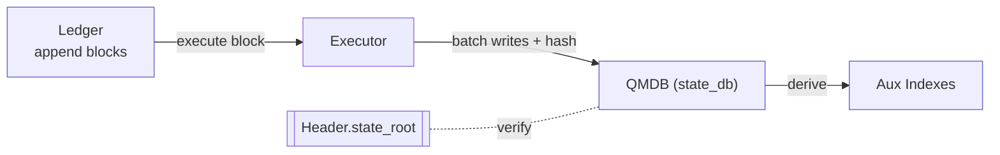

<Note>
  **Status:** Draft
  **Type:** Standards Track
  **Category:** Core
</Note>

## 1. Abstract
This proposal defines Cowboy's storage and state persistence mechanism, adopting a **QMDB** (flat key-value store with Blake3 hashing) architecture. The system employs:
- **Sequential ledger** for persisting consensus blocks;
- **QMDB** as the **canonical state repository**, with fixed 54-byte keys and Blake3-based Merkle commitments;
- **StateValue codec** (commonware `Write`/`Read` binary — the tagged codec `state_value.rs` implements) as the encoding format;
- **Namespaced key space** with byte-prefix routing for accounts, storage, timers, mailbox, and system state;
- **Rebuildable auxiliary indexes** to support queries and browsing;
- **Merkle proof layer** for light client state verification (C15 State Proofs).

## 2. Background and Motivation
Cowboy uses QMDB for:
- **Performance**: Flat KV with Blake3 hashing provides 10-100x throughput vs. hexary MPT for state reads/writes;
- **Simplicity**: Fixed 54-byte keys (1-byte prefix + 20-byte address + 33-byte slot/hash/zero-pad) avoid tree rebalancing;
- **Proof capability**: QMDB native Merkle proofs + Binary Merkle Tree (BMT) for TX/receipt roots provide equivalent light client verification;
- **Production-proven**: Running on devnet with full E2E proof verification.

## 3. Overall Design
Data is organized into three layers:
1) **Ledger**: Append-only block segment files;
2) **QMDB (canonical state)**: Three flat KV databases (`state_db`, `tx_index`, `tx_receipts`) with Blake3 Merkle commitments;
3) **Aux (rebuildable indexes)**: Read-optimized tables (TxHash→location, BlockHash→height, event indexes), not included in state root.

### 3.1 Three-Layer Relationships and Data Flow
These three layers are not parallel repositories but a **top-down rebuildable, verifiable pipeline**:

**Ledger (sequential source of truth) → Execution → QMDB (canonical state roots) → Derivation → Aux (read-optimized indexes)**.

- **Write and Commit Path** (when a block is accepted):
  1) **Consensus produces block → Write to Ledger**: Append block header, transactions/messages; block header contains `state_root`, `tx_root`, `receipt_root`.
  2) **Speculative execution replays the block → Produce write batch**: Update account/actor/storage/timer/mailbox/deferred-tx keys; compute three Merkle roots.
  3) **Root verification**: Locally computed roots must match block header roots; otherwise reject block.
  4) **Batch commit**: Cache the write batch; on finalization, apply atomically to QMDB.
  5) **Derive/refresh Aux (can be async)**: Export from Ledger + QMDB to auxiliary indexes.

- **Read Path** (how they cooperate during queries):
  - By **transaction hash**: Query `tx_index` DB for location → read Ledger for raw tx, read `tx_receipts` for receipt.
  - By **address/slot**: Read `state_db` directly; can return **QMDB Merkle proof**.
  - By **event topic**: Query Aux indexes for candidates, then verify with receipts.

- **Consistency invariants**:
  1) `state_db.root_at(N) == Ledger.block[N].state_root`;
  2) `tx_root` computed via BMT over block transactions matches header;
  3) `receipt_root` computed via BMT over block receipts matches header;
  4) After deleting Aux, can rebuild from Ledger+QMDB within bounded time.



### 3.2 Rollback and Rebuild
- **Speculative rollback**: After speculative execution, the write batch is cached but not applied. On finalization, the cached batch is applied atomically.
- **Fork reorganization**: Replay from last finalized height using Ledger as source of truth.
- **Aux-only corruption**: Rebuild from Ledger + QMDB receipts; does not affect consensus correctness.
- **QMDB corruption**: Replay Ledger from genesis or trusted snapshot to regenerate state.

## 4. Key Space and Namespaces

### 4.1 State Key Format
All state keys are **54 bytes** (fixed length):

```
[1-byte prefix] [20-byte address] [33-byte slot (zeros, or a message index / hashed key)]
```

Cowboy addresses are 20 bytes (Ethereum-style). Hash-keyed prefixes place a 32-byte keccak in the first 32 bytes of the address+slot region; the total key is always 54 bytes.

### 4.2 State Prefixes

> **Normative source of truth:** the `StatePrefix` enum in `node/storage/src/state_key.rs`. Prefixes run **0x01–0x1E (30 distinct); there is no 0x00.** (`0x1E` CodeMeta is added by the CIP-27 fork amendment — this table describes the AMENDED release; the currently deployed node stops at `0x1D`.) Any light-client that queries state MUST use these exact prefixes and key layouts. (Do **not** confuse this KEY-prefix namespace with the independent VALUE-discriminant byte in `state_value.rs`, which tags which `StateValue` variant a value is; the two 0x01… ranges overlap only coincidentally.)

| Prefix | Name | Key layout (after the 1-byte prefix) | Description |
|--------|------|--------------------------------------|-------------|
| `0x01` | Account | `address ‖ zeros` | Account record (nonce, balance) |
| `0x02` | Actor | `address ‖ zeros` | Actor record (code hash, storage root, …) |
| `0x03` | ActorStorage | `address ‖ slot(33)` | Actor KV; slot = verbatim user key if ≤32 B, else keccak256 (HASHED flag) |
| `0x04` | Mailbox | `address ‖ be(index:u64) ‖ zeros` | One entry **per message** (see §4.3) |
| `0x05` | Timer | `keccak256(timer_id) ‖ zeros` | Timer data |
| `0x06` | TimerIndex | `keccak256(height.to_be_bytes()) ‖ zeros` | Per-height timer list (**keccak of height**, not raw height) |
| `0x07` | DeferredTx | `keccak256(tx_hash) ‖ zeros` | Pending deferred-transaction data |
| `0x08` | DeferredIndex | `keccak256(origin_hash) ‖ zeros` | Deferred-tx origin index |
| `0x09` | ActorEvents | `address ‖ zeros` | Actor event-log list |
| `0x0A` | SystemState | `keccak256(key) ‖ zeros` | Governance/system KV (basefee, rent config, …) |
| `0x0B` | ActorTimerCount | `address ‖ zeros` | Per-actor timer count |
| `0x0C` | DeferredActorCount | `address ‖ zeros` | Per-actor pending deferred-TX count |
| `0x0D` | DeferredTxBlock | `keccak256(tx_hash) ‖ zeros` | Deferred-TX creation block height |
| `0x0E` | PvmPerInstrGas | `tx_hash ‖ zeros` | CIP-3 §2.2.1 per-bytecode-instruction gas side-channel |
| `0x0F` | Code | `code_hash[..32] ‖ zeros` | **Content-addressed** actor-code blob, shared by all actors with identical code (not per-address) |
| `0x10` | ActorMailboxHead | `address ‖ zeros` | First unconsumed message seq (8 B BE u64) |
| `0x11` | ActorMailboxTail | `address ‖ zeros` | Next message seq to write (8 B BE u64) |
| `0x12` | ActorKvCount | `address ‖ zeros` | Live KV count (8 B LE u64) |
| `0x13` | ActorKvBytes | `address ‖ zeros` | Total KV bytes (8 B LE u64) |
| `0x14` | Library | `publisher ‖ slot(33)` | CIP-26 library catalog |
| `0x15` | ActorLibPin | `actor ‖ slot(33)` | CIP-26 per-actor pinned libraries |
| `0x16` | TxReturnData | `tx_hash ‖ zeros` | Handler return bytes (observe-only side-channel) |
| `0x17` | PublishRootDedup | `be(height)[..8] ‖ zeros` | CIP-25 ζ-1 publish-root dedup marker |
| `0x18` | EventSub | `keccak256(sub_id)[..32] ‖ zeros` | CIP-29 subscription record |
| `0x19` | EventSubIndex | `keccak256(emitter‖topic)[..32] ‖ zeros` | CIP-29 ordered subscription index |
| `0x1A` | ActorTimerIds | `address ‖ zeros` | §12.3 per-actor timer-ID list |
| `0x1B` | Fairness | `address ‖ zeros` | CIP-1 per-actor timer fairness counter (1000-block window) |
| `0x1C` | MailboxDeadLetter | `address ‖ be(seq) ‖ zeros` | CIP-1/COW-186 dead-letter ring |
| `0x1D` | ActorDeadLetterTail | `address ‖ zeros` | Dead-letter tail pointer (8 B BE u64) |
| `0x1E` | CodeMeta | `code_hash[..32] ‖ zeros` | CIP-27 fork-callback marker bitset (1 B; content-addressed alongside `0x0F` Code) |

### 4.3 Value Encoding
- **StateValue** variants — the amended release set (deployed today through tag 0x11; `CodeMeta` 0x12 ships with the CIP-27 amendment), mirrored from `state_value.rs` (an earlier list here named a nonexistent `StorageSlot` and treated pointer scalars as variants): `Account(Account)` 0x01, `Actor(Actor)` 0x02, `ActorStorageEntry(Vec<u8>)` 0x03, `MailboxMessage(Message)` 0x04 (v2 form at 0x11), `Timer(Timer)` 0x05, `TimerList(TimerList)` 0x06, `DeferredTx(Transaction)` 0x07, `DeferredTxList(DeferredTxList)` 0x08, `ActorEventList(ActorEventList)` 0x09, `SystemBytes(Vec<u8>)` 0x0A (carries the counter/pointer scalars — head/tail, KV count/bytes, dead-letter tail — which are values under their own key prefixes, not variants), `Code(Vec<u8>)` 0x0B, `Library(ActorLibrary)` 0x0C, `ActorLibPin(ActorLibPin)` 0x0D, `EventSub(ActorEventSubscription)` 0x0E, `EventSubIndexValue(EventSubIndex)` 0x0F, `FairnessCounter(FairnessCounter)` 0x10, and `CodeMeta(u8)` 0x12 (CIP-27 fork-callback marker).
- **Mailbox model:** a mailbox is a FIFO ring of **individually-keyed** messages (`0x04 ‖ addr ‖ be(seq)` → `MailboxMessage`), bounded by the head (`0x10`) and tail (`0x11`) pointer keys — **not** a single `VecDeque<Message>` blob. Overflow spills to the dead-letter ring (`0x1C` / `0x1D`).
- Encoding: the commonware `Write`/`Read` binary codec throughout — transactions included (`state_value.rs` and the protocol codec define the encoding).
- Decode bounds enforced: `DeferredTxList` max 16,384 entries; `ActorEventList` max 1,000 entries.

## 5. QMDB State Commitments

### 5.1 State Root
QMDB computes a Merkle root over all key-value pairs in `state_db` using Blake3 hashing. This root is included in every block header as `state_root`.

### 5.2 Transaction Root
Computed via **Binary Merkle Tree (BMT)** over `keccak256` hashes of all transactions in the block:
```
tx_root = BMT(keccak256(tx_0), keccak256(tx_1), ..., keccak256(tx_n))
```

### 5.3 Receipt Root
Computed via **BMT** over each receipt's **commonware-codec** encoding (`Encode`), **not** RLP (`node/storage/src/merkle_utils.rs`):
```
receipt_root = BMT(keccak256(receipt_0.encode()), ..., keccak256(receipt_n.encode()))
```
Empty receipts hash to `keccak256("empty_receipts")`. `TransactionReceipt::rlp_encode()` also exists but is an ancillary Ethereum-compat serialization only — it does **not** feed `receipt_root`.

### 5.4 Proof System
QMDB provides native Merkle inclusion proofs for any state key:

**RPC Endpoints:**
- `GET /proof/account/{address}` — account state proof
- `GET /proof/actor/{address}` — actor metadata proof
- `GET /proof/storage/{address}/{key}` — actor storage slot proof
- `GET /proof/tx/{tx_hash}` — transaction inclusion proof (BMT)
- `GET /proof/receipt/{tx_hash}` — receipt inclusion proof (BMT)
- `POST /proof/multi` — batch state proof (up to 256 keys per request)

**Independent Verifier:**
The `cowboy-proof-verifier` crate provides standalone verification (Rust + WASM), requiring only the proof data and state root — no full node needed.

## 6. Execution and Consistency

### 6.1 Block Lifecycle
1. **Fetch block**: Read block header and body from Ledger.
2. **Pre-check**: Validate signatures, nonces, gas limits.
3. **Speculative execution**: Execute all transactions in batch mode:
   - `begin_batch()` → execute transactions → `commit_batch()`
   - Produces `state_pending`, `tx_index_pending`, `tx_receipts_pending` write sets
   - Processes timers, deferred TXs (with per-actor limits and expiration)
4. **Compute roots**: Calculate `state_root`, `tx_root`, `receipt_root` from the write set.
5. **Root verification**: Roots must match block header; reject if mismatch.
6. **Cache**: Store write batch for later finalization.
7. **On finalization**: Apply cached batch to QMDB databases.

### 6.2 Atomic Commit
Three QMDB databases are committed sequentially: `state_db` → `tx_index` → `tx_receipts`. Each individual DB commit is atomic. A crash between commits is recoverable: consensus layer replays finalized blocks on restart (see §3.2).

### 6.3 Determinism Requirements
- All execution engines must write via unified `StateKey`/`StateValue` interface;
- No wall clock, no external randomness during execution;
- Identical block + identical state must produce identical roots.

### 6.4 Errors and Block Rejection
- **Root mismatch**: Block rejected.
- **Storage errors**: Logged with opaque messages to clients; detailed errors server-side only.
- **Resource exhaustion**: Degrade gracefully (pause Aux derivation), never break QMDB atomicity.

## 7. Auxiliary Indexes (Rebuildable)

### 7.1 Index Schemas
- **`tx_index`**: `tx_hash → TransactionLocation { block_hash, tx_index }`
- **`tx_receipts`**: `tx_hash → TransactionReceipt { ... }`
- **Event indexes**: Per-actor event lists (in `state_db` as `ActorEventList`)

### 7.2 Construction
After block commit, scan transactions and receipts to update auxiliary indexes. Updates can lag behind finalization without affecting consensus.

### 7.3 Rebuild
Full rebuild by replaying Ledger from genesis. Incremental rebuild from last consistent height.

## 8. Snapshots and Sync

### 8.1 Sync Modes
- **Full node sync**: Replay Ledger from genesis or trusted snapshot.
- **Fast sync**: Download QMDB state at height `H`, verify root matches block header, replay from `H`.
- **Light client**: Maintain block header chain; verify state via Merkle proofs (`/proof/*` endpoints).

### 8.2 Proof Packaging
- Batch proofs (`POST /proof/multi`) deduplicate shared proof nodes across multiple keys.
- Max 256 keys per batch request.
- Responses include proof version, chunk location, MMR leaves, and operation digests.

## 9. Performance

### 9.1 QMDB Advantages
- **O(1) reads/writes**: Flat KV with fixed-size keys avoids tree traversal;
- **Efficient hashing**: Blake3 is 3-5x faster than Keccak-256;
- **Batch operations**: Block-level batch commit with deferred merkleization;
- **Bounded cache**: Speculative cache limited to 8 entries (evicts oldest on overflow).

### 9.2 Metrics
Key metrics: `block_apply_ms`, `proof_generation_ms`, `batch_commit_ms`, `speculative_cache_size`.

## 10. Security
- **Canonical source**: Only QMDB `state_db` as authoritative state;
- **Proof integrity**: Merkle proofs verified against `state_root` in finalized block header;
- **DoS mitigation**: Decode bounds on all list types; per-actor limits on timers (1,024) and deferred TXs (64); deferred TX expiration (1,000 blocks); a global RPC rate limit (100 req/s) applies to all endpoints, and the proof endpoints (§5) — whose Merkle/QMDB proof generation is comparatively expensive (`/proof/multi` batches up to 256 keys) — additionally SHOULD sit behind a per-IP limiter so a single source cannot exhaust the shared budget;
- **Error opacity**: Storage errors return opaque messages to API callers; detailed errors logged server-side only.

## 11. Parameters
- `STATE_KEY_LEN = 54` (fixed key size)
- `MAX_SPECULATIVE_CACHE_ENTRIES = 8`
- `MAX_DEFERRED_TX_LIST_SIZE = 16,384`
- `MAX_ACTOR_EVENTS = 1,000`
- `MAX_TIMERS_PER_ACTOR = 1,024`
- `MAX_PENDING_DEFERRED_PER_ACTOR = 64`
- `DEFERRED_TX_MAX_AGE_BLOCKS = 1,000`
- `SNAPSHOT_INTERVAL_BLOCKS = 100_000` (`node/storage/src/state_sync.rs`)

## 12. State Rent

> This section is the **normative source** for actor-state rent mechanics. Whitepaper §17.5 now references this section. Rationale for the move: rent is a CIP-4 concern (it governs the lifecycle of state in the QMDB store); the WP retains a one-paragraph operational summary plus the governance monitoring cadence.

### 12.1 Mechanism

Actors exceeding the grace threshold pay ongoing rent measured in CBY:

```
rent_per_rent_epoch(actor) = max(0, quota_bytes(actor) − grace_threshold) × rent_rate
```

where:

- `quota_bytes(actor)` = the actor's **allocated storage quota** at the start of the rent epoch — NOT its live byte count. This is §12.4's rule (rent on the reservation, deterring quota hoarding), it is what the deployed rent code implements, and it is what CIP-27's fork economics depend on; an earlier formula here billed actual code+storage+mailbox bytes and is superseded — one basis, stated once.
- `grace_threshold` = 10,240 bytes (10 KB) — no rent below this size.
- `rent_rate` = the deployed default `rent_rate_atto = 2_739_726_027_397` atto/byte/epoch (≈ 0.001 CBY/byte/year at 365 epochs; governance-tunable, Tier-0 per CIP-12 — see §12.5).
- `rent_epoch_length` = 1 day at 1-second blocks per WP §6.1 (i.e., 86,400 blocks per epoch).
- **Consensus carrier**: `rent_debt` lives on the **`Actor` record** (codec field, exactly as the current encoder has it) — not under a Governance/SystemBytes key; one carrier, the one the code already uses.

**Settlement unit boundary (normative — one formulation, no other exists):** rent accrues in atto (`rent_debt: u128`); the native ledger is u64 wei. Each settlement computes `paid_wei = min(balance_wei, floor(rent_debt / 10^9))`, debits exactly `paid_wei`, and reduces the debt by exactly what was paid — `rent_debt -= paid_wei × 10^9`. There is no intermediate full-debt subtraction anywhere (a debt-then-cap formulation would erase unpaid debt: 5.5 wei of debt against a 2-wei balance must leave 3.5 wei owing, not 0.5), and the sub-wei remainder carries in `rent_debt`. The unpaid remainder accrues toward eviction. **This is the normative rule; deployed code has the bug (tracked: COW-3106) — this docs-only amendment does not correct it.** `execution/src/execution/rent.rs` currently subtracts u128 atto directly from the u64 wei balance (the same 10^9 unit-error family as the bond path); at deployed defaults that drains every non-exempt actor's entire balance at its first settlement, and `restore_actor` carries the identical bug. The fix landing against COW-3106 must implement the boundary above; settlement vectors pin the carry at zero, partial, and full balance.

Per-epoch settlement (`rent_debt` is stored on the Actor record; settlement uses the following order):

1. At the start of each rent epoch, `0x09` Governance computes `rent_due[actor]` for every actor with size > grace threshold.
2. The amount is debited from the actor's CBY balance.
3. If the actor's balance is insufficient, the unpaid amount accumulates in the actor's own `rent_debt` field (the Actor-record carrier above — nowhere else), penalized at fold time: `folded = unpaid + ceil_div(unpaid × rent_catchup_bps, 10_000)` — checked u128 multiply then add, ceiling division so a nonzero unpaid amount always carries a nonzero penalty; applied exactly once per accrual, so it persists across partial payments (see §12.2). **Missed epochs settle SEQUENTIALLY, oldest first** — the bounded sweep computes `epochs_due` and processes each missed epoch as its own §12.1 settlement in epoch order, each with its own `rent_due`, its own ceil-penalty fold, and checked arithmetic per epoch (an aggregated `billable × rate × epochs` shortcut is observably different because ceil is nonlinear — two 1-atto unpaid epochs at 10% fold to 4 atto sequentially but 3 aggregated). **Each epoch settles at ITS OWN historical rate**, implemented by **rate checkpoints with a retention watermark** (a fixed count alone proves nothing — a funded, long-unswept actor is neither delinquent nor evictable, so its unsettled history can outrun any constant while governance updates consume entries): every `UpdateRentConfig` appends `(effective_epoch, rent_rate_atto)` to the ring (`RENT_RATE_CHECKPOINTS = 32` entries, genesis-seeded with `(0, genesis_rate)`); rates enact at the **next epoch boundary**, and two same-epoch updates **coalesce** (the later in block order overwrites the pending entry — at most one checkpoint per effective epoch). The sweep maintains `rent_sweep_watermark` (SystemState, u64: the epoch through which every actor's settlement is complete; across a paginated pass it advances **only at cursor wrap, to the pass-start epoch** — an implementation cannot overstate it mid-pass), and eviction is judged **by the interval a checkpoint governs, not by its own epoch** (a checkpoint anchors every epoch up to its successor: with `(0,R0),(20,R1)` and watermark 10, evicting `(0,R0)` because `0 < 10` would strand an actor next owing epoch 11 — its lookup `greatest ≤ 11` resolves to exactly `(0,R0)`, and fail-closed would wedge that settlement forever): an `UpdateRentConfig` may evict checkpoint *i* only when checkpoint *i+1*'s `effective_epoch ≤ watermark + 1` — equivalently, the greatest checkpoint at or below the first unsettled epoch is always retained as the anchor — and rejects otherwise. Lookup (**greatest `effective_epoch ≤ due_epoch`**) therefore always succeeds; a miss is nonetheless pinned **fail-closed** (the settlement transaction fails whole, changing nothing) rather than silently using the oldest entry or repricing. Vectors: rate-change-inside-backlog, watermark-rejection, and the exact `(0,R0),(20,R1), watermark = 10, due = 11` anchor case (eviction of `(0,R0)` rejected). A processed-at-current-rate rule appears nowhere. `delinquent_since_epoch` is set **at the first sequential iteration whose post-settlement debt is positive** — not blindly backdated to the first missed epoch: if the balance fully pays the first two of three overdue epochs, delinquency starts at the third. Vectors: a rate change inside a three-epoch backlog, and the paid/paid/unpaid clock case. Within each epoch's settlement, **payment order is pinned current-first, with the exact atto→wei steps**: `paid_current_wei = min(balance_wei, floor(rent_due_atto / 10^9))`; `unpaid_current_atto = rent_due_atto − paid_current_wei × 10^9`; the penalty folds over exactly `unpaid_current_atto` (checked ceil-multiply, then checked add into `rent_debt` — an overflow on either checked op fails the settlement transaction whole, changing nothing; unreachable at real magnitudes, pinned anyway); THEN any remaining balance pays down old `rent_debt` by the §12.2 rule. Current rent the balance can cover never accrues a penalty (old debt = 100, new rent = 100, balance = 100 ⇒ rent paid, old debt stands at 100 — one answer, everywhere).
4. Eviction runs on an **invariant clock, not a debt-to-rent ratio** (a ratio metric shifts with penalties and rate changes — "after 10 epochs" would be false). The clock is a **new field, not an overload**: `delinquent_since_epoch: Option<u64>` (appended in the same Actor codec bump the CIP-27 amendment performs — v8 appends `fork_count` then this field) records the settlement at which `rent_debt` first became positive, cleared when the debt clears; eviction fires at `delinquent_since_epoch + eviction_threshold_epochs` (default 10) if the debt has not cleared. `dormant_since_epoch` is deliberately untouched: in deployed consensus ANY `Some` there already means *evicted/dormant* — catch-up stops, instructions reject, speculative skips — so overloading it as a delinquency marker would turn the first missed payment into de-facto eviction and forbid the very catch-up it schedules; every existing consumer keeps reading `dormant_since_epoch` with its true meaning, set only at actual eviction (snapshot/prune), and no consumer migration is needed.

### 12.2 Catch-up

When an actor with `rent_debt > 0` next interacts on-chain (e.g., a transaction triggers the actor, or the owner deposits CBY), the catch-up settlement runs:

```
# The penalty is NOT recomputed at catch-up. It folded into rent_debt at
# accrual (§12.1 step 3: unpaid amounts enter the debt pre-multiplied by
# 1 + rent_catchup_bps/10^4, once). Catch-up settlement is therefore just
# the ordinary settlement rule paying the debt down:
paid_wei  = min(balance_wei, floor(rent_debt / 10^9))
rent_debt = rent_debt − paid_wei × 10^9
```

Penalty proceeds follow the same sink as rent principal.

If `remaining_debt` reaches zero, the eviction countdown resets. The catch-up rate (10%) is `system:cip4:rent_catchup_bps = 1000` (Tier-0 tunable).

**Rate history is the §12.1 checkpoint ring, and only that.** Already-folded debt is arithmetically immune to later rate changes (the rate is embodied in the accrued atto at fold time); NOT-yet-folded missed epochs get their historical rate from the `RENT_RATE_CHECKPOINTS` ring (§12.1) — the one mechanism, stated once; no per-debt rate snapshot exists or is needed.

### 12.3 Eviction and Restoration

- **Eviction (after 10 rent-epochs of unpaid rent — 7 grace + 3 warning):** Actor storage and active timers are pruned. Code, address, balance, and storage root hash are **preserved**. The actor enters a "dormant" state.
- **Restoration:** anyone may repay the accumulated `rent_debt` — which **already contains** the fold-at-accrual penalty (§12.2); restoration applies NO second multiplication (the current code's restore-time `catch_up_fee` recompute is the double-penalize bug this corrects) and provide the original storage data (verified against the recorded root hash). The actor returns to "active".

### 12.4 Storage quotas

Each actor has a base storage quota of **1 MiB** (`RENT_QUOTA_BASE`), extendable up to **8 MiB** (`RENT_QUOTA_MAX`) via a storage bond. The bond is locked while the quota is in use, returned when reduced, and forfeited if the actor is evicted. Rent applies to the **full allocated quota**, not the current usage — actors that reserve quota they don't use pay rent on the reservation, deterring quota hoarding.

**The bond routine (normative, shared).** One checked routine computes and settles every quota bond — `SetActorQuota` and CIP-27 `fork()` (§3.3.3) both call it; divergent arithmetic between the two paths is non-conformant:

- **Absolute-target, path-independent** — never per-delta quantization (per-delta `ceil` makes the locked amount depend on the *sequence* of raises: at `bond_rate_atto = 1`, two one-byte raises would lock 2 wei where one two-byte raise locks 1, and a combined reduction could strand locked bond at base quota). The routine computes the **end state**: `target_atto = bond_rate_atto × (new_quota_bytes − RENT_QUOTA_BASE)` (checked u128; zero at or below base), `target_locked_wei = ceil_div(target_atto, 10^9)`, and the ledger movement is the signed difference `target_locked_wei − current_locked_wei` (checked): positive debits the payer, negative credits the actor by **checked add** (never saturating). The stored lock is `bond_locked_atto = target_locked_wei × 10^9` — a function of the end state only. A raise-then-lower round trip refunds exactly what was debited. (The deployed implementation subtracts the raw atto delta from the wei balance — a 10^9 **overcharge** on raise, mirrored as a 10^9 **over-refund** on shrink; **live money bug, tracked: COW-3127 — this docs-only amendment specifies the boundary but does not correct the code.** Second-order, and worse than a constant error: `bond_locked_atto` itself IS correctly denominated, so the locked-bond ledger and the actual balance movement disagree by 10^9 — a shrink refunds against `min(freed × rate, bond_locked_atto)` in atto while crediting wei, so the two ledgers *drift* rather than both being wrong by the same factor.)
- **Rate changes settle lazily and hold no tranches**: the locked amount is left untouched by a `bond_rate_atto` change and reconciles to the absolute target at the **next quota change**, whichever direction that moves it. No per-tranche state exists, and no rate is stamped for bonds — `rate_stamped_atto` on the actor record is the *rent* rate field (written by rent settlement) and is not overloaded by the bond path. Note it is **vestigial under this amendment**: with fold-at-accrual and the §12.1 checkpoint ring as the sole rate-history mechanism, `rate_stamped_atto` has no reader, and it **MUST NOT be read by any consensus path**. It is **retained in the v8 layout, not removed** — it sits mid-record (between `last_settled_epoch` and `bond_locked_atto` at `types/src/execution.rs`), and CIP-27's Actor v8 bump is strictly append-only so that v7 blobs still decode; deleting a mid-record field would shift every subsequent field and break that v7-compat property. Actually removing the dead field is therefore a **separate, non-append-compatible codec change** (its own future bump under the reset policy), explicitly not folded into v8 — and that future change must also delete the field's consensus **writes** (`rent.rs` settlement and `restore_actor` both still stamp it), not only the codec slot.
- **Usage guards reduction**: `SetActorQuota` to a lower quota MUST verify `new_quota_bytes ≥` the actor's current read-your-writes `kv_bytes` — a reduction below live usage rejects (the current implementation checks only the global bounds; this amendment adds the usage check).
- Disposition is §12.4's asymmetry, restated: voluntary reduction **returns** the released bond to the actor's balance; eviction **forfeits** the entire locked bond.
- Parity vectors pin fork-vs-`SetActorQuota` equivalence: the same quota level debits identical wei and records identical `bond_locked_atto` on either path; boundary vectors cover the `ceil_div` edge and a raise-then-lower round trip refunding exactly what was debited.

### 12.5 Parameters

All Tier-0 governance-tunable (CIP-12 §5.1). **Storage:** these are **not** five independent keys — the deployed `RentConfig` struct (all six fields below) is stored as **one** JSON blob under the single SystemState key **`system:cip4:rent_config`** at Governance (`0x0A ‖ keccak256("system:cip4:rent_config")`, under actor `0x09`), enacted atomically via `UpdateRentConfig`; a missing key yields `RentConfig::defaults()`. Field names below are the code field names (`node/types/src/execution.rs`).

| Parameter (code field) | Default (deployed) | Notes |
|---|---|---|
| `grace_threshold` | 10,240 bytes (10 KB) | no rent below this size |
| `rent_rate_atto` | `2_739_726_027_397` atto / byte / epoch (≈ **0.001 CBY/byte/year** at 365 epochs) | ratified rate, matching WP §13.1 (COW-2266). The node shipped `2_739_726_027_397_260` — exactly 1,000× this — until COW-2266; that divergence was the drift check's only declared known exception and is now closed. Tier-0, and the value stays governed by the §12.6 `[$1,$10]/MiB/year` monitoring band |
| `rent_epoch_blocks` | 86,400 (~1 day at 1s) | |
| `eviction_threshold_epochs` | 10 | |
| `rent_catchup_bps` | 1,000 (= 10%) | |
| `bond_rate_atto` | 1 | previously undocumented sixth field |

### 12.6 CBY-denominated rent (Decision Register #4 — HOLD)

The architecture review proposed re-pegging rent to USD via a 7-day TWAP oracle. The analysis Decision Register #4 selected **HOLD on CBY-denominated** for v1 to avoid introducing a consensus-layer oracle dependency. Operational mitigation:

- **Monitoring cadence.** The Cowboy Foundation publishes monthly the implied USD value of `rent_rate × 1 MiB × 365 days`. Target band: `[$1, $10] / MiB / year` at the prevailing CBY/USD spot.
- **Tier-0 adjustment trigger.** If the implied USD rent drifts outside the target band for two consecutive monthly reviews, a Tier-0 governance proposal MUST be filed to adjust `rent_rate`.
- **No oracle dependency in v1.** A future CIP MAY introduce oracle-anchored rent; this CIP does not.

Re-evaluation triggers for re-pegging: (a) availability of a battle-tested CBY/USD oracle module (precondition for any USD-pegged consensus parameter), or (b) sustained USD-rent drift outside the band beyond what Tier-0 cadence can manage.

### 12.7 Relationship to other CIPs

- **CIP-7 retention contracts:** separate facility (off-chain blob storage with provider negotiation). State rent in §12 above applies to *on-chain QMDB* state only.
- **CIP-9 / CIP-31 CBFS:** separate facility (decentralized off-chain storage via Relay Nodes). CBFS storage fees and Relay economics live in CIP-9 §10.4 + CIP-31, not here.
- **WP §17.5:** operational summary plus the monitoring cadence above; this CIP §12 is the normative spec.
- **WP §13 parameter block:** the Tier-0 rent parameters above (the six-field `RentConfig`) appear in WP §13 as a one-line reference to this section.

---

## Appendix A/B — removed

The former Appendix A (StateValue variant sketch with obsolete embedded code/storage/mailbox Actor shapes) and Appendix B (a 0x00-based prefix table predating the normative layout) contradicted §4.2/§4.3, which are the sole normative tables; they are deleted rather than maintained in parallel.

## Appendix C: Proof Response Format
```json
{
  "proof_version": 1,
  "loc": <u64>,
  "chunk": "<hex>",
  "mmr_leaves": <u64>,
  "digests": ["<hex>", ...],
  "partial_chunk_digest": "<hex>",
  "ops_root": "<hex>"
}
```
Verification: reconstruct the Merkle path from `loc` through `digests` to `ops_root`, then verify `ops_root` matches the `state_root` from the block header.
