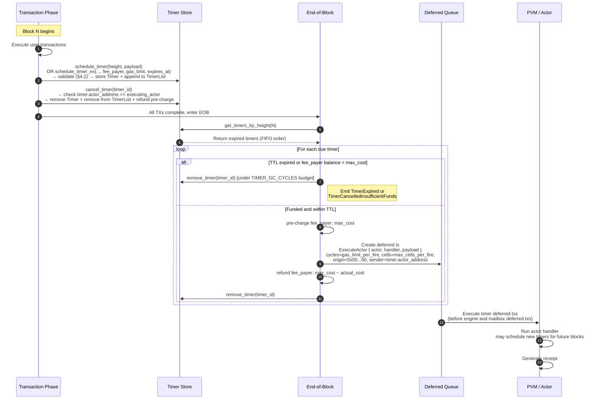

<Note>
  **Status:** Draft
  **Type:** Standards Track
  **Category:** Core
  **Created:** 2026-01-19
  **Requires:** CIP-1, CIP-3
</Note>

<Tip>
  This document describes the timer mechanism **as currently implemented** in the Cowboy node (FIFO within a block-height bucket, with the per-fire `fee_payer` model). **CIP-1 v3 Part III** specifies the target design (EIP-1559 timer-lane basefee + priority tip + per-actor fairness weight) and supersedes the original §9 auction sketch. CIP-5 §§1–8 remain canonical for FIFO behaviour until CIP-1 v3 activates; the activation block is a Tier-3 governance decision.
</Tip>

## 1. Abstract

This proposal defines Cowboy's **native Timer mechanism** — a height-triggered, one-shot scheduling primitive with an explicit fee payer and self-terminating lifecycle. Actors register timers for a future block height; each timer records **who pays** (`fee_payer`), **how much gas it may consume per fire** (`gas_limit_per_fire`), and **when it gives up** (`expires_at`). At the **End of Block (EOB)**, the protocol collects all timers whose `height` matches the current block, **pre-charges the fee payer**, executes the handler, refunds unused gas, and removes the timer. A timer that its fee payer can no longer fund, or that has passed its TTL, is destroyed on the next block without executing. Execution follows insertion order (FIFO within a height bucket) — no priority queue or bidding is involved (see §9 / CIP-1 v3 Part III for the EIP-1559 target design).

Metering follows **CIP-3**'s dual-metered model (Cycles/Cells). Protocol-level timer parameters (`max_ttl_blocks`, `max_cycles_per_fire`, `max_cells_per_fire`, `max_timers_per_actor`, `gc_cycles_per_block`) are held in a governed `TimerConfig`, updated through the same `SubmitProposal → CastVote → ExecuteProposal` path as `BasefeeConfig`.

---

## 2. Motivation

On-chain actors need the ability to schedule future execution without relying on external keepers. Use cases include:

- **Periodic tasks:** An actor schedules a timer in its handler to re-fire at a future height, creating a heartbeat loop.
- **Deferred settlement:** After an off-chain computation (CIP-2), an actor schedules a follow-up action at a known future height.
- **Time-locked operations:** Vesting, escrow release, or governance proposal execution at a predetermined height.

This revision prioritizes **simplicity, determinism, correctness, and economic soundness** over the more advanced scheduling features described in CIP-1 (GBA bidding, tiered queues). The target design layer is referenced in §9 (which points to CIP-1 v3 Part III) and is compatible with the economics defined here — it layers on without revising §§3–8.

---

## 3. Specification

### 3.1 Timer Data Structure

```rust
struct Timer {
    actor_address: Address,  // the actor that owns this timer (also handler execution identity)
    height: u64,             // block height at which the timer fires
    payload: Vec<u8>,        // opaque bytes delivered to the handler (max 1 MiB)
    timer_id: Vec<u8>,       // unique identifier (max 256 bytes)
    handler: String,         // handler method name (max 256 bytes, default: "handle_timer")

    // Economics (Model B):
    fee_payer: Address,      // account debited at each fire (see §4.2)
    gas_limit_per_fire: u64, // max cycles this fire may consume (≤ TimerConfig.max_cycles_per_fire)
    expires_at: u64,         // absolute block height after which the timer self-destructs

    // Flow-control / retry counters (serialized; part of the state root):
    skip_count: u32,         // consecutive carry-forwards under LANE_TIMER_CYCLES (§6.5); dead-letters at TIMER_MAX_CARRY_FORWARD
    retry_count: u32,        // consecutive execution-failure retries; dead-letters per COW-2333

    // CIP-1 v3 Part III auction bid (0 = default-GBA estimator at fire time):
    max_fee_per_cycle: u64,          // max total fee per cycle (lane basefee + tip) the scheduler will pay
    max_priority_fee_per_cycle: u64, // max priority tip per cycle, clamped to max_fee_per_cycle − lane_basefee
}
```

The current on-chain `Timer` codec version is `5` (`node/storage/src/types.rs`). The decoder accepts legacy versions 3–5 on read, defaulting fields introduced in later versions to `0` (`skip_count` / auction-fee fields added in v4, `retry_count` in v5) — a forward-compatible field addition does **not** require a chain wipe or migration pass.

### 3.2 Timer Index

Timers are stored in two structures:

- **Timer store:** `keccak256(timer_id) → Timer` — the canonical timer record.
- **Height index:** `keccak256(height.to_be_bytes()) → TimerList` — a list of `timer_id` values for each height, maintained in insertion order.

```rust
struct TimerList {
    timer_ids: Vec<Vec<u8>>,
}
```

Both structures are part of consensus state (QMDB Current databases) and contribute to `state_root`.

### 3.3 Timer ID Generation

Timer IDs are deterministically derived:

```
timer_id = keccak256(actor_address[20] || height[8 BE] || payload || nonce[8 BE])
```

Where `nonce` is the transaction nonce of the calling actor at the time of scheduling. This guarantees uniqueness across all timers.

---

## 4. API

### 4.1 Python Host API

Actors interact with timers via four host calls exposed to the PVM:

```python
# Schedule a timer for a future block height. Classic 2-arg form — timer
# is created with protocol defaults (fee_payer = actor_address,
# gas_limit = TimerConfig.max_cycles_per_fire, expires_at =
# current_height + TimerConfig.max_ttl_blocks). Returns the timer_id.
timer_id = pvm_host.schedule_timer(height: int, payload: bytes) -> bytes

# Model B extended scheduler — accepts actor-specified overrides for any of
# fee_payer / gas_limit / expires_at. Each argument defaults to None (use
# the protocol default). Exposed as a separate function (not extra kwargs
# on schedule_timer) so existing actor code keeps working without changes.
timer_id = pvm_host.schedule_timer_ex(
    height: int,
    payload: bytes,
    fee_payer: bytes = None,      # 20-byte address; None → actor_address
    gas_limit: int = None,        # None → TimerConfig.max_cycles_per_fire
    expires_at: int = None,       # None → current_height + TimerConfig.max_ttl_blocks
    max_fee_per_cycle: int = None,          # CIP-1 v3 §3; None → default-GBA estimator at fire time
    max_priority_fee_per_cycle: int = None, # CIP-1 v3 §3; None → default-GBA estimator; clamped to max_fee_per_cycle − lane_basefee
) -> bytes

# NOTE: the two CIP-1 v3 fee parameters exist in the host-level signature
# (node/execution/src/pvm_host.rs) but are NOT yet wired through the
# Python-facing binding (positional-only; passes None → default-GBA
# estimator). Exposing them to actor code requires a coordinated cowboy-py
# SDK arity bump (deferred follow-up, tracked with the CIP-1 auction activation).

# Extend a timer's TTL. Caller must own the timer (timer.actor_address ==
# executing_actor); otherwise rejected as Unauthorized.
pvm_host.extend_timer(timer_id: bytes, new_expires_at: int) -> None

# Cancel a previously scheduled timer. See §4.2 for authorization.
pvm_host.cancel_timer(timer_id: bytes) -> None
```

### 4.2 Constraints

- **Future height only:** `height` MUST be strictly greater than the current block height. Scheduling at the current or past height returns an error.
- **One-shot semantics:** Each timer fires exactly once and is immediately removed. To create recurring behavior, the actor must schedule a new timer from within its handler.
- **Custom handler:** By convention, if `payload` is valid JSON containing `{"_handler": "<name>", "_payload": <json-value>}`, the timer invokes the named handler with the inner payload re-serialized as raw JSON bytes (the `_payload` value is **not** base64-decoded). If `_payload` is omitted, the outer object minus `_handler` is passed as the payload. Otherwise, the default handler `handle_timer` is invoked.
- **Payload size:** Maximum 1,048,576 bytes (1 MiB).
- **Handler name:** Maximum 256 bytes.
- **`fee_payer` validation (enforced at schedule time):**
  - `ZERO` (burn address) is rejected.
  - The reserved system-actor band `0x01`..=`0xFF` (every address below
    `RESERVED_SYSTEM_ADDRESS_LIMIT = 0x100`) is rejected as a *third-party*
    `fee_payer` — covers every currently assigned system actor (runner registry /
    dispatcher / verifier / secrets / TEE / token registry / entitlement registry /
    RAS / basefee / governance / event-subscription `0x1D`) plus the reserved slots
    up to `0xFF`. An actor cannot delegate payment to a system actor.
    - **Self-funding exemption.** A system actor MAY name **itself** as `fee_payer`
      (i.e. `fee_payer == actor_address` within the system band) — this is the
      *actor-pays-itself* case, not third-party delegation. Required for the Storage
      Manager (`0x0A`) to fund its own PoR-challenge timer (CIP-9 §5.6; worked
      example in §6.3). The exemption is strictly `fee_payer == actor_address`: one
      system actor still cannot name a *different* system actor, and the `tx_sender`
      branch below is never opened for a system-band `fee_payer` (that would let a
      crafted sender bill a system actor).
  - **`fee_payer` MUST be either the executing `actor_address` (actor pays
    itself) or the current `tx_sender` (deployer / invoker pays). Any other
    third-party address is rejected with `InvalidInput`, except the strictly
    bound CIP-7 canonical Feed renewal described below.**
    - **Rationale.** Without this check, a hostile actor could schedule
      timers with an arbitrary victim's address as `fee_payer`; the
      block-level pre-charge (§6.3 step 4) would then drain the victim's
      account on every fire until depleted — a straight Broken-Access-Control
      class bug. The self-or-sender rule ensures every debit has implicit
      consent: either the actor is paying for its own execution, or the
      tx signer chose to fund this timer by submitting the scheduling
      transaction.
    - **Future opt-in third-party sponsorship** (NOT in this revision) would
      require an explicit on-chain allowance (e.g. `fee_payer` pre-authorizes
      the scheduling actor via a storage-based quota) or a signed
      authorization carried in the scheduling tx. Deliberately deferred —
      the current rule covers the two "typical" cases Model B.2 enumerates
      (actor self-funds; deployer funds its actor) with no attack surface.
  - **CIP-7 canonical Feed renewal exception.** During an authentic firing of
    the exact canonical CONSENSUS Feed artifact, native authority binds the
    executing Feed, its stored `dispatch_timer_id`, and its immutable owner/payer
    to the timer being fired. Only that authority may rearm the next one-block
    dispatch timer with the same payer. Ordinary calls, copied/noncanonical code,
    mismatched timer IDs and different payers do not receive this exception.
    The owner signs initial registration and owner-triggered recovery via
    `restart_dispatch_timer`; both use the ordinary sender-pays rule. Recovery is
    idempotent while the stored timer is live. This is not general third-party
    sponsorship; all budget, funding, rollback and one-shot rules still apply.
  - Default when omitted: `actor_address`.
- **`gas_limit_per_fire`:** MUST be ≤ `TimerConfig.max_cycles_per_fire`.
- **`expires_at`:** MUST satisfy `expires_at ≤ current_height + TimerConfig.max_ttl_blocks`. A timer whose `expires_at` has passed is destroyed on its next scheduled fire without executing (see §5.4).
- **Per-actor cap:** An actor may hold at most `TimerConfig.max_timers_per_actor` live timers at any time (maintained via a per-actor secondary index).
- **`cancel_timer` authorization:** The PVM host call is only permitted to cancel timers where `timer.actor_address == executing_actor`. Cross-actor cancellation via `cancel_timer` is rejected as `Unauthorized` (closes CVE-class bug present prior to this revision). System-level cancellation paths (owner, governance) are exposed via system instructions, not host calls — see §5.4.

### 4.3 Side Effect Semantics

Timer scheduling and cancellation are **side effects** of transaction execution:

- Scheduled timers pass the §4.2 validation (fee_payer, TTL, gas caps, per-actor cap) during the originating tx's execution; validation failure reverts the tx. Accepted timers are collected in `ExecutionSideEffects.scheduled_timers` and persisted to storage after the transaction commits.
- Cancelled timers pass the §4.2 authorization check (or the §5.4 system-instruction authorization) and are collected in `ExecutionSideEffects.cancelled_timers`, then removed from storage after the transaction commits. Any pre-charged `max_cost` is refunded on the same commit.
- On transaction rollback, all timer side effects are discarded — no scheduled timer is persisted, no cancelled timer is removed, no pre-charge is finalized.

---

## 5. End-of-Block Delivery

### 5.1 Execution Order

Timer delivery occurs at the **end of block**, after all user transactions have been executed. The sequence within `process_block()` is:

1. Execute all user transactions (TX phase).
2. Query `get_timers_by_height(current_height)` — returns all due timers in insertion order (FIFO).
3. Classify each due timer per §5.4:
   - **TTL expired** (`current_height > expires_at`) or **insufficient funds** → remove under `TIMER_GC_CYCLES` (§6.5), emit the corresponding event, skip execution.
   - **Within TTL and funded** → pre-charge `fee_payer` (§6.3 step 4), construct a **deferred transaction** targeting the actor's handler, enqueue.
4. Remove the timer from both the timer store and the height index after each classification concludes.
5. Execute the enqueued deferred transactions; refund any over-reserved gas to `fee_payer` (§6.3 step 6).

Timer-created deferred transactions are ordered **before** engine and mailbox deferred transactions within the same block.

### 5.2 Deferred Transaction Construction

Each fired timer produces a deferred transaction with the following properties:

| Field | Value |
| :---- | :---- |
| Origin tx hash | `0x0000...0000` (32 zero bytes — "no parent tx" sentinel) |
| Instruction | `ExecuteActor { actor, handler, payload }` |
| Cycles limit | `timer.gas_limit_per_fire` |
| Cells limit | `TimerConfig.max_cells_per_fire` (conservative flat cap — actor-specified cell limit is unreliable since cells are hard to estimate ahead of time; over-reservation is refunded) |
| Sender | `timer.actor_address` (handler execution identity) |
| Fee payer | `timer.fee_payer` |

The zero-hash origin indicates "this tx has no parent user tx" — it does **not** imply free execution (see §6.3). Unlike user-initiated deferred transactions, timer deferred txs do **not** consume from a parent tx's `deferred_gas_pools` entry; their gas budget is drawn from `fee_payer`'s account directly.

### 5.3 Same-Block Prohibition

Timers created within the current block's transactions MUST NOT fire in the same block. This is enforced by the `height > current_block_height` constraint in `schedule_timer`.

### 5.4 Timer Lifecycle — Three Exit Paths

A timer is guaranteed to disappear through exactly one of the following paths:

1. **Natural fire** (§5.2, §6.3): `height` arrives, `fee_payer` has sufficient funds, handler runs (success or revert); timer is removed.
2. **Insufficient-funds self-destruct**: at fire time, `balance(fee_payer) < max_cost` (see §6.3). The timer is removed without executing. Event: `TimerCancelledInsufficientFunds { timer_id, fee_payer, required, available }`. Clearing runs under the GC budget (§6.5), not the execution lane.
3. **TTL expiry**: at fire time, `current_height > expires_at`. The timer is removed without executing. Event: `TimerExpired { timer_id, expires_at, current_height }`. Also under the GC budget.
4. **Explicit cancellation**, via either:
   - **Actor-self** — `pvm_host.cancel_timer(timer_id)` PVM syscall. The
     host-call layer requires `timer.actor_address == executing_actor`;
     cross-actor cancellation at this path is rejected as `Unauthorized`.
   - **Validator-set emergency** — `SystemInstruction::CancelTimer { timer_id }`
     (opcode `SYS_CANCEL_TIMER = 48`). Authorization: `sender ∈ system_deployers`
     (same gate as `UpgradeActor` and `UpdateBasefeeConfig`). Idempotent:
     cancelling a timer that has already self-destructed (TTL / insufficient
     funds, §5.4 paths 2–3) succeeds as a no-op. Emits
     `timer.cancelled_by_governance` with the `timer_id` as event data.

TTL extension has the same dual path:

- **Actor-self** — `pvm_host.extend_timer(timer_id, new_expires_at)` PVM
  syscall. Caller must own the timer; new TTL must be strictly greater than
  the current block height.
- **Validator-set emergency** — `SystemInstruction::ExtendTimer { timer_id,
  new_expires_at }` (opcode `SYS_EXTEND_TIMER = 50`). Same `system_deployers`
  gate as `CancelTimer`. For timers whose actor can no longer self-extend
  (bricked code, unreachable owner). Emits `timer.extended_by_governance`.

Both paths clamp the new TTL to `current_height + TimerConfig.max_ttl_blocks`
to prevent renewal past the unattended-lifespan ceiling. If the fire-time
self-destruct check has already debited `fee_payer` for the next fire's
`max_cost`, the cancel path refunds the unused portion.

**Note on governance routing.** This CIP deliberately wires `CancelTimer`,
`ExtendTimer`, and `UpdateTimerConfig` (§6.4) as **direct `SystemInstruction`
variants** gated by `system_deployers`, rather than as payloads of a full
`SubmitProposal → CastVote → ExecuteProposal` flow. The validator set acts
as the "governance body" for these operations, matching the existing
`UpdateBasefeeConfig` / `UpgradeActor` pattern. A future revision can layer
a multi-block proposal flow on top if needed; the current design keeps the
emergency-response path fast.

---

## 6. Metering

### 6.1 Scheduling and Cancellation Costs

| Operation | Cost (charged to `tx_sender`) |
| :-------- | :---------------------------- |
| `schedule_timer` / `schedule_timer_ex` | `SET_TIMER_BASE_CYCLES = 200` cycles + payload cells |
| `extend_timer` (PVM host) | `200` cycles (same as `schedule_timer`, no payload) |
| `cancel_timer` (PVM host) | `CANCEL_TIMER_CYCLES = 200` cycles (flat) |

Cell costs for index metadata writes are charged separately by the storage layer per CIP-3. The `schedule_timer` fee charges the **scheduling transaction's sender** — this is independent of the timer's `fee_payer`, which is only debited at fire time.

### 6.2 Execution Budget

Each timer handler execution receives a per-timer budget:

| Resource | Budget |
| :------- | :----- |
| Cycles | `timer.gas_limit_per_fire` (bounded by `TimerConfig.max_cycles_per_fire`, default 550,000) |
| Cells | `TimerConfig.max_cells_per_fire` (default 550,000) |

An actor may choose a smaller `gas_limit_per_fire` to reduce the per-fire max cost (see §6.3). The cell limit is taken from config rather than from the timer for simplicity — over-reservation is refunded.

### 6.3 Fee Settlement

Timer execution is **not free**. Each fire is metered and paid for by `timer.fee_payer`, with the same `burn + tip` breakdown as a normal user transaction:

```
1. Read the current basefee from BasefeeConfig:
       (cycle_basefee, cell_basefee)
2. Compute the worst-case cost:
       max_cost = timer.gas_limit_per_fire × cycle_basefee
                + TimerConfig.max_cells_per_fire × cell_basefee
3. If balance(timer.fee_payer) < max_cost:
       → Insufficient-funds self-destruct (§5.4 path 2).
       → No handler executes, no gas consumed on the execution lane.
4. Debit max_cost from fee_payer (pre-charge).
5. Execute the handler under the budget.
   - On success: writeset is committed.
   - On revert: writeset is discarded; gas used is still charged (same as a reverting user tx).
6. Refund:
       actual_cost = actual_cycles × cycle_basefee
                   + actual_cells  × cell_basefee
       credit(fee_payer, max_cost − actual_cost)
7. Basefee economics match normal txs: the basefee portion of actual_cost is burned;
   any tip goes to the block proposer. Timers contribute to block throughput accounting.
8. Remove the timer from storage.
```

A timer's handler that wants to keep firing must call `schedule_timer` (or `extend_timer` on the current timer before returning) from within itself. Each re-schedule is a fresh fire with a fresh `max_cost` check — this forms a **pay-as-you-go subscription loop**. When `fee_payer` runs dry, the subscription ends automatically on the next fire.

#### Worked example — system-actor self-funding (Storage Manager PoR-challenge timer)

A **system actor** funds its own recurring timer. The Storage Manager (`STORAGE_MANAGER = 0x0A`) re-arms its PoR-challenge timer with **itself** as `fee_payer`. Because `fee_payer == actor_address`, this takes the *actor-pays-itself* branch of §4.2 — the self-funding exemption that lets a system actor name **itself** (but never a *different* system actor). Each fire is pre-charged from `0x0A` by the settlement algorithm above; CIP-9 §5.6 draws that budget from the `0x0B` PoR challenge pool.

```python
STORAGE_MANAGER = bytes(19) + b"\x0a"          # 0x0A, left-padded to a 20-byte address

def rearm_challenge_timer(self):               # runs *as* the 0x0A system actor
    pvm_host.schedule_timer_ex(
        pvm_host.block_height() + self.CHALLENGE_INTERVAL,
        b"",                                   # payload: the challenge round is derived at fire time
        fee_payer=STORAGE_MANAGER,             # == actor_address (0x0A) → self-funding exemption (§4.2)
        gas_limit=self.CHALLENGE_GAS_PER_FIRE, # bounded per-fire budget (§6.3 step 2)
        # expires_at omitted → protocol-default TTL; the handler re-arms on each fire
    )
```

A regular (non-system) actor **cannot** name `0x0A` — or any `0x01`..=`0xFF` reserved system address — as `fee_payer`; the exemption is restricted to `fee_payer == actor_address` (see §4.2). CIP-9 §5.6 covers the challenge timer's funding source and the `PorChallengePaused` fallback when the pool is empty.

### 6.4 `TimerConfig` — Governed Parameters

Timer economics parameters are held in a governed config, stored under the basefee system actor using the same pattern as `BasefeeConfig`:

```rust
struct TimerConfig {
    max_ttl_blocks:       u64,   // default 2_592_000 (~30 days @ 1 s blocks)
    max_cycles_per_fire:  u64,   // default 550_000
    max_cells_per_fire:   u64,   // default 550_000
    max_timers_per_actor: u32,   // default 1_024
    gc_cycles_per_block:  u64,   // default 5_000_000 (see §6.5)
}
```

Stored at `state:actor:{BASEFEE_SYSTEM_ACTOR}:kv:system:timer_config`. Updated
via `SystemInstruction::UpdateTimerConfig` (opcode `SYS_UPDATE_TIMER_CONFIG = 49`)
with sender ∈ `system_deployers` — the same direct-governance pattern used
by `CancelTimer` / `ExtendTimer` (§5.4) and `UpdateBasefeeConfig`. The
`constants.rs` defaults apply when the stored config is absent. This allows
the validator set to raise TTL, lower per-fire caps, or throttle GC without
a chain upgrade and without going through a multi-block proposal flow.
Emits `timer_config.updated` with the serialized new config as event data.

### 6.5 Lane Budgets — Flow Control, Not Free Gas

Two independent block-level budgets bound total timer work per block:

- **`LANE_TIMER_CYCLES`** — aggregate cycles that fired timer handlers (path 1 in §5.4) may consume in one block. A timer whose `gas_limit_per_fire` (capped at `per_fire_cycle_cap`) exceeds the remaining lane budget is **carried forward**: it is removed from the current height index and **re-bucketed at `current_height + 1`** (not merely left in place — an implementation that re-checks it at the same height would silently lose it), and a `skip_count` on the timer record is incremented. `skip_count` is a serialized field of the `Timer` (§3.1) and therefore part of the state root. After `TIMER_MAX_CARRY_FORWARD = 256` consecutive carry-forwards the timer is **dead-lettered** — removed from storage with a `TimerDeadLettered { timer_id, skip_count }` event — so a permanently over-budget timer cannot accumulate forever. (This is a distinct removal mechanic from the §5.4 exit paths and from the execution-failure retry, which follows a separate `retry_count` up to `MAX_TIMER_RETRY_BLOCKS = 3` before dead-lettering.) The carried-forward timer still costs its owner nothing in the skipped block.
- **`TIMER_GC_CYCLES = TimerConfig.gc_cycles_per_block`** — a separate budget for removing expired and insufficient-funds timers (paths 2 and 3). This isolation prevents a resume-after-outage storm (many `expires_at < current_height` at once) from crowding out live-timer execution.

Neither budget grants free gas to handlers — they are purely per-block rate limits on how many timers may be dispatched. Every dispatched fire still charges `fee_payer` per §6.3.

---

## 7. Determinism & Replayability

The timer mechanism is fully deterministic:

- `get_timers_by_height(h)` depends only on the state of the timer store and height index at height `h`.
- Timer IDs are derived from on-chain data only (address, height, payload, nonce).
- Insertion order within a height bucket is determined by transaction execution order, which is consensus-critical.
- Classification (natural fire vs TTL expiry vs insufficient funds) is a pure function of `(current_height, timer.expires_at, balance(timer.fee_payer), max_cost)` — all inputs are in consensus state.
- Pre-charge/refund math (§6.3 steps 4–6) uses integer arithmetic over the basefee read from `BasefeeConfig` at the block boundary; no floating-point, no locale-dependent formatting.
- `TimerConfig` is read once per block from consensus state; mid-block changes do not apply.
- Local randomness, VRF, and wall-clock time are prohibited.
- On reorg, timer state (including pre-charge debits) rolls back with the QMDB state root, and delivery replays identically against the new parent state.

### 7.1 Inline Timer Manifest (block-digest commitment)

The set of timers fired at end-of-block is not only reflected in the state root — the proposer also commits an **inline timer manifest** directly into the block, and it is folded into the **block digest preimage**. An independent client MUST reproduce it exactly or it will compute a different block hash and fork.

- The block carries `inline_timer_manifest_committed: bool` and `inline_timer_ids: Vec<timer_id>` — the ordered list of timer IDs the proposer dispatched at EOB.
- These fields are appended to the block digest preimage after the PresenceInput commitment and before `extra_data`: the `bool` byte, then a big-endian `u64` count, then each `timer_id` length-prefixed with a big-endian `u64`.
- The manifest is **deterministic from state**, not a proposer degree of freedom. On verify it MUST equal the **canonical due-timer prefix**: `inline_timer_ids[i] == get_timers_by_height(H)[i]` for all `i` (the FIFO insertion order of §7 bullet 3), with length `≤ MAX_INLINE_TIMER_MANIFEST_IDS = 4096` and `≤` the deterministic admission cap `ceil(gc_cycles_per_block / TIMER_GC_COST_PER_REMOVAL) + ceil(LANE_TIMER_CYCLES / per_fire_cycle_cap)`. A block whose manifest is missing, oversized, or not the canonical prefix is **invalid**.

The manifest is a cross-check/commitment (any honest proposer and any verifier derive the identical list from state), but because it is digest-covered it is consensus-critical: a spec-only client that omits it cannot match the block hash.

---

## 8. Security Considerations

- **Unbounded free execution:** Prior to this CIP, timers executed under a `!is_system_triggered` branch in `transaction.rs` that **skipped basefee deduction entirely**. A single actor writing a few KVs per fire, paired with a deployer whose balance had dropped to zero, ran forever at the validator's expense. §6.3 removes that branch: every fire is metered against `fee_payer` and self-destructs when funds run out.
- **Timer storms:** A malicious actor could schedule many timers for the same height, causing an EOB spike. Mitigations: per-timer scheduling cost (`SET_TIMER_BASE_CYCLES = 200` cycles) + `TimerConfig.max_timers_per_actor` per-actor cap (default 1,024) + `LANE_TIMER_CYCLES` block-level flow control. A future revision MAY add a global `MAX_FIRES_PER_BLOCK`.
- **Resume-after-outage storm:** If the chain halts for `N` blocks, on resume every timer with `expires_at < current_height` would try to clear at once. §6.5 isolates expired/self-destruct clearing into `TIMER_GC_CYCLES`, separate from `LANE_TIMER_CYCLES`, so live-timer execution is not crowded out. Timers not cleared in one block roll to the next — still expired means still expired.
- **`cancel_timer` cross-actor cancellation (fixed by this revision):** The `pvm_host.cancel_timer(timer_id)` host call previously performed no ownership check, allowing any actor to append any `timer_id` to `cancelled_timers` and silently delete another actor's timer. §4.2 requires `timer.actor_address == executing_actor` at the host-call layer; cross-actor cancellation is only possible via the `CancelTimer` system instruction with explicit authorization (owner or governance, §5.4).
- **Fee-payer griefing / unauthorized fund drainage (closed by §4.2):** An
  earlier draft of this CIP allowed "any valid address" as `fee_payer`,
  which would have let a hostile actor schedule timers with an arbitrary
  victim's address — the block-level pre-charge (§6.3 step 4) would then
  drain the victim on every fire until depleted. §4.2 tightens the rule to
  **`fee_payer` MUST be the executing `actor_address` or the current
  `tx_sender`**; any other third-party address is rejected at schedule time.
  This guarantees every pre-charge has implicit consent: the actor is
  paying for its own work, or the tx signer explicitly chose to fund this
  timer by submitting the scheduling tx. "Third-party sponsorship with
  opt-in" is an enumerated future extension (§4.2).
- **Gas suicide:** Because `gas_limit_per_fire` is actor-chosen, an actor can schedule cheaply-priced timers. The scheduling fee + `fee_payer` balance check at each fire prevents pure-spam: a zero-balance `fee_payer` produces at most one self-destruct event per scheduled timer before removal.
- **Payload abuse:** The 1 MiB payload limit prevents state bloat from oversized timer payloads.
- **Reentrancy:** Timer handlers execute in a fresh transaction context. They may schedule new timers, but those timers fire in future blocks only (same-block prohibition, §5.3).
- **Deduplication:** Timer IDs include the scheduling transaction's nonce (§3.3), preventing duplicate registration from replayed transactions.

---

## 9. Target Design (Future) — see CIP-1 v3 Part III

The previous §9 specified a first-price auction with exponential bias as the future target. That mechanism is **superseded by CIP-1 v3 Part III** (EIP-1559 timer-lane basefee + priority tip + per-actor fairness weight), which is the canonical target design for post-FIFO timer scheduling. CIP-5 retains §§1–8 as the canonical specification of the *currently implemented* FIFO behaviour until CIP-1 v3 activates.

When CIP-1 v3 ships, the `schedule_timer` host API gains `(max_fee_per_cycle, max_priority_fee_per_cycle)` parameters in lieu of the deprecated `bid` field; the per-fire `fee_payer` model in §6.3 remains binding (priority tip extends the `max_cost` formula but does not change pre-charge / refund mechanics). See CIP-1 v3 Part III §7 for the migration table.

---

## Appendix A: End-of-Block Timer Delivery Sequence



## Appendix B: Recurring Timer Pattern

Since timers are one-shot, actors implement recurring behavior by re-scheduling from within the handler. Each re-schedule is a fresh pay-as-you-go subscription tick — when `fee_payer` runs dry, the loop terminates automatically on the next fire (§5.4 path 2).

```python
class HeartbeatActor:
    INTERVAL = 10  # fire every 10 blocks

    def deploy(self):
        # Schedule first heartbeat. fee_payer defaults to the actor's own address;
        # top up self.address to fund the loop. Omit gas_limit / expires_at to use
        # TimerConfig defaults.
        pvm_host.schedule_timer(
            pvm_host.block_height() + self.INTERVAL,
            b""
        )

    def handle_timer(self, payload):
        # Do periodic work
        self.check_positions()
        self.rebalance()

        # Re-schedule for next interval. If the actor's balance can't cover the
        # next fire's max_cost, this schedule succeeds but that fire will self-
        # destruct with a TimerCancelledInsufficientFunds event.
        pvm_host.schedule_timer(
            pvm_host.block_height() + self.INTERVAL,
            b""
        )
```

### Deployer-funded variant

When the deployer wants to fund a long-lived service actor (e.g. a pricing
oracle), call `schedule_timer_ex` from within the `deploy` handler and pass
the deployer's address as `fee_payer`. Because `deploy` runs as part of the
deployer-initiated tx, `tx_sender == deployer` — the `fee_payer` check in
§4.2 accepts this value. Scheduling the same timer with `fee_payer =
self.deployer` from a handler invoked by someone OTHER than the deployer
would be rejected, which is the intended security boundary.

```python
def deploy(self):
    pvm_host.schedule_timer_ex(
        pvm_host.block_height() + self.INTERVAL,
        b"",
        fee_payer=self.deployer,       # == tx_sender during deploy → accepted
        gas_limit=200_000,              # tighter budget than the default 550k
        expires_at=pvm_host.block_height() + 2_592_000,  # ~30 days; use extend_timer to renew
    )
```
