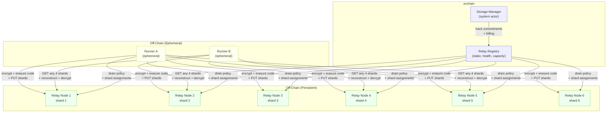
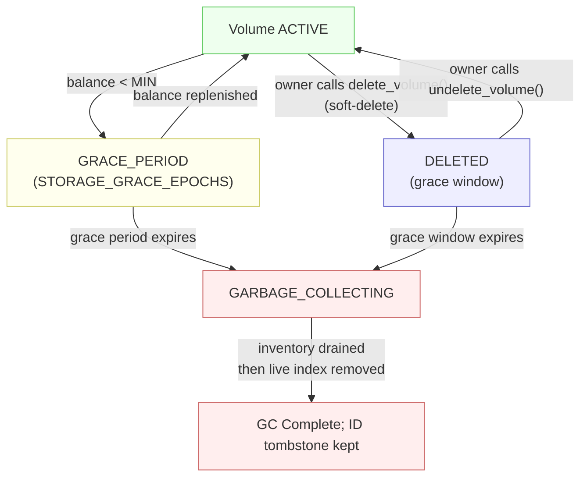

# CIP-9: Runner-Backed Storage

<Note>
  **Status:** Draft
  **Type:** Standards Track
  **Category:** Core
  **Created:** 2026-03-04
</Note>

## 1. Abstract

This proposal defines **CBFS-backed runner storage** — a system for provisioning, addressing, accessing, and billing off-chain storage volumes that are associated with a Cowboy account and made available to Runners during job execution. It extends CIP-2 (Verifiable Off-Chain Compute) by giving Runners persistent, addressable storage that survives beyond a single job invocation.

**CBFS** (the Cowboy File System) is the storage data plane: encrypted object writes, manifest handling, erasure coding, Relay Node RPCs, placement records, autonomous repair, and the FUSE/object client interfaces. **Cowboy** layers the protocol control plane on top: onchain `StorageCommitment` records, CapToken issuance and revocation, Relay Registry state, billing, and task attachment semantics. Together they form what this document calls Runner Attached Storage (RAS).

Key properties:

- **Account-scoped**: All storage is owned by and billed to a Cowboy account (EOA or Actor).
- **Private by default, public by choice**: Private volumes are encrypted client-side before leaving the Runner; only the owning account can decrypt. Public volumes (`visibility = PUBLIC`) are stored unencrypted and readable by any party without a CapToken, enabling use cases like web asset hosting (CIP-15) and public datasets.
- **Access-controlled**: Runners receive scoped capability tokens granting **read-only**, **write-only**, or **read-write** access to a storage volume. Multiple concurrent CapTokens may be active on the same volume simultaneously. Public volumes require CapTokens only for writes, not reads.
- **Addressable**: Every stored object has a deterministic path within the account's storage namespace, enabling targeted reads and deletes by the account owner.
- **Durable**: Objects are erasure-coded (Reed-Solomon) and distributed across multiple Relay Nodes, tolerating node failures without data loss.
- **Metered**: Storage is billed in CBY via a per-epoch, per-byte fee model (including erasure coding overhead) that extends the Cells concept from CIP-3 to persistent off-chain blobs. Rates are denominated in nano-CBY and set by CIP-31.

---

## 2. Motivation

Runners in the Cowboy off-chain compute system (CIP-2) are stateless by design — each job executes in an isolated environment and terminates. This creates four concrete gaps:

1. **Secret management.** Runners need access to API keys, certificates, and credentials without exposing them on the public chain. These secrets must only be decryptable by authorized Runners, optionally gated by TEE attestation.

2. **Large off-chain output.** Computation frequently produces artifacts exceeding the 64 KiB onchain inline cap (whitepaper §7). LLM inference may generate images, audio, datasets, or model weights that are too large for `result_data` and inefficient to pass through onchain callbacks. These must be stored off-chain with a verifiable content commitment anchored onchain.

3. **Multi-step data flow.** Iterative computation (AI training loops accumulating weights across invocations), stateful agents (conversation history, tool outputs, learned preferences persisting across scheduling cycles), pipeline handoff (Runner A produces intermediate data consumed by Runner B), and agent swarms (coordinator + concurrent sub-agents sharing a volume) all require persistent, addressable storage between jobs.

4. **Container persistence.** CIP-10 container runtimes require persistent storage layers for stateful applications, databases, and caching across job restarts. Without attachable storage, containers are limited to ephemeral scratch space.

A critical constraint is that **Runners are ephemeral**. Most Runners operate as short-lived containers without persistent local disk and are not guaranteed to remain available after job completion. This means the storage layer must be **separate from the compute layer** — Runners are clients of the storage system, not the storage system itself.

### 2.1 Why not existing systems?

Existing decentralized storage systems offer relevant concepts but none are a direct fit:

| System | Relevant Concept | Limitation for Cowboy Runners |
|--------|-----------------|-------------------------------|
| **Filecoin** | Content-addressed storage deals with proof-of-spacetime | Minimum 180-day deals; sector sealing takes hours; no built-in access control |
| **IPFS** | Content addressing (CID), pinning | No persistence guarantee; no native privacy; deletion only local |
| **Arweave** | Permanent one-time-payment storage | Immutable — no deletion possible; wrong model for ephemeral runner output |
| **Storj** | S3-compatible API; Macaroon-based capability tokens; client-side encryption | Centralized coordination (Satellites); not permissionless; not integrated with onchain billing |
| **Sia** | Encrypted erasure-coded storage with contract-based billing | Contract formation latency; single-renter access model |

RAS draws on the strongest ideas from these systems — **Storj's Macaroon-inspired capability tokens** for scoped access control, **Sia/Storj's erasure coding** for durability, **S3's path-based addressing** for usability, and **Sia's contract-expiry cleanup** as a safety net — while integrating them into a canonical CBFS-backed storage layer for Cowboy's account model, Runner framework, and dual-metered fee system.

---

## 3. Definitions

- **Volume**: A named, account-scoped storage namespace. An account may own multiple Volumes. Each Volume is an isolated container for stored objects.
- **Object**: A single blob of data stored within a Volume, identified by a path key.
- **CBFS**: The canonical off-chain storage engine used by this CIP. CBFS nodes implement the Relay Node data plane and CBFS clients implement the object API, manifest handling, and FUSE mount described here.
- **Storage Commitment**: An onchain record that tracks a Volume's existence, owner, size, shard placement, creation epoch, and billing state.
- **Capability Token (CapToken)**: A cryptographic bearer token encoding the permissions (read-only, write-only, or read-write), scope (volume + path prefix), time bounds, and size quota for a client's access to a Volume. The client may be a Runner during a job, the owner via the CLI/SDK, or any other authorized caller.
- **Relay Node**: A CBFS storage node participating in the Cowboy network that persistently stores erasure-coded shards of Volume data. Relay Nodes are a distinct network role from Runners and Validators, with their own staking and incentive model.
- **Shard**: A fragment of an erasure-coded object. An object is split into K data shards and M parity shards (K+M total); any K shards are sufficient to reconstruct the original object.
- **ObjectDescriptor**: The immutable content-identity record for a stored object. Contains the path, content hash, ciphertext hash, encryption nonce, size, erasure parameters, and per-shard hashes. Stored inside the encrypted manifest via `ManifestEntry::File`.
- **PlacementRecord**: The mutable shard-to-node assignment record for a stored object. Contains a `shard_id`, a list of `PlacementAssignment` (shard_index → node_id), duplicated erasure params and shard hashes (so repair workers can operate without manifest access), a `ciphertext_size` (the pre-padding ciphertext length needed for correct erasure reconstruction), and a CAS `version` for atomic updates. Replicated to all participating Relay Nodes independently of the manifest.
- **Volume DEK**: The per-volume AES-256 data-encryption key. It is wrapped one or more ways according to the volume's access class (§9.1) — to the owner's wallet-derived key, to the CBSS committee, or both.
- **CBSS**: The Cowboy Secret Service — the threshold committee that holds the IBE capability to unwrap a committee-wrapped Volume DEK on behalf of an authorized Runner (§9.2).
- **Write-Relayer**: The `cowboy-ras-write-relayer` service, which submits owner-signed RAS control-plane transactions (volume create, manifest commit, allowlist updates) and pays their gas on a client's behalf (§12.2.1).
- **Dispatcher**: The **Job Dispatcher** system actor (`0x02`), defined by CIP-2 — the in-consensus job-dispatch logic that selects Runners (VRF + committee filtering), issues and revokes CapTokens, and manages job lifecycle. It is **not** a separate off-chain service: its actions execute inside block processing at consensus trust level. In CIP-9 the Dispatcher additionally applies the storage-capability filter (§5.1.1), scopes a CapToken to a mount grant for cross-owner access (§7.7), and constructs and authorizes the CBSS `SealRequest` for private-volume key delivery (§9.2) — it never handles a plaintext DEK.

### 3.1 Canonical Manifest DAG

The storage manifest is a **content-chunked, path-ordered Merkle-DAG**, and the root committed on-chain (`StorageCommitment.manifest_root`, §11.1) is the trust anchor for every read. The structure is pinned to a single canonical algorithm so any party — a Runner, a Gateway, an indexer, an owner CLI — can independently recompute and verify the root. The canonical implementation is `cbfs/manifest/src/dag.rs` (`build_manifest_dag`):

1. The manifest is the set of `ManifestEntry` (`cbfs/types`): `File { descriptor, metadata }`, `Symlink { … }`, `Directory { … }`, ordered lexicographically by `path()` (UTF-8 byte ordering).
2. Entries are grouped into **leaf nodes** by content-defined chunking: once a node holds at least `MANIFEST_NODE_MIN_ENTRIES` (64) entries, a boundary is cut at the first entry whose domain-separated hash hits the target — `BLAKE3("cbfs.manifest-entry-boundary.v1" || encoded_entry)` with its low `MANIFEST_NODE_TARGET_BITS` (10) bits all zero (≈1024-entry target) — and is forced at `MANIFEST_NODE_MAX_ENTRIES` (2048) or `MANIFEST_NODE_MAX_BYTES` (256 KiB). This is a per-entry hash test, not a rolling hash. A `Leaf { entries }` carries its slice of the sorted entries.
3. Leaf nodes are reduced into **interior nodes** the same way (boundary domain `cbfs.manifest-child-boundary.v1`); an `Interior { children }` carries `ManifestChild { min_path, locator, subtree_count }` pointers. Levels reduce bottom-up until one node remains.
4. Each node is **content-addressed** by its `locator` — the BLAKE3 hash of its canonical encoding (magic `CBMN` for plaintext nodes, `CBME` for encrypted envelopes). The root is the locator of the top node; `manifest_root` is that value.

Because chunk boundaries are content-defined, an insert/update/delete rewrites only the leaf it lands in and the interior nodes on the path to the root — every other node keeps its locator and is **structurally shared** with the prior commit. `build_manifest_dag` takes the prior `ManifestDagSnapshot` and returns the new root plus `added_nodes` / `removed_nodes`, so a commit publishes and bills only the delta (this is what makes incremental commits O(changed), not O(N) — and is the basis for the PoR shard-hash rollup in §5.6 and the delta-scoped commit authority in §7.2).

For **private** volumes each node is individually AES-256-GCM-encrypted under the volume DEK (with no derived node key; the AAD is the literal bytes `cbfs.manifest-node-aad.v1` followed by the 32-byte `volume_id`, without delimiters or a terminating NUL) before storage, so `manifest_root` commits to **ciphertext** nodes and reveals nothing without the DEK. For **public** volumes nodes are stored as plaintext, which is what lets an unauthenticated Gateway recompute and verify the root (§5.3.2, §7.6.3).

---

## 4. Design Overview

### 4.1 Architecture

Runners are ephemeral compute nodes. They do not store data persistently. Instead, a network of **CBFS Relay Nodes** provides durable, always-available storage. Runners write to and read from Relay Nodes over the network during job execution.



### 4.2 Lifecycle

1. **Create**: Account owner creates a Volume via the Storage Manager system actor, specifying a name, optional size quota, and replication parameters. An onchain Storage Commitment is written.
2. **Attach**: When submitting a CIP-2 task, the owner includes one or more volume attachments in the task definition, each specifying the volume name, access mode (read-only, write-only, or read-write), and an optional path prefix scope.
3. **Authorize**: The Dispatcher (or a delegated Storage Manager) issues a CapToken to each selected Runner. The token is scoped to the specified volume, access mode, path prefix, job duration, and byte quota.
4. **Write**: The Runner encrypts object data, erasure-codes it into K+M shards, and distributes shards to Relay Nodes. Shards are immediately available for retrieval by other CapToken holders on the same volume.
5. **Read**: The Runner fetches any K of K+M shards from Relay Nodes, reconstructs the object, decrypts, and verifies the content hash.
6. **Commit**: At job completion (or periodically), the Runner commits a storage manifest — a Merkle root of all objects written — to the onchain Storage Commitment.
7. **Manage**: The account owner can list, read, and delete individual objects or entire Volumes at any time via the Storage Manager.

### 4.2.1 Committee Composition for Storage-Attached Jobs

A job that mounts a volume is dispatched through the **same CIP-2 verification committee** as any other off-chain job — CIP-9 does not introduce a separate dispatch path. It adds one prerequisite to committee selection: every runner considered for a storage-attached job MUST be **storage-capable** (§5.1.1) — `storage_support = true` with a valid x25519 `encryption_pubkey`. Runners lacking the capability are filtered out *before* committee sizing, not after.

This creates a hard coupling between CIP-2 committee size and the storage-capable runner population. If the verification committee size `M` exceeds the number of eligible storage-capable runners, dispatch fails with `InsufficientStorageCapableRunners { required, available, reasons }` (§8.2.1) and never proceeds.

**Open design point (CIP-2 × CIP-9 seam):** whether storage *reads* may ride a smaller committee (e.g., `M = 1`) than verified *compute*, or must always use the full verified-compute committee, is governed by CIP-2 committee sizing and is not yet settled. Until it is, a storage-attached job inherits the compute committee size. Implementations MUST expose the storage-capable count at dispatch so an operator can tell when committee size — not storage availability — is the binding constraint.

### 4.2.2 Dependency on Runner-Backed Continuations

Other than volumes mounted via the CLI or a client application, volume mounts are almost always reached through runner-backed continuations — an actor's `runner.agent` / `runner.http` job. Such a job is materialized on-chain as a **deferred transaction** (`job_submit`) by the CIP-2 / CIP-5 machinery. CIP-9 dispatch is therefore gated on that materialization succeeding: if the deferred `job_submit` tx is dropped (for example by a speculative-execution cache eviction that fails to preserve a block's deferred txs), the mount job is never created and the storage layer is never reached — even though every storage-side gate would have passed.

The full chain of gates a storage job must clear is enumerated in **Appendix D**.

### 4.3 Canonical Implementation Boundary

This CIP is intentionally split into a **CBFS data plane** and a **Cowboy control plane**. Both are normative parts of a conforming CIP-9 implementation.

**CBFS data plane responsibilities:**

- Object encryption/decryption for `PRIVATE` volumes and plaintext handling for `PUBLIC` volumes.
- Reed-Solomon erasure coding, shard hashing, and shard placement records.
- Relay Node RPCs (`PUT_SHARD`, `GET_SHARD`, `LIST_SHARDS`, placement replication, repair traffic).
- Manifest storage, reconstruction, Merkle root computation, and verification against the authoritative root.
- FUSE mount behavior, local cache, sync daemon, and direct object API.
- Shard repair, garbage collection of orphan shards, and local usage reporting hooks.

**Cowboy control plane responsibilities:**

- `StorageCommitment` lifecycle, authoritative `manifest_root`, and volume ownership semantics.
- CapToken issuance, revocation, and task-scoped attachment semantics.
- Relay Registry membership, staking, health, and repair coordination triggers.
- Billing, fee settlement, storage grace periods, and slashing policy.
- Integration with CIP-2 task submission and the Runner execution flow.

CBFS is the canonical storage substrate; CIP-9 specifies how Cowboy governs, authorizes, and pays for that substrate.

### 4.4 Relationship to Existing CIPs

- **CIP-2 (Off-Chain Compute)**: RAS extends the `OffchainTask` definition to include volume attachments. The Runner Submission Contract is extended to accept storage manifests alongside `result_data`.
- **CIP-3 (Fee Model)**: RAS introduces a new fee dimension — **persistent storage fees** — billed per byte per epoch (including erasure overhead). Unlike CIP-3 Cycles and Cells (which are metered by the VM during transaction execution), storage usage is metered externally by Relay Nodes and settled onchain via attestation-based billing.
- **CIP-4 (State Storage)**: onchain Storage Commitments live in the existing `STORAGE` key space under the Storage Manager actor's address. Volume data itself is NOT stored in the MPT trie.
- **CIP-10 (Runner Container Runtime)**: CIP-10 consumes the storage primitive defined here. Container image handling, cgroups, network policy, and GPU passthrough are separate concerns; volume attachment, mount semantics, and the object API are defined by CIP-9 and then mounted into CIP-10 runtimes.

---

## 5. Relay Nodes

### 5.1 Role and Responsibilities

Relay Nodes are distinct from Runners and Validators. They are implemented as CBFS storage nodes. A Relay Node:

- Stores erasure-coded shards of encrypted Volume data.
- Stores `PlacementRecord` entries that map shard IDs to their assigned nodes (see §5.3.1).
- Serves shards and placement records to authorized requesters (Runners with valid CapTokens, account owners).
- Heartbeats to the onchain Relay Registry to prove liveness.
- Runs autonomous two-phase repair (self-heal + redundancy restoration) without Runner involvement (see §5.5).
- Replicates PlacementRecords to peer nodes via `ReplicatePlacement` RPCs.

Relay Nodes hold opaque ciphertext shards and never see plaintext. They verify CapTokens to gate access to both shard and placement operations (§7.1.1) but perform no computation on the data beyond repair.

### 5.1.1 Runner Storage Capability

Relay Nodes hold and serve shards; **Runners** are the clients that read and write them during a job. For a Runner to be assignable to a storage-attached job it must advertise a storage capability, and the dispatcher enforces it (§4.2.1, §8.1). Two fields are added to the Runner's registry capabilities (the CIP-2 `RunnerCapabilities` record):

- `storage_support: bool` — the Runner is willing and configured to mount volumes.
- `encryption_pubkey: [u8; 32]` — the Runner's x25519 public key, used as the recipient key for sealed DEK delivery (§9.2).

A Runner MUST set `storage_support = true` **and** publish a valid `encryption_pubkey` to be eligible; the dispatcher's storage filter rejects any runner missing either. Both default to off — `storage_support` is `#[serde(default)]` false — and auto-registration derives them from the Runner's storage configuration (a CBSS/secrets endpoint and an x25519 key being present). To avoid "advertised but ineligible" runners, auto-registration MUST NOT set `storage_support = true` unless a valid `encryption_pubkey` is present in the same registration — i.e., the two are set together or not at all, so a runner never advertises a capability the dispatcher will reject. A Runner with no storage configuration is then correctly invisible to volume jobs rather than being selected and failing the mount after assignment.

**Capability updates require a re-register path.** Capabilities are fixed at registration, and a second `register_runner` for an already-registered identity is rejected (`RunnerAlreadyRegistered`). To *change* storage capability — e.g., a runner that later gains a secrets endpoint — the operator MUST be able to `deregister_runner` (refunding stake) and register again with the new capabilities.

### 5.2 Relay Registry

The Relay Registry is a system contract (analogous to the Runner Registry in CIP-2) that manages Relay Node registration, staking, health, and capacity.

```
// Consensus RelayNodeProfile — see node/ras/src/types.rs. The per-block `health` decay
// model was never deployed; liveness is a RelayStatus enum + heartbeat freshness (§5.2 note).
RelayNodeProfile {
  address:              bytes20,
  owner_address:        bytes20,        // wallet that owns/controls the relay; receives settlement payouts
  node_id:              bytes32,        // routing identifier (distinct from address)
  relay_identity_pubkey:bytes32,        // Ed25519 pubkey for handshake / PoR signatures
  status:               RelayStatus,    // ACTIVE | DRAINING | DISABLED | INACTIVE (replaces per-block health)
  endpoint:             string,         // advertised relay endpoint
  capacity_bytes:       u64,            // advertised storage capacity
  used_bytes:           u64,            // consensus-derived from committed manifest assignment deltas, not heartbeat self-reporting
  registered_epoch:     u64,
  activated_epoch:      u64,
  updated_epoch:        u64,            // last profile mutation (heartbeat freshness); replaces last_heartbeat
  drain_epoch:          u64,
  stake_amount:         u128,           // CBY staked
  shards_held:          u32,            // number of active shards
  shards_lost:          u32,            // historical shard losses (reputation)
  metadata_version:     u64,            // CAS version for profile updates
  pending_unstake_epoch:Option<u64>,
  region:               Option<string>, // operator-declared canonical region code
  last_auto_drain_reason:Option<AutoDrainReason>,  // OverCapacity | StaleHeartbeat | InsufficientStake | Governance
  last_auto_drain_epoch: u64,
  auto_drain_blocked_epoch: u64,
  // System-level rebalance visibility (derived from absorption receipts + drain state):
  rebalance_shards_moved:     u64,
  rebalance_shards_remaining: u64,
  rebalance_started_epoch:    Option<u64>
}
```

Clients discover the active relay set from this registry and need no relay configuration. (CBSS DEK delivery — the seal committee and the sealed ciphertext — is covered in §9.2 and does **not** use a relay-registry field.)

**Lifecycle:**

- **Register**: Relay Node stakes `MIN_RELAY_STAKE` CBY and calls `register_relay(capacity_bytes)`.
- **Heartbeat**: Relay Node calls `heartbeat()` periodically, refreshing its `updated_epoch`. Liveness is tracked by heartbeat freshness, **not** a per-block health counter (the `health`-decay model of earlier drafts was never deployed): a relay whose last heartbeat is older than the auto-drain policy's `stale_heartbeat_epochs` becomes eligible for auto-drain (`AutoDrainReason::StaleHeartbeat`, §5.8).
- **Removal**: A stale-heartbeat or misbehaving relay is transitioned out of `ACTIVE` (`status` → `DRAINING` / `INACTIVE`) via the auto-drain policy (§5.8). Its shards are migrated / flagged for repair (see §5.5).
- **Unstake**: A Relay Node may unstake after a cooldown period (`RELAY_UNSTAKE_DELAY`), provided it has no active shard assignments or has transferred them.

### 5.3 Shard Assignment

When a client writes an object, it must select K+M Relay Nodes to receive shards. Selection follows these rules:

1. **Eligible set**: All Relay Nodes in the active list with `status = ACTIVE` and sufficient free capacity.
2. **Diversity**: Selected nodes SHOULD have distinct `region_hint` values (best-effort, not enforced).
3. **Determinism**: The initial assignment is recorded in the object's PlacementRecord (replicated to Relay Nodes, §5.3.1) so any future reader or repair worker knows which Relay Nodes hold which shards.

Each stored object produces two records: an **ObjectDescriptor** (immutable, stored in the encrypted manifest) and a **PlacementRecord** (mutable, replicated to Relay Nodes independently of the manifest).

```
ObjectDescriptor {
  object_path:      string,
  write_id:         bytes16,          // CSPRNG(16) — fresh random per write, ensures version isolation
  content_hash:     bytes32,          // BLAKE3 hash of plaintext
  ciphertext_hash:  bytes32,          // BLAKE3 hash of ciphertext (pre-erasure-coding)
  encryption_nonce: bytes12,          // random nonce used for AES-256-GCM (unique per write)
  size_bytes:       u64,              // original object size
  ciphertext_size:  u64,              // ciphertext length before erasure padding (needed for correct reconstruction)
  shard_id:         bytes32,          // BLAKE3(volume_id || object_path || write_id) — opaque, version-unique
  erasure_k:        u8,
  erasure_m:        u8,
  shard_hashes:     [bytes32; K+M],   // BLAKE3 of each whole shard (integrity / repair)
  shard_chunk_roots:[bytes32; K+M],   // per-shard chunk Merkle root; the native RAS inventory anchors PoR (§5.6)
}
```

```
PlacementRecord {
  volume_id:        bytes32,          // volume binding checked against locally stored shard metadata
  shard_id:         bytes32,          // matches ObjectDescriptor.shard_id
  version:          u64,              // CAS version — monotonically incremented on each reassignment
  assignments: [
    { shard_index: u8, node_id: bytes32 },
    ...  // K+M entries
  ],
  // Duplicated from ObjectDescriptor so repair workers can operate
  // without manifest access (critical for private volumes where the
  // manifest is encrypted):
  erasure_k:        u8,
  erasure_m:        u8,
  ciphertext_size:  u64,
  shard_hashes:     [bytes32; K+M],
  shard_chunk_roots:[bytes32; K+M],   // duplicated so relays can build PoR proofs without the manifest (§5.6)
}
```

**Why two records?** The manifest is encrypted for private volumes — repair workers (Relay Nodes) cannot read it. By replicating the erasure params, shard hashes, and `ciphertext_size` into the PlacementRecord, Relay Nodes can autonomously verify, reconstruct, and reassign shards without ever touching the manifest. The CAS `version` field enables atomic reassignment: a repair worker reads the current version, computes a new assignment, and writes with `expected_version = current`; if another node raced, the write fails and the worker retries.

The `write_id` ensures that overwrites to the same object path produce distinct shard addresses. Without it, overwriting a path would physically replace the old shards on Relay Nodes, destroying the only retrievable copy of the previous version. This would break rollback after failed commits, concurrent writers to overlapping paths, and reads from old manifests. With `write_id`, old shards remain on Relay Nodes until the new manifest commits and the old shards become orphans (garbage collected after `ORPHAN_SHARD_TTL_SECS`).

**Two lists, not one.** A volume's `relay_nodes` and an object's
`PlacementRecord.assignments` are different objects. The first is the volume's
relay list, fixed at creation, and is the only per-index responsibility the chain
can see; the second is where an object's shards actually went. They are **not
kept in agreement**, and §5.6.1 states where they diverge and what it costs. This
is a known defect (COW-4124), not a design.

`relay_nodes` is a `Vec<RelayEndpoint>` on the `StorageCommitment`, bounded at
`2 × (K + M)` entries when supplied explicitly at `create_volume`, and required to
hold at least `K + M` **distinct** `node_id`s once the creation floor is active
(COW-2622). Position is meaningful: index `i` is the relay the chain holds
responsible for shard index `i`. §11.1's schema block does not yet list it.

### 5.3.1 Placement Persistence

PlacementRecords are replicated to Relay Nodes independently of the manifest via three dedicated RPCs:

| RPC | Purpose |
|-----|---------|
| `PutPlacement(shard_id, record)` | Store or update a PlacementRecord. Used by the SDK during commit and by repair workers during reassignment. |
| `GetPlacement(shard_id)` | Fetch a PlacementRecord by shard ID. Used by the SDK during open/refresh and by repair workers. |
| `ReplicatePlacement(shard_id, record)` | Node-to-node replication during placement sync. |

All three RPCs are auth-gated by the same `AuthProvider` as shard operations (§7.1.1).

A PlacementRecord MUST carry its `volume_id`. When accepting a placement update or replication for a shard assigned to itself, a Relay Node MUST reject a record whose volume conflicts with that shard’s existing local volume binding. A record cannot change the volume to which stored bytes belong.

**Commit path:** When the SDK commits a volume, it publishes each PlacementRecord to all assigned Relay Nodes via `PutPlacement`. Manifest-node records are part of the commit: every assignee MUST accept the record (`Ok`, or `ErrConflict` for a record it already holds at that version or newer) before the SDK submits `CommitManifest`; a refusal or an unreachable assignee aborts the commit before the chain call, and the client's commit journal stays "not ready" so the next attempt republishes. Object-shard records remain best-effort during commit — failures are logged, and placement sync and repair self-heal them. (COW-3263)

**Open path:** When the SDK opens a volume, it queries Relay Nodes for PlacementRecords via `GetPlacement` for each shard ID in the manifest. For any shard where no Relay Node returns a record (e.g., first open of a migrated volume), the SDK falls back to constructing an assumed placement from the node selector.

**On-disk schema versioning.** PlacementRecords are persisted in the Relay Node's `cbfs-placement` sled store inside a **versioned magic envelope**: `magic: [u8; 4] || schema_version: u8 || bincode(PlacementRecord)`. bincode is not self-describing, so a bare field addition deserializes as a truncated or garbage record ("unexpected end of file") on every node still holding old data — `#[serde(default)]` does not save you. On a `schema_version` mismatch the node treats the record as unreadable and re-derives placement from peers rather than aborting. The `schema_version` MUST be incremented on any change to the `PlacementRecord` layout.

**Placement-store lifecycle across re-genesis.** Placement records reference `node_id`s and a `volume_id` namespace that are only meaningful within a single chain instance. When the chain is re-genesised, every persisted placement is stale: the nodes it names no longer exist and repair can never satisfy it. A Relay Node MUST record the genesis hash alongside its placement store and, on first boot against a different genesis, **wipe the placement store** rather than attempt to repair placements from a dead chain. Skipping this wipe is a documented relay crash-loop source (see §5.5 dead-placement backoff).

### 5.3.2 `GET_MANIFEST` RPC

The manifest can always be read indirectly by traversing the DAG (§3.1): starting from the on-chain `manifest_root`, a client fetches each node by its shard id `manifest_node_shard_id(volume_id, locator)` = `BLAKE3("cbfs.manifest-node.v2" || volume_id || locator)` via `GET_SHARD`. `GET_MANIFEST` is a direct, one-round-trip alternative **for public volumes** that returns the whole manifest without per-node traversal — the recommended path for public-volume consumers (Gateways, indexers):

```
GET_MANIFEST { volume_id: bytes32, manifest_root: bytes32, erasure_k: u8, erasure_m: u8 }
  → { manifest: bincode(map<path → ManifestEntry>) }
```

The response is the manifest's **entry map**, not the DAG encoding of §3.1. That
distinction is load-bearing for the Verification step below, which rebuilds a
manifest from entries and recomputes its root; a reimplementer who serialized the
DAG instead would be incompatible with every existing client.

**The caller names the root; the relay does not return one.** An earlier draft of
this section had the relay return `manifest_root` alongside the manifest, for the
caller to check. That shape invites a specific mistake: a client can compare the
returned root against a root it recomputed from the returned manifest, see them
agree, and believe it has verified something. It has not — a dishonest relay
supplies both halves. Removing the field removes the trap: there is no root in
the response to check the response against, so the only comparison available is
against the root the caller supplied.

This does **not** make verification unskippable. A caller can still pass a root
it did not take from the chain, and a *stale but genuine* root of the same volume
will assemble and verify cleanly while delivering an outdated manifest. The
obligation in Verification below is a real obligation; what the shape removes is
the illusion of having met it.

`erasure_k` and `erasure_m` come with the request because `handle_get_manifest`
reaches assembly with only the `AuthDecision` — `{allowed, max_bytes, metadata}`
— and not the `StorageCommitment` it authorized against, which does carry them
(§11.1). That is an implementation seam, not a protocol necessity: an
implementation that keeps the commitment in hand MAY take `k`/`m` from it and
ignore the request's. No preference is stated here — a `SHOULD` either way would
make two conforming relays answer one request differently, and the reference
implementation passes the request's values straight through.

Because they are caller-controlled on an unauthenticated RPC, a Relay Node MUST
range-check `erasure_k` and `erasure_m` **before any peer fetch**. `k + m` bounds
the shard grid and therefore the per-node fanout of assembly, so an unchecked
pair is an amplification vector.

That bound is per DAG node, and it is the only bound this section states. The
number of nodes an assembly walks is a property of the manifest the caller
named, not of anything it supplies, so the range check does not make
`GET_MANIFEST` cheap — it makes each node's fanout finite. A total budget per
request (node count, response size, or a caller-facing rate limit) is a separate
requirement and is not specified here; a Relay Node that serves this RPC at
volume will want one.

**Authorization (PUBLIC only).** `GET_MANIFEST` applies to PUBLIC volumes, whose manifest nodes are plaintext (§3.1). A relay serves it without a CapToken, deciding from the volume's `StorageCommitment` — visibility `PUBLIC` and status `ACTIVE` or `GRACE_PERIOD` — through the **same `AuthProvider` entry point that authorizes an anonymous `GET_SHARD` and `GET_PLACEMENT`** (§7.6.3). One predicate over one source serves all three, so the read paths cannot disagree.

An earlier draft of this paragraph, and §7.6.3 with it, required the decision to come from stored shard metadata rather than a commitment lookup, for that same "cannot disagree" reason. The plumbing for that exists — `PUT_SHARD` persists whatever `metadata` the `AuthDecision` carries — but two properties of a shard defeat it, and one of them is fatal:

- **Status is dynamic; metadata written at commit time cannot carry it.** A volume that has since become `DELETED` or `GARBAGE_COLLECTING` is indistinguishable from an active one by the bytes on disk. A relay would serve it until its volume-event poller happened to tear the shards down, which is a teardown interval rather than a cache window. The commitment path is not instantaneous either — it reads a bounded-staleness cache — but the two differ by orders of magnitude, so this paragraph would be creating the lag, not closing it.
- **`GET_MANIFEST` is volume-scoped.** "The stored shard metadata" has no referent for a request that names no shard.

Visibility is consequently not written: the metadata a shard carries is its volume binding, its commit state, its kind and its tentative deadline. Adding a visibility marker would restate what the commitment says while still failing the status half.

Shard metadata keeps the job it is genuinely better at. An **anonymous** `GET_SHARD` must additionally match the shard's stored volume binding against the volume named in the request, so a caller cannot name a public volume and be served a shard belonging to a different — possibly private — one. (The distinct hazard of a *capability* for one volume reaching another volume's bytes is a token-path concern and is handled separately, in the handler: when a token IS present the authorized volume is taken from the shard's own recorded binding, falling back to the caller's claim only for a shard that carries none. The caller's claim alone is authoritative only on the anonymous path, where it is the thing being checked against the binding rather than the thing being trusted.)

**Private volumes are not served via `GET_MANIFEST`**: a relay without the DEK cannot decrypt a manifest node to learn its child locators (§3.1), so it cannot assemble the DAG — and the privacy model forbids it inspecting the manifest in any case (§9.3). A private manifest is read only by a DEK holder, node-by-node via `GET_SHARD` from the on-chain root, decrypting each node to discover the next locators. A volume whose status is `DELETED` or `GARBAGE_COLLECTING` is not served — the manifest is treated as absent.

**Owner-token admission.** In the reference CBFS implementation, `registry-proto::access_mode_allows` admits `GET_MANIFEST` for the volume owner's `READ_WRITE` token under the owner-authority rules (§7.2, §12.2.1). This is distinct from a grant-scoped token (§7.7.1), which does not admit `GET_MANIFEST`. The handler consults the resulting allow/deny and performs no visibility check of its own. An owner's request for a private volume therefore reaches assembly and fails when a manifest node decodes as an encrypted envelope under a plaintext reader. No private manifest is returned, but the failure occurs after placement lookup and peer shard fetches.

A Relay Node SHOULD therefore refuse `GET_MANIFEST` for a volume whose commitment is not `PUBLIC` at the authorization layer, on the token path as well as the anonymous one, so that the exclusion this section states is the rule that actually enforces it. Until it does, "not served" is a statement about outcomes, not about admission.

**Verification.** The relay is untrusted: it returns a flat entry map with no intrinsic binding to any root. The caller MUST rebuild the manifest from those entries, recompute its DAG root, and reject unless that root byte-matches the `manifest_root` it supplied — which it MUST have taken from the on-chain `StorageCommitment`. It MUST NOT cache or serve content from a manifest that fails this check. On mismatch, refetch from another Relay Node and mark the offending node suspect (§15.3 reputation). Node-by-node `GET_SHARD` traversal from the root remains valid; a Relay Node that does not implement `GET_MANIFEST` is treated as outdated (clients fall back to DAG traversal), not malfunctioning.

**Entry-map decoding and lookup.** Senders MUST encode each map key as its value's `entry.path()`, with one entry per path. Receivers MUST bound bincode decoding by the received payload length, using the fixed-width integer encoding of `bincode::serialize`; malformed or truncated payloads and DAG-construction errors MUST be rejected. The reference decoder uses `with_fixint_encoding().allow_trailing_bytes().with_limit(payload.len() as u64)`.

A receiver MUST construct the canonical lookup map from the entry values' `entry.path()` fields and use that **same map** for both DAG-root verification and subsequent path lookup. A receiver MAY reject mismatched wire keys or duplicate entry paths. If it accepts them, it MUST normalize as the reference SDK does: iterate the decoded `BTreeMap` in wire-key order and insert each value under `entry.path()`, replacing any earlier value at that path, **before** computing the root. Only this normalized, root-verified map may be cached or used to serve content. Verifying entry values and then looking up content through the original wire keys is non-conforming. The DAG construction and node chunking rules remain those of §3.1.

**Server-side model.** `GET_MANIFEST` is an *optimization*, not a primitive: no single Relay Node inherently holds the whole manifest, since each DAG node is itself an erasure-coded object spread across a placement set. A relay answers it only if it can **assemble** the public DAG — reconstructing each node from its K shards across the placement set, and/or serving a cache it built at commit time. (This is possible only for public volumes; private nodes are opaque to the relay, per the authorization note above.) A relay that cannot assemble it does not implement the RPC, and clients fall back to node-by-node traversal. Because the caller recomputes the root from the entries regardless, a stale or partial cache is safe — it fails verification and triggers a refetch.

### 5.4 Erasure Coding

RAS uses **Reed-Solomon erasure coding** to distribute each object across multiple Relay Nodes.

**Default parameters (governance-tunable, overridable per-volume):**

| Parameter | Default | Description |
|-----------|---------|-------------|
| K (data shards) | 4 | Minimum shards to reconstruct |
| M (parity shards) | 2 | Additional parity shards |
| K+M (total shards) | 6 | Distributed to 6 distinct Relay Nodes |
| Storage overhead | 1.5x | Account is billed for effective_size × 1.5 |

**Write path (performed by the writing client):**

1. Generate `write_id = CSPRNG(16)` and compute `shard_id = BLAKE3(volume_id || object_path || write_id)`.
2. Encrypt the object (AES-256-GCM, see §9). Record `ciphertext_size` (pre-padding length).
3. Erasure-code the ciphertext into K data shards and M parity shards using Reed-Solomon (`reed-solomon-erasure` crate).
4. Compute `shard_hash = BLAKE3(shard_bytes)` for each shard.
5. Select K+M Relay Nodes and PUT each shard to its assigned node, authenticated by the CapToken. The PUTs are issued concurrently, so the latency is one round trip plus the slowest relay, not K+M serial trips. See §5.4.1 for what happens when one refuses, and for when the write is durable.
6. Produce an `ObjectDescriptor` (stored in the manifest) and a `PlacementRecord` (published to Relay Nodes at commit time, §5.3.1).

**Read path (performed by the reading client):**

1. Look up the `ObjectDescriptor` from the manifest and the `PlacementRecord` (from local cache or fetched from Relay Nodes via `GetPlacement`).
2. Request any K shards from available Relay Nodes listed in the PlacementRecord (prefer lowest-latency nodes; fall back if some are unavailable).
3. Reconstruct the ciphertext using Reed-Solomon decoding, truncating to `ciphertext_size` to remove erasure padding.
4. Verify `ciphertext_hash`.
5. Decrypt (AES-256-GCM).
6. Verify `content_hash`.

**Comparison with other systems:**

| System | Scheme | Total Shards | Reconstruct From | Overhead |
|--------|--------|:------------:|:----------------:|:--------:|
| **RAS (default)** | Reed-Solomon 4/6 | 6 | any 4 | 1.5x |
| Storj | Reed-Solomon 29/80 | 80 | any 29 | 2.7x |
| Sia | Reed-Solomon 10/30 | 30 | any 10 | 3.0x |
| AWS S3 | Proprietary (3+ AZ replication) | — | — | ~3x |

The 4/6 default is conservative. Accounts may opt for higher redundancy (e.g., 6/10 for 1.67x overhead, or 10/16 for 1.6x) via volume creation parameters. Governance may adjust the defaults as the Relay Node network matures.

### 5.4.1 Write Durability

A write is **durable** only when all `K + M` shards have been accepted, each by a
distinct relay, and the resulting `PlacementRecord` names an assignee for every
`shard_index` in `0..K+M`. Anything less is a failed write, not a degraded one:
the client MUST NOT produce a descriptor for a partially-placed object.

Placing the shards is necessary and not sufficient. Repair only ever walks a
record a relay **holds**, so a write that meets the bar above but whose record
publication fails everywhere reaches the same invisible-to-repair state by
another route — and §5.3.1 and §12.2 both make object-shard record publication
best-effort, logged but not blocking (COW-3263). Durability in the sense that
matters is placement **plus** at least one relay holding the record.

That threshold is `K + M` and not `K`, even though `K` shards are enough to
*read* the object, because of how repair works. Autonomous repair (§5.5) walks a
record's **assignments**: Phase 1 self-heals only for an index this node is
assigned, and Phase 2 replaces an assignment whose node has gone dead. Neither
ever invents an assignment for a `shard_index` that has none. **An index that was
never assigned is invisible to repair forever.** A record published with K
assignments is therefore not "an object at reduced redundancy that will heal" —
it is an object permanently at zero parity, with nothing in the protocol that
will notice.

**Retry is narrow, and deliberately so.** The writing client over-selects relays:
the first `K + M` are the intended assignees and a fixed, small number beyond them
— `WRITE_ALTERNATE_NODES`, 2 in the reference client — are **alternates**. The
pool does not scale with the network, and on a network with exactly `K + M`
relays there are **no** alternates at all, so every refusal fails the write.
Exactly one refusal is worth asking a different relay about — a **capacity**
refusal, which `PutShard` returns for the node-wide cap, a per-authorization byte
cap and a failed fsync, and which the read-channel limiter returns for rate
limiting. Every other status says the same thing wherever it is sent: an
authorization failure is about the caller's capability, an invalid-request
failure about the request, and a conflict about overwriting committed bytes.
Those MUST fail the write immediately rather than walk the alternates, or the
real cause is spent on `K + M` more round trips and then buried under a
durability shortfall that names the wrong thing. Unreachability is also retried.
A deadline bounds when a *new* attempt may start; it does not cancel an attempt
in flight. A write therefore fails for either of two reasons: the alternates are
spent, or the deadline expired with alternates still unused.

When a shard does fall through to an alternate, the record names the alternate,
and the client additionally fires a best-effort delete at the displaced relay —
because a capacity refusal is also the answer for a failed fsync, so the original
may be holding a partial copy under a live `shard_id`.

**This describes the object-shard path only.** The manifest-DAG publish inside
`commit` (§5.3.1) has no alternates: it sends shard `i` to the `i`-th of the
relays frozen at volume open and aborts on the first non-`Ok`. §5.4 is written as
one procedure, but the fallback behaviour above belongs to `write_object` alone.

Three properties of the built system that §5.4.2 has to work around, stated
precisely because each is easy to state too strongly:

- **Integrity is established at write time.** The client holds every shard, so it
  computes every `shard_hash` and every PoR `chunk_root` itself and commits them
  in the `ObjectDescriptor`. Note two asymmetries. `PutShard` carries only
  `{volume_id, bytes}`, so **the receiving relay has no hash to check the bytes
  against** — it stores what it is given. And the manifest-anchored descriptor is
  the only *unforgeable* carrier of those numbers: repair, drain and the
  `GetPlacement` path all verify against `PlacementRecord.shard_hashes`, a
  duplicate copy that carries no client signature and is served by relays.
- **Only a client authors an assignment that did not already exist.** Relays do
  write records — repair's Phase 2 leader CAS-updates one with an incremented
  `version` (§5.5 step 5), the drain/rebalance worker builds a successor, and
  `ReplicatePlacement` accepts a peer-authored copy under §7.1.2's rule that the
  sender already appear in the record's `assignments`. What no relay does is
  introduce an index, or put itself somewhere it was not.

  The drain push (§7.1.2) is where a relay moves another relay's bytes, and its
  containment is worth stating exactly, because the obvious reading is wrong: the
  `old_record` a draining relay presents is **supplied by that relay**, so the
  "sender is the assignee at this index" check binds the sender to a record it
  chose — self-consistency, not authorization. What contains it is §7.1.2's MUST
  that the sender's registry status be `Draining`, together with the destination
  writing the shard as *volume-bound but never committed*, so promotion to
  committed still comes from the volume's own on-chain add event rather than from
  the sender's assertion.
- **The distinctness and coverage in the first paragraph are protocol, not an
  enforced check.** `validate_placement_record` bounds `assignments.len()` at
  `K + M` and each `shard_index` below `K + M`; it permits a duplicate
  `shard_index` and a duplicate `node_id`. The writer-side gate is a count, not
  per-index coverage. An implementation that checks only the count has not met
  this section's condition — so the two MUSTs in the first paragraph are
  **normative additions here**, not descriptions of an enforced check, and
  closing the gap means tightening `validate_placement_record` or the writer.

Three other descriptions of this write path exist and predate the alternates
work: the storage whitepaper's write flow, cbfs's `README.md`, and cbfs's
`docs/spec.md` all still say the client selects `K + M` relays and PUTs to them,
with no over-selection, no fallback and no durability quorum. This section is the
normative one; the others are stale.

### 5.4.2 Server-Side Fan-Out (proposed, not implemented)

The write path above costs the client `K + M` shard-uploads of
`ceil(ciphertext_size / K)` bytes each — `(K + M) / K` of the padded ciphertext,
1.5× at the default K=4/M=2, and more for small objects, where the AEAD tag and the
erasure padding are a larger fraction. Relays already reconstruct shards from
their peers during repair, so the machinery to produce a missing shard from
others exists server-side. The proposal is to use it on the write path: the
client uploads once, and relays fan the remaining shards out among themselves.

**The naive form does not work.** "Upload the K data shards and let redundancy
repair fill the M parity" fails for the reason §5.4.1 gives: the resulting record
has K assignments, the M parity indices have no assignee, and repair only ever
replaces an assignment that already exists. The object sits at zero parity
permanently. Any design in this space MUST produce a record that names all
`K + M` assignees at publication time, whatever subset of them the client itself
talked to.

**The shape that fits the existing invariants.** Keep the client as the author of
both the descriptor and the complete record, and move only the *bytes*:

1. The client encrypts and erasure-codes locally, exactly as today, so it holds
   every shard's bytes, hash and chunk-root without uploading them.
2. It selects `K + M` assignees as today and designates **exactly one** of them as
   the **ingest** relay. (Splitting the K data shards across several ingest relays
   does not work: Reed-Solomon reconstruction needs K shards, and no such relay
   would hold K. Sending the full input to several is strictly worse than today
   for the client's uplink, which is the thing the proposal exists to reduce.)
3. It uploads the K data shards to the ingest relay, together with the complete
   assignment list, the per-shard hashes and the erasure parameters.
4. The ingest relay reconstructs the `K + M − 1` shards it is not itself keeping,
   verifies each against the client-supplied `shard_hash`, and pushes it to the
   named assignee.
5. The client publishes the `PlacementRecord` naming all `K + M` assignees, and
   the descriptor with all `K + M` hashes and chunk-roots, exactly as today.

Step 4 is where a requirement this CIP does not currently state becomes
load-bearing: the ingest relay's re-encode must be **byte-identical** to the
client's, or every reconstructed shard fails its hash check. That is a
cross-implementation contract over the padding rule
(`shard_size = ceil(ciphertext_size / K)`, zero-filled to `K × shard_size`), the
empty-object case, and the specific Reed-Solomon generator matrix. §5.4 says only
"erasure-code the ciphertext". Fan-out cannot be specified without pinning that
first.

**What it changes.** Today the client watches every shard land, so "the write
returned" and "the bytes are on `K + M` relays" are the same event. With fan-out
they are not, and the two states need different names:

- **Accepted** — the ingest relay holds the K data shards and has taken on the
  duty to deliver the rest. Note what this does *not* mean: the object is not
  readable. Readers build their fetch targets from the record's `assignments`,
  one address per index, and have no discovery path to a relay holding a shard it
  is not assigned. An ingest relay assigned one index can serve exactly one
  shard, so an *accepted* object is unreadable until at least K assignees have
  been delivered to.
- **Placed** — every named assignee holds its shard. This is what §5.4.1 calls
  durable today.

A commit that publishes a record for an object that is only *accepted* is
asserting a placement that does not yet exist, for an object no one can read.
Whether that is permitted, and what bounds the window, is the first thing a
proposal has to answer.

#### 5.4.2.1 Unsolved problems

Each of these is an obstacle against the built system. A proposal that does not
address them is not ready.

1. **PoR liability does not follow the bytes — and does not today either.** A
   challenge binds `responsible_node_id` to `commitment.relay_nodes[shard_index]`,
   the volume-level relay list fixed at create, **not** to the record's assignee.
   §5.6.1 states the four ways the two diverge — there is no configuration in
   which they reliably agree — so the alternates path of §5.4.1 and every repair
   Phase-2 reassignment already point liability at a relay that may not hold the
   shard, and fan-out would widen an existing gap rather than open a new one. Any
   fan-out design has to resolve which list is authoritative. Tracked as COW-4124,
   because it is not a fan-out problem.
2. **A mis-delivered shard cannot be rejected by the relay that stores it.**
   Because `PutShard` carries no hash, an assignee cannot reject bytes that do not match
   the committed `chunk_root`; it stores them and answers the next challenge with
   a proof that fails verification, which lands on the fraud row of §5.6 rather
   than the miss row — an order of magnitude larger. An ingest relay that delivers
   *wrong* bytes therefore puts the assignee in the same position as one that
   delivered nothing: §5.6 records that there is no fraud branch in the
   implementation — an invalid proof reverts and the challenge folds into the same
   miss counter — so the two outcomes converge rather than diverge. The
   accountability problem is unchanged; only its size is.
3. **There is no authorization for the push, and one existing MUST forbids it.**
   Neither existing path fits. §7.1.2 states that the sender of a
   `PeerRelayPushShard` MUST be `Draining`, so an ingest relay — which is
   `Active` — is not merely unauthorized but structurally excluded; reusing the
   primitive means relaxing its only ground-truth gate, widening a
   self-consistency-checked path from "any draining relay" to the whole registry. Reusing ordinary `PutShard` means handing the ingest relay the
   client's **CapToken**, a bearer credential scoped to the volume, not to a
   shard, whose path prefix is explicitly not enforced at the relay — i.e.
   delegating volume-wide write authority, including deletes, to a party the
   client does not control. A shard-scoped, single-use credential does not exist.
4. **An undelivered index does not stay empty — it self-heals, expensively.** The
   assignee holds the record, Phase 1 sees a missing shard and pulls K shards from
   peers to reconstruct it. So the redundancy recovers, but a single lazy or
   failed fan-out costs the network a K-shard pull per undelivered index on
   relay-to-relay links, on top of the fan-out itself. It is client-inducible: one
   upload to a slow ingest relay provokes it. It also means the reason PoR may not
   slash is that self-heal usually wins the race — bounded by the repair budget
   and a 300 s cycle, which is a timing argument, not a guarantee.
5. **Surplus copies on the ingest relay become undeletable and unpaid.** The
   ingest relay holds K data shards, but is the named assignee for at most one.
   When the client commits, the relay's volume-event poller promotes *any* local
   copy matching `(shard_id, shard_index)` and the volume binding to `committed` —
   it does not check node id — and GC's committed-marker veto then holds those
   bytes indefinitely. Rent flows only to named assignees, and there is no
   fan-out equivalent of the displaced-assignee reclaim. A bandwidth favour turns
   into an unbounded, client-inducible storage liability.
6. **Fan-out collapses the one-relay-holds-a-fraction property.** Today no relay
   holds more than `1/K` of an object, because alternates are consumed globally so
   no two shards of one object land on the same relay. An ingest relay holding K
   data shards can reconstruct the whole object alone — and for a PUBLIC volume
   the ciphertext *is* plaintext, so a single relay holds the object in the clear.
   Combined with (5), it may hold it permanently. Nothing in the current threat
   model accounts for that.
7. **Billing asserts owner storage before it exists.** `effective_size_delta` is
   committed for all `K + M` shards, so the owner is billed for placement from the
   commit. (The relay side is already self-correcting: rent rewards are gated on a
   valid PoR response, not on holding an assignment, so an assignee that never
   received its shard earns nothing.)
8. **The retry budget moves server-side and is unbounded there.** The client's
   deadline bounds its own fallback chain. Nothing bounds how long an ingest relay
   keeps retrying a delivery, how many deliveries it may owe at once, or what it
   does with bytes for a duty it can never discharge — and a capacity refusal
   during fan-out has no fallback at all, since the ingest relay cannot rewrite
   the assignment list.
9. **Delivery races reassignment.** If Phase 2 reassigns an index while a delivery
   for it is in flight, the bytes land on a relay the record no longer names —
   where, by (5), the commit then pins them — while the new assignee holds
   nothing and self-heals by (4).
10. **The client has no evidence it can use.** `write_object` returns a receipt
    the *client itself* constructs; there is no relay signature anywhere on the
    write path, so an ingest relay can acknowledge and discard and no party can
    prove it. The shape needed already exists on the drain path, where the
    destination signs an absorption receipt that is settled on chain. Fan-out
    needs its equivalent at ingest, and again at delivery.
11. **The bandwidth accounting is not a wash.** With one ingest relay the client
    sends K shard-units and the relay-to-relay leg is `K + M − 1`, so the network
    moves `2K + M − 1` — 9 units at K=4/M=2, against 6 today. Fan-out saves the client
    `M` units and costs the relays `K + M − 1`; it does not re-route a fixed
    total, it increases it by half. The fee model does not clearly pay for it
    either: §10.1 charges data transfer "at read/write time" while §10.4 routes it
    to the relay *serving the shard*, and neither contemplates a relay-to-relay
    leg on someone else's behalf. Worse, the ingest relay
    chooses the delivery order, so it decides which assignees can answer reads
    during the accepted window, and therefore who earns those fees.

### 5.5 Autonomous Shard Repair

Repair runs on the Relay Nodes themselves — no Runner involvement and no onchain timer required. Each Relay Node periodically inspects the PlacementRecords it holds and executes a two-phase repair cycle:

**Phase 1 — Self-heal (local shard verification):**

For each PlacementRecord where this node is an assigned holder:

1. Verify the local shard bytes against the expected `shard_hash` from the PlacementRecord.
2. If the shard is missing or corrupt, fetch K healthy shards from peer Relay Nodes listed in the same PlacementRecord.
3. Reconstruct the ciphertext using Reed-Solomon decoding, truncating to `ciphertext_size` (not the padded shard length — using the wrong length produces garbage).
4. Re-encode and extract the needed shard. Verify its hash. Store locally.

Self-heal is safe for any node to run concurrently — it only writes to local storage and does not modify the PlacementRecord.

**Phase 2 — Redundancy repair (dead node replacement):**

1. For each PlacementRecord, probe all assigned nodes. A node is considered dead if it is unreachable after the configured timeout.
2. **Leader election**: Only the assigned node with the **lowest `shard_index`** among live nodes drives reassignment for that PlacementRecord. This prevents multiple nodes from racing to repair the same shard.
3. The leader selects replacement node(s) from the known peer list (excluding already-assigned nodes).
4. The leader reconstructs the missing shard(s) from K surviving shards (same erasure reconstruction as Phase 1) and uploads via `PutShard` to the replacement node(s).
5. The leader writes an updated PlacementRecord with the new assignments and an incremented `version`, using a **CAS (Compare-and-Swap) write**: the `PutPlacement` RPC specifies `expected_version = current_version`. If another node raced and already updated the record, the CAS fails and the leader retries from step 1 on the next cycle.
6. The updated PlacementRecord is replicated to all assigned nodes via `ReplicatePlacement`.

**Failure tolerance**: With K=4, M=2, the system tolerates **any 2 simultaneous Relay Node failures** per object without data loss. If 3+ nodes holding shards of the same object fail before repair completes, the object is lost. Repair cycle frequency should be tuned aggressively (default: `REPAIR_CHECK_INTERVAL_SECS` = 300 s, off-chain repair loop) to keep this window small.

**Dead-placement backoff.** A PlacementRecord whose assigned nodes are *all* unreachable (0 of K+M live) cannot be repaired — there is no surviving shard to reconstruct from. The repair worker MUST NOT re-attempt such a record every cycle; it applies exponential backoff (`2^n` cycles, capped at `MAX_REPAIR_BACKOFF`) and, after `LOST_PLACEMENT_CYCLES` consecutive all-dead observations, marks the placement `LOST` and stops attempting repair until a new placement supersedes it. Without this guard, a relay carrying stale placements (e.g., across a re-genesis, §5.3.1) busy-loops the repair worker and emits unbounded "0/N shards available" error logs every cycle.

**No Runner or onchain involvement**: Repair is fully autonomous. Relay Nodes read PlacementRecords (which contain all the information needed — erasure params, shard hashes, ciphertext_size, assignments), reconstruct shards from peers, and update placements via CAS. The onchain `StorageCommitment.degraded_shards` counter is updated by Relay Node heartbeats as a reporting mechanism, not a repair trigger.

### 5.6 Proof of Retrievability (PoR) Challenges

Heartbeats prove liveness but not retrievability — a Relay Node could be alive but have lost or withheld data. RAS uses **random PoR challenges** to verify that Relay Nodes actually hold the shards they claim to hold.

**Challenge mechanism:**

1. A periodic onchain timer (CIP-5, every `POR_CHALLENGE_INTERVAL` blocks) selects a random set of `(shard_id, shard_index, byte_offset, byte_length, nonce)` challenges targeting active Relay Nodes. Both the direct global sampler and the bounded volume-directory builder MUST exclude `GARBAGE_COLLECTING` volumes before drawing, even while their native inventory rows remain for cleanup (§13.3). The `nonce` is fresh per challenge. Consensus point-reads the live native RAS inventory row for each selected `(volume_id, shard_id, shard_index)` and snapshots its `chunk_root`, `shard_size`, and publication event sequence in the challenge (§11.1).
2. The challenged Relay Node must respond within `POR_RESPONSE_WINDOW` blocks with:
   - The requested byte range of the specified shard. The `nonce` seeds *which* range is asked, so a relay cannot precompute or replay a prior response.
   - A **range-inclusion proof**: a Merkle path from the fixed-size chunks (e.g. 4 KiB) covering the requested range to the shard's **chunk-root** — the Merkle root over that shard's chunks. (The relay already builds this chunk tree to serve byte ranges.)
3. The onchain verifier checks against the issue-time `snapshot_chunk_root` carried in the challenge:
   - the returned bytes hash into the chunk leaves of the range-inclusion proof, which resolves to a chunk-root;
   - that chunk-root equals the selected inventory row's snapshotted chunk-root;
   - if either fails, the response is invalid.

A relay that discarded the shard cannot produce valid chunks against the snapshotted chunk-root, and cannot reuse an old response because the `nonce` moves the challenged range. At issue time, consensus point-reads the shard's live native inventory row and records that row's chunk-root in the challenge. This **public per-shard commitment**, rather than `manifest_root`, anchors PoR for **private** volumes: `manifest_root` commits to *ciphertext* manifest nodes (§3.1), so the chain cannot verify plaintext object membership, but a shard's chunks are erasure-coded *ciphertext* and can be checked without the DEK. Public and private volumes use the identical path, and only the challenged range — not the whole shard — is transferred.

**Concurrent manifest updates and terminal GC:** If a volume commits between challenge issuance and response, the Relay Node proves against the selected row's issue-time `snapshot_chunk_root`, even if other inventory rows changed. If the challenged shard was removed by a commit, or the volume enters `GARBAGE_COLLECTING` before an unanswered challenge settles, settlement MUST void that challenge even if its native row remains during bounded GC. A later re-addition does not rewrite the pending challenge's snapshot. Voiding refunds the full bond, releases the relay's open slot, and creates no miss alarm, fee, slash, or bounty. `DELETED` remains challengeable because it is reversible and the relay must still retain the shard.

**Failure and slashing:**

**Everything below is gated.** The ladder runs only when governance has set
`cip31.cbfs.por_slashing_enabled`; it defaults to unset. While it is unset a
settled miss emits a `ras.por.miss_alarm` event and returns — and because the
consecutive-miss counter is written *inside* the slashing path, nothing is
recorded either. **Today the ladder has one rung: an alarm.** The table describes
what happens the day it is turned on, and §5.6.2 states what must be true first.

| Outcome | Consequence (with slashing enabled) |
|---------|-------------|
| Valid response within window or congestion grace | Challenge passed; bond returned less `POR_CHALLENGE_FEE`; no slash |
| Invalid response (proof mismatch) | Response transaction rejected; challenge remains open for a valid response or expiry settlement |
| Unanswered challenge after window and congestion grace | Miss alarm; no stake slash. With slashing enabled, the per-shard consecutive-miss count advances; otherwise it does not. Bond returned less `POR_CHALLENGE_FEE`. |
| Third consecutive miss with slashing enabled | Relay disabled and stake slashed by `RELAY_EVICTION_PENALTY`, capped by available stake; `shards_lost` increments once; challenger receives a full bond refund and may receive a bounded pool-funded bounty. |
| Shard incarnation removed/replaced, or volume reaches `GARBAGE_COLLECTING` before settlement | Challenge voided; full bond refund and open-slot release, with no miss, fee, slash, or bounty. |

**Design rationale:** This is a lightweight PoR scheme — it does not require the full Filecoin-style Proof-of-Spacetime (which seals sectors and requires constant re-proving). Instead, it spot-checks random byte ranges, making it cheap to verify but expensive to fake. A Relay Node that has genuinely stored the shard can respond trivially; one that has discarded it cannot.

**Challenge economics:** Challenges are funded from the storage fee pool — 1% of every per-epoch storage-fee batch accrues to the PoR challenge pool at `0x0B` (`STORAGE_FEE_CHALLENGE_POOL_BPS = 100`, formerly `POR_CHALLENGE_FEE_SHARE`; canonical split in §10.4 and CIP-31 §4).

**Challenge bond (required as of CIP-31).** Calling `por_challenge(shard_id, byte_offset, byte_length)` requires the caller to escrow `RELAY_CHALLENGE_BOND` (default 66 CBY, Tier-0 tunable; see CIP-31 §7) at `0x0B` for the duration of the challenge window. Lifecycle:

- **Valid response or unconfirmed miss:** bond is refunded minus `POR_CHALLENGE_FEE` (default 7 CBY, retained by `0x0B`). A rejected invalid response does not resolve the challenge.
- **Confirmed third consecutive miss with slashing enabled:** bond is refunded in full, **and** the challenger may receive `CHALLENGER_BOUNTY` (default 33 CBY) from the PoR challenge pool, bounded by available pool balance and its epoch cap. The Relay's `RELAY_EVICTION_PENALTY` slash is capped by actual stake and distributed under CIP-31 §8. `POR_MISS_PENALTY` and `POR_FRAUD_PENALTY` remain governed parameters but are not charged by this settlement path. The slashed-stake 10% share is burned, while the storage-fee 10% share is credited to the Platform Fee Account (`0x18`).
- **Void after shard removal/replacement or terminal GC:** the full bond is refunded, with no `POR_CHALLENGE_FEE` and no bounty.

The bond and fee charge unresolved or successful challenges while a confirmed slash can reward a challenger from the funded pool. A void caused by chain-state changes returns the full bond.

**Challenge-timer funding.** The periodic PoR-challenge timer is a CIP-5 timer and is metered per fire (`max_cost = gas_limit_per_fire × cycle_basefee + max_cells × cell_basefee`). It MUST be scheduled with `fee_payer = STORAGE_MANAGER` (`0x0A`), pre-charged each fire from the same PoR challenge pool that the `STORAGE_FEE_CHALLENGE_POOL_BPS` split feeds (above). If the pool is somehow insufficient at fire time, CIP-5 cancels the timer (`TimerCancelledInsufficientFunds`); the Storage Manager SHOULD surface this as `PorChallengePaused { reason: INSUFFICIENT_POOL }` and re-arm on the next interval once the pool refills. Only the timer's billing source is affected — PoR generation and shard validation are unchanged.

**Worked example — the Storage Manager scheduling its own challenge timer.** The timer is a CIP-5 `schedule_timer_ex` call made *by the `0x0A` system actor itself*, naming `0x0A` as `fee_payer`. Because `fee_payer == actor_address`, it is accepted under CIP-5 §4.2's self-funding exemption (a system actor funding itself, not a third party naming a system actor). Per-fire cost is pre-charged from `0x0A`, drawn from the `0x0B` PoR challenge pool above.

```python
STORAGE_MANAGER = bytes(19) + b"\x0a"          # 0x0A, left-padded to a 20-byte address

def rearm_challenge_timer(self):               # runs *as* the 0x0A system actor
    pvm_host.schedule_timer_ex(
        pvm_host.block_height() + self.CHALLENGE_INTERVAL,
        b"",                                   # payload: the challenge round is derived at fire time
        fee_payer=STORAGE_MANAGER,             # == actor_address (0x0A) → self-funding exemption
        gas_limit=self.CHALLENGE_GAS_PER_FIRE, # bounded per-fire budget
        # expires_at omitted → protocol-default TTL; the handler re-arms on each fire
    )
```

See CIP-5 §6.3 (Fee Settlement — worked example and per-fire metering) and CIP-5 §4.2 (the `fee_payer` self-funding exemption). A regular actor cannot name `0x0A` as `fee_payer`; only the Storage Manager itself can.

#### 5.6.1 Who a challenge holds liable

A challenge must name a relay to hold liable. The chain takes it from
`commitment.relay_nodes[shard_index]` — the volume's relay list indexed by shard
index — and binds it into the challenge at issue time. `relay_nodes` is written
once, at `create_volume`; **no instruction updates it**, which also makes the
issue-time binding's usual justification (that a later rotation must not retarget
the slash) vacuous: there is no rotation to defend against.

This is the chain's only per-index notion of responsibility, and it is not the
`PlacementRecord`'s assignee. The chain cannot derive the assignee: a commit's
shard references carry `shard_index` and no relay identity, while
`per_relay_effective_deltas` carries relay identity and no index, so the two
cannot be joined. §5.4.2.1(1) states the same thing from the write-path side;
this section is the definitive statement.

**The two lists diverge in four ways, and there is no configuration in which they
reliably agree.**

1. **The client's selector reorders.** The reference selector rotates a cursor per
   selection and then re-ranks the result by region novelty. The rotation is the
   identity only when the pool length equals `K + M`, and the region re-rank
   permutes even then whenever the volume's relays are not all in one region —
   which the on-chain relay profile supplies, on exactly the chain-integrated
   path. Opening a volume consumes a selection before any write, so for a volume
   named with more than `K + M` relays the first *write* already starts at a
   rotated offset. There is no "first write agrees" case.
2. **The write falls back.** A capacity refusal moves a shard to an alternate and
   the record names the alternate (§5.4.1). The chain is not told.
3. **Repair reassigns.** Phase 2 selects replacements from the repairing relay's
   own peer table, which is wider than, and unrelated to, the volume's relay set.
   A repaired index can leave `relay_nodes` entirely, on any volume.
4. **The list can be short, or point at a relay that has left.** Auto-assignment
   returns however many eligible relays it found; an index past the end of the
   list has *no* relay, so the user challenge path refuses it and the timer path binds no
   responsible node and settles alarm-only forever. Separately, a named relay may
   since have drained, self-disabled or been evicted, at which point its profile
   no longer loads and the index is likewise permanently alarm-only.

Where they diverge, three things follow:

- The named relay is challenged for a shard it does not hold, cannot answer, and
  accumulates a run toward eviction.
- The relay that holds the shard is never challenged for that index, so the shard
  is unaudited.
- The relay that holds it also cannot be credited: a commit may only move bytes
  for a relay already in `relay_nodes` or already in `per_relay_bytes`, so a
  repaired-to relay is outside the accounting entirely.

Tracked as **COW-4124**.

#### 5.6.2 Before slashing is enabled

The ladder in §5.6 is inert until `cip31.cbfs.por_slashing_enabled` is set. These
are the properties that must hold at that moment, each of which fails today.

- **A relay must not be assignable to a volume without its consent, or at least
  without existing.** `create_volume` accepts an explicit `relay_nodes` list and
  validates only its length and endpoint-string length — not that the named
  relays are registered, `Active`, or have capacity. Since that list is what a
  slash binds to, an owner can name any relay's public `node_id`, commit shard
  references for bytes it never delivered, and challenge the resulting index. The
  relay cannot answer by construction. Tracked as **COW-4125**.
- **A response must prove possession by the relay being credited.** The respond
  instruction takes no sender: any account may answer any open challenge, which
  resolves it and resets the named relay's run. For a public volume the shards are
  anonymously readable, so a relay that discarded every byte can have its
  challenges answered by anyone who can fetch them. A pass is therefore no more
  evidence about the named relay than a miss is.
- **Per-index liability must correspond to something the chain can observe** —
  §5.6.1.

Resolving the last one means choosing among at least four options, none free:

1. **Make placement follow `relay_nodes`.** The chain's model becomes true by
   construction. It costs the write fallback and repair's free choice of
   replacement — both of which exist because a single unreachable relay would
   otherwise fail a write or strand a repair — and makes the owner's create-time
   list a veto over every future write to the volume.
2. **Make `relay_nodes` mutable** by a reassignment instruction the incoming relay
   signs. Repair and fallback then reconcile rather than diverge. The chain
   already maintains a per-volume relay-assignment snapshot, so the plumbing is
   partly there.
3. **Put relay identity in the commit's shard references.** The commit payload is
   owner-signed, so this needs the relay to counter-sign, or an owner could name a
   relay that never held the shard. The drain path already has that shape — a
   destination-signed absorption receipt settled on chain — so it is a reuse
   rather than a new primitive. Any such attestation MUST bind `volume_id`,
   `shard_id`, `shard_index`, `chunk_root`, the chain id and a freshness window,
   or one attestation is replayable into another volume.
4. **Drop per-index liability.** Challenge the volume and let any relay that holds
   the shard answer. Payout already works this way in spirit, since a reward
   requires a valid response rather than an assignment. What this gives up is the
   ability to name a specific relay as having lost specific bytes.

### 5.7 Relay Node Incentives

Relay Nodes earn fees from two sources:

1. **Storage fees**: A share of the per-epoch storage fee paid by the account owner, proportional to the number and size of shards held.
2. **Transfer fees**: Reader-authorized fees for complete logical shards, counted per rounded MiB and paid from dedicated funded channels (§10.4.1), not a relay's unilateral byte report.

Fee distribution:

```
Per epoch, for each volume:
  total_storage_fee = ceil(volume_effective_size / 2^20) * STORAGE_FEE_PER_MIB_PER_EPOCH
  per_relay_share = total_storage_fee / num_relay_nodes_holding_shards

Per payer-acknowledged complete logical shard:
  acknowledged_units += ceil(logical_shard_bytes / 2^20)
Per funded-channel checkpoint:
  transfer_fee = (acknowledged_units - settled_units) * current_TRANSFER_FEE_PER_MIB
  (bounded by fixed terms and cumulative payer cap; paid to the fixed serving relay)
```

A first or second unanswered PoR challenge raises a miss alarm without incrementing `shards_lost` or slashing stake. Only a confirmed third consecutive miss with slashing enabled increments `shards_lost` once and slashes up to the Relay's available stake (§5.6). A rejected invalid proof or voided challenge does neither. High `shards_lost` degrades reputation and may reduce future shard assignments.

### 5.8 Relay Drain Governance

Draining a relay — migrating its shards to other relays and releasing it — has three triggers: **manual** (the operator initiates the drain, posts a drain bond, and is given a window to migrate), **policy-driven auto-drain** (the per-epoch storage-settlement scan drains over-capacity or stale-heartbeat relays automatically), and **forced governance-initiated** (governance drains a silent or misbehaving relay whose operator will not cooperate). The manual path is operator-driven and self-bonded; the other two are governance-controlled and specified here.

Both governance affordances ride CIP-12's existing proposal pipeline (`SubmitProposal=45` / `CastVote=46` / `ExecuteProposal=47`) and share the `Proposal` storage schema at `GOVERNANCE_SYSTEM_ACTOR=0x09`. They are exposed as two specialized submit-proposal opcodes; the payload discriminator `ProposalPayloadKind` carries three variants:

```rust
pub enum ProposalPayloadKind {
    UpdateBasefeeConfig,    // CIP-3
    DrainRelay,             // §5.8, opcode 85
    UpdateAutoDrainPolicy,  // §5.8, opcode 86
}
```

The `Proposal` record carries two payload-side fields populated by variant — `payload_relay_node_id: Option<[u8; 32]>` (DrainRelay) and `payload_auto_drain_policy: Option<AutoDrainPolicyConfig>` (UpdateAutoDrainPolicy); both are `None` for `UpdateBasefeeConfig`.

**`SubmitDrainRelayProposal` (opcode 85).** Wire: `{ description_hash: [u8; 32], voting_blocks: u64, node_id: [u8; 32] }`. Preconditions: `MIN_VOTING_BLOCKS ≤ voting_blocks ≤ MAX_VOTING_BLOCKS` (else `InvalidData`); standard base gas; any account may submit (as with `SubmitProposal`). The target `node_id` is **not** validated at submit time — only at execution, since the relay may come and go during the voting window; an unknown `node_id` at execution yields `InvalidData`. Submit writes an `Active` `Proposal` (`payload_kind = DrainRelay`, `payload_relay_node_id = Some(node_id)`, deadline `= block + voting_blocks`) and emits `governance.proposal.submitted`. On `ExecuteProposal` after a passing tally, it enqueues the governance auto-drain: read the relay's `RelayNodeProfile` from `RELAY_REGISTRY=0x0B`, write the node into its `auto_drain_governance_scan` slot, and let the next epoch's storage-settlement loop perform the drain. Governance-initiated drain skips the operator's drain bond (the operator is not posting it) but reuses the same drain windowing, shard-absorption receipts, and stake-reservation/slashing logic; the relay's existing stake is the slashable collateral.

**`SubmitAutoDrainPolicyProposal` (opcode 86).** Wire: `{ description_hash, voting_blocks, enabled, high_water_mark_bps, over_capacity_epochs, stale_heartbeat_epochs, liveness_window_epochs, min_active_stake, drain_bond_base, drain_bond_per_gib, drain_window_epochs }`. It writes the network-wide `AutoDrainPolicyConfig`:

| Field | Type | Meaning |
|---|---|---|
| `enabled` | `bool` | Master switch; if false the per-epoch scanner skips all relays. |
| `high_water_mark_bps` | `u16` | Capacity-utilization threshold in bps of `BPS_DENOMINATOR=10_000`. A relay above it for `over_capacity_epochs` consecutive epochs becomes auto-drain-eligible. Must satisfy `0 < x ≤ 10_000`. |
| `over_capacity_epochs` | `u64` | Consecutive over-capacity epochs required to trigger (≥ 1). |
| `stale_heartbeat_epochs` | `u64` | Consecutive stale-heartbeat epochs required to trigger (≥ 1). |
| `liveness_window_epochs` | `u64` | Epochs without a fresh heartbeat before a relay counts as stale (≥ 1). |
| `min_active_stake` | `u128` | Minimum stake (attoCBY) for a relay to be a valid shard-absorption destination. |
| `drain_bond_base` | `u128` | Base drain bond (attoCBY); auto-drain reserves the equivalent from existing stake. |
| `drain_bond_per_gib` | `u128` | Per-GiB adder to the drain bond, sized to the relay's stored data. |
| `drain_window_epochs` | `u64` | Epochs the drain must complete in; uncopied shards past it are accounted lost and slashed (≥ 1). |

Submit-time validation requires `high_water_mark_bps ∈ (0, 10_000]` and `over_capacity_epochs`, `stale_heartbeat_epochs`, `liveness_window_epochs`, `drain_window_epochs` all `≥ 1`; `enabled` and the stake/bond knobs are unconstrained (zero allowed). On `ExecuteProposal` after a passing tally, the policy is re-validated (defense-in-depth against a malformed record) and written to `0x0B:AUTO_DRAIN_POLICY_KEY`; subsequent epochs read and apply it in the auto-drain scan.

**Cross-references.** Drain-relay and auto-drain-policy proposals are CIP-12 Tier-1 (registry/policy scope), not protocol-wide scalar parameters. Opcodes 85/86 are pinned in the CIP-13 master opcode table. A draining relay's outstanding CBFS rent obligations follow the migrating shards to the absorbing relay; CIP-31 owns the per-shard rent accrual the drain window is sized against.

---

## 6. Storage Addressing

### 6.1 Path-Based Namespace

Every object in RAS is addressed by a three-part key:

```
/{account_address}/{volume_name}/{object_path}
```

- **account_address**: The owning account's 20-byte protocol `Address` (hex-encoded) — the same `Address` type used protocol-wide and carried by `VolumeAttachment.owner` (§8.1).
- **volume_name**: A UTF-8 string (max 64 bytes, restricted to `[a-zA-Z0-9_\-.]`).
- **object_path**: A UTF-8 string (max 512 bytes) using `/` as a logical separator. No leading or trailing `/`.

Examples:
```
/0xaabb...ccdd/model-weights/v3/layer_0.bin
/0xaabb...ccdd/agent-memory/conversations/2026-03-04/session_1.cbor
/0xaabb...ccdd/pipeline-scratch/job_4821/intermediate.parquet
```

### 6.2 Content Integrity

Each stored object is tagged with these hashes:

```
content_hash     = BLAKE3(plaintext_bytes)       // verifies decrypted content
ciphertext_hash  = BLAKE3(ciphertext_bytes)      // verifies pre-erasure-coding ciphertext
shard_hash[i]    = BLAKE3(shard_bytes[i])        // verifies a whole shard (integrity / repair)
chunk_root[i]    = merkle_root(fixed-size chunks of shard_bytes[i])  // PoR spot-check anchor (§5.6)
```

`shard_hash[i]` is the whole-shard integrity hash used by repair; `chunk_root[i]` is the Merkle root over shard *i*'s fixed-size chunks (e.g. 4 KiB). A successful `commit_manifest` delta writes that root into the shard's native RAS inventory row, which PoR snapshots when issuing a challenge (§5.6). Both hashes are carried per shard in the `ObjectDescriptor` and `PlacementRecord`. Every added **and removed** `ShardRef` in a commit delta MUST carry the shard's real, nonzero `chunk_root` and `shard_size`. For a removal, the Storage Manager MUST reject a zero or mismatched `chunk_root`, or a mismatched `shard_size`, against the existing native inventory row; a removal cannot identify a shard by `(shard_id, shard_index)` alone.

BLAKE3 is used throughout (rather than keccak256) for content hashing because it is faster, parallelizable, and the integrity checks happen offchain where onchain compatibility is not a concern.

The storage manifest committed onchain is the root locator of the manifest DAG over all entries, ordered lexicographically by `object_path` (§3.1). This enables:

- **Integrity verification**: Any party can verify the full object lifecycle — shard hashes verify individual shards, ciphertext hash verifies reconstruction, content hash verifies decryption.
- **Efficient proofs**: a path from a leaf node to the DAG root is O(log N) in the number of objects. For a **public** volume this proves object membership directly; for a **private** volume the nodes are ciphertext, so object membership is not chain-verifiable from `manifest_root` alone — shard-level retrievability is anchored separately by the public per-shard chunk-roots in native RAS inventory (§5.6).

### 6.3 Addressing for Deletion

The account owner deletes objects by their full path:

```
delete_object(volume_name, object_path) -> bool
delete_volume(volume_name) -> bool
```

- `delete_object` marks all shards of the object for removal on the assigned Relay Nodes and updates the onchain manifest. Relay Nodes garbage-collect the shard data.
- `delete_volume` initiates a **soft delete**: it sets the volume's status to `DELETED` and starts the GC grace timer (§13.2). The `StorageCommitment` and rent persist through the grace window — the owner may call `undelete_volume()` to restore the volume — after which it is garbage-collected and fees cease.
- Only the account owner (or an Actor acting on behalf of the account) may delete. Runners are never granted delete permission, even under read-write mode — this prevents malicious or compromised Runners from destroying data.

---

## 7. Access Control

### 7.1 Capability Tokens

Access to a Volume is mediated by **Capability Tokens (CapTokens)**, inspired by Storj's Macaroon system and UCANs. A CapToken is a compact, cryptographically signed structure encoding:

```
CapToken {
  volume_id:      bytes32,          // keccak256(account_address || volume_name)
  access_mode:    ENUM { READ_ONLY, WRITE_ONLY, READ_WRITE },
  path_prefix:    string,           // scope to objects under this prefix (e.g., "agent-3/")
  max_bytes:      u64,              // maximum total bytes writable
  valid_from:     u64,              // block height
  valid_until:    u64,              // block height (job timeout)
  runner_address: bytes32,          // the specific Runner authorized
  nonce:          u64,              // prevents replay
  signature:      bytes64           // reserved; presently zero — authority is the stored-token match, see below
}
```

**Token authority.** A CapToken is *not* self-authenticating by an in-token signature. It is minted by the system instruction that records volume attachments (the chain-authority issuance path, §8.2), and the **authoritative copy is written into Storage Manager actor state**. A presented token is honored only if it matches that stored copy byte-for-byte — relays enforce this through the `AuthProvider`, the validator through `validate_token`. Forging a token therefore requires writing Storage Manager state (i.e., compromising consensus), not forging a signature. The `signature` field is reserved for a future client-verifiable token form and is presently zero (§17.3).

Note: For `PUBLIC` volumes (§7.6), CapTokens are required only for write access. Reads and listings are open to any party without a token, making READ_ONLY CapTokens unnecessary for public volumes.

### 7.1.1 Auth Enforcement on Placement RPCs

`GetPlacement` and `PutPlacement` are auth-gated by the same `AuthProvider` that gates shard operations. A request without a valid token (or with an expired/revoked token) MUST be rejected before the Relay Node reads or writes any placement data.

This is critical because PlacementRecords contain shard-to-node mappings — leaking them would reveal which nodes hold which shards for a volume, enabling targeted denial-of-service against specific Relay Nodes. For public volumes, placement reads follow the same open-access model as shard reads (§7.6.3).

#### 7.1.2 Node-to-Node Operations Are Not CapToken-Gated

`ReplicatePlacement` and `SyncPeers` are sent Relay-to-Relay, as are the drain operations `PeerRelayPushShard` and `PeerPlacementUpdate` and the audit read `AuditGetShard`. A CapToken authorizes a *volume holder*; it says nothing about which relay is calling, and these operations are authorized by *who the caller is*, not by what a token grants them. They are therefore **not** gated by `AuthProvider` and MUST NOT be. They carry an empty `auth_token`.

Each instead carries a **relay assertion**: the calling relay signs a domain-tagged digest with the identity key registered in its on-chain `RelayNodeProfile`, and the receiver verifies it against `relay_identity_pubkey` from the relay registry. The receiver MUST check all of:

1. the signing timestamp is within its accepted clock-skew window;
2. the sender resolves to a registered relay whose on-chain status is `Active` or `Draining` — `Disabled` and `Inactive` MUST be refused, since revocation can only come from the registry and never from the signature;
3. the signature verifies against that profile's `relay_identity_pubkey`;
4. **the digest covers the payload being acted on.** A signature that binds only the sender is replayable against attacker-chosen content, which for `ReplicatePlacement` and `SyncPeers` — both writes — is placement poisoning by a longer route.

Operation-specific rules on top of those four:

- `ReplicatePlacement`: the sender MUST already appear in the record's `assignments`. Relay identity alone would otherwise let any registered relay write any record for any volume.
- `SyncPeers`: the advertised `sender.node_id` MUST equal the signing identity, so a registered relay cannot advertise another node's id at an address it controls.
- `PeerRelayPushShard` / `PeerPlacementUpdate`: the sender MUST additionally be `Draining`, since a drain push is only legitimate from a relay that is draining.

A relay that has no view of the chain (standalone or development deployments) has nothing to verify against and MUST refuse these operations rather than accept them unverified.

A receiver MUST NOT distinguish these failures on the wire beyond a single authorization error; the caller learns only that it was refused.

### 7.2 Access Modes (CapToken Scopes)

The following modes apply to **CapToken-gated access** on private volumes:

| Mode | Read Objects | Write Objects | List Objects | Delete Objects |
|------|:-----------:|:------------:|:------------:|:-------------:|
| **READ_ONLY** | Yes | No | Yes | No |
| **WRITE_ONLY** | No | Yes | No | No |
| **READ_WRITE** | Yes | Yes | Yes | No |

**WRITE_ONLY** is the default and preferred mode for most Runner jobs. It allows the Runner to produce output without being able to inspect existing data in the volume. This minimizes the trust surface.

> **Scope of that guarantee.** The table above governs **CapToken-gated access
> on private volumes**, and there it holds: a `WRITE_ONLY` token is refused
> `GET_SHARD`, `GET_PLACEMENT` and listings at the Relay Node. It does *not*
> extend to a `WRITE_ONLY` grant over a **public** volume, whose reads are open
> to any party without a token (§7.6) — such a mount can refresh the manifest
> and therefore learns the object namespace. See §12.1.3. A grant that must not
> reveal what a volume contains is not a write-only mount on a public volume;
> it is a private volume.

**READ_ONLY** is appropriate when a Runner needs to consume data without modifying it — for example, reading a dataset, loading model weights for inference (not training), or a verifier checking another agent's output. Because the Runner cannot write, there is no risk of data corruption or quota exhaustion.

**READ_WRITE** is required when a Runner needs to both consume and produce data in the same volume (e.g., reading prior model weights to continue training, reading an agent's memory and updating it, or a coordinator agent reading reports from sub-agents and writing a synthesis).

**Commit authority is separate from write authority.** Writing shards (`PUT_SHARD`) and committing the manifest (`COMMIT_MANIFEST` / stage + finalize) are distinct. Since a commit sets the volume's single `manifest_root`, an unconstrained committer could replace the whole index — including other prefixes. CIP-9 bounds this with parent-root CAS on every commit, plus prefix-confined commits for `WRITE_ONLY` tokens (enforced onchain for public volumes, via staged-commit + DEK-holder finalize for private volumes). See §7.3.1 for the full model.

> **Note — Public volumes:** Volumes with `visibility = PUBLIC` use a different access model. Reads and listings are open to any party without a CapToken. Writes still require a CapToken (WRITE_ONLY or READ_WRITE). See §7.6 for the full `PUBLIC` volume specification.

### 7.3 Concurrent CapTokens

Multiple CapTokens may be active on the same volume simultaneously. This is essential for the **agent swarm** pattern, where a coordinator Runner holds a READ_WRITE token while multiple sub-agent Runners hold WRITE_ONLY tokens scoped to disjoint path prefixes.

Rules for concurrent access:

- **Non-overlapping write prefixes**: If two CapTokens grant WRITE access, their `path_prefix` values MUST NOT overlap. The Dispatcher enforces this at token issuance.
  - **Prefix canonicalization**: Prefixes are canonicalized by ensuring a trailing `/` separator. A prefix `agent-1` is stored as `agent-1/`. This prevents ambiguity: `agent-1/` and `agent-10/` are non-overlapping; `agent-1/` and `agent-1/sub/` DO overlap (the first is a parent of the second). Overlap is defined as: prefix A overlaps prefix B if A is a prefix of B or B is a prefix of A (after canonicalization).
  - **Empty prefix** (`""`) means full volume access. No other WRITE CapToken may be active on the volume simultaneously if any token has an empty prefix.
- **Reads never conflict**: READ_ONLY tokens may coexist with any number of other READ_ONLY or WRITE tokens. A READ_WRITE token may read paths being written by other tokens.
- **No total ordering of writes**: Concurrent writes to different paths are independent. There is no global write ordering across CapTokens.
- **CapToken revocation**: A CapToken can be revoked before its `valid_until` by the Dispatcher recording the token's `nonce` in a revocation list. Relay Nodes check the revocation list on each request. Writes in-flight at revocation time may or may not land; the next manifest commit determines the canonical state. Revocation is best-effort and convergent — Relay Nodes may serve a revoked token briefly until the revocation propagates.

#### 7.3.1 Prefix Enforcement Boundaries

Prefix enforcement operates across three layers, each with different trust properties:

**Layer 1 — Issuance-time checking (onchain, strong).**
When the Dispatcher issues a new WRITE CapToken, it checks the requested `path_prefix` against all active WRITE CapTokens on the same volume. If the new prefix overlaps an existing one (per the overlap definition above), issuance is rejected. This is an onchain check and is fully trustworthy.

**Layer 2 — Commit authority (onchain, strong).**
Because `commit_manifest` sets the volume's single `manifest_root`, a misbehaving sub-agent's blast radius is bounded by **commit** authority, not just write authority. Two rules apply:

- **Parent-root CAS (all volumes).** Every commit names the `prev_root` it extends; the chain rejects it unless `prev_root` equals the volume's current `manifest_root` (enforced today). A stale or racing committer cannot silently overwrite an intervening commit — it must re-base on the current root and retry. This alone removes the lost-update / replace-from-stale-base class of clobber.
- **Public Store artifact pin.** CIP-33 §2.1.2 adds a commit guard for a Public volume registered as a Store serving artifact. Direct `CommitManifest` and staged `CommitManifestFinalize` MUST reject while that volume's CIP-33 pin count is nonzero. A staged commit prepared before registration still checks the pin at finalization. CIP-33 defines the references and release rule, including the future Forked spawn case; `CommitManifestStage` does not change the canonical root. Node #1708 at `194f400f` adds Shared-hire lifetime references to the existing pin.
- **Prefix-confined commits.** A `WRITE_ONLY` committer may change only manifest nodes under its own `path_prefix`. *How* this is enforced depends on visibility, because the chain can only inspect paths it can see:
  - **PUBLIC volumes** — manifest nodes are plaintext (§3.1), so the chain verifies prefix-confinement directly: a commit whose changed nodes (relative to `prev_root`) touch any path outside the committer's prefix is **rejected onchain**. Prevention, not detection.
  - **PRIVATE volumes** — manifest nodes are encrypted (§3.1), so paths are not visible onchain; the chain cannot check them without breaking the privacy guarantee (§9.3), and sampling cannot prove the *absence* of an out-of-prefix path. Prevention therefore routes through a DEK holder: a `WRITE_ONLY` sub-agent **stages** its prefix-scoped delta (`CommitManifestStage`, attributed to `staged_by`) but cannot finalize the canonical root; the DEK-holding **coordinator or owner** decrypts the staged delta, verifies prefix-confinement, and issues `CommitManifestFinalize`. A sub-agent therefore cannot unilaterally set `manifest_root`, so it cannot clobber another prefix.

The coordinator remains the natural verifier for private volumes precisely because it already holds the DEK and issued the sub-agent's CapToken — but verification now gates *finalization* rather than being after-the-fact cleanup.

**Layer 3 — Write-time (Relay Nodes, weak).**
Relay Nodes receive `PUT_SHARD` requests keyed by opaque `shard_id` values (`BLAKE3(volume_id || object_path || write_id)`). Because the shard ID is a one-way hash, **Relay Nodes cannot verify whether the underlying object path falls within the CapToken's prefix**. A Relay Node can verify that the CapToken is valid (signature, expiry, volume ID, write permission) but NOT that the write targets an authorized path. Prefix enforcement at the Relay Node layer is therefore **not possible by design** — this is the cost of shard ID opacity (§16.4), which protects object-path privacy.

**Consequence — junk-shard waste vector.**
Between `PUT_SHARD` and commit, a rogue Runner holding a CapToken scoped to `agent-1/` could write shards for paths outside its prefix (e.g., `agent-2/poison.dat`). These out-of-prefix shards land on Relay Nodes but can never be referenced by an accepted commit — Layer 2 rejects (public) or refuses to finalize (private) any out-of-prefix change, so the shards are never committed. The waste is bounded by the CapToken's `max_bytes` quota, which caps total shard bytes the Relay Node will accept for that token. Orphan shards (written but never referenced by a committed manifest) are garbage collected by Relay Nodes after `ORPHAN_SHARD_TTL_SECS` (§14).

**Summary:**

| Layer | Verifier | Strength | What it checks |
|-------|----------|----------|----------------|
| Issuance | Onchain Dispatcher | **Prevention** | No overlapping prefixes among active CapTokens |
| Commit (public) | Onchain (parent-root CAS + changed-node prefix check) | **Prevention** | Commit's changed nodes are confined to the committer's prefix; out-of-prefix commit rejected |
| Commit (private) | Staged commit + DEK-holder finalize | **Prevention** | Sub-agent may only stage; coordinator/owner decrypts, verifies prefix, and finalizes |
| Write | Relay Nodes | **None** | CapToken is valid (but not prefix compliance) |

### 7.4 Caveats and Restrictions

CapTokens support **additive caveats** (restrictions can be appended but never removed):

- **Path prefix narrowing**: A CapToken scoped to `job_4821/` can be further restricted to `job_4821/checkpoints/` but never broadened to `/`.
- **Byte quota reduction**: A 1 GiB quota can be reduced to 512 MiB but never increased.
- **Time window narrowing**: The valid window can be shortened but never extended.

This enables delegation chains: the Storage Manager issues a broad CapToken to the Dispatcher, which narrows it per-job before passing it to the Runner.

### 7.5 Read Consistency

All reads are **READ_COMMITTED**: objects are visible only after the writing client has committed a manifest onchain that includes the object's ObjectDescriptor.

**Manifest verification (mandatory)**: When a client fetches a manifest from Relay Nodes, it MUST:

1. Fetch the manifest DAG nodes from Relay Nodes (starting at the root locator) and reconstruct them.
2. Recompute the root locator of the reconstructed DAG (§3.1).
3. Compare the computed root to the onchain `manifest_root` in the volume's `StorageCommitment`.
4. **Reject on mismatch.** A mismatched root means the fetched manifest is stale, partially published, or corrupted.

This verification rule is the mechanism behind READ_COMMITTED: because manifest nodes are content-addressed and a commit replaces only the root and the nodes on the changed path (§3.1), readers never trust fetched manifest data without recomputing the root and checking it against the onchain `manifest_root`, which is the single source of truth.

This prevents dirty-read attacks: a malicious or buggy sub-agent could write garbage data and publish a manifest with it, but until `commit_manifest()` succeeds onchain, no reader will accept that manifest because its root won't match the onchain commitment.

> **Future work — READ_UNCOMMITTED**: A mode where objects are visible as soon as shards land on Relay Nodes (before `commit_manifest()`) is desirable for the real-time agent swarm pattern, where latency matters more than strict consistency. However, it is not implementable on the current design for two reasons:
>
> 1. **Discovery**: With versioned shard IDs (§5.3, `write_id` in the shard address), a reader cannot predict the `shard_id` for an uncommitted write — they don't know the writer's random `write_id`. Discovering uncommitted objects requires a separate metadata channel (pubsub or uncommitted manifest fragments) that this spec does not yet define.
> 2. **Prefix safety**: prefix-confinement is enforced at *commit* (§7.3.1); an uncommitted read would bypass that gate and could observe out-of-prefix shards from a rogue writer before the commit that would reject them.
>
> READ_UNCOMMITTED is deferred to a future CIP that defines the discovery mechanism.

### 7.6 Public Volumes (`PUBLIC`)

#### 7.6.1 Overview

A volume with `visibility = PUBLIC` is publicly readable by any party without a CapToken. This enables DNS-addressable actors (CIP-14) and other use cases such as serving static web assets (CIP-15), public datasets, or shared artifacts directly from Relay Nodes.

Public volumes are created by setting `visibility = PUBLIC` at volume creation time (§12.3). The visibility of a volume is **immutable after creation** — a private volume cannot be made public, and a public volume cannot be made private. This prevents accidental data exposure and simplifies Relay Node behavior.

#### 7.6.2 Properties

- **No encryption**: Objects in `PUBLIC` volumes are stored **unencrypted** on Relay Nodes. No DEK is generated for the volume. The `wrapped_dek` field in the `StorageCommitment` is empty.
- **No CapToken for reads**: Any party can fetch shards from Relay Nodes without presenting a CapToken. Relay Nodes serve `GET_SHARD` for a public volume's shards without authenticating the caller — but not unconditionally: the volume must be `ACTIVE` or `GRACE_PERIOD` (§13.5), and the shard's recorded volume must be the one the request names (§7.6.3).
- **CapToken still required for writes**: Only the account owner (or authorized Runners via CapToken) can write to the volume. Write access uses the same CapToken mechanism as private volumes.
- **Content integrity preserved**: `content_hash` (BLAKE3) is still computed and stored for every object. Readers MUST verify the content hash after shard reconstruction to detect corruption or tampering.
- **Erasure coding preserved**: Reed-Solomon coding applies identically. The only change is that the input to erasure coding is plaintext (not ciphertext).
- **Billing unchanged**: The account owner pays the same per-epoch, per-byte storage fees as private volumes.
- **Listing is public**: `list_objects` for public volumes does not require a CapToken. The manifest is stored unencrypted and readable by anyone who traverses the manifest DAG from the on-chain root (§3.1) or calls `GET_MANIFEST` (§5.3.2).

#### 7.6.3 Relay Node Behavior

Relay Nodes determine whether a shard is publicly readable from the volume's **`StorageCommitment`** — visibility `PUBLIC` and status `ACTIVE` or `GRACE_PERIOD` — through one `AuthProvider` entry point shared by anonymous `GET_SHARD`, `GET_PLACEMENT` and `GET_MANIFEST` (§5.3.2). One predicate over one source serves all three, so the read paths cannot disagree about whether a volume is servable.

An earlier revision of this section had the decision come from **shard metadata** written at commit time (`metadata: { "visibility": "PUBLIC" }` in the `AuthDecision`, persisted by the Relay Node), to avoid a per-read commitment lookup. The persistence path exists and is still used for the keys below, but visibility is not among them, because status is not a property a shard written at commit time can carry: a volume that has since become `DELETED` or `GARBAGE_COLLECTING` looks identical on disk, and the relay would keep serving it until its volume-event poller tore the shards down. §5.3.2 records the full argument. The commitment lookup reads a bounded-staleness cache rather than the chain on every request.

**Shard metadata still carries the volume binding**, and that is what it is better at: on a `GET_SHARD` **without** a CapToken the Relay Node passes the stored `shard_metadata` to the `AuthProvider`, which requires the shard's recorded volume to equal the volume named in the request. Without it a caller could name a public volume and be served a shard belonging to a different — possibly private — one.

For public volumes:

- `GET_SHARD` requests are served without CapToken verification, authorized from the commitment as above and additionally bound to the shard's recorded volume. Serving is **status-gated**: a volume that is not `ACTIVE` or `GRACE_PERIOD` is not served anonymously, matching §13.5.
- `GET_MANIFEST` (§5.3.2) is served without a CapToken — the same open-read rule.
- `LIST_SHARDS` is not exposed; listing is performed client-side from the manifest.
- `PUT_SHARD` requests still require a valid CapToken with write access. The Relay Node persists the shard's volume binding alongside the shard, taking it from the authenticated `PUT_SHARD` payload's `volume_id` — the same value the CapToken is checked against — together with whatever metadata the `AuthDecision` carries, and with the shard's commit state, kind and tentative deadline. The binding is written by the relay, not minted by the `AuthProvider`; the provider's decision is what makes the payload's claim trustworthy enough to persist.

For private volumes the commitment says `PRIVATE`, so unauthenticated `GET_SHARD` requests are refused. They are not short-circuited: a Relay Node MUST perform the same work — metadata read, placement lookup, authorization round-trip — whatever the outcome, and collapse every refusal to one indistinguishable response, or the difference in latency between a refused present shard and an absent one is an existence oracle. Private data operations require a valid CapToken. Relay Nodes do not expose any listing operation — object listing is performed client-side by reading the manifest.

**Explicit payment is a separate choice.** The funded-channel operation (§10.4.1) may be selected by a payer for public or private data. Public data remains readable without a CapToken; channel payment requirements apply only to the explicitly chosen channel operation and do not silently change legacy `GET_SHARD`, manifest or repair behavior. A selected paid strategy MUST NOT fall back to an unpaid operation on error. A saved channel ACK handoff delivers no new data: it checks its durable request/voucher binding and payer signature, not a current data token, relay registration or volume reauthorization. The same separation applies to recovery after a token expires or serving eligibility changes.

**Gateways are not a privileged role.** A Gateway (CIP-15) serving public web assets is simply an unauthenticated public-volume reader — no different from an indexer or a browser. The Relay Node does not need to know a request originates from a Gateway; the public-volume open-read rule applies uniformly. There is no Gateway storage role, key, or capability.

#### 7.6.4 Shard ID Opacity

For private volumes, shard IDs are opaque (`BLAKE3(volume_id || object_path || write_id)`) to prevent Relay Nodes from learning object paths or detecting overwrites (§16.4). For public volumes, shard IDs remain opaque for consistency, but the manifest is unencrypted, so object paths are visible to anyone reading the manifest. This is acceptable because the data itself is public.

#### 7.6.5 Content-Type Metadata

Public volumes support an optional **content-type map** stored as a well-known object at the path `_meta/content_types.json`:

```json
{
  "defaults": {
    ".html": "text/html; charset=utf-8",
    ".css": "text/css",
    ".js": "application/javascript",
    ".json": "application/json",
    ".png": "image/png",
    ".jpg": "image/jpeg",
    ".svg": "image/svg+xml",
    ".woff2": "font/woff2"
  },
  "overrides": {
    "data/feed.xml": "application/atom+xml"
  }
}
```

Consumers (e.g., CIP-15 Gateways) read this map to set appropriate HTTP `Content-Type` headers when serving objects. If no map exists, consumers infer content types from file extensions using a standard MIME type database.

#### 7.6.6 Cache Headers

Public volumes support an optional **cache configuration** stored at `_meta/cache_config.json`:

```json
{
  "default_max_age": 3600,
  "paths": {
    "assets/*": {"max_age": 86400, "immutable": true},
    "index.html": {"max_age": 0, "must_revalidate": true}
  }
}
```

Consumers use this to set `Cache-Control` headers. The `ETag` for any object is its `content_hash` (BLAKE3, hex-encoded), enabling conditional requests (`If-None-Match`). Cache invalidation is driven by manifest root changes — when the onchain `StorageCommitment.manifest_root` changes, consumers know the volume contents have been updated.

### 7.7 Cross-Owner Volume Access (Mount Allowlist)

By default only a volume's owner can attach or open it. To let another principal use a volume it does not own, the owner maintains an on-chain **mount allowlist** on the volume's `StorageCommitment` (§11.1), mutated only by an owner-signed `UpdateMountAllowlist` transaction (§12.3). The allowlist is the single cross-owner authority for both access paths: the Dispatcher-issued CapToken at job dispatch (§8), and the grantee's self-issued owner-auth token on the data plane (§7.7.1). A principal must appear on the allowlist before either path serves it. There is no second grant mechanism: a `DelegationCert` (§12.2.1) never carries volume authority of its own.

Each grant is a `MountGrant`:

```
MountGrant {
  grantee:               MountPrincipal,                           // Account(addr) | Actor(addr); existing wire tags; matched by bare address
  max_access_mode:       ENUM { READ_ONLY, WRITE_ONLY, READ_WRITE },
  canonical_path_prefix: string,                                   // "" = whole volume; canonical form (§8.1.1)
  tee_required:          bool,
  valid_until:           u64?,                                     // block height; absent = no expiry
  grantee_signing_key:   bytes32?,                                 // the grantee's cbfs Ed25519 delegated key this grant is bound to (§7.7.1)
  grantee_encryption_key: bytes32?,                                // the grantee's separate X25519 key the DEK is sealed to (§9.2.1)
  grantee_wrapped_dek:   bytes?,                                   // HPKE package sealing the DEK to grantee_encryption_key; PRIVATE volumes only
}
```

A grant with `grantee_signing_key` absent authorizes the dispatch path only (§8): the grantee may attach the volume from a job it submits, and nothing else. A grant with `grantee_signing_key` present additionally authorizes direct client access under §7.7.1 by exactly that key. On a PRIVATE volume, direct reads further require `grantee_encryption_key` and `grantee_wrapped_dek`; on a PUBLIC volume they are absent.

At dispatch, when the task submitter is not the volume owner, the Dispatcher resolves the submitter to a principal, looks up a matching unexpired grant, and scopes the issued CapToken to the grant's `max_access_mode` and `canonical_path_prefix` (intersected with the attachment request). Delete is never grantable (§6.3). Grants whose `valid_until` has passed are skipped.

**What removing a grant does, and what it does not.** Removal deletes the grant
row, and with it the `grantee_wrapped_dek` copy of the DEK that lived in it. It
stops the Dispatcher issuing that principal a new CapToken, and it stops the
direct-client path, which resolves the grant on every request. For a grantee that
never decrypted its package, that is a complete withdrawal.

It does not reach a grantee that has already **used** the key. The DEK is the same
key before and after — nothing about removal changes what the stored ciphertext
opens to — so a party that decrypted its package, or completed a CBSS seal, or
holds an owner wrap, keeps a working key. Two consequences are worth stating
because neither is obvious from the grant row:

- Any ciphertext it kept, and any plaintext it extracted, stay readable. Removal
  bounds future fetches, not past ones.
- The DEK is also the **path-tag key**: `path_tag = HMAC(dek, seq, path)` and every
  `path_tag` is published on-chain in every commit, permanently. A former DEK
  holder can therefore test candidate paths against the whole commit history
  **offline** — no CapToken, no relay, no network. Removing the grant does not
  close that, and nothing except rotating the DEK does.

Withdrawing a key, as opposed to withdrawing permission, requires rotating the DEK
and re-encrypting the volume (§9.4). An implementation MUST NOT present grant
removal as key revocation.

**Principal type must be unambiguous (Actor vs Account).** A grantee address can denote either an `Account` or a deployed `Actor`. The mount check derives the submitter's principal type from chain state — `Actor(addr)` if the submitter carries an `ActorManifest`, else `Account(addr)`. If the allowlist stored only one variant (e.g., `Actor(addr)`, because the owner ran `allow-actor`), a manifest-less deployed actor that resolves to `Account(addr)` fails an exact-variant match and is **silently rejected even though its address is on the list**. To remove this trap, `UpdateMountAllowlist` records grants keyed by the bare address, and the mount check matches on the canonical address regardless of principal variant. (Equivalently, an implementation MAY require deployed actors to always carry a manifest so they are always `Actor` principals — but the address-keyed match is the normative rule, because it does not depend on ephemeral manifest state.) A grant MUST NOT be silently dropped on a variant mismatch. The `MountPrincipal` wire encoding is unchanged; bare-address matching is a comparison rule, not a wire change.

**Admission rules for direct-client grants.** `UpdateMountAllowlist` MUST reject a grant whose `grantee_signing_key` is present and whose `canonical_path_prefix` is non-empty, for every access mode: with opaque shard addressing (§7.3.1, Layer 3) and one DEK per private volume (§9.1), a prefix bounds neither what a direct client can fetch or decrypt nor where its shards land, and the protocol MUST NOT present a scope it cannot enforce. Direct-client grants are whole-volume. `grantee_encryption_key` and `grantee_wrapped_dek` MUST be both present or both absent, and MUST be absent on a PUBLIC volume; the package MUST be exactly `GRANT_PACKAGE_BYTES` long (§9.2.1, §14) and MUST name the commitment's current `dek_version`.

**What a direct write grant is.** A `WRITE_ONLY` or `READ_WRITE` direct grant lets the grantee upload shards and placements to the granted volume. It does not let the grantee publish a manifest root: `COMMIT_MANIFEST`, staging and finalization are owner actions (§7.7.1), so uploaded data becomes visible only when the owner commits a manifest that references it. On a PRIVATE volume the grantee holds the whole DEK, so a write grant is a storage-authority boundary, not a cryptographic one: it is not "write-only" against a reader who holds the package.

**Grants do not survive ownership changes.** `TransferVolume` clears `mount_allowed_actors` atomically with the owner change (§13.2); a deleted-and-recreated volume is a new commitment with an empty allowlist. A transfer back to a previous owner therefore never revives that owner's earlier grants.

#### 7.7.1 Grant-Scoped Owner Tokens

A grantee exercises a direct-client grant on the data plane with its **own** delegation cert (§12.2.1) — never with any key material of the owner. The grantee self-issues an `OwnerCapTokenV1` exactly as an owner does, except that `owner_address` names the volume's owner rather than the grantee's wallet. Relay validation (`validate_owner_cap_token`) accepts such a token iff every ordinary conjunct holds (cert validity; the cert registered on chain and unrevoked for the **grantee's** wallet; token signature by the cert's key; volume, TTL and status bounds) **and** a grant on the commitment's allowlist matches on every one of:

- `grantee` equals the cert's `wallet_address` by bare address;
- `grantee_signing_key` is present and equals the cert's `cbfs_public_key`;
- `token.access_mode` is permitted by `max_access_mode` as an operation set: `READ_ONLY` permits only `READ_ONLY` tokens, `WRITE_ONLY` only `WRITE_ONLY` tokens, `READ_WRITE` any of the three;
- `token.path_prefix` is `""` — a grant-scoped token is always whole-volume;
- `valid_until`, if present, has not passed at the relay's block-height view; a relay without a height view MUST refuse an expiring grant;
- `tee_required` is false — a client holder is never a TEE, so a `tee_required` grant does not authorize an owner-auth token.

The existing owner rule (`cert.wallet_address == commitment.owner`) and the grant rule are alternatives; a token satisfying neither is refused. An owner-admitted token keeps every operation §7.2 and §12.2.1 give an owner. For a grant-admitted token the operation is checked against the token's mode as the following operation sets, which are all a grantee ever gets: a `READ_ONLY` token permits the metadata needed to open the volume, committed-manifest discovery, shard and placement reads and read-only proofs — each only against a request whose target volume the relay resolved from authoritative stored state (a grantee is never served on the caller's own claim, so a present-but-unattributed shard and an unscoped `PROVE_SHARD` are refused for grantees while the owner keeps today's exceptions) — and MUST deny shard, placement and replication writes, staging, finalization, manifest commit, deletion and every administrative operation; a `WRITE_ONLY` token permits shard and placement writes and denies reads, deletion, replication and every commit or administrative operation; `READ_WRITE` is the union of the two. A grant never broadens native (control-plane) authority: RAS owner actions on the volume — commit, stage/finalize, allowlist changes, deposits, transfer, delete — still require the owner's authorization, which a grantee's delegation cannot produce, so no grant-scoped token can publish a root.

Grant revocation (`UpdateMountAllowlist` remove), delegation revocation, expiry, and ownership transfer all end access within the relay's chain-state refresh bound, which MUST be at most 60 seconds; stale or unavailable commitment, delegation or revocation state fails closed. Tokens are bearer credentials after issuance, exactly as owner tokens are today (§12.2.1); this section adds no request-level possession proof, and the short owner-token TTLs (§12.2.1) remain the bound on a copied token. A request-signing extension covering both owner and grantee tokens is a follow-up (§17).

**Open by owner.** `GET /ras/volumes/{name}/open` resolves names in the caller's own namespace. A grantee opens a volume it does not own with an explicit owner: `GET /ras/volumes/{name}/open?owner={address}`. The node serves the request iff the caller is the owner, or the caller's authenticated delegated key matches a grant on that volume's allowlist under the same rules as above (bare address, signing key, expiry, `tee_required`, revocation, volume status). The response carries the caller's `grantee_wrapped_dek` in place of `owner_wrapped_dek` and never the owner wrap; it is otherwise identical, so token construction (§12.2.1) does not branch on ownership. Owner-wide enumeration (`GET /ras/volumes`) lists only volumes the caller owns; a grantee discovers granted volumes by owner and name.

---

## 8. Volume Attachment

### 8.1 Attachment at Job Dispatch

When submitting a CIP-2 task, the account owner specifies volume attachments in the task definition. `VolumeAttachment` is the normative, wire-canonical structure (as implemented in `cowboy-protocol-codec`); the same 10 fields, in the same order, back both the attachment request at dispatch and the `OffchainTask.volume_attachments` extension (§12.4):

| # | Field | Type | Description |
|---|-------|------|-------------|
| 1 | `owner` | `Address` | Address of the account that owns the volume being attached. Together with `volume_name` this is the same `(owner, volume_name)` key used by `get_volume_id_by_name` (§11.3) and by the `/{account_address}/{volume_name}/{object_path}` namespace (§6.1) — required because the task submitter may not be the volume owner (cross-owner mount, §7.7). |
| 2 | `volume_name` | `String` | The volume to attach. MUST satisfy the §6.1 volume-name rule (enforced at admission, §8.1.1). |
| 3 | `access_mode` | `AccessMode` | `ReadOnly = 0`, `WriteOnly = 1`, `ReadWrite = 2` (§7.2). |
| 4 | `canonical_path_prefix` | `String` | Restricts the attachment to a sub-path; `""` = whole volume. MUST already be in canonical form — validated, not normalized, at admission (§8.1.1). |
| 5 | `max_bytes` | `u64` | Byte quota for this job. |
| 6 | `mount` | `bool` | `true` = FUSE mount at `/mnt/volumes/{name}` (§12.1); `false` = Object API only (§12.2). |
| 7 | `sync_interval` | `u32` | Seconds between sync cycles for a FUSE mount (default 5; unused when `mount = false`). |
| 8 | `relay_endpoints` | `Vec<RelayEndpoint>` | The Relay Nodes resolved for this attachment, so the Runner can begin shard I/O without a separate Relay Registry (§5.2) lookup. **Runtime grant** — empty in the client-submitted spec; see below. Shape below. |
| 9 | `erasure_k` | `u8` | Data-shard count for the volume, duplicated onto the attachment (same duplication rationale as `PlacementRecord`, §5.3). |
| 10 | `erasure_m` | `u8` | Parity-shard count for the volume, duplicated onto the attachment. |

```
RelayEndpoint {
  node_id:        bytes32,          // relay's on-chain node identity (RelayNodeProfile.address, §5.2)
  address:        string,           // network-routable address for shard RPCs (host:port or URL)
  relay_address:  Address?,         // optional: relay operator's on-chain account, if distinct from node_id
}
```

**Runtime-grant fields vs `job_spec_hash`.** Fields 8–10 exist on the struct so one shape backs both the submission and the runner-facing task, but their *resolved* values are Dispatcher-produced runtime grants: a client-submitted spec carries `relay_endpoints` empty, and the Dispatcher resolves relays (and confirms the erasure parameters against the volume's `PlacementRecord`, §5.3) when it builds the runner-facing `OffchainTask.volume_attachments`, delivered with the assignment. Per CIP-11 §12.6, `job_spec_hash` covers the attachment exactly as the client submitted it — Dispatcher-side resolution MUST NOT rewrite the stored spec or move the hash, so relay churn between submission and dispatch never invalidates an assignment.

Multiple volumes can be attached to a single job. Each produces an independent CapToken.

**Storage-capable runners only.** A task carrying any `VolumeAttachment` is dispatched only to runners advertising `storage_support = true` with a valid `encryption_pubkey` (§5.1.1). The Dispatcher applies this filter as part of committee selection (§4.2.1); if it cannot assemble the required committee from storage-capable runners, dispatch fails with `InsufficientStorageCapableRunners` (§8.2.1) rather than assigning a runner that would then fail the mount.

### 8.1.1 Per-Job Attachment Admission Caps

Before any volume lookup or CapToken issuance, `cowboy-protocol-codec` enforces three admission checks on the task's `volume_attachments` list at `validate()` time. These are pure, stateless checks against the task's bytes alone, and they run — and can reject — before the Dispatcher performs any state lookup:

- **Attachment count.** `attachments.len() <= 64`. A task carrying more than 64 `VolumeAttachment` entries is rejected outright.
- **`volume_name` charset/length.** Each `volume_name` MUST satisfy the volume-name namespace rule of §6.1 (the single normative statement of the length cap and character set) — an attachment naming a volume that would itself be an invalid `volume_name` under §6.1 is rejected at admission, before any `(owner, volume_name)` lookup is attempted.
- **`canonical_path_prefix` canonical form.** The prefix MUST already be in canonical form: `""` for whole-volume access, or a non-empty prefix ending in a single trailing `/` with no leading `/` (matching the separator convention of §6.1). `validate()` rejects a non-canonical prefix; it does not normalize one on the caller's behalf — canonicalization is the caller's responsibility before submission.

Because all three checks run pre-state-lookup, a task that fails one is rejected without the Dispatcher ever resolving a volume, an owner, or a mount-allowlist grant (§7.7) — the failure is attributable to the task bytes alone.

### 8.2 Attachment Process

Since Runners have no persistent local disk, "attachment" is not about moving data to the Runner. Instead, attachment means:

1. **CapToken issuance**: The Dispatcher issues a scoped CapToken for each volume attachment.
2. **Volume key delivery** (private volumes only): the Runner obtains the DEK via a CBSS `SealRequest` it completes itself (§9.2); the Dispatcher constructs and authorizes the seal request but **never** unwraps or handles a plaintext DEK. A private volume must carry a committee wrap to be runner-mountable — an `owner-key`-only volume is read by its owner via the CLI (§9.2), not delivered to a Runner. Public volumes skip this step.
3. **Manifest fetch**: The Runner fetches the manifest DAG from the on-chain root locator (§3.1) by node-addressed `GET_SHARD`, recomputes the root, and verifies it matches the onchain `manifest_root` (§7.5). On a **public** volume it MAY use `GET_MANIFEST` (§5.3.2) instead and verify the same way; a private volume has no such option, since a relay cannot assemble a manifest it cannot decrypt. Only after verification does the Runner trust the manifest for reading or writing.

The Runner then reads and writes objects over the network to Relay Nodes as needed during execution. There is no bulk data "prefetch" phase — reads are on-demand.

**Expected latency:**

| Scenario | Attachment Latency | Notes |
|----------|-------------------|-------|
| Any volume (READ_ONLY, WRITE_ONLY, or READ_WRITE) | ~100-500ms | Key delivery + manifest fetch |
| First read of an object (1 MiB) | ~200ms-1s | Fetch K shards + reconstruct + decrypt |
| First read of an object (100 MiB) | 2-10s | Proportional to object size and network |

**Attachment cost** is a fixed fee covering key delivery and manifest sync:

```
attachment_cost = BASE_ATTACHMENT_FEE
```

This is charged at task submission time. Data transfer fees (reads/writes during execution) are metered separately.

### 8.3 Detachment

When a Runner job completes (or times out):

1. The Runner commits the final storage manifest onchain (if it wrote any objects).
2. The CapToken is invalidated (past `valid_until`).
3. Shards written during the job persist on Relay Nodes, independent of the Runner's lifecycle.

The Runner may terminate immediately after commit. Data durability does not depend on the Runner remaining online.

### 8.2.1 Dispatch Eligibility Diagnostics

Health and eligibility are distinct gates: a runner can be "healthy" in the registry yet still be filtered out of a storage job by reputation, job-type, `storage_support`, or DNS constraints. Because a storage mount must clear several independent gates (Appendix D), a silent "0 eligible runners" is the most common and least legible failure mode. The Dispatcher MUST therefore emit a structured, per-gate exclusion summary when selecting for a storage-attached job:

```
{ total_candidates, excluded_by_job_type, excluded_by_health,
  excluded_by_reputation, excluded_by_storage_support, selected }
```

When `selected` is below the required committee size, the dispatch error MUST be the structured `InsufficientStorageCapableRunners { required, available, reasons: [...] }`, not a generic "no eligible runners" — the operator needs to know *which* gate was binding. Note that reputation eligibility is itself a gate: a freshly-bootstrapped runner whose reputation has not yet crossed the selection threshold (or has lazily decayed just below it) is excluded here, and the summary MUST make that visible rather than collapsing it into a generic exclusion.

---

## 9. Encryption and Privacy

### 9.1 Encryption at Rest

All **private** Volume data is encrypted **client-side** before erasure coding and distribution to Relay Nodes — by whichever client writes it, whether a Runner during a job or the owner via the CLI. Relay Nodes never see plaintext.

**Exception: Public volumes** (`visibility = PUBLIC`) skip encryption entirely. Objects are erasure-coded and distributed as plaintext. No DEK is generated, no wrapping key is needed, and Runners do not perform encryption or decryption. Content integrity is still verified via BLAKE3 content hashes. See §7.6 for full public volume semantics.

The encryption scheme uses **envelope encryption** with a random Data Encryption Key (DEK) per volume:

1. **Volume DEK (Data Encryption Key)**: A random 256-bit key generated at volume creation. The DEK is never derived from the account's signing key — signing keys sign; they do not derive encryption keys.

   ```
   volume_dek = CSPRNG(32)  // generated once at create_volume()
   ```

   The commitment carries a **`dek_version: u32`** alongside the wraps. It is an
   input to the CBSS volume-DEK identity
   `volume_dek_identity(chain_id, owner, volume_id, dek_version, committee_epoch, release_key_material_hash, committee_override_hash)`
   (CIP-24 §9.3), hashed as 4 little-endian bytes, and to `release_context`; it is
   also carried in every direct-client `GrantDekPackage` (§7.7), whose fixed
   116-byte layout puts it in the first 4 bytes big-endian. **Its width is part of
   three preimages and one fixed wire layout**, so it is not a field an
   implementation may widen locally.

   It is **not** initialised to 1 and it is not chain-assigned: `create_volume`
   takes an owner-supplied `initial_dek_version` and applies only a floor of 1. A
   `dek_version` is therefore a label the owner chose, not a count of rotations,
   and nothing today advances it — see §9.4.

   The DEK is then **wrapped one or more ways** according to the volume's **access class** (`wrapping_key_policy`, stored on-chain in the `StorageCommitment`, §11.1). The wraps are independent and additive — a volume may carry either or both:

   - **Owner wrap** (`owner-key`, v2): the DEK is wrapped to a key derived from a deterministic wallet **signature**, so the owner can read and write directly from the CLI or browser, including extension wallets that never expose their private key. Native wallets, CLI wallets, and extension `signMessage` implementations MUST use this same derivation:

     ```text
     msg = UTF8("cbfs/owner-key-wrap/v2|" || decimal(chain_id) || "|"
                || network || "|" || lowercase_hex(volume_id))
     H = keccak256(msg)  // exactly 32 bytes
     digest = keccak256(0x19 || UTF8("Cowboy Signed Message:\n32") || H)
     signature = RFC6979_secp256k1_sign(digest)
     ikm = r_be32 || min(s, secp256k1_order - s)_be32
     salt = UTF8("cbfs/owner-key-volume-dek-wrap/salt/v2")
     info = UTF8("cbfs/owner-key-volume-dek-wrap/info/v2")
            || u64_be(chain_id)
            || u16_be(byte_length(UTF8(network))) || UTF8(network)
            || owner_address_raw20 || volume_id_raw32
            || u16_be(byte_length(UTF8(volume_name))) || UTF8(volume_name)
     wrapping_key = HKDF-SHA256(ikm=ikm, salt=salt, info=info, length=32)
     nonce = CSPRNG(12)
     owner_wrapped_dek = AES-256-GCM(wrapping_key, nonce, volume_dek,
                                    aad=volume_id_raw32)
     ```

     The chain ID is unsigned canonical decimal with no leading zeroes; volume hex is exactly 64 lowercase digits **without** `0x`. Lengths count UTF-8 bytes, and the two length-framed strings MUST fit in `u16`. Both signature scalars MUST satisfy `0 < r,s < secp256k1_order`; normalize high-s before HKDF and exclude the recovery byte `v`. Extension wallets sign the 32-byte hash `H` through `window.cowboy.signMessage("0x" + lowercase_hex(H))`; this API accepts exactly 32 bytes and shows the user the hex of `H`. It adds the Cowboy personal-message prefix exactly once. Native wallets and the cbfs CLI sign `digest` directly. The shared `personal_message_digest(bytes)` remains generic (`prefix || decimal(byte_length(bytes)) || bytes`), but the owner-wrap path always supplies `H`, so its prefixed length is always `32`. The caller MUST establish that the signing wallet is the volume owner.

     The signature is **secret key material** for this derivation: retain it, the wrapping key, and the plaintext DEK only in the client; never send them to a server or log them. Wipe owned signature/IKM, key, and plaintext buffers after use. The shared implementation is `cowboy-protocol-client-crypto`, exported by `cowboy-protocol-cbss-wasm`; its `tests/fixtures/owner_wrap_v2_vectors.json` fixes the cross-client bytes, including deterministic nonces for tests only. Production wrapping always samples a fresh nonce. The existing stored owner-wrap envelope format is unchanged.

     Owner-wrap v2 is genesis-active from block 0 of the next regenesis. The raw-wallet-secret v1 derivation is removed; there is no migration path.
   - **Committee wrap** (`committee-only`): the DEK is IBE-encrypted to the CBSS committee under domain `CIP9_VOLUME_DEK_IBE_DOMAIN = "cbss/ibe/cip9-volume-dek/v1"`, so an authorized Runner can obtain it at mount via a threshold seal (§9.2) without the owner ever placing wallet key material on the runner.

   A canonical hash domain `CIP9_HASH_DOMAIN_VOLUME_DEK = "cowboy.cip-9.volume-dek.v1"` (with AAD domain `…volume-dek-aad.v1`) binds each wrap to its `volume_id`. The wraps are stored in the on-chain `StorageCommitment` (§11.1).

   **Access classes** (`wrapping_key_policy`):

   | Policy | Wraps present | Who can write | Who can read |
   |---|---|---|---|
   | `owner-key` | owner (and, typically, committee) | owner via CLI; runners with an RW CapToken | owner directly; committee-served runners |
   | `committee-only` | committee | runners with an RW CapToken | committee-served runners (the owner cannot read without a runner) |
   | `tee-gated` *(future)* | committee, release gated on TEE attestation | attested runners with an RW CapToken | attested committee-served runners |

   This resolves the long-standing "can't write a private volume from the CLI" confusion: CLI writes are valid for any volume that carries an owner wrap, and `--owner-key` at create means *also store the owner wrap* — additive, not exclusive. The threat model is per-class and deliberate: `committee-only` keeps wallet key material off every client machine at the cost of the owner needing a runner to read; `owner-key` trades that for direct CLI access.

2. **Object Encryption**: Each object is encrypted with AES-256-GCM using a **random nonce per write**:
   ```
   nonce = CSPRNG(12)       // fresh random nonce for EVERY write, including overwrites
   ciphertext = AES-256-GCM(key=volume_dek, nonce=nonce, plaintext=object_bytes, aad=object_path)
   ```

   The nonce is stored alongside the ciphertext in the ObjectDescriptor. This is critical: **deterministic nonces derived from the object path would cause nonce reuse on overwrites**, which is catastrophic for AES-GCM (leaks XOR of plaintexts, breaks authentication). A fresh random nonce on every write eliminates this class of attack entirely.

3. **Shard opacity**: Erasure coding is applied to the ciphertext, not the plaintext. Relay Nodes hold shards of ciphertext — even if they reconstructed all shards, they would only have ciphertext.

4. **Manifest encryption**: The volume manifest (list of object paths, sizes, content hashes, ObjectDescriptors) is encrypted with the volume DEK before transmission to Relay Nodes. PlacementRecords are stored separately on Relay Nodes (§5.3.1) and are not part of the encrypted manifest.

### 9.2 Runner Key Access

To read or write a private volume a Runner needs the volume DEK. The DEK is delivered at job attachment (§8.2); it is never stored on-chain in plaintext. Which delivery path applies depends on the volume's access class (§9.1).

**Committee seal (CBSS) — committee-wrapped volumes.** This is the path that lets a Runner read a private volume for which the owner has shared no wallet key. The Runner holds an x25519 recipient keypair whose public key is the `encryption_pubkey` in its registry capabilities (§5.1.1). At mount:

1. The Runner issues a `SealRequest` for the volume's committee-wrapped DEK, presenting its CapToken (and, for `tee-gated`, its attestation).
2. Each CBSS committee member verifies authorization and returns a **partial** decryption.
3. The Runner combines the threshold partials and completes the IBE decryption (domain `cbss/ibe/cip9-volume-dek/v1`) to recover the DEK, sealed in transit to its `encryption_pubkey`.
4. The DEK is held in memory for the job and zeroized on completion.

Both halves are discovered from chain, never from local configuration (§16.7): the seal **committee** for a volume is resolved from the CBSS committee registry (CIP-24), keyed by the volume's recorded committee epoch, and the sealed **ciphertext** is an ordinary CBFS object fetched from the relays already in the relay registry (§5.2). A Runner needs no CBSS endpoint set.

**Runner-mountable volumes require a committee wrap.** The committee seal is the *only* path by which a Runner — which is not the owner — obtains the DEK. A private volume is therefore runner-mountable only if it carries a committee (CBSS) wrap; an `owner-key`-only volume (owner wrap, no committee wrap) is readable by its owner via the CLI (below) but cannot be mounted by a Runner, and is made runner-readable by adding a committee wrap. The Dispatcher never holds the owner wrapping key and never sees a plaintext DEK — it only constructs and authorizes the `SealRequest`.

**Owner CLI access — owner-wrapped volumes.** The owner unwraps the owner wrap locally with its wallet-derived key; no runner or committee is involved. This is the direct read/write path that makes `owner-key` volumes CLI-writable.

**Security properties.**

- The DEK never appears in plaintext on-chain or in any persistent store.
- `READ_ONLY` CapTokens on private volumes still require DEK delivery — the Runner must decrypt ciphertext shards to serve reads.
- For TEE-attested runners (`tee-gated`), the committee releases partials only against a valid attestation, and the DEK is sealed to the enclave, never exposed to the host OS.

**Public volumes** skip key delivery entirely — there is no DEK; the `encrypted_dek` field is absent from the job assignment payload.

### 9.2.1 Delegated Client Key Access

A direct-client grant (§7.7) authorizes storage operations; it does not hand over the owner's wallet-derived unwrap key. Direct access to a PRIVATE volume therefore requires a recipient-sealed copy of that volume's DEK, carried in the grant itself as `grantee_wrapped_dek`.

The grantee generates a separate X25519 encryption keypair and gives the owner only its public half, which the owner records as `grantee_encryption_key`. The grantee's Ed25519 signing key is never converted into or reused as an encryption key. The owner — or, for a committee-wrapped volume, an already authorized DEK holder acting under the applicable CBSS release policy — seals the volume's current DEK with the CBSS HPKE suite: DHKEM(X25519, HKDF-SHA256), HKDF-SHA256, AES-256-GCM, single-shot base mode, `info = "cbfs/grant-volume-dek/v1"`.

**Package bytes** (`grantee_wrapped_dek`, exactly `GRANT_PACKAGE_BYTES = 116`): `u32` BE `dek_version` ‖ `recipient_public_key[32]` ‖ `enc[32]` (the HPKE encapsulated key) ‖ `ciphertext[48]` (the 32-byte DEK plus the 16-byte AES-GCM tag). A package of any other length, or whose `recipient_public_key` differs from the grant's `grantee_encryption_key`, or whose `dek_version` differs from the commitment's, is rejected at `UpdateMountAllowlist` admission.

**Authenticated data** for the seal, built with the §12.2.1 `Encoder` (big-endian fixed-width integers, `u64`-BE length prefixes, EIP-55 checksum address strings, `bool` as one byte, `Option` as a `0x00`/`0x01` tag then the value) and excluding the package itself: domain string `cbfs/grant-volume-dek-aad/v1` ‖ `u64` chain_id ‖ network string ‖ `volume_id[32]` ‖ `u64` created_at ‖ `u64` last_owner_transfer_block ‖ owner address string ‖ grantee bare address string ‖ `grantee_signing_key[32]` ‖ `grantee_encryption_key[32]` ‖ `u8` max_access_mode (existing `AccessMode` tags) ‖ canonical_path_prefix string ‖ `bool` tee_required ‖ `Option<u64>` valid_until ‖ `u32` dek_version. The canonical helper lives in `cowboy-protocol-codec` alongside the other CIP-9 signing-byte functions; cbfs and node derive from it. A package therefore cannot be re-attached to another chain, volume, ownership generation, grantee, key, ceiling or DEK generation.

The grantee persists only its own encrypted private keys and opens the granted volume by unsealing the package locally. For PUBLIC volumes there is no package. Under a `WRITE_ONLY` or `READ_WRITE` direct grant the same DEK encrypts uploads.

Revocation of a grant or delegation stops subsequent authorized storage requests within the authorization-cache bound (§7.7.1); it cannot recall a DEK or plaintext already delivered. Cryptographic exclusion from future ciphertext requires a new DEK and re-encryption, or a new volume. A DEK rotation (`dek_version` bump) invalidates every package on the allowlist; the owner's rewrap flow MUST re-seal for each direct-client grant, and a grantee holding a stale package reads nothing newer than the rotation.

### 9.3 Privacy Guarantees

**For private volumes (`visibility = PRIVATE`):**

- **Relay Nodes** see only ciphertext shards indexed by opaque shard IDs (see §16.3). They cannot read object contents or inspect the manifest. Object paths are encrypted within the manifest and never exposed to Relay Nodes.
- **Other Runners** (not assigned to the job) cannot access the volume DEK.
- **onchain observers** see only the Storage Commitment (volume ID, wrapped DEK, encrypted manifest hash, total size, shard assignments). They cannot determine what is stored.
- **The account owner** has full access to all their volume data by unwrapping the DEK with their wrapping key.

**For public volumes (`visibility = PUBLIC`):**

- **No confidentiality**: Data is stored unencrypted. Relay Nodes, Runners, and any network participant can read object contents. This is by design — public volumes are intended for publicly readable data (web assets, public datasets, shared artifacts).
- **Integrity preserved**: Content hashes (BLAKE3) ensure that data has not been tampered with, even though it is unencrypted.
- **Write access is still restricted**: Only the account owner (or authorized Runners via CapToken) can write to a public volume. Public readability does not imply public writability.

### 9.4 Rewrapping and Rotation

Two operations are routinely conflated, and the difference is the whole of this
section: one changes **who can obtain the key**, the other changes **what the key
opens**. Only the second is a revocation. Today the protocol has the first and not
the second.

#### 9.4.1 Rewrapping — same DEK, new wrap (built)

`RewrapVolume` replaces a private volume's committee wrap (`wrapped_dek`) with one
the owner supplies, after checking that the accompanying `cbss_committee_epoch` and
`cbss_release_key_material_hash` equal the owner's *current* release key material.
It leaves `dek_version`, `owner_wrapped_dek` and every stored byte alone, and it
clears `cbss_rewrap_required`.

Its actual trigger is **ownership transfer**, not committee rotation:
`TransferVolume` sets `cbss_rewrap_required` on any volume that has a committee
wrap, and the Dispatcher refuses to serve a private attachment while that flag is
set (§13.4). Rewrapping is therefore an **availability gate** as much as
maintenance — a transferred volume is unmountable by runners until the new owner
rebinds the wrap to their own release key.

Two properties an implementer should not assume:

- The chain cannot check that the re-wrapped plaintext is the *same* DEK. It
  verifies the epoch and the material hash, never the wrapped key. An owner can
  substitute a different key with no `dek_version` change, which produces the
  inverse hazard to the one §9.4.2 is about: the commitment asserts no rotation
  while the served key no longer opens the ciphertext.
- Rewrapping revokes nothing. Every party that has ever held the DEK still holds a
  working key afterwards. This CIP does not permit rewrapping to be described as a
  security boundary.

#### 9.4.2 Rotation — not implemented, and not cheap

Rotation MUST re-encrypt. There is no cheaper construction available today: the
DEK is what decrypts the ciphertext, so while the ciphertext is unchanged the old
DEK still opens it, whatever the commitment says about versions. An instruction
that incremented `dek_version` and republished wraps **without** re-encrypting
would be worse than doing nothing — it would change the CBSS identity so new seals
are issued against the new version, while leaving every stored object openable by
the old key, and the commitment would assert a rotation that did not occur.

That is what §17.2 rules out. **Rotation itself is in scope and is a gap, not a
non-goal**: until it exists, no operation withdraws a volume key, only ones that
withdraw permission (§7.7). An owner acting on a compromised grantee has no
protocol remedy short of creating a new volume and copying into it by hand.

This CIP does **not** specify the instruction. A first design was drafted and
withdrawn because review found it unsatisfiable, and the obstacles it ran into are
the useful output — they are stated in §9.4.3 so the next attempt starts from them
rather than rediscovering them.

What a rotation MUST achieve, whatever shape it takes:

- **R1 — Re-encryption is total.** Every object and every manifest node is
  re-encrypted under the new DEK. A partial rotation leaves the remainder readable
  and is not a rotation.
- **R2 — No split state.** No commitment is reachable in which `dek_version` has
  advanced but the root has not, or the reverse. A reader that trusts the
  commitment must never be handed a key that does not open the data it names.
- **R3 — Authority is the owner's.** A principal that can rotate can lock the
  owner out, so rotation is not delegable to any grant, CapToken or delegation
  scope that is otherwise sufficient to commit.
- **R4 — Pre-rotation authority ends.** After a rotation, no principal authorized
  before it retains read or write access. Permission and key must be withdrawn
  together, or the rotation is decorative.

#### 9.4.3 What any rotation design has to solve

Each of these is a concrete obstacle found against the shipped chain, not a
hypothetical. A proposal that does not address them is not ready.

1. **A full-volume rewrite does not fit one commit.** `apply_manifest_commit`
   refuses when added + removed shard references exceed `MAX_COMMIT_FINALIZE_SHARDS`
   (65,536). At the default K=4/M=2 that is on the order of 5,400 objects, against
   a `MAX_OBJECTS_PER_VOLUME` of 1,000,000. R2's atomicity and a bounded finalize
   are therefore in direct tension for exactly the volumes most worth rotating, and
   resolving it is the first job of any design — either by making the rekey durable
   across a multi-commit rewrite, or by giving the volume an explicit
   mid-rotation state that readers can see.
2. **The finalize instruction carries no authorization.** `CommitManifestFinalize`
   is `{ volume_id, stage_id }`. Its authority is derived from the stage header and
   admits a full-volume `ReadWrite` mount grantee and a staged owner delegation, not
   only the owner. R3 cannot be met by riding an existing commit instruction
   without adding a discriminator that narrows authority when a rekey is present.
3. **Clearing the allowlist does not end pre-rotation authority.** `TransferVolume`
   invalidates CapTokens by advancing `last_owner_transfer_block`, which
   `token.valid_from` is compared against; clearing `mount_allowed_actors` alone
   does not. R4 needs a rotation analogue of that fence, or a runner attached before
   the rotation keeps write authority and can commit **old-DEK** objects onto the
   post-rotation root — reintroducing exactly the split state R2 forbids.
   (Direct-client grants are a different case: each carries a `GrantDekPackage`
   bound to `dek_version`, so those go inert on a bump by themselves. It is the
   keyless grants and the already-issued CapTokens that survive.)
4. **The party being rotated away can starve the rotation.** A staged rewrite spans
   many transactions and expires; the stage header pins `prev_root`, and
   `apply_manifest_commit` refuses on a `prev_root` mismatch. Any intervening commit
   by a principal that still holds write authority busts the CAS and the owner
   re-uploads the whole volume. Authority has to be withdrawn **before or during**
   the rewrite, not on its success.
5. **An owner may not be able to decrypt its own volume.** §9.2 states that for a
   `committee-only` volume the owner cannot read without a runner. Client-side
   re-encryption by the owner is therefore not universally available, and rotation
   for that class needs either a runner-mediated form — which collides with R3 — or
   an explicit statement that the class is not rotatable.
6. **`dek_version` is owner-chosen and 32 bits.** A monotonic `+1` rule on the
   rotation path does not make an identity one-shot: `volume_id` is deterministic
   in `(owner, volume_name)`, the identity carries no incarnation nonce, and
   `initial_dek_version` is caller-supplied, so delete-and-recreate can re-reach a
   spent identity — and a party that once combined threshold partials for it holds
   that decryption key permanently. Overflow at `u32::MAX` is also undefined.
7. **`wrapping_key_policy` does not exist on chain.** §9.1's access classes are a
   target, not state a validator can read (§17.3), so no rotation rule may be
   conditioned on them today.
8. **The rekey is a cross-repo wire change.** The commit payloads are owned by the
   `cowboy-protocol` codec, pinned by revision into node and mirrored in cbfs, with
   golden vectors in three places and a fixed-size owner-operation table. Any new
   signed field is a coordinated pin bump, not a local schema addition.

#### 9.4.4 What rotation would and would not revoke

Stated here so that a future design is measured against it, and so that the
absence of rotation is legible today:

- Objects written **after** a rotation are opaque to a holder of the old DEK.
  Objects that existed before it are opaque only because R1 re-encrypted them.
- Plaintext already extracted is gone; nothing on-chain recalls it.
- `path_tag` history (§7.7) is computed under the **old** DEK and stays on chain
  forever. Rotation stops new tags being linkable; it does not unlink old ones.
- Relays that retain superseded pre-rotation ciphertext hold bytes the old DEK
  still opens, until shard lifecycle (§13) removes them.
- A rotation rewrites the whole volume: every object re-encrypted, re-erasure-coded
  and re-uploaded, with the byte delta counted twice over. It is not a background
  operation and MUST NOT be presented as one.

---

## 10. Billing and Fees

### 10.1 Fee Components

RAS introduces four fee components, all denominated in CBY:

| Fee | When Charged | Calculation |
|-----|-------------|-------------|
| **Volume Creation** | At `create_volume()` | `VOLUME_CREATION_FEE` (fixed) |
| **Attachment** | At `submit_task()` with volume attachment | `BASE_ATTACHMENT_FEE` (fixed per volume per job) |
| **Persistent Storage** | Per epoch, while volume exists | `ceil(effective_size / 2^20) * STORAGE_FEE_PER_MIB_PER_EPOCH` |
| **Data Transfer** | At a funded read-channel checkpoint | Newly acknowledged logical-shard MiB units × execution-time rate, within signed caps (§10.4.1); writes are not charged by this read mechanism |

### 10.2 Effective Size and Erasure Overhead

The **effective size** of a volume is the raw data size multiplied by the erasure coding overhead factor:

```
effective_size = raw_size * (K + M) / K
```

For the default 4/6 scheme, `effective_size = raw_size * 1.5`. The account pays for the full effective size, since that is the actual storage consumed across Relay Nodes.

### 10.3 Persistent Storage Billing

Unlike onchain Cells (which are a one-time cost metered by the VM at transaction execution), persistent storage incurs ongoing costs. Storage usage is metered externally by Relay Nodes and settled onchain — the chain cannot directly measure how many bytes a Relay Node stores, so it relies on attestations and Proof of Retrievability challenges (§5.6) to verify. The billing model:

- Each epoch, the protocol calculates the total effective storage used by each account across all volumes.
- The per-epoch storage fee is deducted from the account's balance.
- If the account's balance falls below `MIN_STORAGE_BALANCE` (sufficient to cover one epoch of fees), the protocol enters a **grace period** of `STORAGE_GRACE_EPOCHS`.
- After the grace period, if the balance is still insufficient, all volumes owned by the account are marked for **garbage collection**.

This mirrors Sia's contract-expiry cleanup model — storage only persists while it's paid for.

### 10.3.1 Escrow and Rent Lifecycle

A volume's billing state is explicit, not implicit. At `create_volume()` the owner MAY prepay storage with `--initial-escrow`; escrow is drawn down per epoch ahead of the account balance. Lifecycle:

- **Create:** with no escrow and insufficient balance to cover `MIN_STORAGE_BALANCE`, creation MUST fail with a distinct, named error (§12.3.1) — not a generic `E1900 "invalid data"`, which today conflates the duplicate-name and escrow-shortfall cases. A no-escrow volume that *is* created bills from balance immediately and expires after one epoch if balance is insufficient.
- **Active → grace:** when escrow is exhausted and balance falls below `MIN_STORAGE_BALANCE`, the volume enters `GRACE_PERIOD` for `STORAGE_GRACE_EPOCHS`. A top-up of escrow or balance returns it to `ACTIVE`.
- **Expiry:** after the grace window with still-insufficient funds, the volume is marked `GARBAGE_COLLECTING` (§13).

There is no separate "rent renewal" instruction — escrow/balance top-up uses normal account-balance operations. CIP-31 (CBFS Rent Schedule) owns the per-epoch rent accrual, the grace/eviction economics, and the Tier-0 parameter values; this section fixes only the lifecycle states and the requirement that each transition surface as a legible, distinct error or status.

### 10.4 Fee Distribution

Storage fees flow from account owners to Relay Nodes in a three-way split:

```
Account Owner ──(per-epoch storage fee)──► Protocol ──► { platform (0x18) :: PoR challenge pool (0x0B) :: Relays pro-rata }
Explicit Payer ──(fixed deposit)──► Dedicated Read Channel ──(bounded cumulative ACK claim)──► Fixed Serving Relay
```

Per-epoch storage-fee split (canonical numeric values in CIP-31 §4):

- **`STORAGE_FEE_PLATFORM_BPS`** (default 1000 = 10%) → credited to the Platform Fee Account `0x18` per CIP-31 §4.
- **`STORAGE_FEE_CHALLENGE_POOL_BPS`** (default 100 = 1%) → accrued to the PoR challenge pool at `0x0B` (this is the explicit form of the `POR_CHALLENGE_FEE_SHARE` row in §14; it funds the challenger bounty defined in CIP-31 §7).
- **`STORAGE_FEE_RELAY_BPS`** (default 8900 = 89%) → distributed pro-rata across active Relay Nodes with weight `(shard_count × shard_age_in_epochs)` per CIP-31 §5.

Invariant: `STORAGE_FEE_PLATFORM_BPS + STORAGE_FEE_CHALLENGE_POOL_BPS + STORAGE_FEE_RELAY_BPS == 10000`. Tier-0 governance MAY rebalance the three under the invariant; CIP-31 owns the genesis defaults and Tier-0 keys.

Transfer fees (`TRANSFER_FEE_PER_MIB`) go entirely to the serving Relay Node (no burn, no challenge-pool share).

### 10.4.1 Funded cumulative read channels

The version-1 funded-channel mechanism is an independently activated extension.
Implementations MUST default it to inactive until a finite activation height is
explicitly approved. Its advertised authorization is
`funded_payer_cumulative_read_channel_v1`; the presence of legacy read-transfer
support MUST NOT imply channel support. The existing kind-27 per-transfer
instruction, ticket/completion domains and persisted records remain distinct.
Neither old signatures nor old per-transfer fee caps may be reinterpreted as
cumulative channel authority.

**Funding boundary.** RAS kind 28 (`OpenReadChannel`) MUST be a direct,
externally signed transaction from the configured payer; deferred/ambient Actor
authority is insufficient. The terms fix version, chain ID, genesis beacon,
payer, relay wallet, relay node ID, volume ID, a nonzero funding nonce, maximum
rate `R`, maximum cumulative units, deposit `B`, read-stop height, and later
claim deadline. Identities, deposit and unit bound are nonzero. The deadline is
strictly later than read-stop and less than u64::MAX.

The channel ID binds network, payer and funding nonce; a separate terms hash
binds the complete fixed terms. Reusing a nonce with changed terms MUST collide
with the permanent channel/tombstone, not create another channel. Opening
requires an Active volume and an Active registered fixed relay with the matching
wallet. It debits exactly `B` from the payer into a dedicated per-channel ledger
under `0x0A / ras:read-channel:v1:`. It MUST NOT fund reads from volume rent
escrow, rent rewards, challenge pools, or an attachment/job budget. Transaction
gas is additional and charged to the opening transaction's payer.

**Data and ACK boundary.** A signed off-chain request binds channel ID, terms
hash, a permanent read ID, shard ID/index, complete logical payload length and
BLAKE3, previous sequence, and a deadline no later than read-stop. One complete
logical shard is at most 256 MiB. A request permits an attempt to serve bytes;
it is NOT an acknowledgement or spending authority. Every new data request
MUST independently pass current serving-registration, manifest/placement,
pinned transport-identity, and data-access checks (including a capability where
the private-data policy requires one). Payment does not grant
data access; possession of an Actor, job, CapToken or DEK does not grant payment
authority. Active or Draining fixed relays may serve valid new reads.

Only after the complete logical payload matches the independently trusted
manifest may the payer persist and sign the cumulative ACK. Each ACK contains:

- channel ID and terms hash;
- strictly advancing sequence;
- cumulative units `U = sum(ceil(logical_shard_bytes / 2^20))`;
- cumulative fee ceiling `F`, read count, payload-byte count and receipt root.

For a new acknowledged request the receipt root is
`keccak256(READ_CHANNEL_RECEIPT_DOMAIN || previous_root || canonical_request_bytes)`;
the domain is the bytes `cowboy.cbfs.read-channel-receipt.v1` followed by one NUL,
and the initial root is zero. Sequence, units, read count and payload bytes advance together under the
codec's counter-shape constraints. Fee ceilings are monotone and bounded by
`B`; an object-level cap bounds incremental exposure, not the sum of cumulative
ceilings. Network/domain separation and canonical low-S payer signatures MUST
be checked. Transport chunks MUST NOT be individually rounded or acknowledged
as extra logical shards.

**Claim boundary.** RAS kind 29 (`SettleReadChannels`) carries an epoch label
and 1..32 vouchers for one fixed relay wallet/node, sorted by unique channel ID.
The epoch is scheduling metadata, NOT a replay namespace or a budget reset.
Only each selected channel's latest cumulative ACK is needed. A checkpoint at
the execution height charges:

```
delta = (U - settled_units) * current_TRANSFER_FEE_PER_MIB
```

It MUST satisfy the fixed rate bound `r <= R`, signed cumulative ceiling
`delta <= F - paid_atomic`, and remaining dedicated escrow. It MUST advance
the settled cursor exactly once, even when `r == 0`; all arithmetic is checked.
Only the fixed relay wallet receives `delta`, regardless of transaction sender,
relayer, current registry owner, or current volume ownership/status. Sender/payee
aliases do not eliminate the escrow release. The entire page, including all
signatures, channels and aggregate payout, is validated before any page writes;
one invalid entry rejects the page atomically. Settlement at the claim deadline
is permitted. Existing ACKs/claims MUST NOT depend on present serving
registration or reauthorization of the volume.

**Refund boundary.** RAS kind 30 (`RefundReadChannel`) may be submitted by any
gas-paying account strictly after the claim deadline. The remaining principal
goes only to the fixed original payer. No early refund may race a timely claim,
no submitter can redirect it, and the closed tombstone is permanent. At every
valid state:

```
escrow_remaining + paid_atomic + refunded_atomic == B
```

Refunding or changing ownership MUST NOT erase a funding nonce or revive a
closed channel.

**Canonical representation.** The version-1 codec defines fixed big-endian
terms (217 bytes), unsigned voucher (137 bytes), signed voucher (202 bytes),
unsigned request (186 bytes), signed request (251 bytes), refund ID (32 bytes),
and a settlement page of `62 + 202*N` bytes (maximum 6,526). CBFS operations 16
and 17 add channel shard delivery and ACK handoff respectively; operations 0..15
and the legacy payment domains remain unchanged. The canonical codec and its
golden vectors, not language-specific JSON or host-native serialization, define
the signed bytes.

### 10.4.2 Bounded journals, economics and recovery

Payers MUST reserve a channel's full `B` and worst-case opening gas under
explicit durable lifetime budgets before signing any opening. All payment APIs
sharing an identity/journal share that allowance; independent APIs MUST NOT each
allocate a fresh copy. A relay MUST reserve one unacknowledged logical-shard
window per channel before serving bytes, enforce global unsigned-byte/value and
lifetime all-delivery limits at `R`, and retain permanent read/cursor markers.
A payer's refusal to ACK is a bounded delivery risk, not a proof of payment or
a solvable last-chunk fair-exchange guarantee. Finite journal capacity MUST fail
closed rather than evicting authority or resetting budgets.

Exact signed opening/page bytes and nonce ownership MUST be durable before
submission. Unknown admission/finality permits only replay of those exact bytes:
no repricing, repacking, replacement signature or new nonce. Release requires
trusted finalized evidence for the exact transaction and committed nonce
consumption, not an HTTP status, missing transaction or elapsed time. A finalized
page revert may permit a new explicitly budgeted page assembled from still
unconsumed vouchers; an unknown page may not. Signed ACK recovery resends the
saved ACK without data reread or new signature. A crash after payload verification
but before signing may resume only its exact durable unsigned intent; it cannot
invent an ACK for bytes never verified.

Every relay/epoch settlement page remains bounded to 32 channels; multiple
explicitly budgeted pages may be required, and small tails may be deferred.
Before requesting a gas signature, a submitter MUST evaluate the actual page
size, live weighted Access floor, current/fixed economic authority, claim window,
worst-case signed Cycle/Cell/Access gas, and per-page/epoch/lifetime budgets.
Epoch labels and restart MUST NOT reset those budgets. Current native accounting
debits the SUM of all three tariff components from the same CBY balance; historical
CBY/DBY component field labels are not two assets and MUST NOT justify a discount.
A configured Cell-risk factor, if used, cannot be below one.

Whole-lifecycle economics include opening, checkpoints, charged failed attempts,
refunds, locked capital and unsigned-delivery exposure. Protocol implementation
does not select production lock windows, deposit tiers, gas/revenue ratios,
carry-over or loss budgets. Batching alone does not make every small read
profitable. Real 1/8/32-channel Cycle/Cell/Access measurements and equal-total-unit
checkpoint-partition comparisons are required; a pure arithmetic model is not
a substitute for execution receipts or real balance changes.

New reads may be stopped without invalidating existing funded claims and
fixed-payer expiry refunds. Reverting deployment code must not strand escrow.
No historical pool migration, activation, free fallback, or journal deletion is
implicit in enabling a new client implementation. Pinned trusted-node JSON
state/finalized archives MUST be labelled as observations, not cryptographic
state proofs or relay delivery evidence.

### 10.5 Relationship to CIP-3

CIP-3 defines the existing Cycle, Cell and Access meters. RAS does not create another onchain meter. Instead:

- **onchain operations** (creating Storage Commitments, writing manifests, opening/claiming/refunding read channels) consume Cycles, Cells and Accesses as normal CIP-3 transactions, separate from escrow principal.
- **Off-chain storage fees** are a separate ledger entry, debited from the account balance per epoch by the Storage Manager system actor.

This keeps the onchain metering model clean while extending billing to cover persistent off-chain resources.

---

## 11. onchain State

### 11.1 Storage Manager System Actor

RAS is managed by the **Storage Manager** system actor at `STORAGE_MANAGER = 0x0A`. This actor maintains:

**StorageCommitment** (per volume):

```
StorageCommitment {
  volume_id:             bytes32,    // keccak256(account_address || volume_name)
  owner:                 address,
  volume_name:           string,
  visibility:            ENUM { PRIVATE, PUBLIC },  // PRIVATE = encrypted, CapToken-gated; PUBLIC = unencrypted, open reads
  wrapping_key_policy:   ENUM { OWNER_KEY, COMMITTEE_ONLY, TEE_GATED },  // access class (§9.1); ignored for PUBLIC
  created_at:            u64,        // block height
  owner_wrapped_dek:     bytes?,     // DEK wrapped to the owner wallet key (§9.1); absent if no owner wrap / PUBLIC
  wrapped_dek:           bytes?,     // DEK IBE-wrapped to the CBSS committee (§9.1); absent if no committee wrap / PUBLIC
  dek_version:           u32,        // §9.1. Owner-chosen at create (floored at 1); nothing advances it today.
  cbss_committee_epoch:  u64,        // committee epoch the committee wrap is bound to (§9.2)
  cbss_release_key_material_hash: bytes32,  // binds the wrap to the owner's release key material (CIP-24 §9.3)
  relay_nodes:           [RelayEndpoint],  // the volume's relay list (§5.3). Position is meaningful: index i is the relay the chain holds responsible for shard index i (§5.6.1). Written at create; no instruction updates it.
  cbss_rewrap_required:  bool,       // set by TransferVolume; blocks private attachment until rewrapped (§9.4.1)
  last_owner_transfer_block: u64,    // CapTokens with valid_from below this are revoked (§13.4)
  manifest_root:         bytes32,    // root locator of the manifest DAG (§3.1); over ciphertext nodes for PRIVATE, plaintext for PUBLIC
  live_shard_count:      u64,        // number of dense native RAS inventory ordinals for this volume (§5.6); at most MAX_LIVE_SHARDS_PER_VOLUME
  raw_size_bytes:        u64,        // sum of object sizes (pre-erasure)
  effective_size_bytes:  u64,        // raw_size * (K+M)/K
  erasure_k:             u8,         // data shards
  erasure_m:             u8,         // parity shards
  last_updated:          u64,        // block height of last manifest update
  degraded_shards:       u16,        // count of shards needing repair
  mount_allowed_actors:  [MountGrant],  // cross-owner allowlist (§7.7); matched by bare address; authorizes dispatch CapTokens and grantee owner-auth tokens (§7.7.1)
  status:                ENUM { ACTIVE, GRACE_PERIOD, DELETED, GARBAGE_COLLECTING }
}
```

The authoritative live shard set is stored in **native consensus state**, outside the serialized `StorageCommitment`: one primary row keyed by `(volume_id, shard_id, shard_index)` contains the shard's `chunk_root`, `shard_size`, publication event sequence, and dense ordinal; one ordinal row keyed by `(volume_id, ordinal)` identifies that shard. `live_shard_count` is both the count and next append ordinal. `MAX_LIVE_SHARDS_PER_VOLUME = 1,048,576` bounds the live rows for one volume. `MAX_COMMIT_FINALIZE_SHARDS = 65,536` bounds the combined number of added and removed shard references in one commit finalization. A manifest commit updates only rows in its shard delta and the count, atomically with `manifest_root`; removal compacts the ordinal list. PoR point-reads a primary row at challenge issue and records the selected row in the challenge (§5.6).

For a PRIVATE volume at least one of `owner_wrapped_dek` / `committee_wrapped_dek` MUST be present, per the volume's `wrapping_key_policy` (§9.1); both may be present (the additive dual-wrap). Each wrap is bound to `volume_id` via the canonical hash domain `cowboy.cip-9.volume-dek.v1` — there is no separate `wrapping_key_hash` field. *(Implementation status: the chain `StorageCommitment` today carries only the committee wrap as a single `wrapped_dek`; `wrapping_key_policy` and the owner-wrap field are target additions not yet threaded through CreateVolume/OpenVolume RPC and consensus — see §17.3.)*

*(Implementation status: `owner_wrapped_dek` and `committee_wrapped_dek` both exist on the chain `StorageCommitment`, as do `dek_version`, the two `cbss_*` binding fields, `cbss_rewrap_required` and `last_owner_transfer_block`. What does **not** exist anywhere in the node is `wrapping_key_policy` — §9.1's access classes are a target, so no rule may be conditioned on reading them from state. This block is also still a partial view: the chain commitment additionally carries `cbss_committee_override`, the MPK-setup fields, `relay_nodes`, `deleted_at_epoch` and the whole rent/escrow group. See §17.3.)*

**AccountStorageSummary** (per account):

```
AccountStorageSummary {
  total_volumes:          u32,
  total_effective_bytes:  u64,
  last_billed_epoch:      u64,
  balance_reserved:       u256       // CBY reserved for storage fees
}
```

### 11.2 Relay Registry

The Relay Registry is the system actor at `RELAY_REGISTRY = 0x0B`, managing:

- `RelayNodeProfile` entries (see §5.2)
- Active relay list (ordered, health-decaying, analogous to CIP-2 Runner Registry)
- Shard assignment index: `volume_id → list[PlacementAssignment]`
- The network-wide `AUTO_DRAIN_POLICY_KEY` slot written by governance (§5.8)

### 11.3 Key Space

Storage Commitments are stored in the CIP-4 `STORAGE` key space under the Storage Manager actor's address:

```
key = 0x1 || keccak256(storage_manager_address) || 0x00 || keccak256("commitment" || volume_id)
value = rlp(StorageCommitment)
```

Volume name index — the canonical `(owner, name) → volume_id` lookup (§12.3). It is written **at `create_volume()`**, not lazily at first commit, and is keyed by the owner's **chain address** — the same `owner_address` used to derive `volume_id` — so a read resolves under exactly the owner-domain the writer used. The canonical derivation is `owner_volume_name_key(owner, volume_name)`:

```
key = "ras:owner-name:" || owner_address || keccak256(volume_name)   // OWNER_NAME_PREFIX = b"ras:owner-name:"
value = volume_id (bytes32)
```

A name lookup that misses this index (a real cause of `volume info --name` / `allow-actor --name` returning 404 for volumes that demonstrably exist) MUST be treated as "volume not found for this owner," not silently routed to a different owner-domain.

Account summaries:

```
key = 0x1 || keccak256(storage_manager_address) || 0x00 || keccak256("summary" || account_address)
value = rlp(AccountStorageSummary)
```

Relay profiles:

```
key = 0x1 || keccak256(relay_registry_address) || 0x00 || keccak256("relay" || relay_address)
value = rlp(RelayNodeProfile)
```

---

## 12. Client Interfaces

RAS exposes two client interfaces to Runner workloads. The choice of interface depends on the workload type:

- **Filesystem interface** (§12.1): A FUSE-mounted directory that presents the volume as a standard filesystem. This is the **primary interface** for agentic workloads where an LLM (Claude, Kimi-K2, GPT, etc.) operates via tool calling. The model's existing filesystem tools — `Read`, `Write`, `Bash` (`ls`, `grep`, `find`), `Glob`, `Grep` — work unchanged against the mounted volume. No custom tool definitions required.
- **Object API** (§12.2): A programmatic interface for orchestration code and non-agentic workloads. This is what the FUSE layer calls internally, and is also available directly for lightweight write-only jobs that don't need filesystem semantics.

### 12.1 Filesystem Interface (FUSE Mount)

#### 12.1.1 Design Rationale

The primary consumer of Runner storage is an AI model doing tool calling. When Claude runs as a Cowboy Runner, it uses tools like `Read` (read a file by path), `Write` (write a file by path), and `Bash` (run shell commands like `ls`, `grep`, `find`). These tools operate on filesystem paths. Every major model provider — Anthropic, Moonshot (Kimi), OpenAI — exposes similar filesystem-based tool sets.

Requiring models to use a custom `put_object` / `get_object` API would mean:
- Injecting custom tool definitions into every model's tool set
- Models are less fluent with unfamiliar, domain-specific tools
- Loss of composability with standard unix tools (`grep`, `find`, `jq`, `wc`, etc.)
- Every model provider's runner integration needs custom work

By presenting volumes as a mounted filesystem, the model's existing tools work natively:

```
Model tool call                        What happens under the hood
─────────────────                      ──────────────────────────────
Read("/mnt/memory/state.json")    →    FUSE read → fetch shards → reconstruct → decrypt
Write("/mnt/memory/state.json")   →    FUSE write → local buffer → background push
Bash("ls /mnt/memory/logs/")      →    FUSE readdir → list objects from manifest
Bash("grep -r 'error' /mnt/mem")  →    FUSE read (multiple) → local cache → grep
Bash("wc -l /mnt/memory/*.json")  →    FUSE read (multiple) → local cache → wc
```

#### 12.1.2 Mount Point Layout

Each attached volume is mounted at a deterministic path inside the Runner's execution environment:

```
/mnt/volumes/{volume_name}/
```

If a `path_prefix` is specified in the attachment, only that subtree is visible:

```
# Full volume mount:
/mnt/volumes/agent-memory/
├── state/
│   ├── memory.json
│   └── portfolio.json
├── logs/
│   └── 2026-03-04/
│       └── analysis.json
└── config.json

# Prefix-scoped mount (path_prefix="state/"):
/mnt/volumes/agent-memory/
├── memory.json
└── portfolio.json
```

#### 12.1.3 Sync Strategy (Hybrid)

The FUSE mount uses a **hybrid sync strategy** combining local caching with background synchronization:

**Local layer**: A tmpfs (in-memory filesystem) provides fast local reads and writes. All filesystem operations hit the local layer first.

**Background sync daemon**: A process running alongside the container that bridges local state with Relay Nodes:

- **Pull cycle** (Relay Nodes → local): Re-fetches the volume's committed manifest from Relay Nodes, verifies it against the onchain `manifest_root` (§7.5), and materializes any new objects not already in the local tmpfs. Because reads are READ_COMMITTED (§7.5), the pull cycle only discovers objects that have been included in a committed manifest — objects from a sub-agent become visible only after that sub-agent calls `commit_manifest()`. In the agent swarm pattern, this means the coordinator sees a sub-agent's files appear as a batch when the sub-agent commits, not individually as they are written.
- **Push cycle** (local → Relay Nodes): Detects locally written or modified files (via inotify/fswatch), encrypts them, erasure-codes, and distributes shards to Relay Nodes.

**Sync interval**: Configurable per mount, default `SYNC_INTERVAL_SECONDS = 5`. Implementations SHOULD also support an explicit `sync` trigger (e.g., `Bash("sync /mnt/volumes/agent-memory/")`) for applications that need immediate durability.

**Read behavior**:

| Scenario | Behavior |
|----------|----------|
| File exists in local cache | Return from cache (fast, ~microseconds) |
| File not in local cache, exists on Relay Nodes | Fetch on demand: shards → reconstruct → decrypt → cache locally → return |
| File written locally, not yet pushed | Return local version |
| File written by another writer, not yet pulled | Not visible until next pull cycle |

**Write behavior**:

| Scenario | Behavior |
|----------|----------|
| Write new file | Write to local tmpfs immediately. Queued for next push cycle. |
| Overwrite existing file | Update local tmpfs. Queued for next push cycle. Previous version on Relay Nodes is replaced after push. |
| Write exceeds `max_bytes` quota | `write()` returns `ENOSPC`. |

**On container shutdown**: The sync daemon performs a final push of all dirty files, then commits the manifest onchain. If the container crashes before final push, data written since the last push cycle is lost (durability window = sync interval).

**Background sync under a partial grant.** A mount whose grant is
`WRITE_ONLY` or `READ_ONLY` schedules the pull cycle in every mode; the push
cycle runs only under a grant that permits writes.

Scheduling and succeeding are different things, and the difference is the
volume's visibility. This is deliberately **not** stated as a MUST on the
refresh, because §7.2 gives `WRITE_ONLY` no read authority and a private
manifest is read node-by-node via `GET_SHARD` (§5.3.2): a rule requiring the
refresh to happen would be a rule the authorization policy refuses.

- **Public volume.** Reads and listings are open without a CapToken (§7.6), so
  a write-only mount's manifest refresh succeeds. It follows that **a
  `WRITE_ONLY` grant on a public volume exposes the object namespace — paths,
  sizes, and object descriptors — to the mounter**, even though every POSIX
  read of an object's contents is refused at the syscall surface (§12.1.4).
  That is not a weakening: a public volume's namespace is open to any party
  already.
- **Private volume.** The refresh is `GET_PLACEMENT` followed by per-node
  `GET_SHARD`, both presenting the mount's CapToken, and §7.2 grants
  `WRITE_ONLY` neither. It is refused at the Relay Node, and a client cannot
  tell that refusal from transient unavailability. **A `WRITE_ONLY` mount on a
  private volume therefore has no committed base state to compute a delta
  against.** The parent-root CAS of §7.3.1 is what keeps that from becoming a
  destructive commit; the practical consequence is that such a mount cannot
  commit rather than that it commits something wrong.

**This is an open gap, not a settled design.** Closing it needs a carve-out
admitting `GET_SHARD` for **manifest-node shards only** — and a way for a
Relay Node to recognise one, which it cannot do today because shard IDs are
opaque and one-way by construction (§7.3.1 Layer 3, §7.6.4). The nearest
existing mechanism is the write-time shard metadata of §7.6.3, and using it
here would have to be specified.

The cheap alternative — admitting object `GET_SHARD` for `WRITE_ONLY` tokens
wholesale — **MUST NOT** be taken. A write-only mount already holds the volume
DEK (§9.2: DEK delivery is per-volume, because the Runner must encrypt to
write), so Relay-side refusal of object `GET_SHARD` is the only thing between
a write-only Runner and full plaintext; the client-side `EACCES` runs inside
the container the Runner controls. Granting it would repeal the confidentiality
property `WRITE_ONLY` exists for (§7.2, §15.2) and belongs in §15.2 as a
deliberate change of the threat model, not in a sync-behaviour paragraph.

Object **materialization** — fetching object bytes into the local cache — is
not part of what runs in every mode: it is an object `GET_SHARD` and is checked
as one.

`GET_SHARD`, `PUT_SHARD` and `COMMIT_MANIFEST` are checked where they are
performed — at the shard fetch, the shard put, and the commit — not at the
syscall that eventually leads to one. A guard evaluated where no shard
operation happens constrains nothing. In particular, commit authority is
checked at the commit: §7.2 separates it from write authority, so a
`PUT_SHARD` answer must not be taken as a `COMMIT_MANIFEST` answer even where
the two modes happen to coincide.

**CapToken refresh.** A long-lived mount can outlive its CapToken's `valid_until`. The sync daemon MUST re-mint the CapToken before expiry (via the mount's `set_auth_token` hook) and continue without interrupting in-flight reads or writes; a write that races an expired token retries with the refreshed token rather than surfacing a `403` to the workload. The Object API equivalent for batched writes is in §12.2.1.

#### 12.1.4 FUSE Operation Mapping

| POSIX operation | CIP-9 equivalent | Notes |
|----------------|-------------------|-------|
| `open(path, O_RDONLY)` | `get_object(path)` (lazy, on first `read()`) | READ_ONLY or READ_WRITE mode. Returns `EACCES` for WRITE_ONLY mounts. |
| `open(path, O_WRONLY)` | Buffered locally | WRITE_ONLY or READ_WRITE mode. Returns `EACCES` for READ_ONLY mounts. Pushed to Relay Nodes by sync daemon. |
| `read(fd, buf, size)` | Returns from local cache or fetches from Relay Nodes | Transparent to the caller |
| `write(fd, buf, size)` | Writes to local tmpfs | Async push to Relay Nodes |
| `readdir(path)` | `list_objects(prefix)` | READ_ONLY or READ_WRITE (§12.2). Returns `EACCES` on a WRITE_ONLY mount, even where the pull cycle has loaded the manifest locally (§12.1.3) — the syscall is gated on the grant, not on what the process happens to hold |
| `stat(path)` | Object metadata from manifest | Size, mtime (from manifest timestamp) |
| `unlink(path)` | Returns `EPERM` | Runners cannot delete. Account owner uses onchain API. |
| `mkdir(path)` | No-op (directories are implicit in path structure) | `mkdir -p` works; directories exist when files exist under them |
| `rmdir(path)` | Returns `EPERM` | Runners cannot delete (§6.3). Applies even where an implementation materializes explicit directory entries — see the note below. |
| `rename(old, new)` | Not supported | Returns `ENOTSUP`. Write to new path + leave old. |
| `access(path, mask)` | Grant check per requested mode | `R_OK` requires READ_ONLY or READ_WRITE; `W_OK` requires WRITE_ONLY or READ_WRITE. `F_OK` is an existence probe and is admitted in every mode, as is `X_OK` — execute is not a grant-derived permission here. |
| `chmod(path, mode)` | Manifest metadata update, masked by the grant | See the note below. |

**The grant mask.** Access modes are defined over object operations (§7.2);
this is the one place they are also defined over POSIX mode bits, so that two
implementations refuse the same requests. For a given inode a mount reports,
and may change, only:

| Condition | Bits withheld |
|---|---|
| Grant does not permit reads | `0o444` |
| Grant does not permit writes | `0o222` |
| Grant is partial in either direction | `0o7000` (setuid, setgid, sticky) |

Symlinks are exempt from the read/write plane — Linux reports `0o777` for them
regardless — but **not** from the special-bit rule: a partial grant may not
write setuid into durable, replicated state through any kind. A `READ_WRITE`
grant withholds nothing.

**Note on `chmod` under a partial grant.** A mount whose grant does not cover
the whole permission plane reports a **masked** mode: a bit the grant cannot
see reads back as `0`. Two different requests are therefore byte-identical on
the wire — a tool echoing the view it was shown (`cp -p`, `rsync -a`, `tar -p`,
`chmod --reference`) and a caller asking for that bit to be cleared.

The ambiguity is resolved by which half of it is actually ambiguous:

- A request that leaves the masked-out bits at `0` is ambiguous, and the
  implementation MUST preserve the stored value of those bits. Storing the
  masked value instead would carry the mask into `PosixMetadata`, replicate it
  through the manifest, and narrow the object for every mount — losing more
  bits on each cycle.
- A request that **sets** a masked-out bit is not ambiguous: the report showed
  `0` there, so no caller read a `1` from this mount. The implementation MUST
  refuse it with `EPERM`, and MUST NOT apply any other field of the same
  `setattr`. `chmod(2)` is specified to apply the requested `S_IALLUGO` bits or
  fail, and reporting success while the durable state keeps bits the caller
  asked to change is a false answer on the call used to tighten permissions.

The cost is wider than archive tooling. Under `WRITE_ONLY` the withheld set is
`0o7444`, so **any** request naming one of those bits fails: `cp -p`,
`rsync -a`, `install -m 0644`, `chmod u+r`, and `chmod 0600`. The file contents
still land; only the mode change is refused. A full grant has no withheld bits,
so neither rule reaches it.

**What this does not restore.** `chmod 0600` over a stored `0o644` on a
`WRITE_ONLY` mount — the security-motivated tightening — sets `0o400`, a
withheld bit, and is now refused rather than silently ignored. `chmod 0200`
leaves the withheld bits at `0`, succeeds, and preserves the stored `0o644`.
So clearing the group and other read bits from such a mount **remains
impossible by any request**, and the preserving branch still reports success
while the durable state keeps bits the caller asked to change. That is the
trade: it is what stops the mask eroding into replicated state. What changed is
that the unambiguous half stopped reporting success for a change it did not
make — not that tightening from a partial grant started working.

**Note on `rmdir` and explicit directories.** Because `mkdir` is a no-op and
directories are implicit, a literally-conformant implementation has no directory
object for `rmdir` to remove, and the row above is vacuous. Implementations MAY
extend this by materializing explicit directory entries in the manifest (to carry
POSIX mode, ownership, timestamps and xattrs for directories that contain no
files). Where they do, those entries are manifest state covered by §6.3: a Runner
MUST NOT be able to remove one, in any access mode, because doing so mutates the
volume index and produces a new `manifest_root` committed under a Runner CapToken
with no owner authorization. Such an extension MUST NOT create a deletion
capability that §6.3 and §7.2 withhold. The account owner removes directory
entries through the onchain API, as with objects.

The resulting asymmetry — a Runner may `mkdir` but not `rmdir` — matches the one
this specification already imposes on files, where creation is permitted under a
write grant and `unlink` returns `EPERM`.

### 12.2 Object API (Programmatic)

The Object API is the low-level interface used internally by the FUSE layer and available directly for programmatic workloads. This is the appropriate interface when:

- The Runner is a script (not an LLM doing tool calling) that just needs to write output files.
- The workload is lightweight and a full FUSE mount is unnecessary overhead.
- The orchestration layer needs to interact with storage outside of a container context.

```python
# Object operations (subject to CapToken permissions)
put_object(cap_token: bytes, object_path: str, data: bytes) -> ObjectReceipt
put_many(cap_token: bytes, items: list[(str, bytes)]) -> list[ObjectReceipt]  # batched; refreshes token mid-stream (§12.2.1)
get_object(cap_token: bytes, object_path: str) -> bytes          # READ_ONLY or READ_WRITE
list_objects(cap_token: bytes, prefix: str = "") -> list[str]    # READ_ONLY or READ_WRITE

# CBFS-level commit (data plane)
commit(cap_token: bytes) -> CommitReceipt

# Cowboy-level commit (control plane, onchain)
commit_manifest(cap_token: bytes, prev_root: bytes32, new_root: bytes32,
                added_shards: [ShardRef], removed_shards: [ShardRef]) -> bool
```

**Two-level commit.** Committing a volume is a two-step process that reflects the data-plane / control-plane split (§4.3):

1. **CBFS commit** (`commit`): Publishes the manifest DAG's **new** nodes — only the delta's `added_nodes`, since unchanged nodes are structurally shared with the prior root (§3.1) — to Relay Nodes, each addressed by `manifest_node_shard_id(volume_id, locator)`, and publishes PlacementRecords to all assigned Relay Nodes via `PutPlacement` (§5.3.1). This is a data-plane operation — it makes the data durable and discoverable by other CBFS clients, but does not touch the chain. Manifest-node PlacementRecord publication MUST succeed on every assignee before step 2 (§5.3.1, COW-3263); object-shard record publication is best-effort — failures are logged but do not block the commit.

2. **Cowboy commit** (`commit_manifest`): Submits the new manifest DAG root, the `prev_root` it extends, and the `added_shards` / `removed_shards` deltas to the Storage Manager via the write-relayer (§12.2.1). The chain enforces a **parent-root compare-and-swap** — it rejects the commit unless `prev_root` equals the volume's current `manifest_root` — so concurrent or stale commits cannot silently lose updates. In the same state transition, it updates the delta's native shard primary and dense ordinal rows and `live_shard_count` (§11.1). `manifest_root` anchors READ_COMMITTED consistency (§7.5); the live rows supply PoR's per-shard issue-time commitments (§5.6). Individual ObjectDescriptors stay off-chain in the manifest DAG; for a **public** volume the plaintext root yields O(log N) object-inclusion proofs, while for a **private** volume object contents stay opaque and shard retrievability is checked against the selected native row instead.

**Commit ordering and atomicity.** Manifest nodes are content-addressed and immutable (§3.1): a commit publishes *new* nodes under new locators and never overwrites the nodes of the previous root. Combined with the parent-root compare-and-swap on `commit_manifest` (§7.3.1), this makes commit naturally crash-safe. The required order is: publish the new nodes, **then** advance the on-chain root. If the on-chain commit fails, the chain still points at the prior root, whose nodes are untouched and fully intact — the volume simply remains at its previous consistent state, with no "manifest root mismatch" and no brick. Nodes orphaned by a failed (or superseded) commit are reclaimed through bounded orphan GC (§13), subject to the publication protection below.

**Reclamation and republication.** A Relay Node MUST preserve both the current committed shard set and newly published bytes awaiting a commit. Each accepted publication or republication, including an identical-byte upload at an existing node address, MUST establish a bounded tentative hold. An event for a commit that predates that publication MUST NOT delete the bytes or clear the hold. The hold ends when a commit incorporating that publication makes the bytes live, or when its tentative deadline expires. Publication and reclamation MUST coordinate atomically at the local shard: a delete authorized against an older stored publication MUST NOT delete a concurrent replacement. A publisher MUST keep publication holds valid through commitment; after a hold lapses it MUST re-establish publication before attempting to commit that data.

After a hold expires, reclamation on a volume that has not entered `GARBAGE_COLLECTING` still MUST preserve shards in the current authoritative committed set. Relays establish that set from the chain's native RAS inventory at the same finalized state as the current authoritative `manifest_root` (§11.1). The cursor-paged `/ras/chain/volumes/{id}/shards` view exposes the dense rows and a change token; a scan MUST restart if that token changes between pages. The inventory includes manifest-node shards and works for private volumes without decrypting the DAG. A stale removal event or a lagging event-derived live set alone is not proof of absence. If the relay cannot establish current absence or the local publication's eligibility, it MUST defer deletion. Once the finalized volume status is `GARBAGE_COLLECTING`, that terminal status authorizes the relay's volume purge (§13.3) even while native rows remain for bounded consensus cleanup; shared shards still require protection against deletion through another volume's live reference. The current CBFS removal-event path does not yet satisfy the nonterminal reclamation requirements; see [COW-4300](https://linear.app/cowboy-labs/issue/COW-4300) and §17.3.

On every successful `commit_manifest`, the Storage Manager emits a chain event:

```
event ManifestCommitted {
    volume_id:      bytes32,
    manifest_root:  bytes32,
    block_height:   u64,
    raw_size_delta: i64,     // signed delta from the previous manifest
    visibility:     u8       // 0 = PRIVATE, 1 = PUBLIC
}
```

Subscribers (Gateways, indexers) use it for eager cache invalidation; polling `manifest_root` remains valid as a floor (`MANIFEST_POLL_INTERVAL` blocks). `raw_size_delta` lets indexers update aggregates without re-reading the manifest, and `visibility` lets consumers filter for public volumes without joining against `StorageCommitment`.

Under the hood, `put_object` encrypts, erasure-codes, and distributes shards, producing an `ObjectDescriptor` (stored in the manifest) and a `PlacementRecord` (published at commit time). `get_object` reads the `PlacementRecord` to locate shards, fetches K shards, reconstructs, decrypts, and verifies. The caller does not interact with individual shards or Relay Nodes.

#### 12.2.1 Manifest Commit Transport (Write-Relayer)

Control-plane writes — `create_volume`, `commit_manifest`, `UpdateMountAllowlist`, relay registration, escrow deposits — are **not** issued as direct RPC from the client. They go through the `cowboy-ras-write-relayer`: the client signs an owner authorization and POSTs it; the relayer builds the signed transaction, pays the gas, and submits it. This keeps the data path chain-free (a client needs only an RPC URL, §16.7) and keeps chain funds off every client machine.

Normative requirements:

- **Routable bind + self-registration.** A write-relayer MUST bind a routable address (not loopback) and, given a public endpoint, self-register on the on-chain `/ras/write-relayers` registry, so clients discover relayers from chain rather than hardcoding an address. A loopback-only, unregistered relayer breaks the "RPC-URL only" goal — it forces an out-of-band tunnel.
- **Canonical owner-authorization signing domain.** The owner authorization MUST canonicalize addresses as **EIP-55** in *both* the payload hash and the signing bytes; a mismatch between the two is a class of signature-rejection bug and is non-conforming. The owner-action payload is signed over an explicit, language-neutral big-endian byte layout (not a Rust struct encoding), so a non-Rust or alternate-chain backend can produce an identical signing domain. This canonical layout is now the **wired implementation**, owned by `cowboy-protocol-codec` (`cowboy_protocol_codec::ras`) as the single owner of the RAS wire contract and its signing bytes; both the node validator and the cbfs client **derive** from it rather than carrying their own copy — one implementation, structurally preventing the encoder fork that conformance depends on (native == WASM, golden-vector-locked). See §17.3.
- **Chain-binding of owner authorizations.** The owner authorization and owner delegation carry a signed `chain_id` (and `network`). A verifier MUST bind `chain_id` to the **running** chain — it MUST reject any owner authorization or delegation whose `chain_id` does not equal the running chain's `chain_id` — and it MUST NOT validate a delegation's `chain_id` against the delegation's own self-claimed value (a self-comparison is tautological and permits cross-chain replay). `network` binding is currently **advisory / deferred**: the transaction-replay model already rejects any transaction whose `chain_id` differs from the running chain (a foreign-chain tx is dropped at mempool/block validation), so a distinct `chain_id` per network already prevents cross-network replay — `network` verification is therefore defense-in-depth rather than independently load-bearing. On an unconfigured genesis (`chain_id == 0`, dev/test) the binding degrades to a no-op, matching the transaction model.
- **Per-relayer gas key.** Each relayer instance MUST use its own gas key; a key shared across instances races on nonce selection.

**Long-write CapToken refresh.** Batched writes (`put_many`) and other long operations MUST refresh the CapToken mid-stream. Minting a single token at open and never refreshing causes loads that outlive the token TTL to fail `403` mid-batch; the writer MUST re-mint (the same `set_auth_token` path the FUSE mount uses, §12.1.3) before expiry and continue without aborting the batch.

### 12.3 Account Owner API (via Storage Manager Actor)

```python
# Volume lifecycle
create_volume(
    volume_name: str,
    max_size_bytes: int = 0,
    erasure_k: int = 4,                       # data shards (default 4)
    erasure_m: int = 2,                       # parity shards (default 2)
    visibility: str = "PRIVATE",              # "PRIVATE" (encrypted, default) or "PUBLIC" (unencrypted, open reads)
    wrapping_key_policy: str = "owner-key",   # access class (§9.1): "owner-key" | "committee-only" | "tee-gated"
    initial_escrow: int = 0,                  # CBY prepaid toward storage rent (§10.3.1)
) -> bytes32  # returns volume_id; writes StorageCommitment + name index atomically (§11.3)

delete_volume(volume_name: str) -> bool           # soft-delete: sets status=DELETED, starts GC timer
list_volumes() -> list[VolumeInfo]
transfer_volume(volume_name: str, new_owner: address) -> bool  # transfer ownership to another account

# Key management (§9.4). Rewrap is the only one that exists; see §9.4.2 for rotation.
rewrap_volume(                                    # same DEK, rebound to the caller's release key material
    volume_name: str,
    wrapped_dek: bytes,                           # DEK re-wrapped by the caller; the chain cannot check it is the same key
    cbss_committee_epoch: int,                    # MUST equal the owner's current release epoch
    cbss_release_key_material_hash: bytes32,
) -> bool

# Lookup & cross-owner access
get_volume_id_by_name(owner: address, volume_name: str) -> bytes32   # (owner, name) → volume_id (§11.3)
update_mount_allowlist(volume_name: str, grant: MountGrant, remove: bool = False) -> bool  # owner-signed (§7.7); a direct-client grant names the grantee's signing key and, for PRIVATE volumes, seals the DEK to the grantee's X25519 key (§9.2.1)
open_volume(volume_name: str, owner: address = SELF) -> OpenVolumeResponse           # owner or allowlisted grantee (§7.7.1)

# Object management
delete_object(volume_name: str, object_path: str) -> bool
list_objects(volume_name: str, prefix: str = "") -> list[ObjectInfo]
get_volume_info(volume_name: str) -> VolumeInfo

# Billing
get_storage_usage() -> AccountStorageSummary
reserve_storage_balance(amount: uint256) -> bool
```

### 12.4 CIP-2 Task Definition Extension

The `OffchainTask` struct from CIP-2 is extended with an optional `volume_attachments` field:

```
struct OffchainTask:
    ... (existing CIP-2 fields) ...
    volume_attachments: list[VolumeAttachment]  # NEW: optional
```

`VolumeAttachment` — the 10-field wire-canonical structure, its `RelayEndpoint` shape, and the `AccessMode` tag values (`ReadOnly = 0`, `WriteOnly = 1`, `ReadWrite = 2`) — is defined once, normatively, in §8.1; this extension carries that same structure. There is no `read_consistency` field — all reads are READ_COMMITTED (§7.5).

### 12.3.1 Volume Creation and Lookup Errors

Volume-create and name-lookup failures MUST be distinct, named errors rather than a single opaque `E1900 "invalid data"` (which today conflates a duplicate `(owner, name)` with an escrow-path failure):

- `E_VOLUME_NAME_DUPLICATE` — `(owner, volume_name)` already present in the name index (§11.3).
- `E_VOLUME_ESCROW_INSUFFICIENT` — `initial_escrow` (or account balance) below `MIN_STORAGE_BALANCE` (§10.3.1).
- `E_VOLUME_PARAM_INVALID` — erasure `k`/`m` out of bounds, unknown `visibility` or `wrapping_key_policy`, or a `volume_name` violating the `[a-zA-Z0-9_\-.]` / 64-byte rule (§6.1).
- `E_VOLUME_NOT_FOUND_FOR_OWNER` — a name lookup missed the index for this owner-domain (§11.3); this MUST NOT be reported as a bare 404 that hides whether the caller queried under the wrong owner.
- `E_VOLUME_RELAY_FLOOR` — the relay set, auto-assigned or explicitly supplied, holds fewer than `erasure_k + erasure_m` **distinct** `node_id`s (§5.4.1). Counted by `node_id`, not by list length: a list that repeats one relay would write every shard of an object to one machine, so the erasure coding protects nothing. Such a volume can never serve a write while its escrow is locked to it, so creation MUST be refused rather than half-completed.
- `E_VOLUME_RELAY_UNKNOWN` — an explicitly supplied `relay_nodes` entry names a `node_id` the relay registry has never held. `relay_nodes[shard_index]` is the only per-index responsibility the chain records — a PoR challenge binds `responsible_node_id` to it (§7.6) and a rent assignment interval is opened against it (§5.6.1) — and neither issue path validates it: both range-check the index and take the `node_id` verbatim, so a challenge against such an index is accepted and bonded, and only settlement discovers the miss, emits an alarm and slashes nothing. Such an index can never produce a slash and is unauditable for the volume's life, while every challenge against it spends a bond cycle to reach that alarm. Auto-assignment has always drawn from the registry; the explicit branch MUST be held to the registry too — to membership, not to the stricter `Active`-and-has-room filter auto-assignment applies when it is choosing.

  Registration, and deliberately NOT status or capacity. A relay profile row is never deleted — a full unstake zeroes the stake and marks the relay disabled but keeps the row — so registration is monotone, and a create-time check of it stays true for the life of the list §5.6.1 freezes. `status` and used capacity both move every epoch while no instruction rewrites `relay_nodes`, so a create-time check of either would assert a property that expires one block later; a full relay is already answered with `ErrCapacity` and falls through to an alternate (§5.4.1).

  This narrows no adversary's choice of victim: the registry is public, so an owner can still name a registered relay it does not own. That residual is a **consent** defect, addressed by §5.6.2, not by this rule.

Each maps to a stable code/string so the CLI and SDK can branch on it rather than string-matching a generic message.

---

## 13. Garbage Collection

### 13.1 Triggers

Volume data is garbage-collected under two conditions:

1. **Explicit deletion**: Account owner calls `delete_volume()` (soft-delete + grace window, §13.2) or `delete_object()`.
2. **Escrow/balance exhaustion**: after escrow is depleted and the account balance stays below `MIN_STORAGE_BALANCE` through `STORAGE_GRACE_EPOCHS` (§10.3). There is no separate `expiry_height` — volume lifetime is governed by escrow/rent, not a fixed height.

### 13.2 Process



### 13.3 Deletion Semantics

- On `delete_object`: A Public volume with a nonzero CIP-33 Store pin count rejects any object deletion that changes the committed manifest (§2.1.2 of CIP-33). `delete_object` has no separate onchain instruction; it submits a manifest commit and uses that commit's CIP-43 access row. Otherwise, all shards of the object are marked for removal on their respective Relay Nodes. The onchain manifest is updated. Relay Nodes garbage-collect shard data asynchronously, but the object is immediately inaccessible to CapToken holders.
- On `delete_volume`: A Public volume with a nonzero CIP-33 Store pin count rejects owner deletion (§2.1.2 of CIP-33; node PR #1708 at `d60babed`). Otherwise, the volume enters the **DELETED** state (soft-delete). All active CapTokens are revoked. New CapTokens cannot be issued. Storage fees continue accruing during a grace window of `VOLUME_DELETE_GRACE_EPOCHS` (default: same as `STORAGE_GRACE_EPOCHS`). During this window, the account owner may call `undelete_volume()` to restore the volume to ACTIVE status. After the grace window, the volume transitions to `GARBAGE_COLLECTING`; both PoR sampling builders exclude it before drawing, including while its native rows remain. The epoch sweep prunes acknowledged event history. An independent, bounded native-inventory GC lane advances across blocks after the event-prune gate, deleting at most one primary row and its matching dense ordinal per item and durably decrementing `live_shard_count`. Its consensus-state progress cursor survives restart and rotates fairly among terminal volumes; a volume with the maximum 1,048,576 live rows makes progress across blocks rather than waiting for one daily rent epoch per batch. Native GC MUST NOT block later rent epochs or settle one epoch twice. The `StorageCommitment` remains in `GARBAGE_COLLECTING` while any native row remains. Only after the count reaches zero and the event-prune gate is satisfied may control-plane cleanup remove the volume from the live index. Relay Nodes may purge that terminal volume's bytes asynchronously without waiting for its native rows to drain (§12.2); storage fees cease under the terminal status. Live-index removal does not delete the `StorageCommitment`: it remains as a terminal `volume_id` tombstone. `CreateVolume` rejects an occupied ID regardless of status, so rent-driven garbage collection cannot make that ID reusable (COW-3813).
- Rent exhaustion can still move a pinned Public Store volume to `GARBAGE_COLLECTING` and remove its bytes. The Trading Post pin count survives in separate actor storage, and the RAS commitment stays as an ID tombstone, but neither preserves those bytes. CIP-33 §2.1.2 records the unresolved availability and OneShot serving rule; the owner-deletion guard does not resolve it.
- Garbage collection is **irreversible**. Once a volume enters `GARBAGE_COLLECTING`, data cannot be recovered.

**Current implementation gap for long-lived volumes:** Event pruning still stops after `MAX_PRUNE_PER_PASS = 1,024` events for one volume in each daily storage epoch. A volume with a large acknowledged event history can therefore wait many epochs before the independent native-inventory GC lane becomes eligible; a live volume adding more than 1,024 events per day can grow its backlog indefinitely. A durable, fair per-block event-prune queue is required, but a queue alone does not bound the backlog: the current sweep has at most 32 items per block shared with other work, while valid manifest traffic can create more than 32 items of event-prune work per block. Before claiming indefinite production readiness, a separate CIP-10 follow-up must also bound outstanding prune work with deterministic commit admission and backpressure, reserve prune capacity at stage ingress so an accepted staged commit is not blocked at finalize solely by prune saturation, and make temporary admission refusals automatically retryable by clients. A further recovery path must safely discharge an event-time relay's ACK obligation when that relay is permanently unavailable: the current prune gate still requires its signed ACK, even after eviction, assignment rotation, or terminal volume status. The queue, admission bound, client retry, and lost-relay ACK recovery behavior are proposed work, not part of the native-inventory change. The native-row lane above solves drainage *after* the event frontier clears; it does not remove this earlier gate.

### 13.4 Ownership Transfer

The account owner may transfer a volume to another Cowboy account via `transfer_volume(volume_name, new_owner)`. Transfer semantics:

- All active CapTokens are revoked (they were issued under the old owner's authority).
- The `StorageCommitment.owner` field is updated atomically.
- The new owner assumes billing responsibility starting from the next epoch.
- All active CapTokens are revoked by advancing `last_owner_transfer_block`; a token whose `valid_from` is below it is refused. `mount_allowed_actors` is cleared in the same transaction.
- For private volumes, the **owner wrap** is re-encrypted to the new owner's wallet-derived key as part of the transfer transaction. This requires the old owner to unwrap and re-wrap the DEK, so transfer is an interactive operation requiring the old owner's cooperation.
- A **committee wrap is not unaffected**, contrary to an earlier revision of this clause: the transfer sets `cbss_rewrap_required`, and the Dispatcher refuses to serve a private attachment while it is set. The new owner must call `RewrapVolume` (§9.4.1) to rebind the wrap to their own release key material before any runner can mount the volume.
- Transfer is a **rewrap, not a rotation** (§9.4). The DEK is unchanged, so an old owner who held it — which the owner-wrap path requires, though a `committee-only` volume's owner may never have — can still decrypt everything the volume held at transfer time and everything written afterwards under the same key. A new owner who needs that not to be true has no protocol remedy today (§9.4.2).
- For public volumes, no key re-wrapping is needed (no DEK exists).
- Transfer of a volume in `DELETED` or `GARBAGE_COLLECTING` status is rejected.
- A Public volume with a CIP-33 Store artifact pin cannot be transferred. The pin remains after artifact retirement while a pinned hire can execute; CIP-33 §2.1.2 defines its terminal release. Node #1708 at `194f400f` adds hire-lifetime references to this guard.

### 13.5 Gateway HTTP Serving by Status

A public-volume Gateway (CIP-15) maps the volume's `StorageCommitment.status` to HTTP serving behavior. There is no separate `DELINQUENT` status — the existing lifecycle states are sufficient:

| `status` | Gateway behavior | Header |
|---|---|---|
| `ACTIVE` | Serve normally | (none) |
| `GRACE_PERIOD` | Serve | `X-Cowboy-Storage-Status: grace` (advisory) |
| `DELETED` | `503 Service Unavailable` | `X-Cowboy-Error: VOLUME_DELETED` |
| `GARBAGE_COLLECTING` | `410 Gone` | `X-Cowboy-Error: VOLUME_GC` |

`GRACE_PERIOD` keeps serving deliberately — the owner may top up at any moment, and an abrupt 503 is a worse experience than serving with an advisory header. `DELETED` reflects owner-intent removal (recoverable during the deletion grace window but not served); `GARBAGE_COLLECTING` is irreversible, so `410 Gone` is the correct permanent-removal semantic.

---

## 14. Parameters

| Parameter | Value | Notes |
|-----------|-------|-------|
| **Volume** | | |
| `VOLUME_CREATION_FEE` | 1,000 CBY | Covers onchain commitment |
| `MAX_VOLUMES_PER_ACCOUNT` | 256 | Abuse protection |
| `MAX_OBJECTS_PER_VOLUME` | 1,000,000 | Manifest size bound |
| `MAX_OBJECT_SIZE` | 1 GiB | Per-object limit |
| `MAX_VOLUME_SIZE` | 100 GiB | Per-volume limit |
| `MAX_LIVE_SHARDS_PER_VOLUME` | 1,048,576 | Maximum native inventory rows per volume (§11.1) |
| `MAX_COMMIT_FINALIZE_SHARDS` | 65,536 | Maximum added plus removed shard references per commit finalization (§11.1) |
| `MAX_VOLUME_NAME_LENGTH` | 64 bytes | |
| `MAX_OBJECT_PATH_LENGTH` | 512 bytes | |
| `GRANT_PACKAGE_BYTES` | 116 | Exact length of `MountGrant.grantee_wrapped_dek` (§9.2.1) |
| `VOLUME_DELETE_GRACE_EPOCHS` | 1 | Storage **epochs** of soft-delete recovery window (default: same as `STORAGE_GRACE_EPOCHS`) |
| **Erasure Coding** | | |
| `DEFAULT_ERASURE_K` | 4 | Data shards |
| `DEFAULT_ERASURE_M` | 2 | Parity shards |
| `MAX_ERASURE_K` | 16 | Upper bound for custom K |
| `MAX_ERASURE_M` | 8 | Upper bound for custom M |
| **Billing** | | |
| `BASE_ATTACHMENT_FEE` | 100 CBY | Per volume per job |
| `STORAGE_FEE_PER_MIB_PER_EPOCH` | 2,905 nano-CBY (see CIP-31 §1) | Tier-0 tunable; canonical value in CIP-31 |
| `TRANSFER_FEE_PER_MIB` | 66,700 nano-CBY (see CIP-31 §2) | Tier-0 tunable; canonical value in CIP-31 |
| `STORAGE_FEE_PLATFORM_BPS` | 1000 (10%) — see CIP-31 §4 | Tier-0; three-way split invariant in CIP-31 §4 |
| `STORAGE_FEE_CHALLENGE_POOL_BPS` | 100 (1%) — see CIP-31 §4 | Tier-0; replaces the legacy `POR_CHALLENGE_FEE_SHARE` row |
| `STORAGE_FEE_RELAY_BPS` | 8900 (89%) — see CIP-31 §4 | Tier-0; pro-rata distributed per CIP-31 §5 |
| `MIN_STORAGE_BALANCE` | 1 × per-epoch fees at current rate (see CIP-31 §3) | formula-derived; Tier-0 multiplier |
| `STORAGE_GRACE_EPOCHS` | 1 | Storage **epochs** (not blocks) of continued shortfall before GC; 1 epoch = 1 CIP-31 rent day (~86,400 blocks). See CIP-31 §3. |
| **Relay Nodes** | | |
| `MIN_RELAY_STAKE` | 33,000 CBY (see CIP-31 §6) | Tier-0 tunable |
| `AutoDrainPolicyConfig` | `stale_heartbeat_epochs`, `liveness_window_epochs` (see `node/ras/src/types.rs`) | Governs relay liveness; **replaces** the never-deployed `MAX_RELAY_HEALTH` / `MIN_HEALTH_FOR_ASSIGNMENT` per-block health-decay model (§5.2) |
| `RELAY_UNSTAKE_DELAY` | 86,400 | ~24 hours cooldown (at 1s blocks) |
| `REPAIR_CHECK_INTERVAL_SECS` | 300 | Wall-clock **seconds** between proactive repair checks (~5 min). Off-chain relay loop — no onchain timer (§5.5). |
| `ORPHAN_SHARD_TTL_SECS` | 86,400 | Wall-clock **seconds** (~24 h) before unreferenced shards are GC'd; GC scan runs every `GC_INTERVAL_SECS = 3,600` (~1 h). Off-chain (§5.5). |
| **Proof of Retrievability** | | |
| `POR_CHALLENGE_INTERVAL` | 7,200 | Blocks between challenge rounds (~2 hours at 1s blocks per WP §6.1) |
| `POR_RESPONSE_WINDOW` | 50 | Blocks to respond (~50 seconds at 1s blocks) |
| `POR_MISS_PENALTY` | 330 CBY (see CIP-31 §8) | Tier-0 tunable |
| `POR_FRAUD_PENALTY` | 3,300 CBY (see CIP-31 §8) | Tier-0 tunable |
| `RELAY_EVICTION_PENALTY` | 13,200 CBY (see CIP-31 §8) | Tier-0 tunable |
| `RELAY_CHALLENGE_BOND` | 66 CBY (see CIP-31 §7) | Tier-0; new field — required to call `por_challenge` |
| `POR_CHALLENGE_FEE` | 7 CBY (see CIP-31 §7) | Tier-0; retained by `0x0B` on success or an unconfirmed miss, waived on a void or confirmed slash |
| `CHALLENGER_BOUNTY` | 33 CBY (see CIP-31 §7) | Tier-0; bounded pool-funded payout on a confirmed third consecutive miss |
| `MAX_SHARD_AGE_FOR_WEIGHTING` | 90 epochs (see CIP-31 §5) | Tier-0; caps pro-rata weight to prevent permanent first-mover advantage |
| **Filesystem Mount** | | |
| `DEFAULT_SYNC_INTERVAL` | 5 seconds | Background push/pull frequency |
| `MIN_SYNC_INTERVAL` | 1 second | Minimum allowed sync interval |
| `MAX_LOCAL_CACHE_SIZE` | 10 GiB | Per-mount tmpfs limit |

These parameters are governance-tunable and may be adjusted via governance proposals.

---

## 15. Security Considerations

### 15.1 CapToken Forgery

A CapToken's authority comes from Storage Manager actor state, not an in-token signature (§7.1): the issuing system instruction writes the authoritative token into chain state, and a presented token is honored only if it matches that stored copy byte-for-byte. Forging a token therefore requires writing Storage Manager state, which is equivalent to compromising consensus. The `nonce` field is monotonically increasing per `(owner, volume)`, preventing replay of old tokens, and `valid_until` is fixed at issuance in the stored copy — a Runner cannot extend a token's lifetime.

### 15.2 Runner Compromise

**WRITE_ONLY token.** A compromised Runner can write garbage data, consuming the account's byte quota. This includes writing shards outside the CapToken's path prefix — Relay Nodes cannot detect this because shard IDs are opaque (§7.3.1).

On a **private** volume it cannot exfiltrate: `GET_SHARD` and `GET_PLACEMENT`
are refused at the Relay Node, which is the only barrier that matters, because
the mount already holds the volume DEK (§9.2) and the client-side refusal runs
inside the container the Runner controls. On a **public** volume there is no
confidentiality to lose — reads are open to any party — but note that the mount
does learn the object namespace through its manifest refresh (§12.1.3), so
"write-only" describes what it may change, not what it may see. Mitigations:

- **Byte quotas** limit the damage per job.
- **Prefix-confined commits**: A `WRITE_ONLY` commit may change only manifest nodes under the committer's prefix — enforced onchain for public volumes (parent-root CAS + changed-node prefix check) and via staged-commit + DEK-holder finalize for private volumes (§7.3.1). Out-of-prefix commits are rejected (public) or never finalized (private), not merely detected after the fact.
- **Orphan shard GC**: Shards not referenced by any committed manifest are garbage collected after `ORPHAN_SHARD_TTL_SECS`.
- **No delete access**: A compromised Runner cannot destroy existing data.

**READ_ONLY token.** A compromised Runner can exfiltrate data within its scope. Mitigations are limited to TEE attestation and path prefix scoping. READ_ONLY is still preferable to READ_WRITE when the Runner only needs to consume data, because it eliminates the write-garbage attack vector entirely.

**READ_WRITE token.** Combines both risks: data exfiltration and garbage writes. Mitigations:

- **TEE attestation**: For sensitive workloads, require TEE-attested Runners (CIP-2 `tee_required=true`).
- **Minimal scope**: Use `path_prefix` to restrict access to only the necessary sub-path.
- **Account owner discretion**: READ_WRITE is an explicit opt-in; the account owner accepts the elevated trust.

### 15.3 Relay Node Compromise

Relay Nodes hold opaque ciphertext shards. Without the volume DEK, a compromised Relay Node cannot read data. The specific attack vectors and mitigations:

| Attack | Mitigation |
|--------|-----------|
| **Shard deletion** (data loss) | Erasure coding: any K of K+M shards reconstruct the object. Attacker must compromise M+1 nodes holding shards of the same object. |
| **Shard corruption** (integrity) | Content hashing: clients verify `shard_hash` on every read. Corrupt shards are detected and the client fetches from alternative nodes. |
| **Data withholding** | Health monitoring + PoR challenges (§5.6). Relay Nodes that fail to serve shards are detected and replaced. |
| **Manifest root spoofing** | Only holders of valid CapTokens with write access can submit `commit_manifest`. Readers verify manifest root against onchain `StorageCommitment`. |
| **Placement record leakage** | PlacementRecords reveal which nodes hold which shards. All placement RPCs are auth-gated (§7.1.1). For public volumes, placement reads follow the open-access model (§7.6.3). |

### 15.4 Denial of Service

| Vector | Mitigation |
|--------|-----------|
| **Volume spam** | `VOLUME_CREATION_FEE` (1,000 CBY) + `MAX_VOLUMES_PER_ACCOUNT` (256) |
| **Object spam** | `MAX_OBJECTS_PER_VOLUME` (1M) + per-CapToken byte quotas |
| **Relay Sybil** | `MIN_RELAY_STAKE` prevents cheap node registration |
| **Billing evasion** | Grace period → garbage collection ensures unpaid storage is reclaimed |
| **CapToken exhaustion** | Tokens are time-bounded and nonce-gated; expired tokens are discarded |

### 15.5 Key Management

- A Volume DEK is wrapped per the volume's access class (§9.1): to the owner's wallet-derived key, to the CBSS committee, or both. Losing the owner's wallet key forfeits the owner-wrap path, but a committee-wrapped volume remains readable through an authorized runner. The wraps live on-chain in the `StorageCommitment`, so the DEK itself is never at risk of loss — only the ability to unwrap a given wrap.
- **Dispatcher trust boundary.** The Dispatcher is never on the key path: for private volumes the Runner completes the CBSS `SealRequest` itself (§9.2) and the Dispatcher only constructs and authorizes it, so the Dispatcher never sees a plaintext DEK. A compromised Dispatcher could mis-authorize a seal request — bounded by the same consensus-level trust already required to issue CapTokens — but cannot exfiltrate volume DEKs, since it never holds them.
- **Rewrapping is not rotation.** `RewrapVolume` (§9.4.1) and the ownership-transfer rewrap (§13.4) change which wrap is published; the DEK is unchanged, so every prior holder keeps a working key. Neither revokes anything, and this CIP does not permit either to be described as a security boundary. **DEK rotation does not exist** (§9.4.2): there is today no operation that withdraws a volume key, only ones that withdraw permission. A compromised owner key, or a compromised grantee that already decrypted its package, requires creating a new volume and re-encrypting into it by hand.
- **Grant removal is not key revocation** (§7.7). It deletes the grant's own `grantee_wrapped_dek` and stops new CapTokens, which is a complete withdrawal for a grantee that never used its package — but it cannot reach a key already decrypted, and it does not close the `path_tag` history oracle, which is computed under the DEK and is permanent public chain state.

---

## 16. Implementation Notes

### 16.1 Canonical Implementation Stack

The canonical implementation of this CIP is the `cbfs` workspace in this repository. The major protocol surfaces in this document map directly onto the following CBFS components:

| CBFS component | Responsibility in this CIP |
|----------------------|----------------------------|
| `cbfs-node` | Relay Node daemon, shard serving, placement sync, repair, GC, health reporting |
| `cbfs-sdk` | `create/open/put/get/commit`, manifest fetch/verify, placement fetch/publish |
| `cbfs-fuse` | FUSE mount, inode/cache layer, sync daemon, POSIX interface |
| `cbfs-hooks::AuthProvider` | CapToken validation and `PUBLIC` visibility auth decisions |
| `cbfs-hooks::AuthoritativeStore` | Canonical `manifest_root` commit/read boundary |
| `cbfs-hooks::ManifestRegistry` | Live-shard registration for GC and repair bookkeeping |
| `cbfs-hooks::MeteringSink` | Storage usage reporting into Cowboy billing |

Underlying Rust crates such as `reed-solomon-erasure`, `aes-gcm`, `blake3`, `fuser`, and QUIC transport libraries remain implementation details of the canonical CBFS stack rather than separate pluggable protocol choices.

### 16.2 FUSE Mount Implementation

The FUSE mount layer translates POSIX filesystem operations into CIP-9 object operations. The implementation consists of three components:

1. **FUSE daemon** (`fuser` crate): Implements the `Filesystem` trait, handling `read`, `write`, `readdir`, `getattr`, etc. Delegates to the local cache layer.
2. **Local cache** (tmpfs-backed): An in-memory filesystem that serves as the working copy. All reads/writes hit the cache first. The cache is populated lazily on first access (fetch from Relay Nodes) and eagerly for files modified locally.
3. **Sync daemon** (background task): Runs a push/pull loop at the configured `sync_interval`. Uses `notify` for detecting local changes and polls Relay Nodes for remote changes. Handles encryption, erasure coding, and shard distribution.

```
┌─────────────────────────────────────────────────────────┐
│ Container / Runner process                              │
│                                                         │
│  Model (Claude, Kimi-K2, etc.)                          │
│    │                                                    │
│    ├─ Read("/mnt/volumes/mem/state.json")               │
│    ├─ Write("/mnt/volumes/mem/state.json", data)        │
│    └─ Bash("ls /mnt/volumes/mem/")                      │
│         │                                               │
│         ▼                                               │
│  ┌─────────────┐     ┌──────────────┐                   │
│  │ FUSE daemon │◄───►│ Local cache   │                  │
│  │ (fuser)     │     │ (tmpfs)       │                  │
│  └─────────────┘     └──────┬───────┘                   │
│                             │                           │
│                      ┌──────▼───────┐                   │
│                      │ Sync daemon  │                   │
│                      │  push/pull   │                   │
│                      └──────┬───────┘                   │
│                             │                           │
└─────────────────────────────┼───────────────────────────┘
                              │ encrypt / erasure code / QUIC
                              ▼
                     ┌─────────────────┐
                     │   Relay Nodes   │
                     └─────────────────┘
```

### 16.3 Object API Client Library

For direct Object API usage (no FUSE mount), the Runner SDK exposes a high-level interface that abstracts the storage internals:

```rust
// Programmatic usage (non-agentic runners):
let data = volume.get("state/memory.cbor").await?;
volume.put("state/memory.cbor", &updated_data).await?;

// Under the hood:
// get: fetch PlacementRecord → identify assigned nodes → fetch K shards
//      → Reed-Solomon reconstruct (truncate to ciphertext_size)
//      → verify ciphertext hash → AES-GCM decrypt → verify content hash
// put: AES-GCM encrypt → Reed-Solomon encode → distribute K+M shards
//      → produce ObjectDescriptor (manifest) + PlacementRecord (published at commit)
```

### 16.4 Relay Node Implementation

A Relay Node (implemented as a `cbfs-node` daemon) runs the following subsystems:

1. **Blob store** (`cbfs-store`): A sled-backed key-value store mapping `(shard_id, shard_index) → shard_bytes`. The `shard_id` is an opaque BLAKE3 hash (see §5.3) — Relay Nodes never see object paths, only opaque identifiers. This ensures the privacy guarantee in §9.3.
2. **Placement store** (`cbfs-placement`): A sled-backed store mapping `shard_id → PlacementRecord`. Stores the mutable shard-to-node assignments separately from shard data, enabling repair workers to read placement information without accessing the encrypted manifest.
3. **RPC server**: Accepts shard operations (`PUT_SHARD`, `GET_SHARD`, `PROVE_SHARD`) and placement operations (`PutPlacement`, `GetPlacement`, `ReplicatePlacement`). Client-facing operations are authenticated by the `AuthProvider` (§7.1.1); the node-to-node operations of §7.1.2, `ReplicatePlacement` among them, are authorized by relay assertion instead. For public volumes (`visibility = PUBLIC`), `GET_SHARD` and `GetPlacement` are served without CapToken verification (§7.6.3); write operations still require a CapToken. Relay Nodes do NOT expose any listing operation — object listing is performed client-side by reading the manifest. Requests are keyed by `shard_id`, not object path.
4. **Repair loop** (`repair.rs`): Periodically runs the two-phase autonomous repair cycle (§5.5). Uses a mutable peer list (`Arc<RwLock<Vec<NodeInfo>>>`) bootstrapped from seed peers in the node config and updated as new nodes are discovered.
5. **Placement sync** (`placement_sync.rs`): Replicates PlacementRecords to peer nodes to ensure all assigned nodes have a consistent view of shard assignments, and gossips peer lists via `SyncPeers`. Both are relay assertions under §7.1.2.
6. **Heartbeat loop**: Periodically calls `heartbeat()` on the onchain Relay Registry.
7. **Spot-check responder**: When challenged, returns a random chunk of a specified shard for integrity verification.

The operational requirements for running a Relay Node are modest: stable uptime, network connectivity, and disk space. No GPU, no TEE, no high-compute requirements.

### 16.5 Performance Expectations

**Object API (direct):**

| Operation | Expected Latency | Notes |
|-----------|-----------------|-------|
| `create_volume` | 1 block (~1s) | onchain transaction |
| `put_object` (1 MiB) | ~200ms | Encrypt + erasure code + distribute 6 shards in parallel |
| `put_object` (100 MiB) | 2-8s | Dominated by network upload of ~150 MiB total shards |
| `get_object` (1 MiB) | ~200ms | Fetch 4 shards in parallel + reconstruct + decrypt |
| `get_object` (100 MiB) | 2-8s | Dominated by network download of ~100 MiB from 4 shards |
| `commit_manifest` | 1 block (~1s) | onchain transaction |
| `delete_object` | 1 block (~1s) | onchain manifest update |
| Volume attachment | ~100-500ms | Key delivery + manifest fetch from Relay Nodes |

**Filesystem mount (FUSE):**

| Operation | Expected Latency | Notes |
|-----------|-----------------|-------|
| Read (cached file) | ~microseconds | From local tmpfs, no network |
| Read (uncached, 1 MiB) | ~200ms-1s | Fetch from Relay Nodes on demand, then cached |
| Write (any size) | ~microseconds | To local tmpfs; async push to Relay Nodes |
| `ls` (cached directory) | ~microseconds | From local manifest |
| `ls` (uncached directory) | ~100ms | Manifest fetch from Relay Nodes |
| `grep` across cached files | Native speed | All local after first access |
| Durability window | ≤ sync_interval | Data not yet pushed is lost on crash |

### 16.6 Runner ↔ Validator Wire Compatibility

Runners submit transactions the validator must decode: heartbeats, job results, manifest commitments. A runner binary built against an older node can emit an encoding the newer validator cannot decode (`failed to decode transaction submission … CBOR decode`); the runner then polls forever and completes nothing, and the failure is invisible on the runner side. CIP-9 requires this seam be legible:

- A runner's `cowboy-ras` protocol types MUST be pinned compatibly with the deployed validator. A runner outside the validator's supported wire range is rejected with a **clear, typed reason** ("unsupported transaction wire version — upgrade runner") surfaced back to the submitter, not a silent drop or a generic decode error.
- Wire-format changes to runner↔chain transactions MUST be versioned (a discriminant the validator checks), and the validator SHOULD accept a defined compatibility window rather than only the exact current version, so a rolling upgrade does not strand every runner at once.
- Decode-reject reasons MUST be observable to the runner operator — a runner that cannot complete jobs because of wire skew has to be able to find out *why*.

### 16.7 Client Bootstrap and Discovery

A conforming client needs **only the node RPC URL**. Everything else is discovered from chain; flags and environment variables are overrides, not defaults:

- `chain_id` / `network` from chain-info, plus consensus parameters and the basefee schedule (`GET /basefee`, `suggested_max_fee_*`) — not hand-set flags. A wrong or missing `chain_id`/fee fails certificate auth or is silently dropped by the mempool (`fee_below_basefee`), so guessing is worse than discovering.
- Storage relays from the relay registry (§5.2), write-relayers from `/ras/write-relayers` (§12.2.1), and CBSS DEK delivery from chain (§9.2) — the seal committee from the CBSS committee registry (CIP-24) by epoch, and sealed ciphertext as a CBFS object from the relays already listed in the registry. None of it is client-configured.
- The RPC URL MUST be resolved **once** at startup and threaded everywhere. A subcommand MUST NOT silently fall back to a hardcoded default (e.g., `127.0.0.1:4000`) or ignore an explicit `--indexer-url`; a missing or unreachable RPC is a clear error, not a silent localhost attempt.

---

## 17. Scope and Future Work

### 17.1 In Scope (This CIP)

- Private and public account-scoped volumes.
- READ_ONLY, WRITE_ONLY, and READ_WRITE CapToken access modes; PUBLIC volume visibility mode (§7.6).
- Concurrent CapTokens on the same volume (agent swarm pattern).
- Two client interfaces: FUSE filesystem mount (for agentic/LLM workloads) and Object API (for programmatic workloads).
- Hybrid sync strategy for FUSE mounts (local cache + background push/pull).
- Relay Nodes as a dedicated storage layer with staking and incentives.
- Reed-Solomon erasure coding (default 4/6) for durability.
- AES-256-GCM encryption with HKDF-derived keys.
- BLAKE3 content hashing at object, ciphertext, and shard levels.
- Path-based addressing with Merkle manifest for integrity proofs.
- Per-epoch billing with grace period and garbage collection.
- Lazy and proactive shard repair.
- Private dual-wrapped volumes with first-class access classes (`owner-key`, `committee-only`; `tee-gated` reserved), and owner-curated cross-owner mount allowlists that also authorize direct-client access under the grantee's own delegation, with recipient-sealed DEK delivery (§7.7, §7.7.1, §9.2.1).
- Control-plane writes via the `cowboy-ras-write-relayer`, with client discovery of chain parameters, relays, write-relayers, and CBSS endpoints from chain (§16.7).

### 17.2 Explicitly Out of Scope

- **Request-level possession proof for owner tokens**: owner and grantee tokens are bearer after issuance, bounded by the §12.2.1 TTLs. A request-signing extension that binds each relay request to the delegated key is a follow-up covering both token kinds together (§7.7.1).

- **Content-addressed retrieval**: RAS uses path-based addressing only. CID-based retrieval (IPFS-style) may be layered on top in the future.
- **Storage marketplace**: A competitive market where Relay Nodes bid on storage deals (Filecoin-style) is a future extension; pricing is protocol-set.
- **Alternative storage backends**: This CIP standardizes on CBFS as the canonical storage layer. Supporting Filecoin, Arweave, or other backends under the same CIP-9 surface is future work and would require a follow-on standard.
- **READ_UNCOMMITTED consistency mode**: Pre-commit read visibility for real-time agent swarms. Requires a shard discovery mechanism (pubsub or uncommitted manifest fragments) not defined in this CIP. See §7.5.
- **Rotation without re-encryption**: advancing a volume's key while leaving stored ciphertext openable by the old one. It provides no revocation and would let a commitment assert a rotation that did not happen. Proxy re-encryption, or any scheme that re-keys ciphertext without a full rewrite, would be a follow-on standard. **DEK rotation itself is not out of scope** — it is an unfilled gap, with its requirements and unsolved problems in §9.4.2–§9.4.3.
- **Runner-initiated task dispatch**: Allowing a coordinator Runner to dynamically spawn sub-agent tasks. Currently, all tasks must be dispatched by onchain Actors. This is a CIP-2 extension.
- **Full container runtime spec**: Container image management, container registries, resource limits, GPU passthrough, and network policies. CIP-9 defines the CBFS-backed storage primitive (including the FUSE mount and object API); a separate CIP will define the full container runtime that consumes it.

### 17.3 Implementation Status

- **Publication-safe manifest-node reclamation (§12.2) — pending ([COW-4300](https://linear.app/cowboy-labs/issue/COW-4300)).** At CBFS devnet `efd80995`, `node/src/volume_events.rs::apply_event_batch` deletes volume-bound shards on the removal event alone, including a freshly republished node needed by a newer commit. `promote_added_shards` warns when an added shard is missing but does not restore its bytes. The path does not yet enforce the publication hold and current-set checks above. Source inspection confirms this gap; the full end-to-end sequence remains to be reproduced. This specification amendment records the required behavior and does not fix the relay implementation.
- **Canonical owner-authorization signing path — LANDED (COW-2636).** The canonical owner-auth / owner-delegation / relay-auth signing bytes are now wired via `cowboy-protocol-codec` (`cowboy_protocol_codec::ras`), the single owner of the RAS wire contract; the node validator and the cbfs client both **derive** from it (no copies), golden-vector-locked with native == WASM. This supersedes the prior bincode-serialized path (formerly `registry-proto/src/canonical.rs`); delegation and relay-auth were canonicalized off bincode in the same change. Node PR #1037 additionally fixed the owner-delegation verifier to bind `chain_id` to the running chain (§12.2.1) rather than comparing the delegation's `chain_id` to itself (which was a tautology permitting cross-chain replay).
- **`wrapping_key_policy` (§9.1) — pending.** The access-class field does not exist anywhere in the node; §9.1's `owner-key` / `committee-only` / `tee-gated` table is a target, and no normative rule may be conditioned on reading it from state. The **owner-wrap field is no longer pending**: `owner_wrapped_dek` exists on `StorageCommitment`, on the create request and on the open/mount response, alongside the committee `wrapped_dek`. (An earlier revision of this bullet said otherwise; it was stale.)
- **DEK rotation (§9.4.2) — a gap, not a design.** `RewrapVolume` is live and behaves as §9.4.1 describes. Nothing rotates a DEK, so there is no operation that withdraws a volume key. A first design was drafted and withdrawn: review found it unsatisfiable against the shipped chain — a full-volume rewrite exceeds `MAX_COMMIT_FINALIZE_SHARDS`, `CommitManifestFinalize` carries no authorization to make the operation owner-only, clearing the allowlist does not invalidate issued CapTokens, and the party being rotated away retains the write authority needed to starve the rewrite. §9.4.3 records those obstacles so the next attempt begins from them.
- **CapToken client-verifiable `signature` field (§7.1) — reserved.** The CapToken `signature` field is reserved for a future client-verifiable token form and is presently zero; authority today is the byte-for-byte match against the stored token in Storage Manager actor state (§7.1).

---

## Appendix A: Worked Examples

These examples show the two interaction patterns: **filesystem mounts** for agentic workloads (LLMs doing tool calling) and **direct object writes** for lightweight programmatic workloads. In all examples, the Runner runtime handles encryption, erasure coding, and Relay Node communication transparently.

### A.1 AI Agent with Persistent Memory (Filesystem Mount)

An autonomous trading agent runs as Claude with tool calling. The model reads its prior state, performs analysis, and writes updated state — all using its standard filesystem tools.

**Actor dispatches the job:**
```python
submit_task(
    task_definition=encode_task({
        "model": "claude-sonnet",
        "system": "You are a trading analyst. Your memory and portfolio are in /mnt/volumes/agent-memory/state/.",
        "prompt": "Analyze today's market conditions. Update your memory and portfolio.",
    }),
    volume_attachments=[
        VolumeAttachment(
            volume_name="agent-memory",
            access_mode=READ_WRITE,
            mount=True,                    # FUSE mount at /mnt/volumes/agent-memory/
            max_bytes=500 * 1024 * 1024,
        ),
    ],
    num_runners=1,
    timeout_blocks=500,
    proof_type_requested=TEE,
    ...
)
```

**What Claude does (tool calling inside the Runner):**

The model uses its existing tools. It does not know about CapTokens, shards, or Relay Nodes.

```
── Claude's tool calls during execution ──────────────────────────

1. Read("/mnt/volumes/agent-memory/state/memory.json")
   → Returns the agent's memory from yesterday's run
   → (Under the hood: FUSE → fetch shards from Relay Nodes → reconstruct → decrypt)

2. Read("/mnt/volumes/agent-memory/state/portfolio.json")
   → Returns the current portfolio state

3. Bash("ls /mnt/volumes/agent-memory/logs/")
   → 2026-03-01/  2026-03-02/  2026-03-03/

4. Bash("grep -r 'NVDA' /mnt/volumes/agent-memory/logs/2026-03-03/")
   → Shows yesterday's NVDA-related log entries

5. [Claude performs analysis, makes decisions]

6. Write("/mnt/volumes/agent-memory/state/memory.json", updated_memory)
   → Writes to local tmpfs instantly
   → (Under the hood: sync daemon pushes to Relay Nodes within 5 seconds)

7. Write("/mnt/volumes/agent-memory/state/portfolio.json", updated_portfolio)

8. Write("/mnt/volumes/agent-memory/logs/2026-03-04/analysis.json", todays_analysis)

── Container shuts down ──────────────────────────────────────────
   → Final sync pushes any remaining dirty files
   → Manifest committed onchain
   → tmpfs deleted. Data persists on Relay Nodes.
```

Next time this job runs (tomorrow), Claude gets the same volume mounted and continues from where it left off. From the model's perspective, it's just reading and writing files.

### A.2 Distributed Scraping with Map-Reduce (Direct Object API)

Five scraper runners write results to a shared volume using direct object writes (no mount needed). A collator runner later mounts the volume as a filesystem to process everything.

**Actor dispatches scraper jobs (map phase):**
```python
for i, site in enumerate(sites):
    submit_task(
        task_definition=encode_task({"action": "scrape", "url": site}),
        volume_attachments=[
            VolumeAttachment(
                volume_name="scrape-results",
                access_mode=WRITE_ONLY,
                path_prefix=f"scraper-{i}/",
                max_bytes=500_000_000,
                mount=False,                   # no FUSE mount, direct object writes
            ),
        ],
        ...
    )
```

**Scraper runner execution (direct API, no LLM):**
```python
# Simple Python script, not an LLM. Uses the Object API directly.
for page in crawl(site_url):
    put_object(cap_token, f"scraper-{my_id}/{page.slug}.json", json.dumps({
        "url": page.url,
        "title": page.title,
        "content": page.text,
        "links": page.links,
    }))
commit_manifest(cap_token, manifest_root)
```

**Actor dispatches collator job after all scrapers complete (reduce phase):**
```python
submit_task(
    task_definition=encode_task({
        "model": "kimi-k2",
        "system": "You have scraped web data in /mnt/volumes/scrape-results/. Analyze and collate.",
        "prompt": "Find all mentions of product launches across the scraped sites. Write a summary.",
    }),
    volume_attachments=[
        VolumeAttachment(
            volume_name="scrape-results",
            access_mode=READ_WRITE,
            mount=True,                        # FUSE mount for filesystem access
            max_bytes=100_000_000,
        ),
    ],
    ...
)
```

**What the LLM does in the collator (tool calling):**
```
1. Bash("find /mnt/volumes/scrape-results -name '*.json' | wc -l")
   → 47

2. Bash("ls /mnt/volumes/scrape-results/")
   → scraper-0/  scraper-1/  scraper-2/  scraper-3/  scraper-4/

3. Bash("cat /mnt/volumes/scrape-results/scraper-0/about-page.json | jq '.title'")
   → "About Us - Acme Corp"

4. Bash("grep -rl 'product launch' /mnt/volumes/scrape-results/")
   → scraper-0/news.json
   → scraper-2/blog-post-3.json
   → scraper-4/press-release.json

5. Read("/mnt/volumes/scrape-results/scraper-0/news.json")
   → [full content]

6. [... reads relevant files, analyzes ...]

7. Write("/mnt/volumes/scrape-results/collated/summary.md", summary)
8. Write("/mnt/volumes/scrape-results/collated/product-launches.json", structured_data)
```

The scrapers used the lightweight Object API (no mount, no filesystem overhead). The collator used the FUSE mount so the LLM could explore the data with standard unix tools. Same volume, two interaction patterns.

### A.3 Agent Swarm with Batch Coordination (Filesystem Mount + Concurrent Writers)

A coordinator agent and five sub-agents share a volume. Sub-agents write reports (WRITE_ONLY, prefix-scoped). The coordinator reads reports after each sub-agent commits (READ_WRITE, READ_COMMITTED) using its filesystem tools.

Because reads are READ_COMMITTED (§7.5), the coordinator does **not** see individual files as they are written — it sees a sub-agent's entire output appear as a batch when that sub-agent commits its manifest.

**Actor dispatches all jobs:**
```python
# Coordinator: READ_WRITE mount, sees the full volume
submit_task(
    task_definition=encode_task({
        "model": "claude-sonnet",
        "system": "You are coordinating 5 research agents. Their reports will appear in /mnt/volumes/swarm/agent-*/. Poll for new reports and synthesize findings. Reports appear in batches as each agent completes and commits.",
    }),
    volume_attachments=[
        VolumeAttachment(volume_name="swarm", access_mode=READ_WRITE, mount=True,
                         sync_interval=5, max_bytes=100_000_000),
    ],
    timeout_blocks=2000,
    ...
)

# Sub-agents: WRITE_ONLY mount, scoped to their prefix
for i in range(5):
    submit_task(
        task_definition=encode_task({
            "model": "claude-haiku",
            "system": f"You are research agent {i}. Write your findings to /mnt/volumes/swarm/.",
            "prompt": f"Research: {topics[i]}",
        }),
        volume_attachments=[
            VolumeAttachment(volume_name="swarm", access_mode=WRITE_ONLY, mount=True,
                             path_prefix=f"agent-{i}/", max_bytes=50_000_000),
        ],
        timeout_blocks=1000,
        ...
    )
```

**Sub-agent (Claude Haiku) tool calls:**
```
1. [Performs research using web tools]

2. Write("/mnt/volumes/swarm/report.md", research_findings)
   → (Visible path: agent-2/report.md due to prefix scoping)

3. Write("/mnt/volumes/swarm/sources.json", source_list)
   → (Visible path: agent-2/sources.json)

── Container shuts down ──
── Sync daemon pushes all shards to Relay Nodes ──
── Runtime calls commit_manifest(), updating onchain manifest_root ──
── Agent-2's files are now committed and visible to other readers ──
```

**Coordinator (Claude Sonnet) tool calls:**
```
1. Bash("ls /mnt/volumes/swarm/")
   → (empty — no sub-agents have committed yet)

   [Waits... sync daemon re-fetches manifest every 5 seconds,
    verifying against onchain manifest_root (§7.5)]

   [Agent-0 finishes and commits its manifest]

2. Bash("ls /mnt/volumes/swarm/")
   → agent-0/
   → (Agent-0 committed — all its files appear at once)

3. Read("/mnt/volumes/swarm/agent-0/report.md")
   → [agent-0's findings]

   [Agent-1 and agent-3 finish and commit around the same time]

4. Bash("ls /mnt/volumes/swarm/")
   → agent-0/  agent-1/  agent-3/
   → (Two more agents committed since last check)

5. Read("/mnt/volumes/swarm/agent-1/report.md")
   → [agent-1's findings]

6. Read("/mnt/volumes/swarm/agent-3/report.md")
   → [agent-3's findings]

   [... continues polling until all 5 agents have committed ...]

7. Write("/mnt/volumes/swarm/synthesis/final-report.md", synthesized_findings)
```

The coordinator sees sub-agent files appear in batches as each sub-agent commits its manifest. The sync daemon's pull cycle re-fetches the committed manifest and verifies it against the onchain root (§7.5) before materializing new files locally. No custom polling API — just `ls` and `Read`.

### A.4 Multi-Stage Pipeline with Handoff

A data processing pipeline: Runner A preprocesses data (direct writes), Runner B runs ML inference (filesystem mount).

**Stage 1 (preprocess, direct API):**
```python
submit_task(
    task_definition=encode_task({"stage": "preprocess", "source": "https://data.example.com/feed"}),
    volume_attachments=[
        VolumeAttachment(volume_name="pipeline", access_mode=WRITE_ONLY,
                         path_prefix="stage1/", mount=False, max_bytes=2_000_000_000),
    ],
    ...
)
```

**Stage 2 (inference, filesystem mount — after Stage 1 callback):**
```python
submit_task(
    task_definition=encode_task({
        "model": "kimi-k2",
        "system": "Input data is in /mnt/volumes/pipeline/stage1/. Run inference and write results to /mnt/volumes/pipeline/stage2/.",
    }),
    volume_attachments=[
        VolumeAttachment(volume_name="pipeline", access_mode=READ_WRITE,
                         mount=True, max_bytes=1_000_000_000),
    ],
    ...
)
```

---

## Appendix B: Comparison with Existing Systems

| Dimension | RAS (This CIP) | Filecoin | IPFS | Storj | Sia |
|-----------|----------------|----------|------|-------|-----|
| **Addressing** | Path + content hash | Content (CID) | Content (CID) | Path (S3) | Path (S3) |
| **Access Control** | CapToken (UCAN-like) | None built-in | None built-in | Macaroon caveats | Encryption-only |
| **Deletion** | Immediate by owner | Impossible during deal | Local only | S3 DELETE | Contract expiry |
| **Privacy** | AES-256-GCM (client-side, mandatory) | Optional (client-side) | Optional (client-side) | AES-256-GCM (client-side, default) | ChaCha20 (default) |
| **Durability** | Reed-Solomon 4/6 (1.5x) | PoSt + sector sealing | None (without pinning) | Reed-Solomon 29/80 (2.7x) | Reed-Solomon 10/30 (3x) |
| **Billing** | Per-byte per-epoch (onchain, CBY) | Per-epoch per-sector (onchain, FIL) | Free + pinning services | Tiered monthly (USD/STORJ) | Per-epoch (onchain, SC) |
| **Provisioning** | Instant | Hours (sealing) | Instant | Instant | Minutes (contracts) |
| **Trust Model** | Permissionless (staked Relay Nodes) | Permissionless (staked miners) | Permissionless (no incentive) | Centralized (Satellites) | Permissionless (staked hosts) |
| **Integration** | Native (Cowboy accounts, Runners, CBY) | Separate network | Separate protocol | Separate service | Separate network |

---

## Appendix C: CapToken Wire Format

```
CapToken (variable length)
┌──────────────────────────────────────────────────┐
│ version:         u8          (1 byte) [reserved]  │
│ volume_id:       bytes32     (32 bytes)          │
│ access_mode:     u8          (1 byte) [0=RO,1=WO,2=RW] │
│ path_prefix_len: u16         (2 bytes)           │
│ path_prefix:     bytes       (variable)          │
│ max_bytes:       u64         (8 bytes)           │
│ valid_from:      u64         (8 bytes)           │
│ valid_until:     u64         (8 bytes)           │
│ runner_address:  bytes32     (32 bytes)          │
│ nonce:           u64         (8 bytes)           │
│ caveats_hash:    bytes32     (32 bytes) [reserved]│
│ signature:       bytes64     (64 bytes)          │
└──────────────────────────────────────────────────┘
```

The `caveats_hash` is `BLAKE3(rlp(caveats_list))`, enabling chained delegation without growing the token linearly with caveat depth. The `signature` field is reserved and presently zero: token authority is the byte-for-byte match against the copy in Storage Manager state (§7.1), not an in-token signature.

---

## Appendix D: "Why Won't My Volume Mount?"  

A storage-attached job must clear several independent gates, in order, before a Runner executes it. Historically each failed silently or with a generic error, turning a single misconfiguration into a multi-hour investigation. A conforming implementation MUST make each gate emit a distinct, structured reason; this appendix is the canonical ordering and the signal to expect at each step.

| # | Gate | Layer | Failure signal (structured) | Operator remedy |
|---|------|-------|------------------------------|-----------------|
| 1 | **Deferred-tx / `job_submit` materialization** (§4.2.2) | Chain (CIP-2/CIP-5) | `JobNotMaterialized { job_id }` — the continuation's deferred tx was never applied (e.g., dropped on a speculative-cache eviction) | Confirm the validator is live and block height is advancing; verify deferred txs survive cache eviction |
| 2 | **Committee size vs. storage-capable runners** (§4.2.1) | Dispatcher | `InsufficientStorageCapableRunners { required, available, reasons }` | Add storage-capable runners, or reconcile committee size with the storage-runner population |
| 3 | **Runner health / reputation** (§8.2.1) | Dispatcher | runner excluded; shown in the per-gate exclusion summary (health; reputation, including a bootstrap reputation still below the selection threshold) | Ensure the runner heartbeats; let a fresh runner cross the reputation selection threshold |
| 4 | **`storage_support` capability** (§5.1.1) | Dispatcher | runner excluded: `storage_support = false` or missing `encryption_pubkey` | Re-register the runner with storage config (deregister → register, §5.1.1) |
| 5 | **Mount-allowlist principal** (§7.7) | Storage Manager | `MountNotAuthorized { reason }` where reason is `not_on_allowlist` or `principal_type_mismatch` | Owner adds the submitter to the allowlist by bare address (avoiding the Actor/Account variant trap) |
| 6 | **Runner ↔ validator wire compat** (§16.6) | Validator | `UnsupportedTxWireVersion { received, supported }` — not a silent decode drop | Upgrade the runner to a wire-compatible build |

The gates are ordered: a job that fails gate 1 never reaches gate 2. Implementations MUST surface *which* gate was binding rather than collapsing all six into a generic "job did not dispatch" — this is the single most valuable diagnostic in the storage path.
