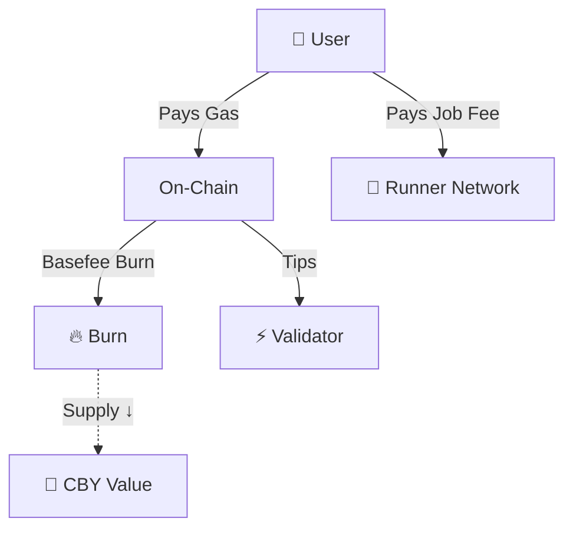
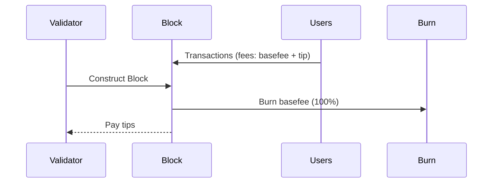
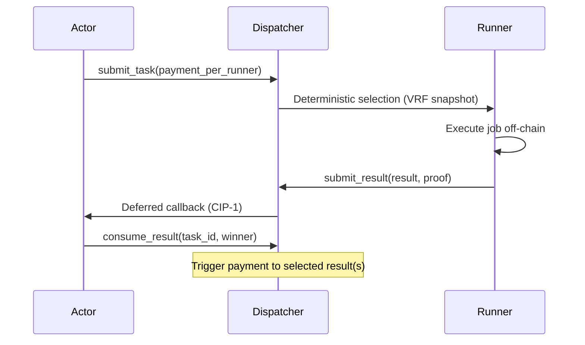

## Introduction

Understanding where fees go, how rewards are distributed, and how value accrues is crucial for all Cowboy participants. This page visualizes and explains the **complete value flow** in the ecosystem.

<Tip>
  Basefee for Cycles and Cells is burned (CIP‑3); tips go to the validator (block proposer). Off‑chain job fees are paid in CBY separately and are market‑priced (CIP‑2/3).
</Tip>

---

## High-Level Flow (Conceptual)



---

## Per-Transaction Flow (Normative Parts)

### On-Chain Transaction

**When a user submits a transaction**:

```text
# CIP‑3 (dual meters), per resource x ∈ [Cycles, Cells]
basefee_component_x = usage_x × basefee_x

effective_tip_rate_x = min(tip_per_x, max_fee_per_x − basefee_x)
tip_component_x = usage_x × effective_tip_rate_x

Total fee = Σ_x (basefee_component_x + tip_component_x)
# Basefee components are burned; tip components go to the validator
```

**Fee breakdown**:

1. **Basefee**:
   - 100% burned (CIP‑3)

2. **Tip**:
   - Paid to the validator (block proposer) (CIP‑3)

3. **Protocol Fees**:
   - Any treasury/fee allocations are governance/implementation‑specific (non‑normative)

---

## Per-Block Flow (Conceptual)



---

## Off-Chain Compute Flow (CIP‑2)



- Payments are market‑priced and denominated in CBY per runner (CIP‑2/3).

---

## Scope Notes

- Issuance/inflation schedules and validator reward splits are governance‑defined and out of scope for this document. Any numerical examples must be specified via separate proposals.
- Direct numerical comparisons to other protocols’ tokenomics are out of scope; Cowboy’s normative mechanisms here are the dual meters and dual basefee burn (CIP‑3).

---

## Interactive Flow Visualization

<Tabs>
  <Tab title="User Transaction">
    ```mermaid
    flowchart LR
        U[User] -->|Pays Gas| L[On-Chain]
        L -->|Basefee| B[🔥 Burn]
        L -->|Tips| V[Validator]
    ```
  </Tab>
  
  <Tab title="Runner Job">
    ```mermaid
    flowchart LR
        A[Actor] -->|"Job Payment (CBY)"| R[Runner]
        R -->|Submit Result| D[Dispatcher]
        D -->|Deferred Callback| A
    ```
  </Tab>
</Tabs>

---
## Summary

- Basefee (Cycles/Cells) is burned; tips go to the validator (CIP‑3).
- Off‑chain job payments are market‑priced in CBY and handled separately (CIP‑2/3).
- Issuance/treasury specifics are governance‑defined (scope notes).

---
## Further Reading

- [Tokenomics](/economics/tokenomics)
- [Fee Model Overview](/architecture/fees/overview)
- [Off-Chain Lifecycle](/architecture/offchain/lifecycle)
- [CIP-2](/cips/cip-2-offchain-compute)
- [CIP-3](/cips/cip-3-fee-model)

---