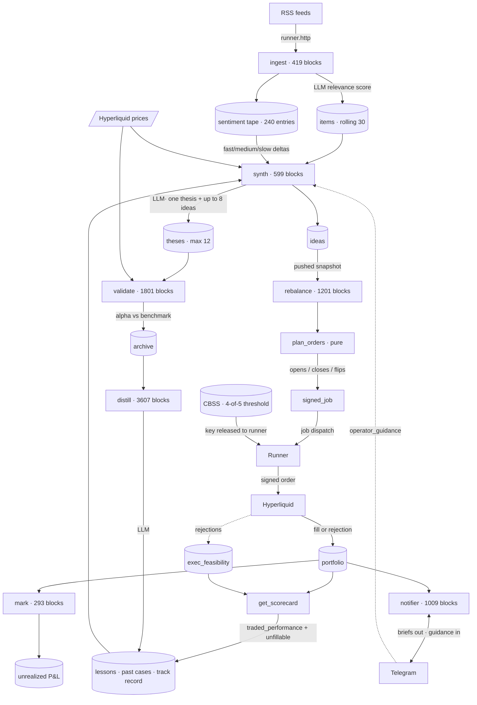

# System Flow

How a headline becomes a position, and how the result becomes a lesson.

---

## The loop, end to end

---

## Stage by stage

### 1 · Ingest — news in

A rotating batch of 6 RSS feeds is fetched through runner HTTP calls, parsed, and deduplicated against a rolling set of 500 URL keys. Surviving items go to an LLM relevance scorer with the standing mandate and asset universe as context. Items scoring ≥ 7 are kept (max 8 per cycle) and prepended to a rolling 30-item window.

Each cycle also appends one aggregate to the **sentiment tape** — mean score, item count, per-theme means — which persists after the items themselves roll out.

### 2 · Synthesis — news to conviction

A single LLM call receives everything the system knows:

- recent scored news
- the tradeable universe, minus assets the venue keeps refusing
- existing thesis statements (to force differentiation)
- realized trading performance, weighted most heavily
- per-asset track record with sample counts and alpha
- distilled lessons and matched past cases
- sentiment trend across three horizons
- operator guidance from Telegram

It returns an economic context, **one thesis** (long basket, short basket, conviction, rationale) and up to 8 ideas. The thesis snapshots every universe price as its baseline. A thesis that merely restates an existing one — ≥ 75% basket overlap on both legs — bumps the incumbent's conviction instead of taking a slot.

### 3 · Planning — conviction to orders

The trader reads the latest pushed idea snapshot, filters by confidence, and diffs the target book against holdings. Two dampers prevent whipsaw, since synthesis re-opines on a rolling news window:

- **min hold** — never close a position younger than the floor
- **flip margin** — only reverse if opposing conviction beats the held position by a margin

Every symbol *not* ordered is recorded with a reason. Assets the venue has repeatedly refused are skipped for opens — but never for closes, since suppressing an exit would strand real exposure.

Limit prices are per-class: tight for deep core perps, wider for thin books.

### 4 · Execution — orders to positions

The actor builds an unsigned action with placeholder signature fields and declares a CBSS secret reference. The job dispatches to a runner, which requests the key; 4 of 5 proxies each return a partial decryption and the key is reconstructed **inside the runner**, signed, and posted. Only the response comes back on-chain.

Responses are parsed into three outcomes, which used to be indistinguishable:

| Outcome | Signal |
|---|---|
| Filled | `statuses[].filled` |
| Refused — no liquidity | `statuses[].error` |
| Refused — request rejected | top-level `status: "err"` |

Refusals increment per-symbol feasibility counters and emit events.

### 5 · Marking — positions to P&L

Prices refresh on their own loop, recomputing unrealized P&L against entry. Closed positions accumulate realized P&L, win count, and history.

### 6 · Learning — results to lessons

Three feedback paths run continuously:

**Realized performance.** The scorecard flows back to synthesis as `traded_performance`, the most heavily weighted evidence.

**Execution feasibility.** Assets the venue refuses are reported as unfillable and stripped from candidates — so the system learns what it *can* trade, not just what performed.

**Thesis outcomes.** Validation marks each thesis against its baseline and computes alpha — return in excess of the market's move, scaled by net exposure. Retirement uses raw return; learning uses alpha, so a long book in a rising market isn't credited as skill. Retired theses are archived and distilled into lessons of the form *market condition → what tended to work*.

Track-record rows carry sample counts and a confidence flag, so thin evidence is discounted rather than treated as established.

### 7 · Notification — the human loop

The notifier pushes briefs to Telegram and accepts replies as `operator_guidance`, which enters synthesis as advice weighed alongside everything else — though risk discipline stays enforced in code, never overridden by advice.

---

## Timing

Every cadence is prime and pairwise coprime, so no two loops routinely come due in the same block. Inline timers execute *during block production*, so a collision stacks handler cost inside one block deadline.

| Loop | Cadence (blocks) |
|---|---|
| mark | 293 |
| ingest | 419 |
| brief | 449 |
| synth | 599 |
| discover | 997 |
| notifier watchdog | 1009 |
| rebalance | 1201 |
| validate | 1801 |
| distill | 3607 |
| universe | 4001 |

Cadences are block-denominated, so wall-clock intervals stretch as block rate changes: rebalance is ~26 min on a fresh chain and ~74 min on a decayed one.

---

## What can break, and what watches it

| Failure | Symptom | Detector |
|---|---|---|
| Order refused | Fewer positions than planned | `live.orders_rejected` |
| Exit refused | Position persists after a close | `live.exit_rejected` |
| Symbol skipped | Rebalance places nothing | `live.plan_skips` |
| Loop dies | Started-block frozen | `live.tick_failed` |
| Continuation hangs | Pending flag stuck, no error | `live.continuation_lost` |
| Runner lockout | Book freezes, chain healthy | Heartbeat rejections; jobs created, none assigned |
| Chain livelock | Height frozen, RPC still answering | Box watchdog restarts the validator |

The recurring theme: each of these once looked identical to success. Most of the instrumentation exists because a failure was invisible until someone noticed by eye.
